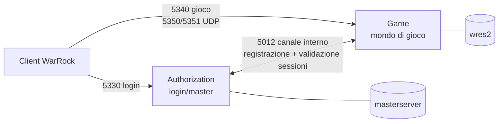
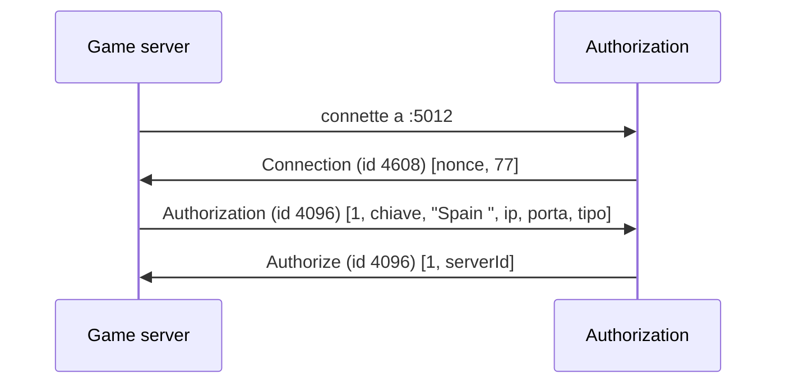
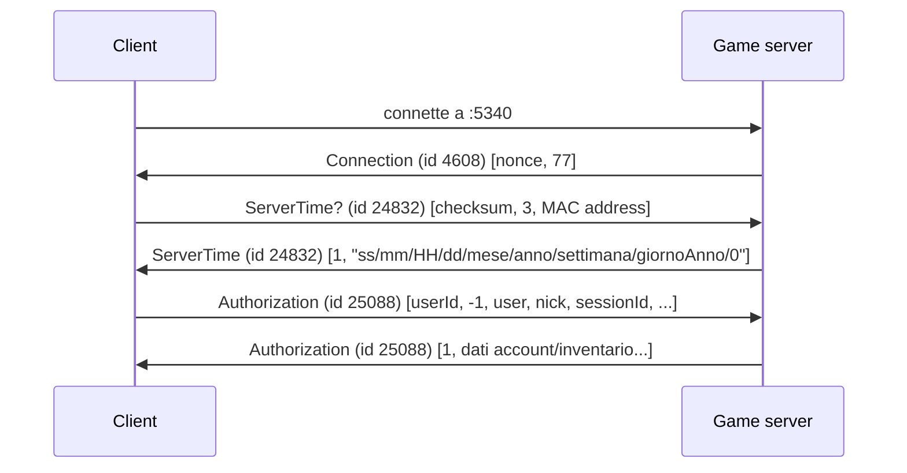

# Protocollo WarRock — dalla connessione alla lobby

Guida di riferimento a quello che abbiamo costruito e verificato contro il client reale nelle Fasi 1-3 del porting Node.js. Ogni sezione ha: il concetto, il pacchetto reale catturato dai nostri log, e — dove è successo — il bug che abbiamo trovato e come l'abbiamo diagnosticato.

## 0. Architettura: perché due processi



`Authorization` è il "centralino": autentica l'account, e tiene la lista dei `Game` server disponibili. `Game` è dove si gioca davvero. Sono processi separati perché nel 2008, un publisher poteva avere **un solo** Authorization server ma **molti** Game server (uno per regione/lingua) — il client fa login una volta, poi sceglie a quale mondo entrare. Il canale sulla porta 5012 è come i due processi si parlano *tra loro*, invisibile al client.

Questo spiega anche perché un login riuscito **non basta**: dopo aver scelto un server dalla lista, il client apre una **connessione TCP completamente nuova** verso il Game server (porta 5340) e deve autenticarsi *di nuovo* lì, usando un `SessionID` che l'Authorization server gli ha dato come "lasciapassare" temporaneo.

## 1. Il pacchetto di base: testo + XOR

Ogni pacchetto, prima di essere cifrato, è una stringa di testo semplice, separata da spazi:

```
<tick> <id> <campo1> <campo2> ... \n
```

`tick` è un timestamp locale del mittente (non validato da nessuno), `id` è un numero che identifica il tipo di pacchetto (es. `24832` = "voglio l'ora del server"), il resto sono i dati.

**"Cifratura"**: ogni byte della stringa viene messo in XOR con **una singola chiave fissa**. Non è crittografia vera — con la chiave nota si legge tutto in chiaro. Il bello dell'XOR è che è la sua stessa inversa: `byte ^ chiave ^ chiave = byte`, quindi la stessa funzione cifra e decifra.

Esempio reale, dal nostro primo test (`fake-client.js` che manda `hello world`):

| carattere | byte (hex) | chiave client→server | byte sul cavo |
|---|---|---|---|
| `h` | `0x68` | `0xC3` | `0x68 ^ 0xC3 = 0xAB` |

Chi cattura il traffico con Wireshark vede `0xAB`, non `h` — ma conoscendo la chiave (`0xC3`), un XOR e torna in chiaro.

**Chiavi usate**, da `Core/Constants.cs`:

| canale | server → client | client → server |
|---|---|---|
| esterno (login, gioco) | `0x96` | `0xC3` |
| interno (Auth ↔ Game) | `0x23` (lato Auth) | `0xA3` (lato Game) |

**Framing**: TCP non sa cos'è un "pacchetto", consegna solo un flusso di byte. Il separatore è il byte `0x0A` (newline) — il server accumula byte finché non ne trova uno, poi quello è un pacchetto completo. Importante: si **decifra prima**, poi si cerca `0x0A` nel testo in chiaro (il byte `0x0A` cifrato non sarebbe più `0x0A`).

## 2. Canale interno: il Game server si registra

Appena connesso alla porta 5012, l'Authorization server manda per primo un pacchetto "saluto" (`Connection`, id `4608`). Il Game server risponde registrandosi:



Catturato dai log reali:

```
OUT id=4096 fields=[1, AlterEmuV5.0.1, Spain , 127.0.0.1, 5340, 0]
Internal: registered game server "Spain" as id 1
OUT id=4096 fields=[1, 1]
```

Da qui in poi, l'Authorization server sa che esiste un server "Spain", raggiungibile su `127.0.0.1:5340`, e lo include nella lista che manderà ai giocatori che fanno login.

> **Nota:** il nome viene mandato con uno spazio finale (`"Spain "`) — commento originale nel C#: serve a separarlo visivamente da qualcos'altro nel client. Rimosso per errore in un primo momento con un `.trim()`, poi verificato che in realtà non cambiava nulla (lo spazio, una volta passato dentro l'escaping dei pacchetti, non è più un carattere "spazio" vero e proprio — vedi più sotto).

## 3. Login: patch-check, poi username/password

Prima ancora di autenticarsi, il launcher chiede "sono aggiornato?":

```
IN  id=4112 (Launcher / patch-check), nessun campo
OUT id=4112 fields=[0, 0, 0, 0, 0, 0, http://]
```

Rispondere sempre versione `0` in ogni campo fa sì che il client (che ha una versione reale più alta) concluda "sono già aggiornato" e proceda — un trucco pigro ma efficace del server originale.

Poi il vero login:

```
IN  id=4352 (login) blocks=[1335749171, 0, wruser, password123, 0, 0]
OUT id=4352 (ServerList) blocks=[1, 100, 0, wruser, NULL, WRUser, 24693, 1, 0, 1, 1, 1, Spain, 127.0.0.1, 5340, 0, 0, -1,-1,-1,-1, 0, 0]
```

`blocks[2]` e `blocks[3]` sono username e password — non per struttura del protocollo (potevano essere ovunque), ma perché è lì che il riferimento C# li leggeva, e la cattura reale l'ha confermato al primo tentativo. La password non viaggia in chiaro nel database: è salvata come `SHA256(password + salt)`, e il salt è pubblico nel DB — serve solo a far sì che due utenti con la stessa password non abbiano lo stesso hash.

### 🐛 Bug trovato: un campo di troppo sfasa tutto

Il riferimento C# manda anche un campo "versione" (`1.11025`) prima del conteggio server. Includendolo, il client mostrava il server come **"pieno"**, con un nome a caso al posto di "Spain". Non un errore di validazione — un disallineamento posizionale: il protocollo non è auto-descrittivo, ogni campo è letto "alla cieca" in base alla sua posizione. Un campo extra sposta *tutti* quelli dopo di una posizione: il nome del server legge quello che doveva essere l'ID, il conteggio giocatori legge quella che doveva essere la porta (`5340`, enorme per un contatore di giocatori → "pieno"). **Diagnosi**: abbiamo chiesto "che nome vedi nella riga?" — la risposta ("qualcosa di strano, non 'Spain'") ha confermato lo sfasamento prima ancora di guardare altro.

## 4. Connessione al Game server

Il client, scelto il server, apre una *nuova* connessione TCP a `:5340` e ripete l'autenticazione, stavolta in due passi:



Il primo scambio (`ServerTime`, id `24832`) è in realtà un controllo anti-cheat/anti-ban: il client manda `versionId=3` (fisso) e il proprio **indirizzo MAC** (12 caratteri esadecimali), il server lo confronta con una tabella `macaddress_blacklist`. Se pulito, risponde con l'ora corrente in un formato a campi slash-separati.

Poi il vero `Authorization` (id `25088`, **diverso** dal login: qui gira sulla porta di gioco, non su quella di login) — il client manda di nuovo `sessionId` (quello ricevuto al login) per dimostrare "sono davvero io". Il server risponde con un pacchetto enorme: account, clan, livello, inventario, equipaggiamento — per un account nuovo, valori "vuoti" (`F,F,F,F` = 4 slot inventario disattivati, `^` = nessun oggetto).

### 🐛 Bug trovato: intero con segno vs senza segno

Il `SessionID` lo generavamo come numero casuale fino a ~268 milioni. Il client lo salva e lo rimanda indietro come **intero a 16 bit con segno** (`short`, range -32768..32767). Un valore come `39574` (che sta in 16 bit *senza* segno) torna interpretato come `39574 - 65536 = -25962`. Risultato: la nostra validazione `sessionId > 0` falliva sempre, e il client mostrava "errore 73030". **Lezione**: quando un protocollo non dichiara i tipi, ogni "intero" nasconde un range implicito — va dedotto dal comportamento osservato, non assunto.

## 5. UDP: un protocollo completamente diverso

Fin qui, tutto testo + XOR su TCP. UDP è tutt'altra cosa: **binario**, a offset fissi, big-endian (l'ordine "di rete" — il byte più significativo per primo). Serve per i dati in tempo reale (movimento, spari) dove perdere occasionalmente un pacchetto è accettabile, ma aspettare una ritrasmissione TCP no.

> Non è un protocollo standard (non è STUN, non è nulla di documentato) — è un formato binario inventato dai dev di WarRock. Per fare pratica a leggerlo byte per byte, con il pacchetto reale che abbiamo catturato: **[WarRock Dissector](https://claude.ai/code/artifact/7cd96003-9d50-4ccb-bc9e-800f5a47648c)**.

Il client apre lo scambio UDP con un pacchetto "Initial":

```
10 01 01 00 7a 4f 00 00 00 00 00 00 00 64
└─type─┘  └sessionId┘
0x1001            0x7a4f = 31311
```

`0x7a4f` = **31311**, esattamente il `SessionID` di quella sessione — il client sta dicendo "questo flusso UDP appartiene a questa sessione TCP". Il server risponde con lo **stesso pacchetto**, ma riscrive i byte 4-5 con "porta+1" (5350+1=5351): "usa l'altra porta UDP per il prossimo passo".

Poi arriva un pacchetto "Ping" (`type=0x1010`), che scambia indirizzo IP:porta locale e remoto (utile dietro NAT, per scoprire il proprio IP pubblico) — cifrati con le **stesse chiavi XOR** del canale esterno (`0xC3`/`0x96`), ma applicate solo a 6 byte alla volta, non a tutto il pacchetto.

## 6. Lobby: canale, stanze, utenti

Ultimo passo delle Fasi 1-3: il client sceglie una modalità/canale (CQC, Urban Ops, ecc.) e il server risponde con conferma + lista stanze (vuota) + lista utenti (solo se stesso):

```
IN  id=28673 (ChannelSelection) blocks=[1]
OUT id=28673 fields=[1, 1]
OUT id=29184 (RoomList) fields=[0, 0, 0]     ← 0 stanze, pagina 0
```

Da qui il client mostra la lobby vuota — obiettivo delle Fasi 1-3 raggiunto.

## 7. Stanze e chat: serve un registro condiviso

Fin qui ogni connessione viveva per conto suo — un socket, un utente, nessun bisogno di sapere degli altri. Le stanze rompono questo isolamento: se crei una stanza, *un altro* utente collegato deve vederla comparire nella sua lobby senza fare nulla. Questo richiede per la prima volta uno stato **condiviso** tra le connessioni — un piccolo registro in memoria (`game/state.js`) con chi è connesso, in che canale, in che stanza.

**Creazione stanza** (`RoomCreation`, id `29440`):

```
IN  blocks=[OneShot,OneKill, 0, NULL, 1, 12, 3, 0, 0]
OUT fields=[1, 0, 1, 1, 1, 0, OneShot,OneKill, 0, 16, 1, 1, 0, 2, 0, 2, 4, 1, 0, 0, 0, 0, 0, 0, 0, 0, 2, -1]
```

Stesso pattern posizionale già visto: `blocks[0]` è il nome, `blocks[3]` è un "indice" di capienza massima (non il numero diretto — per il canale CQC, indice `1` → `8×(1+1)=16` giocatori, la formula è nel codice originale). La risposta rispecchia lo stesso blocco di 25 campi usato anche da `RoomList`, `RoomJoin` e `RoomUpdate` — un solo formato "descrizione stanza" riusato ovunque.

### 🐛 Bug trovato: un ID di sessione dove doveva starci uno slot

Il campo "master" di una stanza è pensato per essere un piccolo **indice di slot** (0, 1, 2...), non un identificativo di sessione. Il codice iniziale ci metteva per errore il `SessionID` intero (es. `29562`) — invisibile finché non si guarda il pacchetto `RoomLeave` byte per byte e si nota un numero enorme dove ci si aspettava uno 0 o un 1. Corretto usando sempre `0` (non tracciamo ancora slot/team reali, quindi non c'è un "vero" master da calcolare).

**Chat** (`Chat`, id `29696`) — il campo messaggio ha un formato particolare: il client lo manda come `"WRUser>>ciao"`, dove `>>` separa un prefisso (probabilmente il proprio nickname, aggiunto dal client) dal testo vero. Se nel messaggio originale c'erano spazi, sono già stati sostituiti con il carattere `0x1D` (lo stesso escaping visto nella Fase 1 per tutti i campi testo) — per leggerlo va prima isolato il testo dopo il marcatore, poi rimesso lo spazio al posto di `0x1D`.

Testato: creazione stanza, chat visibile nel client, uscita dalla stanza — tutto verificato con il client reale.

### Serve un secondo giocatore per testare davvero

Il gioco non permette di lanciare due istanze del client sullo stesso PC. Per verificare che due utenti si vedano a vicenda (stanza che appare senza refresh, chat ricevuta), abbiamo scritto un **client finto** (`node/tools/fake-client.js`): uno script che fa l'intero login+autenticazione vero (stesse funzioni di codifica del server) e si presenta al server esattamente come un secondo giocatore, pilotabile da terminale. Non è un mock — è un client reale dal punto di vista del protocollo, solo senza interfaccia grafica.

### 🐛 Bug trovato: nessun riutilizzo degli ID stanza

Prima creazione stanza → id `1`. La si distrugge uscendo. Nuova stanza creata → invece di riprendere l'id `1` libero, il contatore continuava semplicemente a salire (id `2`), lasciando un "buco" nella lista — visibile nel client come una stanza che compare nella *seconda* posizione invece che nella prima. Era una semplificazione dichiarata fin dall'inizio ("niente riutilizzo ID, aggiungilo se serve") — è bastato il primo test con due sessioni reali per farla emergere concretamente. Corretto cercando sempre il più piccolo id libero, invece di un contatore che sale e basta.

### Non-bug: l'altro giocatore non compare nella lista utenti

Controllando il codice C# di riferimento (`Game/Entities/User.cs`, `SetChannel`): quando un giocatore entra in un canale, il server **non notifica nessun altro** — manda solo a lui stesso la lista stanze. Nessun aggiornamento automatico della lista utenti esiste nemmeno nell'originale (l'id `28944`, nominato nei file di riferimento come "aggiornamento lista utenti", non è mai implementato in nessun handler). Quindi se il tuo compagno di test non compare, non è un difetto della nostra porting — probabilmente il client la richiede di nuovo solo in certe azioni dell'interfaccia (es. aprire una scheda specifica).

## Fuori scope, per ora

Durante il test è arrivato anche un pacchetto `id=30000` (`GamePacket`) da un tentativo di cambiare squadra — non gestito allora. È il contenitore generico per tutte le azioni *dentro* una partita (cambio team, pronti/non pronti, mappa, ecc.), smistato nel C# a decine di sotto-handler (`GameSubs`). Implementato nella fase successiva.

## 8. Flusso di partita: un contenitore, tanti sotto-pacchetti

Tutte le azioni dentro una stanza (cambio squadra, "pronto", impostazioni, avvio) viaggiano dentro **un solo id di pacchetto** (`GamePacket`, `30000`), con un'intestazione fissa di 4 campi seguita da un payload specifico:

```
[slot mittente, id stanza, campo non identificato, sotto-tipo, ...payload]
```

Es. cambio squadra reale catturato: `[1, 1, 2, 56, 1, 0, 1, 0, 0, 0, 0, 0, 0, 0]` → slot `1`, stanza `1`, sotto-tipo `56` (SideUpdate), payload `[1,0,1,0,0,0,0,0,0,0]` dove la posizione `[2]` del payload (`1`) è la squadra richiesta. La risposta ha la stessa forma e viene trasmessa a tutta la stanza.

### 🐛 Bug trovato: la squadra è codificata nello slot, non in un campo a parte

Il primo tentativo di cambio squadra sembrava non fare nulla. Il motivo, trovato leggendo `Room.SwitchSide` nel C# originale: **ogni stanza divide i suoi slot a metà** — la metà bassa (0-7 su 16 posti) è squadra 0, la metà alta (8-15) è squadra 1. La squadra di un giocatore non è un dato indipendente: il client la deduce dal *numero di slot* che gli è stato assegnato. Noi assegnavamo gli slot in ordine sequenziale (0, 1, 2...) ignorando la squadra — quindi dicevamo internamente "sei in squadra 1" ma gli davamo uno slot della metà bassa, che il client legge come squadra 0. Risultato: il client mostrava una squadra, il server ne teneva un'altra a mente, e ogni tentativo di "andare in squadra 1" falliva silenziosamente perché per il server ci si era già.

Fix: quando un giocatore entra o cambia squadra, lo slot va cercato nel range corretto (metà bassa o alta) in base alla squadra di destinazione — non assegnato a caso.

### 🐛 Bug trovato: l'intestazione del pacchetto va scritta *prima* di applicare la modifica

Cambiare squadra sposta anche lo slot del giocatore. La domanda è: l'intestazione di risposta (`slot mittente`) deve riportare lo slot **vecchio** o quello **nuovo**? Il codice C# risponde chiaramente: lo slot nell'intestazione viene letto *all'arrivo* del pacchetto, prima di eseguire l'azione — quindi è sempre il valore precedente. Lo slot nuovo compare solo dentro il payload (un campo specifico del sotto-pacchetto `SideUpdate`). Il nostro codice inizialmente costruiva l'intestazione *dopo* aver già spostato il giocatore, mandando quindi due volte lo stesso valore (nuovo slot sia in testa che nel payload) — il client, non trovando più nessuno nella riga "vecchia" da aggiornare, mostrava un pannello vuoto.

## 9. Avviare davvero una partita: equipaggiamento e game loop

Dopo "Start", il client mostra la schermata di selezione personaggio/armi — un pacchetto completamente diverso da tutto il resto (`Equipment`, id `29970`, non passa dal contenitore `GamePacket`). Poi manda `ConfirmSpawn` (100) e... si ferma. Nessun `Spawn` (150) in arrivo.

### 🐛 Bug trovato: senza battito, il client non parte mai

La causa: il client aspetta il **battito del server** prima di considerare la partita "davvero iniziata". Quel battito è `GameTick` (id `30016`), un pacchetto mandato una volta al secondo con due contatori — il primo, commentato **"Spawn Counter"** nel codice originale, è esattamente il timer di spawn che appariva fermo a zero. Senza quel pacchetto, il client resta in attesa indefinitamente: non manda mai `Spawn` da solo, quindi lo "spawn on demand" che avevamo già implementato non veniva mai nemmeno invocato.

Fix: un ciclo che, mentre la stanza è in stato "Playing", manda `GameTick` ogni secondo (contatore su/giù, punteggio a zero — non teniamo ancora il punteggio reale). Appena il client riceve il primo tick, manda da solo `Spawn` — che gestivamo già dalla fase precedente. Nessun trigger di spawn dal server necessario: bastava far vedere al client che il tempo stava scorrendo.

```
OUT(broadcast x2) id=30016 fields=[20000, 3580000, 0, 0, 0, 0, 2, 0, 30]   ← battito
Game IN  id=30000 blocks=[..., 150, ...]                                    ← il client chiede di spawnare, finalmente
OUT(broadcast x2) id=30000 fields=[1, 0, 1, 2, 150, ...]                    ← confermato, sei in gioco
```

Questo è il confine di quello che il progetto di riferimento aveva davvero completato (fino alla Fase 20): il vero ciclo di gioco (danni, morte, veicoli, condizioni di vittoria) esiste nel C# come codice ma con calcoli di danno, hitbox, e un intero sistema di armi/veicoli reale — territorio nuovo, non più solo lettura di un protocollo già mappato. Il danno/morte/respawn è stato affrontato nella Fase 21.

## 10. Movimento e sparo: il server fa il postino, non il fisico

Ultima scoperta, e la più sorprendente. Ci si aspetterebbe che il server debba capire i pacchetti di movimento/sparo (dove sei, dove miri) per validarli o farne qualcosa. Leggendo fino in fondo `UDPListener.cs`, invece:

Tutto il traffico di gioco in tempo reale viaggia sotto lo stesso `type=0x1010` già visto per il ping — ma con un **byte di sotto-comando** all'offset 14 (`0x10`, `0x30`, `0x31`, `0x32`, `0x34`, uno per tipo di azione: movimento, salto, mira, ecc. — mai completamente mappati nemmeno nel codice originale, c'è un commento dello sviluppatore che dice letteralmente "non sono sicuro di dove si trovino"). Il server:

1. Legge solo tre cose dal pacchetto: chi lo manda (`sessionId`, offset 4-5), in che stanza (offset 6-7), e a chi è diretto (`targetId`, offset 22-23).
2. Verifica che mittente e destinatario siano nella stessa stanza, e che la stanza sia in stato "Playing".
3. Se tutto torna, inoltra il pacchetto **byte per byte, invariato**, all'indirizzo UDP pubblico del destinatario (quello imparato durante l'handshake Ping della Fase 1).

Il contenuto — la posizione vera, l'angolo di mira — non viene mai decifrato dal server: viaggia direttamente da client a client, il server fa solo da centralino che sa "chi è dove". Questo è il motivo per cui bastava implementare il relay (poche righe) invece di simulare posizioni/fisica: il gioco è client-autoritativo per il movimento, il server valida solo "siete nella stessa partita?" prima di inoltrare.

Verificato con il client vero che si muove e il client finto (esteso per completare anche l'handshake UDP) che riceve i pacchetti relayati in tempo reale, senza doverli interpretare.

## 11. Decodificare il pacchetto di movimento (e il limite raggiunto)

Dato che il server fa solo da postino per il movimento, per capirne il contenuto non serviva Wireshark: **il nostro stesso server è il punto di relay**, vede ogni pacchetto in chiaro prima di inoltrarlo — bastava stamparlo da lì.

### Il campo XOR nascosto nel corpo del pacchetto

I primi 29 byte (tipo, sessionId, stanza, sotto-comando, id destinatario) sono in chiaro — li leggevamo già. Il resto del pacchetto, però, mostrava lunghe sequenze del byte `c3` ripetuto — lo stesso valore usato come chiave XOR nell'handshake Ping. Un XOR ripetuto su un valore zero produce sempre la chiave stessa, quindi lunghe sequenze di `c3` sono quasi certamente byte "vuoti" cifrati, non dati reali. Decifrando il corpo con XOR `0xc3` (stessa chiave, direzione client→server) sono comparsi numeri in virgola mobile plausibili:

| offset nel corpo | comportamento osservato | ipotesi (aggiornata in Fase 24) |
|---|---|---|
| 9 | 359.78 → 352.38 → 358.68 → 14.18 (salta da 359 a 14: un giro oltre lo zero) | angolo di mira (0-360°) |
| **13 e 41** (stesso valore ripetuto) | sempre uguale nei due punti, es. `180.0000` | **non è una posizione** (ipotesi originale) — un unico valore ripetuto due volte somiglia più a un *orientamento/heading*, riaffermato con più forza dopo la Fase 24 (vedi sotto) |
| 17 | sempre 1.00 | flag/costante |
| **29** | quasi fisso in un breve movimento | **confermata coordinata X** — vedi conferma numerica sotto |
| 33 | quasi fisso in un breve movimento | non è la Y (non combacia col valore reale, vedi sotto) — resta senza spiegazione |
| **37** | quasi fisso in un breve movimento | **confermata coordinata Z** — vedi conferma numerica sotto |
| **61** | **sempre 100.00** | **salute — confermata esatta**, non più solo l'ipotesi più convincente |

### Conferma numerica (Fase 24): finalmente un valore di riferimento indipendente

Fino alla Fase 21 queste ipotesi erano tutte "sembra plausibile" — nessun modo di confrontarle con un valore vero. Il pacchetto `PlayerDamage` (Fase 21) le ha rese verificabili: porta la posizione del bersaglio **in chiaro, senza XOR** (è testo+XOR standard, non binario come l'UDP), quindi è una verità di riferimento indipendente dalla decodifica del movimento.

Con due client reali connessi, un colpo ha riportato il bersaglio a `x=3191.2261, y=98.0820, z=1885.5220`. Decifrando (XOR `0xc3`) il pacchetto di movimento UDP di quello stesso giocatore, catturato pochi istanti prima dello stesso colpo:

```
offset 13 = 180.0000   offset 41 = 180.0000   (stesso valore, come sempre)
offset 17 = 1.0000
offset 29 = 3191.6746   ← combacia con la X reale (3191.2-3191.6)
offset 33 = 62.7014     ← NON combacia con la Y reale (98.08)
offset 37 = 1880.6887   ← vicina alla Z reale (1885.4-1885.6, scarto ~5, plausibile nel breve intervallo)
offset 61 = 100.0000    ← esatto, salute a vita piena
```

X e salute combaciano con un margine minimo, Z è vicina (normale: qualche secondo di movimento reale è passato tra i due campioni). Offset 33 resta un mistero — non è la Y, nonostante fosse raggruppata insieme a 29/37 come "altra coordinata" nella tabella originale.

### Il tentativo di replay, e dove si è fermato

Per verificare l'ipotesi abbiamo provato a far apparire un "giocatore fantasma": il client finto cattura dal vivo l'ultimo pacchetto di movimento ricevuto dal client vero (che quindi contiene la *sua* posizione reale), lo re-invia sotto la propria identità (mittente/destinatario scambiati nell'header, corpo del pacchetto invariato) in un flusso continuo — invece di un singolo pacchetto isolato, impercettibile.

Meccanicamente ha funzionato alla perfezione: il pacchetto viene costruito, arriva al server, viene relayato al client vero, in streaming continuo, con la posizione presa dal vivo. **Ma nessun personaggio è mai comparso a schermo.**

Questo è il punto in cui l'esplorazione per tentativi (cattura → ipotesi → verifica) smette di bastare. Il relay dimostra che il *trasporto* è giusto; quello che manca è sapere cosa fa scattare nel motore del client la decisione "questo è un giocatore reale, disegnalo" — potrebbe essere un sotto-comando diverso da mandare una volta sola prima del flusso di movimento (`0x10`, `0x30`, `0x32` o `0x34`, mai catturati), un altro pacchetto TCP di sincronizzazione, o un campo del corpo che non abbiamo ancora identificato. Quella logica vive dentro l'eseguibile nativo del client — per trovarla con certezza servirebbe un disassembler (Ghidra, x64dbg), non solo un editor esadecimale e un XOR noto. È esattamente il confine indicato fin dall'inizio di questa guida.

**Aggiornamento (Fase 22)**: il problema del "giocatore fantasma" è diventato meno urgente da quando un secondo client reale è diventato disponibile (server raggiungibile da qualunque rete, Fase 22) — con due giocatori veri non serve più simulare un fantasma per vedere un secondo personaggio a schermo. Il mistero di *cosa* faccia scattare il rendering di un fantasma resta comunque irrisolto e non più indagato da quel momento in poi.

## 12. Livelli ed esperienza: una tabella, non una formula

Il livello non è mai salvato da nessuna parte — solo l'XP grezzo (`user_details.xp`) lo è. Il livello si **deriva** ogni volta cercando in una tabella di 100 soglie (`Core/LevelCalculator.cs`): scorri finché l'XP del giocatore non è più piccolo della soglia corrente, quel punto è il livello.

```
xp=0      → livello 1   (sotto la prima soglia, 2250)
xp=2200   → livello 1   (ancora sotto 2250)
xp=2300   → livello 2   (ha superato la soglia 2250)
```

**Quando si guadagna XP**: qui il server non ha un vero sistema di punteggio (nessun conteggio uccisioni/morti in game), quindi il momento scelto per "assegnare XP" è quando un giocatore lascia una stanza che è in stato *Playing* — l'equivalente più onesto di "fine partita" che questo server può offrire oggi. La formula stessa (`20 + punti×4×tasso`) degrada correttamente a un premio fisso quando i punti sono sempre zero:

```
node standalone test:
GameConfig: { expRate: 5, dinarRate: 5, levelUpMoneyReward: 5000 }   ← da `gameconfig`, non inventato
applyMatchEnd result: { xpEarned: 100, moneyEarned: 250, levelUp: null }
```

`100 = ceil((20 + 0) × 5)` — il moltiplicatore premium (Fase 13) *non* cambia questo numero quando i punti sono zero: nella formula originale il bonus premium moltiplica solo il termine `punti×4`, non il `20` fisso. Non è un bug nostro, è così anche nel C# — un dettaglio che si scopre solo leggendo la formula fino in fondo, non intuendolo.

Testato anche l'attraversamento di soglia: partendo da xp=2200 (livello 1) e guadagnando 100 xp → 2300 (livello 2), il server manda il pacchetto `LevelUp` (id `31008`) e assegna il bonus di denaro da `gameconfig.levelup_base_reward` (5000 per livello).

**Gate di livello riportati dal C#**: creare o entrare in una stanza con un limite di livello (1-10, 11+, 21+, 31+, 41+) ora controlla davvero il livello del giocatore, non solo lo mostra — prima veniva solo salvato sulla stanza senza mai essere confrontato con nessuno.

## 13. Premium: Free2Play, Bronze, Silver, Gold (e un quarto tier mai davvero usato)

Il campo "Premium" scoperto per sbaglio nella Fase 3 (serviva a sbloccare l'avvio partita) è un byte con 5 valori possibili — `Game/Enums/Premium.cs`:

```
0 = Free2Play   1 = Bronze   2 = Silver   3 = Gold   4 = Platinum
```

Il valore `3` che avevamo hardcoded fin dall'inizio era "Gold" per puro caso, non un codice magico a caso.

### 🐛 Bug del riferimento, non copiato: Platinum manda in crash il bonus XP

L'array dei bonus XP per tier nel C# ha solo 4 celle (`{0, 0.2, 0.3, 0.5}`, indici 0-3): un giocatore Platinum (indice 4) causerebbe un `IndexOutOfRangeException`. Segno che quel tier è stato aggiunto all'enum ma mai davvero completato nel gioco originale. Nella nostra porta, un tier oltre Gold semplicemente non riceve alcun bonus extra (lookup con fallback a 0) invece di far esplodere il server — non un tentativo di "completare" Platinum, solo di non ereditarne il crash.

**Cosa cambia visibilmente per tier**: 5° slot inventario sbloccato per qualunque tier sopra Free2Play (`SlotState` passa da `F,F,F,F` a `T,F,F,F`), e un countdown "tempo premium rimanente" nel pacchetto `Ping` (id `25600`) che il server ora manda ogni 5 secondi a tutti i connessi — pacchetto che prima non esisteva affatto lato nostro (il client sopravviveva comunque, ma senza countdown visibile).

## 14. Clan: qui non c'era nulla da portare

Le prime due fasi (Livelli, Premium) sono state porting: leggere cosa fa il C#, tradurlo. Il clan è diverso — l'opcode `CLAN_SYSTEM` (`0x6710` = `26384`) esiste nella lista dei pacchetti ma **non è mai letto né scritto da nessuna parte** nel codice C# di riferimento: nessun handler, nessun formato di payload, niente da copiare. Tutto quello che segue — i numeri dei sotto-comandi, la forma dei pacchetti — è stato progettato da zero, usando solo la tabella `clan` e i campi `user_details.clanid`/`clanrank` come punti fermi. **Non è ancora verificato contro l'interfaccia reale del client** (non sappiamo se/come il client renderizzi la risposta) — verificato finora solo con due client finti.

Sotto-comandi scelti (dentro l'inviluppo `[sottotipo, ...payload]`):

```
1 = crea    2 = entra    3 = esci    4 = sciogli    5 = lista membri
```

Test dal vivo con due client finti (creazione + ingresso + chat):

```
[client A] OUT id=26384 fields=[1, TestClan, TC]              ← crea clan "TestClan"
[client A] IN  id=26384 blocks=[1, 1, 1, TestClan, TC]         ← ok, id clan=1, sei master (rango 1)
[client B] OUT id=26384 fields=[2, 1]                          ← entra nel clan 1
[client B] IN  id=26384 blocks=[2, 1, 1, TestClan, TC]         ← ok, sei membro (rango 0)
[client A] OUT id=29696 fields=[10, 0, NULL, WRUser>> hi from A]      ← chat tipo 10 = Clan
[client B] IN  id=29696 blocks=[1, ..., 10, 0, NULL, WRUser>>hifromA] ← ricevuto
```

Il tipo di chat `10` (`Game/Enums/ChatType.cs`, `Clan = 10`) è reale — quello sì confermabile dal C#, anche se la logica di inoltro (mai scritta nel riferimento: la chat di clan lì scrive solo su un log DB, non la manda a nessuno) è nostra.

### 🐛 Bug trovato: due richieste ravvicinate si "sorpassavano"

Il primo tentativo (creare un clan e subito chiedere la lista membri) rispondeva "non sei in nessun clan" alla seconda richiesta, subito dopo che la prima aveva confermato la creazione. Causa: gli handler scrivevano prima sul database (con un `await`) e solo *dopo* aggiornavano lo stato in memoria (`u.clanId`). Se due pacchetti dello stesso client arrivano nello stesso istante (stesso blocco TCP), il server li processa uno via l'altro nello stesso istante — il secondo pacchetto veniva gestito mentre il primo era ancora "a metà", con la memoria non ancora aggiornata. **Fix**: aggiornare prima la memoria (sorgente di verità per le risposte immediate), poi scrivere sul database in modo "spara e dimentica" (senza `await`) — lo stesso schema già usato per salvare XP/denaro nella Fase 12. Un promemoria che vale oltre il clan: qualunque handler futuro che mischia `await` e stato condiviso in memoria ha lo stesso rischio.

**Scelte deliberatamente minime per questa prima versione** (non porting, quindi da rivedere quando si testerà con il client vero):

- Entrata diretta, senza inviti/richieste di approvazione.
- Se il master esce, il clan si scioglie (nessun passaggio di leadership).
- La lista membri mostra solo chi è **online** in quel momento — i membri offline vivono nel database del game server per id numerico, senza nickname (quello sta nel database di login, separato): unire i due richiederebbe una query cross-database non giustificata per una prima versione.
- Nessuna persistenza della chat di clan (la tabella `chat_private_clan` esiste ma non viene ancora scritta) — aggiungerla quando servirà una cronologia leggibile dal client.

## 15. Comandi GM: perché non ci si può fidare di un campo mandato dal client

Il C# di riferimento ha un sistema di comandi GM (`Game/Commands/`), ma anche qui solo 3 comandi su 11 elencati nel database sono realmente implementati, e l'invocazione passa per il chatbot interno "Cristina" — fuori scope fin dall'inizio di questo progetto. Quindi, come per i clan (Fase 14), l'**invocazione** è reinventata; il contenuto dei comandi (livello, denaro) non esisteva affatto da portare.

### La scoperta che ha cambiato il progetto: un campo di permesso scritto dal client

Cercando "chi decide chi è GM" nel C#, il campo si chiama `AccessLevel` — e arriva nel pacchetto `Authorization` del Game server (`blocks[7]`) **scritto dal client stesso**. Il riferimento lo rende sicuro con un giro di validazione verso l'Authorization server: il client dichiara un livello, e l'Auth server lo confronta con quello che aveva salvato in sessione al login (derivato lì da `users.status`, colonna del database di *login*, mai del client). Il nostro Game server oggi non fa quella validazione — quindi fidarsi del campo mandato dal client per decidere chi può eseguire comandi GM avrebbe significato: chiunque modifichi il proprio client può autodichiararsi amministratore.

**Soluzione adottata**: un flag `is_gm` aggiunto a `user_details` (lo stesso database di gioco già usato per XP/denaro/premium), mai influenzato da nessun campo che il client manda. Concesso a un account con una query diretta (`UPDATE user_details SET is_gm=1 WHERE id=...`), non da un pacchetto di rete — coerente con come si tratta ogni altro dato sensibile lato server in questo progetto.

### Comandi, come pacchetti di chat travestiti

Nessun nuovo id di pacchetto: un comando è un normale messaggio di chat (`Chat`, id `29696`) che inizia per `/`, intercettato **prima** di essere trasmesso — solo per account con `is_gm=1`, altrimenti `/qualsiasi-cosa` resta testo normale (comportamento scelto apposta: "inghiottire" silenziosamente messaggi di chi non è GM sarebbe più sorprendente che semplicemente non riconoscerli come comando).

```
[client] chat /setlevel WRUser 15
[server] GM>> Livello di WRUser impostato a 15 (xp=130725)
```

La risposta arriva come un normale messaggio di chat "da" un mittente fittizio chiamato `GM`, mandato solo al chiamante — stesso schema già usato per l'errore "utente non trovato" del whisper (Fase 4).

Bersaglio del comando: per nome se il giocatore è online, altrimenti trattato come ID account diretto (funziona anche su chi è offline, senza dover collegare il database di login dove vivono i nickname — stesso taglio già fatto per i clan).

> **Aggiornamento**: il canale di risposta è passato da Notice a Whisper — vedi la nota nella Fase 21.

### 🐛 Bug trovato: un comando ha fatto cadere **l'intero server**

Testando `/addmoney <id> -1000000` su un account con meno di un milione di dinar, il processo Node è crashato del tutto — disconnettendo *tutti* i giocatori collegati, non solo chi aveva digitato il comando. Causa a due livelli:

1. **Immediata**: la colonna `money` è `unsigned` nel database. Il calcolo `money + (-1000000)` va sotto zero *prima* che l'istruzione SQL `GREATEST(0, ...)` abbia la possibilità di riportarlo a zero — MariaDB, invece di troncare, lancia un errore (`ER_DATA_OUT_OF_RANGE`). Corretto convertendo esplicitamente a un tipo con segno prima della somma: `GREATEST(0, CAST(money AS SIGNED) + ?)`.
2. **Di fondo, più seria**: quell'errore era dentro una funzione `async` mai avvolta in un `try/catch`, in nessun punto della catena di chiamate — un "unhandled promise rejection", che per default fa terminare l'intero processo Node. Un singolo comando malformato bastava a buttare giù il server per chiunque fosse connesso in quel momento. Corretto con una sola modifica nel punto condiviso da cui *ogni* pacchetto in arrivo viene smistato (`game-server.js` e, per lo stesso motivo, `auth-server.js`): se un handler fallisce, l'errore viene loggato e la connessione di chi ha causato il problema resta in piedi — non l'intero server. Una singola guardia nel dispatcher, invece di un `try/catch` da ripetere in ogni handler presente e futuro.

### 🐛 Bug trovato: puntare a un giocatore online per ID lo trattava come offline

`resolveTarget` cercava prima per nickname tra gli utenti online, e solo se falliva trattava l'argomento come un ID diretto (percorso "offline": scrive solo su database). Ma se un GM online viene indicato **per ID** anche mentre è connesso, quel percorso veniva comunque preso — l'aggiornamento arrivava sul database ma **non** sulla copia in memoria di quella sessione attiva, disallineando i due. Alla mossa successiva che avrebbe risalvato i suoi dati (ad esempio uscendo da una partita, Fase 12), il valore vecchio in memoria avrebbe silenziosamente sovrascritto la correzione appena fatta. Corretto cercando l'ID anche fra gli utenti già online, non solo il nickname.

Un promemoria generale, oltre il caso specifico: qualunque comando che confronta o mostra un campo di un oggetto condiviso in memoria *dopo* un `await` rischia di leggere un valore già cambiato da un altro comando arrivato nel frattempo — meglio catturare il risultato in una variabile locale subito dopo averlo calcolato, non ripescarlo più tardi dall'oggetto condiviso.

## 16. Notifiche di presenza: batching per non pagare O(n²) sotto carico

`UserList` (id `28928`) esiste già dalla Fase 3 ma è **su richiesta**: il client la chiede, il server risponde con l'elenco intero — nessuno viene avvisato quando un altro utente si collega o si disconnette. Anche qui il C# di riferimento ha un opcode dedicato mai implementato (`USER_LIST_MODIFY = 28944`, in `txt/Packets.txt` ma in nessun handler) — stessa situazione già vista per clan (Fase 14) e comandi GM (Fase 15): il nome e il numero del pacchetto sono reali, il contenuto è da progettare.

### Il problema di prestazioni da evitare

La tentazione ovvia — un pacchetto broadcast a *tutti* ogni volta che *qualcuno* si connette o disconnette — sotto un carico realistico (es. tutti che si riconnettono dopo un riavvio server) costa lavoro **quadratico**: N eventi, ognuno trasmesso a fino a N destinatari, è N² scritture di socket in una manciata di millisecondi.

Tre scelte, tutte orientate a spezzare quella quadraticità:

1. **Solo un delta, mai l'elenco intero** — il pacchetto contiene solo chi si è aggiunto/rimosso in quella finestra, non l'intero elenco rispedito da capo.
2. **Batching temporale**: gli eventi si accumulano per 750ms prima di partire in un unico pacchetto. Un login isolato aspetta al massimo 750ms per essere annunciato — impercettibile per un umano — ma cento login nello stesso secondo diventano *un* broadcast con cento voci dentro, non cento broadcast separati.
3. **Platea ridotta**: solo chi ha `roomId === null` (è in lobby, non in partita) riceve la notifica — stesso filtro già usato per gli aggiornamenti della lista stanze (Fase 4). Chi è a metà partita non ha bisogno di sapere chi si è appena collegato, ed è proprio nei momenti di partita attiva che il server ha già più traffico da gestire (relay UDP, `GameTick`).

### Verificato (meccanica, non resa grafica)

Due client finti, connessi con ~1.5s di distanza: ciascun evento (join di A, join di B, disconnessione di B) genera il proprio pacchetto batched, nella finestra giusta, con il conteggio di aggiunti/rimossi coerente:

```
[game] IN id=28944 blocks=[1, 0, 100, 1193, WRUser, -1,-1,-1,-1, 0,16, 37757475, 0, 0, 0]   ← 1 aggiunto (se stesso)
[game] IN id=28944 blocks=[1, 0, 101, 17356, Sidekick, -1,-1,-1,-1, 0,16, 0, 0, 0, 0]        ← 1 aggiunto (il secondo client)
[game] IN id=28944 blocks=[0, 1, 17356]                                                       ← 0 aggiunti, 1 rimosso
```

Come per il clan, a questo punto la **meccanica** (batching, platea, formato interno coerente) era verificata solo sui log — se il client reale avrebbe mostrato qualcosa alla ricezione di questo opcode inventato restava da provare dal vivo. Non l'ha mostrato: vedi sotto.

### 🐛 Bug trovato: l'opcode inventato viene ignorato — il client capisce solo quello che già conosce

Test dal vivo: collegando un client finto mentre il client reale era aperto sulla lista utenti, **non succedeva nulla visibilmente** — nonostante i log confermassero che il pacchetto `USER_LIST_MODIFY` (`28944`) veniva costruito e inviato correttamente. Cliccando invece manualmente "aggiorna" nella UI, la lista si aggiornava. La spiegazione più semplice è anche la più probabile: **28944 non è mai stato implementato nemmeno nel client**, non solo nel server — è un nome di opcode rimasto nei file di riferimento senza che nessuno, né server né client, lo abbia mai davvero scambiato. Un client non aggiorna nulla alla ricezione di un pacchetto che non sa interpretare; lo ignora silenziosamente, senza errori né segnali visibili — motivo per cui "non vedo nulla" non ha prodotto alcun indizio nei log lato client.

**Correzione**: invece di inventare un formato nuovo, riusare **lo stesso pacchetto che il click "aggiorna" già produce** (`UserList`, id `28928`, confermato funzionante) e rimandarlo in automatico ai giocatori interessati, con lo stesso batching a 750ms di prima. Non è più un "delta" (aggiunto/rimosso) ma l'intero elenco ricostruito da capo a ogni invio — costa qualche byte in più, ma è l'unica versione che il client sa davvero mostrare. Verificato dal vivo: il client reale ha ricevuto e mostrato correttamente un aggiornamento contenente la sessione di un *altro* utente (il client finto) — prova che il pacchetto non è legato a chi lo ha originariamente richiesto, ma è un semplice "ecco chi è connesso ora" valido per chiunque lo riceva.

### Una nota sulla paginazione

Il campo `page` di `UserList` **non filtra** chi viene incluso nel pacchetto: sia la versione su richiesta sia quella spinta in automatico mandano sempre l'**elenco intero** di chi è connesso — cambia solo l'offset numerico del campo "indice" di ogni voce (`indice = i + page×10`), non l'elenco stesso. Questo è già così nel C# di riferimento (`Packets/UserList.cs` itera l'intera lista qualunque sia la pagina richiesta), non una scelta fatta qui — la spiegazione più probabile è che `page` sia un suggerimento su "da dove far partire la vista", non un vero filtro: il client riceve sempre tutti i dati e pagina localmente.

Questo significa che un eventuale problema di paginazione sarebbe identico sia per il click sia per il push automatico — non c'è un bug introdotto apposta dal meccanismo di notifica. L'unico rischio specifico del push: ogni sessione ricorda solo l'ultima pagina richiesta esplicitamente (`userListPage`, di default `0`); se un giocatore naviga a una pagina diversa da 0 e poi chiude quella schermata senza tornare indietro, un push successivo arriverebbe comunque con gli indici offset per quella pagina — l'elenco completo ci sarebbe comunque, quindi nella peggiore delle ipotesi è un disallineamento cosmetico, non dati mancanti. Con il numero di account usati per questi test (ben sotto la soglia di 10 che fa scattare una seconda pagina), lo scenario non si presenta mai in pratica.

## 17. Inventario e shop: qui il C# è completo, non uno scheletro

A differenza di clan (Fase 14) e comandi GM (Fase 15) — dove il riferimento aveva solo il nome di un opcode e nient'altro — inventario e shop nel C# sono **reali e funzionanti**: `Game/Handlers/Itemshop.cs`, `Game/Handlers/Equipment.cs`, `Game/Managers/ItemManager.cs` e sei tabelle DB (`item_weapons`, `item_extra`, `item_shop`, `item_equipment`, `user_inventory`, `user_equipment`) sono tutte popolate con 148 oggetti reali. Qui il lavoro è stato tradurre fedelmente, non inventare.

### Il modello dati

Tutte le tabelle oggetto condividono la stessa chiave: un codice a 4 lettere (`DA02`, `DC01`, `CA04`...). `item_weapons`/`item_extra` sono il catalogo; `item_shop` dice se e a che prezzo un codice si compra (`cost` è un elenco di 5 prezzi, indicizzati per durata: 3/7/15/30 giorni + un quinto valore "permanente", quasi sempre `-1` nei dati di test); `item_equipment` dice in quali slot/classe un'arma può stare (una griglia CSV a 8 flag per ognuna delle 5 classi). **10 armi di base** (`DA02, DB01, DF01, DG05, DC02, DJ01, DR01, DQ01, DN01, DL01`) si possono sempre equipaggiare gratis, senza possederle — sono la dotazione di partenza.

`user_inventory` registra un acquisto (chi, cosa, quando, per quanto, a che prezzo) — nessuno slot persistito, la posizione in inventario è solo una nozione a runtime. `user_equipment` è una riga per utente con 5 colonne CSV (una per classe) — è letteralmente la stessa stringa spedita al client.

### Acquisto (`Itemshop`, id `30208` = `0x7600`)

```
[client] buy DC01 1     → OUT id=30208 fields=[1110, DC01, 0, 0, 1]
[server] IN  id=30208 blocks=[1, 1110, -1, 3, 1, DC01-1-0-26082810-0, 145100, F,F,F,F]
```

Ordine di validazione identico al C#: codice/formato → in vendita → spazio in inventario (max 32) → premium richiesto → livello richiesto → prezzo per quella durata esiste → denaro sufficiente → non già posseduto. Ogni passo ha un codice di errore reale già noto dal riferimento (es. `97040` = denaro insufficiente, `97070` = inventario pieno). Un codice inesistente o una durata fuori range fanno chiudere la connessione, non un errore "normale" — stessa scelta del C# (lì trattati come probabile tentativo di manomissione del pacchetto).

Verificato dal vivo: acquisto scala il denaro esattamente del prezzo giusto, l'oggetto compare nell'`Itemlist`, ricomprare lo stesso oggetto ancora valido dà `97020` (non comprabile) invece di procedere.

### 🐛 Bug trovato nel C# (non copiato): il rinnovo disallinea DB e memoria

Leggendo `Itemshop.cs` fino in fondo: se ricompri un oggetto che già possiedi (non "retail"/permanente), il riferimento non aggiorna la riga esistente — ne **inserisce una seconda**, mentre solo la scadenza in memoria viene estesa. Nel tempo, DB e stato a schermo divergono. Invece di portare questo comportamento (o correggerlo senza che nessuno l'abbia chiesto), qui possedere ancora un oggetto valido blocca semplicemente un nuovo acquisto — il rinnovo vero si aggiunge quando servirà davvero, con una progettazione voluta invece di ereditare un bug.

### Equipaggiamento (`Equipment`, id `0x7512`, stesso pacchetto di sempre — cambia solo cosa c'è dietro)

Prima (Fase 4/9) accettava **qualunque** codice a 4 lettere, senza controllare nulla, e l'equipaggiamento spariva alla riconnessione. Ora:

- il codice deve esistere nel catalogo, essere un'arma attiva
- deve poter stare in quello slot per quella classe (matrice `item_equipment`)
- il giocatore deve possederlo davvero (o essere una delle 10 armi di base)
- il risultato si **salva** su `user_equipment` — sopravvive alla riconnessione

```
[client, non-GM] equip 3 0 DC01   ← slot non valido per DC01 in quella classe, e non posseduto
[server] Game: disconnected        ← trattato come probabile manomissione, non un errore normale
```

### 🐛 Dettaglio trovato leggendo il codice: il bypass GM è più stretto di quanto pianificato

Nel piano avevo scritto che un account GM avrebbe saltato anche il controllo di possesso. Leggendo `Equipment.cs` byte per byte, invece, `AccessLevel > 3` nel C# salta **solo** il controllo "questo slot va bene per questa classe" — il possesso resta obbligatorio comunque. Corretto in corsa per restare fedele al riferimento: un GM può forzare un'arma valida in uno slot "sbagliato" per testare, ma deve comunque possederla (comprarla, o usare `/addmoney` per finanziarsi) — coerente con l'idea che gli altri sistemi nuovi (shop) vadano provati attraverso se stessi, non aggirati.

Verificato dal vivo: un account GM in uno slot non idoneo per quella classe → equipaggiamento riuscito comunque (bypass confermato); lo stesso identico oggetto, non posseduto, su un account non-GM → disconnessione. Un oggetto di base già equipaggiato in quello slot → errore "già equipaggiato" (`97090`); rimosso e poi ri-equipaggiato → funziona di nuovo.

### Rimandato deliberatamente

Rinnovo di un oggetto posseduto (vedi sopra), statistiche di combattimento delle armi (`item_target_info` — non c'era ancora un sistema di danno reale che le usasse, colmato in parte dalla Fase 21), valuta premium `cash` (i prezzi qui sono trattati sempre in dinar), `UseItem`/`RemoveItem` (mai implementati nemmeno nel riferimento).

## 18. Scadenza del premium in tempo reale

Dalla Fase 6, il premium veniva calcolato **solo al login** (`effectivePremium()`): se scadeva mentre un giocatore era già connesso, non succedeva nulla finché non si riconnetteva — il countdown nel `Ping` mostrava correttamente `-1`, ma il campo `premium` vero e proprio restava quello vecchio, con bonus XP e badge ancora attivi ben oltre la scadenza reale.

**Rilevamento**: riusato il loop di `Ping` (già gira ogni 5s su tutti — lo stesso punto in cui il C# di riferimento chiama `UpdatePremiumState()`, appena prima di ogni invio). Ad ogni giro, se il premium risulta scaduto, torna a Free2Play sia in memoria sia sul database (`checkPremiumExpiry()` in `progression.js`).

**Comportamento scelto** (con l'utente): solo un avviso in chat, **nessuna disconnessione forzata** — a differenza di `/setlevel`/`/addmoney`, il bonus XP e il badge premium nella lista giocatori si leggono dal vivo da `u.premium`, quindi smettono di applicarsi immediatamente; resta indietro solo il 5° slot inventario (mostrato una volta sola nel pacchetto Authorization) finché non ci si riconnette da soli — stesso limite già noto e accettato per livello/denaro.

Nuovo comando `/setpremium <giocatore|id> <tier 0-4> <giorni>` per assegnare un premium con una scadenza vera — prima non esisteva alcun modo di testarlo se non con query SQL dirette (i due account seed hanno una `premium_expiredate` con un'unità sbagliata ereditata dai dati originali — sembra millisecondi ma viene confrontata come secondi — che li rende "premium per sempre" e mai testabile). `giorni=0` concede il tier senza scadenza pratica (100 anni).

### 🐛 Bug trovato durante il test: il comando disconnetteva il bersaglio prima ancora che potesse scadere

Il primo tentativo di verifica (concedere 60 secondi di premium e aspettare) non mostrava mai la scadenza: il bersaglio veniva disconnesso **5 secondi dopo la concessione**, non dopo lo scadere. Causa: `/setpremium` era stato scritto copiando lo stesso schema di `/setlevel`/`/addmoney`, che disconnettono sempre chi viene modificato per forzare un rilogin — necessario lì (livello e denaro si vedono solo dal pacchetto Authorization), ma non per il premium, i cui effetti principali sono già letti dal vivo. Rimossa la disconnessione forzata dalla concessione — coerente con la scelta appena fatta di rendere anche la *scadenza* solo un avviso, non un'espulsione.

Verificato dal vivo: concesso Gold per 60 secondi a un secondo client rimasto connesso, il countdown nel `Ping` scende regolarmente fino a scadere, arriva l'avviso in chat, `premium`/`premium_expiredate` tornano a zero sul database — e il client **resta connesso**, nessuna disconnessione.

## 19. Clan war: vuota quanto il clan system lo era all'inizio

Prima di progettare, un controllo più a fondo di quanto fatto in Fase 14/15: `Room.isClanWar`/`Clan1`/`Clan2` esistono e vengono persino trasmessi al client (`-1` = no, `>0` = sì, in `RoomCreation`/`RoomList`/`RoomJoin`/`RoomUpdate`/`RoomSpectate`) — ma **nessuna stanza viene mai creata con `isClanWar=true`** in nessun punto del codice: la chiamata al costruttore in `RoomCreation.cs` lo passa sempre `false`, cablato. Anche `Clan1`/`Clan2` non vengono mai trasmessi sul filo — un commento dice letteralmente "IF ENABLED ADD 2 BLOCKS WITH BOTH OF THE CLAN IDS", mai abilitato. L'unica logica reale: `!isClanWar` disabilita il cambio squadra libero, e `Room.Add()` ha un controllo `ClanRank<1` che — con un modello di rango binario come il nostro — bloccherebbe *tutti* i membri normali dall'entrare in una guerra del proprio clan. Con zero stanze mai create in stato clan-war, questo controllo non è mai stato eseguito da nessuno: scaffolding morto, non una funzione testata.

**Scostamento deliberato**: il controllo `ClanRank<1` non è stato portato. Qualunque membro del clan, di qualunque rango, può partecipare — altrimenti la funzione sarebbe inutilizzabile per chiunque non sia il master.

### Come funziona qui (progettato da zero)

Nuova sotto-azione nel `CLAN_SYSTEM` già esistente (Fase 14): un master di clan dichiara guerra a un altro clan per ID. Il server crea subito una stanza (nessun accetta/rifiuta in questo giro), con `isClanWar=1`, e assegna la squadra in base al clan di appartenenza invece che a scelta — clan sfidante → squadra 0, clan sfidato → squadra 1. Il clan sfidato riceve un avviso in chat (stesso canale "Notice" di GM/premium).

```
[A, master di Alpha] clan war 1        → dichiara guerra al clan Beta (id 1)
[B, membro di Beta]  IN id=29696 blocks=[..., Alpha ha dichiarato guerra al tuo clan! Stanza #1 pronta.]
[B]                  join 1            → IN id=29456 blocks=[1, 8, ...]   ← slot 8 = metà squadra 1, assegnato non scelto
```

Un cambio squadra manuale in una stanza di guerra non ha alcun effetto (stesso schema "ignora silenziosamente" già usato altrove nel dispatcher `GamePacket`).

### 🐛 Bug trovato riusando il clan system della Fase 14: l'appartenenza andava stantia dopo una riconnessione

Il primo tentativo di notificare il clan sfidato non arrivava mai a destinazione, pur senza errori. Causa: `clan.members` era un `Set` di ID di sessione popolato solo alla creazione/ingresso nel clan — mai aggiornato quando un membro si riconnette con una sessione nuova. La chat di clan (Fase 14) non aveva questo problema perché deriva l'appartenenza dal vivo da `users` filtrando per `clanId`, non da un Set separato; lista membri e scioglimento clan invece lo avevano, solo che non era mai emerso perché nessun test li aveva ancora esercitati dopo una riconnessione. Corretto alla radice: eliminato il `Set`, ogni punto che aveva bisogno di "chi è online in questo clan" ora usa lo stesso metodo già corretto della chat.

### 🐛 Bug trovato, pre-esistente e non specifico della clan war: i giocatori "fantasma"

Testando la clan war (che nel test comportava molte riconnessioni con lo stesso account), un giocatore appariva **due volte** nel roster della stanza sotto lo stesso nome, da sessioni ormai chiuse. Causa: chiudere la connessione senza mandare un `ROOM_LEAVE` esplicito (client chiuso, crash, o semplicemente `quit` del client di test) non rimuoveva mai il giocatore dalla stanza — solo dall'elenco utenti globale. Bug presente fin dalla Fase 4, mai emerso prima perché i test precedenti uscivano sempre esplicitamente dalla stanza. Corretto: la stessa pulizia che avviene su `ROOM_LEAVE` esplicito ora avviene anche alla disconnessione — verificato indirettamente durante il test stesso: una stanza di guerra lasciata vuota (l'unico giocatore si disconnette) sparisce subito, invece di restare fantasma in lista per sempre.

### Rimandato deliberatamente

Nessun accetta/rifiuta della sfida (la stanza esiste subito); nessun punteggio o vittoria reale (non esiste ancora un sistema di combattimento completo con condizioni di vittoria per clan war — le colonne `wins`/`losses`/`draws` già su `clan` restano ferme).

## 20. Coupon: qui "eventi" significava qualcos'altro

Prima di progettare qualsiasi cosa, un controllo a fondo su cosa significhi davvero "eventi" in questo C#: gli opcode `EVENT_*` (`EVENT_HOT_TIME_CLAN_WAR`, eventi stagionali, ecc.) sono nomi che compaiono solo nei dump grezzi dei pacchetti del client — **non entrano nemmeno nell'enum del server**, zero handler, zero tabelle, ancora meno scaffolding di quanto avesse la clan war prima della Fase 19. Il comando GM `gift` (elencato nella tabella `commands`) è nella stessa condizione: una riga di permessi senza una riga di codice dietro.

Quello che invece esiste per davvero, completo e funzionante, è il sistema **coupon**: un codice testuale che si scambia con denaro e/o oggetti. Stessa maturità dell'inventario/shop (Fase 17) — qui si porta codice vero.

### Il flusso (`Coupon`, id `33024` = `0x8100`, stesso id in entrata e in uscita)

```
[client] coupon MEOW      → OUT id=33024 fields=[MEOW]
[server] IN  id=33024 blocks=[0, 0, 119000]                                    ← successo, denaro accreditato
[client] coupon PEWPEW    → OUT id=33024 fields=[PEWPEW]
[server] IN  id=30208 blocks=[1, 1110, -1, 3, 1, DF07-1-0-26092012-0, 119000, F,F,F,F]  ← oggetto, tramite il pacchetto shop
```

Dettaglio del riferimento riusato fedelmente: per i premi in oggetti, il C# non risponde con un pacchetto Coupon proprio — rispedisce il pacchetto di successo dello shop (Fase 17), lo stesso già scritto per gli acquisti normali. Qui è bastato esportare due funzioni già esistenti (`grantItem`, `sendSuccess` di `shop.js`) invece di riscrivere la logica una seconda volta.

Un coupon ha un contatore di usi: `0` = esaurito, `-1` = illimitato, un numero positivo che scende a ogni redenzione. I dati di test già nel seed coprono tutti i casi: `MEOW` (illimitato, solo denaro), `PEWPEW`/`NINJA`/`ASSAULT`/`HEALSLUT` (illimitati, oggetti), `ROBINHOOD` (esaurito, per testare quel caso).

### Un buco reale del riferimento, chiuso qui

Il C# non traccia da nessuna parte *chi* ha già usato un coupon — un coupon a usi illimitati si può ripetere all'infinito con lo stesso account, semplicemente ridigitando lo stesso codice. Per un sistema pensato per restare in piedi (non solo per il test una tantum di questo progetto), è un buco genuino: aggiunta una tabella `user_coupons` con vincolo di unicità (proprietario, coupon), caricata al login come inventario/equipaggiamento. Un coupon già usato torna "esaurito" per chi lo ridigita — stesso codice di risposta già usato per quel caso, nessun nuovo valore inventato sul filo.

Verificato dal vivo in sequenza su un unico account: `MEOW` accredita denaro (50000→119000, esatto), `PEWPEW` accredita l'oggetto senza toccare il denaro, `ROBINHOOD` risponde "esaurito", un codice inventato risponde "non valido", e ridigitare `MEOW` una seconda volta — pur essendo il coupon ancora a usi illimitati — viene correttamente bloccato dal nuovo guardiano per-utente.

## 21. Danno, morte, respawn: il primo giro di combattimento vero

Fase testata con **due client reali contemporaneamente** (non client finti), grazie alla scoperta della Fase 22 (server multi-rete) che l'ha resa possibile lo stesso giorno — vedi sotto per come i due si intrecciano.

### Il buco: colpire qualcuno non faceva nulla

Un colpo sparato da un client reale contro l'altro produceva un `GamePacket` con sotto-tipo `103` — **mai visto prima**, non nella tabella `SUB` di `gamesubs.js` e quindi silenziosamente scartato (`if (!handler) return;`, lo stesso comportamento "ignora quello che non conosci" già documentato più volte in questa guida). Il colpito non riceveva mai conferma del danno subito. Pochi secondi dopo, il client colpito ha mandato da solo un `ROOM_LEAVE` e si è disconnesso dalla stanza — la spiegazione più semplice è che il client, non ricevendo mai risposta al proprio colpo/al danno subito, abbia deciso lato suo che qualcosa non andava.

`103` = `PlayerDamage` (`Game/Enums/GameSubs.cs`). Nel riferimento C# **non è affatto uno scheletro**: `Objects/GameMode.cs`'s `OnDamage`/`DamagePlayer` è un sistema reale, con formula danno per arma (`Weapon.Power` × `Weapon.PowerPersonal` × un moltiplicatore per hitbox — testa/torso/arti/zona sniper, da `GameConfig`), rilevamento headshot, regole di friendly-fire diverse per modalità (FFA: sempre PvP), e la promozione automatica dello stesso pacchetto a `PlayerDeath` (`152`) quando la vita arriva a zero.

Verificare **tutta** quella formula subito non era possibile: il nostro catalogo oggetti (148 voci, Fase 17) non porta ancora i campi `Power`/hitbox delle armi — servirebbe prima estendere lo schema item con quei dati da `WarRock-Chapter-1-Server/Databases/*.SQL`. Scelta fatta con l'utente: sbloccare **morte, respawn e conteggio uccisioni/morti** subito con un danno fisso per colpo, rimandando la formula reale a quando servirà davvero.

### Cosa esiste ora (semplificato, non porting fedele)

`gamesubs.js`'s `handlePlayerDamage`, dichiarata `ponytail:` nel codice:

- **25 danni fissi per colpo** (4 colpi per uccidere da 100 di vita) invece della formula arma/hitbox del riferimento.
- Nessuna regola di friendly-fire/squadra — chiunque nella stanza, tranne se stesso, è un bersaglio valido finché è vivo. Il campo `room.mode` non è ancora tracciato in modo affidabile (vedi Fase 8/9), quindi non c'era una base solida su cui applicare le regole FFA/TDM del C#.
- Alla morte: `victim.alive=false`, `victim.deaths++`, `attacker.kills++`, persistiti su `user_details.kills`/`deaths` in modalità "spara e dimentica" (stesso schema già usato per XP/denaro dalla Fase 12).
- Il pacchetto stesso viene ripromosso da `PlayerDamage` (103) a `PlayerDeath` (152) sull'ultimo colpo — stesso trucco del riferimento (`handler.type = GameSubs.PlayerDeath`), qui fatto passando un `newType` diverso dal `subType` in ingresso.
- `ConfirmDeath` (154): ack del client a fine animazione di morte, nessuna risposta prevista — stesso schema già visto per `ConfirmSpawn` (100) dalla Fase 9.
- Respawn: già gestito dal semplice riutilizzo di `SPAWN` (150, Fase 9) — ora resetta anche `health=100`/`alive=true`, non solo la posizione.

`roomPlayerFields` (il roster della stanza, Fase 4) ora riporta `health`/`kills`/`deaths` reali del giocatore invece dei placeholder fissi usati da inizio progetto.

### Cattura reale contro due client, sequenza pulita

```
Game IN  id=30000 blocks=[0, 1, 2, 103, 0, 1, 1, 4, 0, 1, 0, 1, 0, 0, 0, 23952, ...]   ← colpo 1, targetSlot=4
OUT(broadcast x2) id=30000 fields=[..., 103, ..., 75, 100, ...]                         ← salute 100→75
Game IN  id=30000 blocks=[..., 103, ...]                                                ← colpo 2
OUT(broadcast x2) id=30000 fields=[..., 103, ..., 50, 75, ...]                          ← 75→50
Game IN  id=30000 blocks=[..., 103, ...]                                                ← colpo 3
OUT(broadcast x2) id=30000 fields=[..., 103, ..., 25, 50, ...]                          ← 50→25
Game IN  id=30000 blocks=[..., 103, ...]                                                ← colpo 4
OUT(broadcast x2) id=30000 fields=[..., 152, ..., 0, 25, ...]                           ← 25→0, tipo promosso a PlayerDeath
Game IN  id=30000 blocks=[4, 1, 2, 154, ...]                                            ← ConfirmDeath dal colpito, nessuna risposta
Game IN  id=30000 blocks=[4, 1, 2, 150, ...]                                            ← respawn, Spawn come sempre
```

Quattro colpi, salute che scende esattamente di 25 ogni volta, promozione a morte al colpo giusto, nessun errore — funziona al primo tentativo contro due client reali, non solo client finti.

### Rimandato deliberatamente

Formula danno reale (serve estendere il catalogo item con `Power`/hitbox), regole friendly-fire per modalità, headshot, veicoli/artiglieria/oggetti (`ObjectDamage`, Fase successive se servirà), condizioni di vittoria/fine round — quest'ultima è la Fase 23.

## 22. Un secondo client reale: multi-rete, non multi-istanza

Per la Fase 21 serviva un vero secondo giocatore, non un client finto — il danno/morte va confermato contro il rendering vero del client, non solo contro i log. Il gioco non permette due istanze sullo stesso PC (vedi Fase 7): la soluzione qui non è stata aggirare quel limite, ma eseguire il secondo client su una **rete virtuale diversa** (una VM/sandbox sulla stessa macchina, via Hyper-V Default Switch) — un PC diverso agli occhi del client, zero bisogno di toccare quel limite.

### Il sintomo: connesso, ma "Connection failed"

Login riuscito (il client riceve la lista server), ma la connessione al Game server falliva subito con un errore generico lato client ("Connection failed. Returning to the main screen") — **senza che il nostro Game server registrasse alcun tentativo di connessione**. Il login arrivava da un IP di rete (`172.21.238.209`), non da `127.0.0.1`.

Causa: `config.json`'s `serverIp` era hardcoded a `127.0.0.1` — l'Authorization server lo rispedisce dentro `ServerList` come indirizzo a cui il client deve connettersi per il Game server (Fase 3). Per un client sulla stessa macchina, `127.0.0.1` funziona per definizione. Per un client su un'altra rete/VM, `127.0.0.1` significa "connettiti a te stesso" — non arriva mai al nostro server.

### La soluzione: rispecchiare l'indirizzo che ha già funzionato

Invece di scegliere un IP fisso in config (che si romperebbe di nuovo con una terza rete diversa), l'Authorization server ora risponde con l'indirizzo **locale della connessione TCP in ingresso** (`socket.localAddress`, spogliato del prefisso IPv4-mapped `::ffff:`) invece del valore statico di `config.json`. Auth e Game girano sullo stesso host e ascoltano su tutte le interfacce di rete (verificato: nessun `host` esplicito in nessuna `.listen()`/`.bind()`) — qualunque indirizzo un client abbia usato per raggiungere l'Auth server raggiunge anche il Game server.

```
auth/handlers.js:
  const gameIp = localIp(socket);  // socket.localAddress, senza "::ffff:"
  for (const s of servers) fields.push(s.id, s.name, gameIp, PORTS.game, s.playerCount, s.type);
```

`config.json`'s `authServerIp`/`serverIp` restano `127.0.0.1` — sono solo il canale interno Auth↔Game sullo stesso host (Fase 2), non più quello che arriva ai client.

Verificato dal vivo: client sulla VM (`172.21.224.0/20`, dietro l'Hyper-V Default Switch) riceve `172.21.224.1` come indirizzo del Game server e si connette correttamente; un client sulla stessa macchina (`127.0.0.1`) continua a funzionare con `127.0.0.1` — stesso server, stesso codice, nessuna configurazione da cambiare quando cambia la rete di chi si collega.

### 🐛 Bug trovato: stesso account, due sessioni contemporanee

Con due client reali finalmente possibile, è emerso subito un buco pre-esistente mai notato con i client finti (che di solito usavano account diversi apposta): **lo stesso account poteva autenticarsi sul Game server da due connessioni contemporaneamente**. Il riferimento C# ha per questo un intero giro di validazione tra Auth e Game (`Session`/`SessionManager`, pacchetti interni `PlayerAuthorization`) — non portato per intero (avrebbe richiesto uno stato di sessione a due fasi su entrambi i processi solo per questo). Invece, un controllo diretto e sufficiente nel Game server: alla `Authorization`, se un altro utente online ha già lo stesso `userId`, la seconda connessione riceve `92040` (`IdInUse`, codice reale del C#) e viene chiusa — una scansione della mappa `users` già in memoria, niente di nuovo da costruire.

## 23. Comandi GM: canale di risposta corretto, e un secondo comando

Due correzioni minori emerse testando con due client reali in parallelo (Fase 21/22):

- **`/help` collide con un comando built-in del client** — digitarlo mostra l'help *del client*, il messaggio non arriva mai al server come chat. Rinominato in `/gmhelp`.
- **Le risposte GM apparivano come "Notice"** (un tipo di messaggio confermato funzionante dalla Fase 4, usato per i messaggi "il server ti parla"), non come una riga nella chat normale. Cambiato in `Whisper` (tipo `6`, Fase 4) con i campi target (sessionId/nome del **destinatario**, non del mittente fittizio "GM") valorizzati come in un sussurro reale ricevuto — un tentativo precedente di usare Whisper aveva quei campi vuoti e non renderizzava affatto; verificato dal vivo che con i campi corretti funziona.

## 24. Fine round e condizione di vittoria: chiudere il ciclo

Con danno/morte/respawn già in piedi (Fase 21), mancava il pezzo che chiude un round: qualcuno raggiunge un obiettivo (o resta l'unico in piedi), la partita finisce, si torna alla lobby della stanza. Testato dal vivo con due client reali, ognuno dei pezzi sotto è emerso rompendosi in un modo diverso.

### Condizione di vittoria e pacchetto EndGame

Semplificata rispetto al riferimento: una sola regola di kill-limit condivisa da ogni stanza (`10 + 5×setting`, la formula di `Modes/FreeForAll.cs`) invece delle regole per-modalità del C# (TDM/Conquest hanno le proprie, non portate — `room.mode` non è tracciato in modo affidabile, Fase 8/9), più "resta un solo giocatore" come caso universale. Controllata subito dopo ogni uccisione (stesso punto in cui il C# chiama `OnDeath`), non su un ciclo a bassa frequenza.

A fine round: pacchetto `EndGame` (id `30048` = `0x7560`, **non** dentro il contenitore `GamePacket` — un id a sé, come `GameTick`), con XP/denaro guadagnati per giocatore (riusa la stessa formula di `applyMatchEnd`, Fase 12, ora con `points = kills` reali invece di sempre 0) e persistiti su DB.

```
Game IN  id=29504 (RoomLeave) blocks=[]                          ← un giocatore esce a metà partita
OUT(broadcast x1) id=30048 (EndGame) fields=[1, 1, 0, 0,0,0,0, 0,0, 1, 0,0,0,0,0, 250, 100, 37758075, 0]
```

### 🐛 Bug trovato: il client resta bloccato sulla schermata dei risultati

Dopo `EndGame`, il client manda `BackToLobby` (sotto-tipo `9` dentro `GamePacket`) — il primo tentativo rispondeva `null` (stesso schema "fire-and-forget" di `ConfirmSpawn`/`ConfirmDeath`), ragionando che non ci fosse nient'altro da fare visto che `endRound()` aveva già rimesso la stanza in `Waiting`. Risultato osservato: **entrambi i giocatori restavano bloccati sulla schermata di fine partita**, nessuno tornava alla lobby. Rileggendo `Handlers/Game/Ingame/BackToLobby.cs`: il riferimento ha sempre `respond = true; selfTarget = true;` — il client aspetta l'eco del proprio pacchetto prima di far sparire quella schermata. Bastava rispondere con lo stesso payload, solo al mittente.

### 🐛 Bug trovato: chi resta in stanza continua a vedere anche chi se n'è andato

Dopo la correzione sopra, un giocatore usciva correttamente (tornava alla lobby, la vedeva in lista), ma **l'altro, rimasto nella stanza, continuava a vedere entrambi i giocatori nel roster** — come se nessuno fosse mai uscito. La causa era in `Room.Remove` nel C#: il pacchetto `RoomLeave` viene mandato **due volte** — una al giocatore che esce, e una in *broadcast a tutti quelli rimasti nella stanza* (`Send(pBuffer); u.Send(pBuffer);`). La nostra versione lo mandava solo a chi usciva. Aggiunta la stessa broadcast verso i membri rimasti.

### 🐛 Bug trovato: lo slot sbagliato nella risposta RoomLeave

Nello stesso punto, il terzo campo di `RoomLeave` è lo **slot che il giocatore occupava** (`Packets/RoomLeave.cs`'s `oldSlot`) — noi lo mandavamo sempre a `0`, indipendentemente da chi uscisse davvero. Se chi usciva non era in slot 0 (es. slot 4), il client riceveva "slot 0 se n'è andato" — un'informazione sbagliata, probabile causa di comportamenti imprevedibili lato client su chi doveva reagire all'uscita. Anche gli ultimi due campi (XP/denaro del giocatore) erano sempre `0, 0` invece dei valori reali post-pagamento.

### 🐛 Bug trovato: nessuna risposta a una richiesta di lista stanze già in corso

Durante lo stesso test, un client chiedeva `RoomList` (id `29184`) di sua iniziativa (refresh manuale, o cambio pagina) — noi non avevamo **nessun handler registrato** per quell'id come richiesta, solo come pacchetto che il server manda proattivamente dopo `ChannelSelection` (Fase 6). Il C# ha invece un intero `Handlers/RoomList.cs` dedicato, con paginazione (`direction`, calcolata come differenza fra due campi) e un filtro "solo stanze in attesa" (`waitingOnly`). Implementato fedelmente, incluso il dettaglio che **risponde solo se il giocatore non è in una stanza** (`u.Room == null`) — chi è ancora dentro una stanza non riceve questa risposta, il suo roster si aggiorna tramite le broadcast dirette (`sendRoomUpdateToLobby`), non ri-richiedendo la lista.

### Spawn dinamico in FFA

Tutti i giocatori spawnavano nello stesso punto — mandavamo sempre `0` come indice di spawn. Nel C#, `Modes/FreeForAll.cs`'s `SpawnSlot()` è un contatore round-robin condiviso da tutta la stanza (0-19, poi ricomincia), non legato a quale giocatore chieda di spawnare: il primo che manda `Spawn` in un round prende l'indice 0, il secondo l'1, e così via. Il server non sa dove si trovi fisicamente ogni indice sulla mappa (nessun dato di mappa reale) — manda solo il numero, è il client a tradurlo in una posizione usando i propri dati. Il contatore si azzera a ogni nuovo round (`Start`), come `blnFirstSpawn` nel riferimento.

### Limite noto: vittoria/sconfitta in FFA

Un test con la squadra 0 rimasta da sola in stanza ha mostrato **LOSE** invece di WIN — controintuitivo. Rileggendo il C# fino in fondo: `FreeForAll.Winner()` restituisce sempre `Team.None`, mai una squadra reale — e `Room.EndGame()` assegna `Wins++` solo se `player.Team == winning`. Siccome nessun giocatore ha team `None`, **in FFA ogni giocatore riceve sempre `Losses++`, mai `Wins++`, anche nel riferimento originale**: non è un bug nostro, è il comportamento letterale del codice originale. Il "vincitore" in una FFA reale si vede probabilmente solo dalla classifica per punti/uccisioni, non da un banner win/lose per squadra — ma senza vedere il client non possiamo esserne certi. Un primo tentativo di correzione (assegnare esplicitamente un "round vinto" alla squadra rimasta) non ha cambiato l'esito osservato — accantonato come limite noto, invece di continuare a indovinare alla cieca.

### Limite noto: headshot non distinguibile dal campo boneId

Test mirato: colpi dichiarati "alla testa" hanno prodotto `boneId - sessionId` = `1241`, `1237`; un colpo dichiarato "al corpo" ha dato `1239` — tutti e tre troppo vicini per essere il piccolo enum discreto (`Hitbox`: testa/torso/arti/sniper) che la formula del C# (`DamagePlayer`'s `_realBoneId`) farebbe pensare. Con questi campioni non è possibile distinguere in modo affidabile un colpo alla testa da uno al corpo tramite questo campo — stesso tipo di limite già documentato per il movimento (Fase 11): senza un disassembler non c'è modo di essere certi se l'informazione viva altrove nel pacchetto o sia calcolata solo lato client.

### Sotto-tipi minori: cambio arma, ricarica, suicidio

Tre `GameSub` piccoli, portati fedelmente:

- **WeaponSwitch** (`155`) — registra l'arma corrente (`payload[2]`) e la ribroadcasta alla stanza, così tutti vedono il modello giusto in mano. Nessuna validazione contro l'inventario reale (il riferimento non la fa nemmeno lui — stesso client-autoritativo del movimento). Verificato dal vivo: ogni cambio arriva in coppia (stesso valore due volte, poi un flag a 0) — probabile "inizio cambio" seguito da "cambio completato".
- **AmmoRecharge** (`105`) — solo un ack, nessuno stato da aggiornare (non teniamo conteggio munizioni per arma). Non ancora osservato in un pacchetto reale nei test dal vivo — possibile che questo client gestisca la ricarica solo via animazione, senza notificare il server.
- **Suicide** (`157`) — una morte senza uccisore, nessun kill assegnato a nessuno. Il riferimento lo disabilita del tutto in stanze FFA/Explosive (`Room.Mode` check) — dato che le nostre stanze sono sempre internamente `mode=2` (Team_Death_Match, Fase 8) a prescindere da cosa mostri il client, quel controllo qui non blocca mai nulla in pratica. Non ancora testato dal vivo (nessun modo di invocarlo trovato nell'interfaccia del client in questa sessione).

## 25. Un pomeriggio di test con due client reali: respawn, AFK, e un vicolo cieco

Sessione lunga, tutta guidata da capture dal vivo con due client reali (uno locale, uno su una VM dietro la NAT dell'Hyper-V Default Switch già vista in Fase 22). Diversi bug piccoli ma reali, e un limite confermato definitivamente chiuso.

### 🐛 Bug trovato: il mapping UDP della NAT scade, il client se ne accorge

Sintomo riportato: il client sulla VM torna da solo alla lista server dopo diversi minuti di inattività — mai quello locale. Coerente con il timeout di default di Windows ICS (Internet Connection Sharing, l'NAT dietro l'Hyper-V Default Switch) per i mapping UDP inattivi: se per un po' non passa traffico di movimento/sparo (es. si è fermi in lobby), il mapping scade, i pacchetti UDP smettono di arrivare alla VM, e il client se ne accorge.

**Fix**: un keepalive periodico (ogni 60s) che rimanda a ogni giocatore connesso — sul suo endpoint UDP già noto dall'handshake — lo stesso identico pacchetto di risposta già usato per l'handshake stesso (Fase 5). Non serve inventare un nuovo tipo di pacchetto: un mapping NAT si rinfresca con *qualunque* datagramma che passa sul flusso, non serve che il client lo capisca in modo particolare. Costo trascurabile (un pacchetto di ~65 byte a giocatore ogni 60s).

### 🐛 Bug trovato: ConfirmDeath senza risposta lascia il client in attesa

Come per `BackToLobby` (Fase 24), un altro sotto-tipo trattato per analogia invece che verificato: `ConfirmDeath` (154) non esiste affatto come handler nel C# di riferimento (nessun `Handlers/Game/Ingame/ConfirmDeath.cs`) — trattato inizialmente come fire-and-forget per somiglianza con `ConfirmSpawn`. Cattura reale ha smentito: senza un eco di conferma, il client aspettava qualche secondo dopo aver confermato la propria morte e poi usciva dalla stanza da solo, senza mai richiedere lo spawn. Corretto rispondendo con lo stesso payload, solo al mittente — stesso schema di conferma usato da quasi ogni altro `GameSub` implementato finora.

### Rete di sicurezza: respawn automatico lato server

Anche con l'eco di `ConfirmDeath`, la richiesta di `Spawn` successiva non arrivava sempre — un test ha mostrato 4/5 respawn riusciti, un altro 8/9: fallimento intermittente (10-20%), non deterministico, senza alcuna differenza nel pacchetto che mandiamo, senza errori di socket, con il TCP sempre sano (il ping continuava regolare). Invece di continuare a cercare la causa esatta lato client, aggiunta una rete di sicurezza: se un giocatore conferma la propria morte e non richiede lo spawn entro 5 secondi (e la stanza è ancora in stato Playing), il server lo rispawna comunque, costruendo e trasmettendo da solo lo stesso pacchetto `Spawn` che il client avrebbe mandato.

Test successivi con la rete di sicurezza attiva hanno mostrato qualcosa di inatteso: **nessuno dei due giocatori ha più mandato una richiesta di `Spawn` propria dopo la prima morte della partita** — ogni respawn successivo, per entrambi i client (non solo quello sulla VM), è partito dal timer del server. Ipotesi più probabile: il respawn dopo la morte nel gioco vero non è mai stato pensato per essere richiesto dal client — è il server a deciderlo dopo un tempo fisso, e quello che sembrava un fallimento intermittente era in realtà il comportamento giusto, semplicemente mai implementato prima d'ora.

### Non-bug: un timer anti-AFK del client, non del nostro protocollo

Il dubbio finale, verificato con un test mirato: un giocatore lasciato **vivo, fermo, senza fare nulla** per il tempo necessario è comunque uscito da solo dalla stanza — dopo circa 115 secondi (~2 minuti), con la connessione perfettamente sana per tutto il tempo (ping regolare). Nessuna morte, nessun respawn in ballo: conferma che si tratta di un timer di inattività lato client, del tutto slegato dal nostro sistema di morte/respawn — un comportamento anti-AFK previsto dal client stesso, non qualcosa da correggere lato server. Spiega retroattivamente buona parte dei `ROOM_LEAVE` "misteriosi" osservati nei test precedenti: un giocatore morto che restava troppo a lungo in attesa di un respawn che tardava finiva per incappare in questo stesso timer.

Per i test in solitaria (un'unica persona che segue due client), scritto un piccolo aiuto esterno al protocollo: `node/tools/anti-afk.ps1`, uno script PowerShell che ogni 45s porta brevemente in primo piano la finestra del client locale, manda un tocco di tasto movimento, e ripristina il focus precedente — tiene "sveglio" il client su cui non si sta interagendo attivamente. Non è codice del server, è uno strumento di comodo per chi testa da solo.

### 🐛 Bug trovato: RoomLeave con lo slot sbagliato, e nessuna notifica a chi resta

Due problemi nello stesso pacchetto, trovati testando un'uscita a metà partita con due client reali:

1. **Slot sempre 0.** Il terzo campo di `RoomLeave` (`Packets/RoomLeave.cs`'s `oldSlot`) è lo slot che il giocatore uscente occupava — mandavamo sempre `0`, indipendentemente da chi uscisse davvero. Se chi usciva non era in slot 0, il client riceveva un'informazione sbagliata su chi se ne fosse andato. Anche gli ultimi due campi (XP/denaro del giocatore) erano sempre `0, 0` invece dei valori reali post-pagamento.
2. **Nessuno lo dice a chi resta.** `Room.Remove` nel C# manda lo stesso identico pacchetto `RoomLeave` **due volte**: una al giocatore che esce, e una in broadcast a tutti quelli ancora nella stanza (`Send(pBuffer); u.Send(pBuffer);`). La nostra versione lo mandava solo a chi usciva — risultato osservato: chi restava in stanza continuava a vedere anche il giocatore che se n'era già andato nel proprio roster.

Corretti entrambi: slot reale del giocatore preso dal suo stato prima di rimuoverlo dalla stanza, e broadcast aggiunta verso i membri rimasti.

### 🐛 Bug trovato: nessun handler per la richiesta di RoomList

Un client fuori da una stanza può richiedere di sua iniziativa un aggiornamento della lista stanze (refresh, cambio pagina) — opcode `RoomList` (`29184`, lo stesso usato per il push automatico dopo `ChannelSelection`, Fase 6), ma stavolta **come richiesta in arrivo**, mai gestita: avevamo solo il lato "lo mandiamo noi", non "il client ce lo chiede di nuovo". Il C# ha un intero `Handlers/RoomList.cs` dedicato: paginazione (calcolata come differenza tra due campi, avanti/indietro), e un filtro "solo stanze in attesa" (`waitingOnly`, le ultime 8 per ID). Implementato fedelmente, incluso il dettaglio che risponde solo se il richiedente non è già in una stanza — chi è in stanza si aggiorna tramite le broadcast dirette, non ri-richiedendo la lista.

### Scoreboard live: target uccisioni e leader in tempo reale

Il pacchetto `GameTick` (Fase 9) porta anche `ScoreboardA()`/`ScoreboardB()` — per FFA, rispettivamente il numero di uccisioni bersaglio e le uccisioni del giocatore in testa in quel momento. Mandavamo entrambi fissi a `0`: da qui il "000" mostrato nell'interfaccia al posto del vero obiettivo (es. 10/20/30, in base a `10 + 5×setting`, la stessa formula già usata per la condizione di vittoria). Corretto calcolando i due valori a ogni tick e passandoli nello stesso pacchetto già in onda ogni secondo — nessun nuovo pacchetto necessario.

### Vicolo cieco (chiuso): il campo "round vinto" in EndGame

Ultimo tentativo sul mistero win/lose in FFA (Fase 24): con la squadra vincente nota con certezza (20 uccisioni contro 5, dati confermati riga per riga nel pacchetto), sono stati provati entrambi i modi di assegnare il "round vinto" nell'header di `EndGame` — alla squadra vincente, e a quella perdente. **Risultato identico in entrambi i casi: schermata di sconfitta per tutti e due i giocatori.** Se questi due campi controllassero davvero chi vede win/lose, invertire un singolo valore avrebbe dovuto dare il risultato corretto al secondo tentativo, non lo stesso esito rotto — segno che il modello "questi due bit scelgono il vincitore" è sbagliato, non solo il segno. Rimesso `0, 0` fisso, il valore realmente inviato dal riferimento C# per FFA (`FreeForAll.CurrentRoundTeamA/B()` sono hardcoded a zero anche lì) — l'unica delle tre configurazioni provate che almeno produce un esito "pulito" (sempre squadra 0 vincente, sbagliato ma coerente) invece di un esito rotto per tutti. Il vero meccanismo che decide win/lose in FFA resta un mistero irrisolvibile senza vedere il client da dentro — stesso confine di sempre.

## 26. Team Death Match: squadre vere, ticket invece di kill-target, e una scoperta grossa

`room.mode` è hardcoded a `2` fin dalla Fase 8 — che nell'enum del C# è già **Team Death Match** (`Explosive=0, Free_For_All=1, Team_Death_Match=2, Conquest=3`). Fino a qui, però, tutta la logica di vittoria/scoreboard/spawn applicava sempre le formule di `Modes/FreeForAll.cs`, mai quelle di `Modes/TeamDeathMatch.cs` — un'incoerenza mai emersa finché si è testato solo FFA. Sessione lunga con due client reali per far seguire davvero a `room.mode===2` il proprio riferimento.

### Condizione di vittoria: pool di "ticket" per squadra, non un target di kill individuale

`Modes/TeamDeathMatch.cs`: ogni squadra parte con un pool di ticket — `Constants.TDMTickets = [30, 50, 100, 150, 200, 300]`, indicizzato da `room.setting` (lo stesso campo usato dal target-kill di FFA, riusato con significato diverso). Un'uccisione **normale** (non friendly-fire) decrementa il ticket della squadra **della vittima**, non un contatore dell'uccisore. Il round finisce quando un pool arriva a `0` o una squadra resta senza giocatori; vince chi ha più ticket rimasti — mai `Team.None` come FFA.

### Friendly fire, portato per la prima volta

FFA non aveva mai bisogno di controllare la squadra (`CanInFlictDamageTo`: `Attacker.Team != Victim.Team || Room.FriendlyFire || Mode == FFA` — sempre vero in FFA). TDM invece blocca il danno tra compagni a meno che `room.friendlyFire` sia attivo (già letto dal client alla creazione stanza, Fase 8 — non serviva aggiungerlo). Un'uccisione friendly-fire non passa dal normale `AddKill`/`AddDeaths` — penalizza chi ha sparato (`kills--`, `deaths++`) e non tocca nessun pool ticket, esattamente come nel C#.

### 🐛 Bug trovato: le statistiche non si aggiornavano mai durante la partita

Il roster della stanza (`PLAYER_INFO`, id `29952`) viene mandato **solo** quando un giocatore entra — mai più aggiornato dopo, in nessuna fase precedente. Kills/morti cambiavano nel nostro stato interno ma il client non ne veniva mai informato di nuovo. Corretto: ogni volta che un colpo uccide qualcuno (branch normale o friendly-fire), si ri-manda `PLAYER_INFO` per attaccante e vittima a tutta la stanza.

### 🐛 Bug trovato: il respawn automatico faceva spawnare la squadra 1 nel posto della squadra 0

Verificato con l'utente che lo spawn per squadra funzionava al primo colpo ma non ai respawn successivi. Causa: la rete di sicurezza per il respawn (Fase 25) costruiva un payload di `Spawn` **vuoto** invece di riusare quello reale mandato dal client — i campi 0-6 del payload (mai decodificati con certezza, ma evidentemente legati a squadra/classe) restavano a zero, e il client li interpretava come "squadra 0" di default. Il primo spawn di ogni round è sempre client-iniziato (payload reale, corretto); tutti i respawn successivi, in questa sessione, sono sempre partiti dalla rete di sicurezza (nessun giocatore ha mai rimandato `Spawn` da solo dopo la prima morte, osservazione già fatta in Fase 25) — quindi il bug si vedeva su ogni respawn. Corretto: il payload reale dell'ultimo spawn del giocatore viene memorizzato e riusato, aggiornando solo l'indice di spawn.

### Esperimento fatto e disfatto: spawn multipli per squadra

Osservazione dal vivo: in TDM lo spawn di una squadra non resta fisso in un solo punto come previsto dal C# (`TeamDeathMatch` non sovrascrive `SpawnSlot()`, eredita il `return 0;` di base). Primo tentativo: un contatore round-robin *per squadra* invece che condiviso da tutta la stanza (stesso meccanismo di FFA, isolato per team). L'esperimento si è smentito da solo: l'indice cambiava correttamente lato server (`0,1,2,3...`, verificato nei log) ma **senza alcun effetto visibile** sulla posizione mostrata dal client — segno che quel campo non è il meccanismo che sceglie il punto fisico. Rimesso a `0` fisso, fedele al riferimento; qualunque variazione visibile vicino al punto di spawn di una squadra è quasi certamente decisa dal client per conto suo.

### Dati di mappa reali: bandiere e punti di spawn

Domanda dell'utente: quanti spawn ha davvero una mappa in TDM? Risposta nel database di riferimento già presente nel repo (`Databases/GameServer.SQL`, tabella `map_data`, mai portata prima): ogni mappa ha un numero di "bandiere" (`flag_count`, lo stesso sistema di Conquest) e uno `flag_state` nel formato `"X-Y"` — i due indici bandiera usati come **ancore di spawn**, uno per squadra (`Room.Start()`: `Flags[spawnFlags[0]] = 0; Flags[spawnFlags[1]] = 1;`). Sono sempre e solo 2, qualunque sia il numero totale di bandiere sulla mappa. Portato `map_data` in un nuovo modulo (`node/game/maps.js`, 44 mappe caricate all'avvio) e agganciato a `Start()`: la stanza ora sa quali sono le due bandiere reali della propria mappa (loggato all'avvio round), anche se — per ora — il campo `Spawn` mandato al client resta fisso a `0` (vedi sopra) e non usa ancora queste posizioni.

### 🐛 Bug trovato: un intero pacchetto mai intercettato — lo scoreboard on-demand

Il tabellone che il client mostra tenendo premuto Tab **non è mai stato gestito**: è un id a sé (`Scoreboard`, `0x7550` = `30032`), non un `GameSub` dentro `GamePacket` — per questo sfuggiva a `handleGamePacket`. Cattura reale: il client manda ripetutamente `id=30032 blocks=[]` mentre Tab è premuto, mai risposto finora (silenziosamente ignorato, stesso destino di ogni id senza handler). `Handlers/Scoreboard.cs` + `Packets/Scoreboard.cs` nel C# sono completi: risposta solo se il giocatore è in una stanza in stato Playing, con lo stesso `ScoreboardA/B` di `GameTick` più una riga per giocatore (`slot, kills, morti, flags, assists+points, 0`). Implementato fedelmente — `flags` e `assists+points` mandati a `0` (nessuna delle due meccaniche esiste qui).

### Limite noto: la colonna "assist" è calcolata dal client, non dal nostro dato

Con `Scoreboard` finalmente risposto, kills/morti sono apparsi corretti nel tabellone — ma la colonna "assist" mostrava `-25` per un giocatore con 5 kill/0 morti e `-5` per l'altro con 0 kill/5 morti. Il campo che mandiamo per quella posizione è sempre `0` per entrambi: la matematica osservata (`-5×kills - 1×morti`, verificata su entrambe le righe) usa **solo** kills/morti che già mandiamo corretti — il client calcola quel numero per conto suo, non lo legge dal nostro pacchetto. Stesso tipo di limite già documentato per headshot e win/lose: dato coerente dal nostro lato, comportamento non influenzabile da qui.

**Aggiornamento Fase 30**: la formula esatta è stata isolata con tre campioni puliti (kills/morti → assist mostrato: 2/2→-10, 1/0→-4, 0/1→-1): `assist mostrato = -4×kills - 1×morti`, non `-5×...` come stimato qui la prima volta con solo due campioni. Confermato che non dipende né dal campo "assist" né da "points" che mandiamo (entrambi provati, nessun effetto) — resta un limite lato client, non risolvibile da un pacchetto nostro.

## 27. Explosive: bomba a tempo, un bug di fine-round, e la chiave del mistero win/lose

Modalità Explosive (bomba piazza/disinnesca, round brevi fino a un target di round vinti) implementata e testata una prima volta in una sessione precedente contro due client reali — round giocato per intero, `Mission`/`StartRound`/`EndRound` reali confermati, ma con un bug di fine-partita noto e non ancora corretto, e il mistero win/lose (Fase 24/25) ancora aperto. Questa sessione ha chiuso entrambi.

### 🐛 Bug trovato: serviva vincere due round, non uno

`tickExplosive()` controllava `room.teamRounds[winner] < room.roundLimit` **prima** che l'incremento del contatore (dentro `endExplosiveRound`) avvenisse — con `roundLimit=1` la squadra doveva vincere due round prima che la partita finisse davvero. Confermato confrontando col riferimento più recente (`WarRock-ToXiiC-Core`, `Room/Modes/Explosive.cs`'s `prepareRound()`): lì l'incremento avviene *prima* del controllo, con `>=` non `<`. Stesso ordine applicato qui — verificato dal vivo, la partita ora finisce dopo esattamente un round vinto con `roundLimit=1`.

### 🐛 Bug trovato: la stanza restava sempre a 5 round, mai a 1

Anche dopo il fix sopra, una stanza Explosive appena creata giocava sempre a **5 round**, non a 1 come il client mostrava da solo ("single round" selezionato in automatico). Causa: `room.setting` nasceva sempre a `2` (un placeholder ereditato dai tempi in cui la stanza era sempre TDM per default, Fase 8) — e il client, verificato nei log, **non manda mai** un pacchetto `CHANGE_ROUNDS`/`CHANGE_KILLS` per una stanza Explosive mai toccata su quel campo. `ROUND_LIMITS=[1,3,5,7,9]` indicizzato da `setting=2` dà 5. Corretto il default di creazione stanza a `setting: 0` — confermato dal vivo, una stanza Explosive intonsa ora gioca davvero a 1 round.

### 🐛 Bug trovato (il grosso): i campi del banner win/lose erano nel posto sbagliato del pacchetto

Con round-limit e round-count finalmente corretti, un test dal vivo ha mostrato la squadra che aveva **vinto** la bomba (piazzata ed esplosa) vista come **Lose** sullo schermo — la squadra 1 come Win. Invertire i valori mandati (provato in entrambe le direzioni, come già fatto per la FFA in Fase 25) non ha cambiato nulla: stesso risultato sbagliato sia mandando i dati fedeli sia invertiti.

La causa vera, trovata confrontando campo per campo `roundtimer.js` col riferimento (`Game/Packets/EndGame.cs`):
```
Riferimento: [OK, CurrentRoundTeamA, CurrentRoundTeamB, killsDerb, deathsDerb, killsNIU, deathsNIU, 0, 0, numGiocatori, ...]
Nostro:      [1,  0,                0,                 killsDerb, deathsDerb, killsNIU, deathsNIU, roundA, roundB, numGiocatori, ...]
```
`CurrentRoundTeamA/B` — i campi che il client legge davvero per il banner — andavano in posizione 1-2, subito dopo l'OK. Il nostro codice li mandava invece in coda (posizione 7-8, dove il riferimento ha `0,0` fissi), mentre la posizione 1-2 restava sempre `0,0`. Tutti e due gli esperimenti di inversione di questa sessione — e, con ogni probabilità, anche quelli della Fase 25 sulla FFA — stavano cambiando un valore che il client non ha mai letto, perché il campo vero è sempre rimasto fermo a zero. Corretto l'ordine dei campi in `roundtimer.js`'s `endRound()`; **confermato dal vivo sia per Explosive sia per TDM**: il banner ora mostra la squadra giusta. La FFA specificamente non è stata riverificata con l'ordine corretto (il suo `Winner()` di riferimento resta comunque sempre `Team.None`, quindi il campo lì è comunque sempre `0,0` per definizione — nessun cambiamento atteso, ma da confermare).

## 28. Un fantasma che restava in stanza dopo un crash, e un ping-pong per non fidarsi solo di TCP

Un client è crashato durante un test — l'altro giocatore ha continuato a vederlo nel roster della stanza, come se non fosse mai uscito.

### 🐛 Bug trovato: la broadcast di uscita esisteva solo per chi usciva volontariamente

`removeFromRoom` (condivisa dal `close` handler del socket e dalla `ROOM_LEAVE` esplicita) puliva correttamente `room.players` e la lobby esterna, ma la **broadcast di `ROOM_LEAVE` ai giocatori rimasti nella stanza** — quella che fa sparire il giocatore dal roster degli altri, il fix della Fase 24 per l'uscita volontaria — era cablata solo dentro `handleRoomLeave`, mai nel percorso di disconnessione. Spostata dentro `removeFromRoom` stessa, così ogni via d'uscita la ottiene gratis. Confermato dal vivo: un client chiuso bruscamente ora fa sparire correttamente il giocatore dal roster dell'altro.

```
Game: socket error: read ECONNRESET
Game: disconnected
OUT id=30048 (EndGame)
OUT id=29200 (RoomListUpdate)
OUT(broadcast x1) id=29504 (RoomLeave) fields=[1, 23938, 0, 1, 0, ...]   ← nuova, il player crashato sparisce dal roster
```

### Ping-pong di liveness, per l'altro tipo di guasto

Il crash sopra è stato rilevato **subito** da TCP (`ECONNRESET`) — non serviva un ping-pong per quello. Esiste però un rischio diverso, mai capitato in sessione ma reale: una connessione che muore senza generare mai un evento di chiusura lato socket (cavo staccato senza RST, NAT che silenzia il flusso). Il ping periodico già esistente (`ping.js`, ogni 5s, il client risponde già — visibile nei log come `id=25600` in ingresso, prima scartato come pacchetto sconosciuto) ora traccia l'ultimo pong ricevuto; se un utente resta muto per 20s (4 ping mancati), il server chiude forzatamente il socket, riusando lo stesso percorso di pulizia del fix sopra. Nessun nuovo pacchetto, nessun traffico aggiuntivo — solo si è iniziato ad ascoltare una risposta che il client manda già.

## 29. Il vero mistero dello spawn TDM: non era una formula, era un timer troppo impaziente

La Fase 26 aveva chiuso l'indagine sul punto di spawn TDM con un esperimento fallito (contatore round-robin per-squadra, nessun effetto visibile) e una conclusione provvisoria: "qualunque variazione è decisa dal client per conto suo". Questa sessione ha riaperto l'indagine con uno strumento nuovo, ed è arrivata a una risposta — ma non quella che ci si aspettava.

### Uno strumento di debug live: `/spawnfields`

Aggiunto un comando GM (`node/game/gm.js`, riusa il sistema comandi già esistente dalla Fase 15/23) che forza i 7 campi "mai decodificati" del payload `Spawn` (indici 0-6, quelli che finora si pensava fossero solo identità/classe del client, ininfluenti) sul prossimo respawn — nessun riavvio server richiesto tra un tentativo e l'altro:
```
/spawnfields <v0> <v1> <v2> <v3> <v4> <v5> <v6> | /spawnfields off
```

### 🐛 Bug trovato (crash reale): il campo "Classe" ha un range valido, e non è mai stato controllato

Primo test, tutti i campi a `5`: il client **avversario è crashato**. Causa isolata: l'indice 3 del payload è `Class` (stesso nome/range del riferimento, `Handlers/Game/Ingame/Spawn.cs`, valido 0-4) — mandare `5` manda il client a cercare una classe che non esiste. Isolato con un test dedicato (indice 2 fisso, solo l'indice 3 variato): la classe da sola non influenza il punto di spawn, solo la propria validità.

### La vera scoperta: l'indice 2 sceglie squadra *e* punto esatto

Forzando sul respawn di un giocatore squadra 1 i valori reali osservati per squadra 0 (`[0,0,2,1,1,0,0]`), quel giocatore è comparso **sulla flag della squadra 0** — confermato anche nel verso opposto. L'indice 2 (non l'indice 7-8-9 già escluso in Fase 26) è il vero selettore. Dentro una sessione il comportamento è deterministico e ripetibile: una sessione ha mostrato un pattern palindromo pulito attorno al valore 6:
```
idx2=0  → squadra 0, punto A        idx2=8  → squadra 0, punto C (= idx2 4)
idx2=2  → squadra 0, punto B        idx2=10 → squadra 0, punto B (= idx2 2)
idx2=4  → squadra 0, punto C        idx2=12 → squadra 0, punto A (= idx2 0)
idx2=6  → squadra 1
```
Ma la mappatura esatta valore→punto **non è stabile tra sessioni diverse** (stessi valori, partita diversa, punto diverso) — nessuna formula fissa trovata, solo un meccanismo confermato. Trovato anche un secondo valore pericoloso: `idx2=9`, in una sessione, ha bloccato il client in un loop di respawn (sbloccato solo disattivando l'override). Aggiunto un secondo comando, opt-in e mai automatico per non rischiare di rompere una partita vera con un valore mai verificato: `/spawncycle team0|team1 <valori idx2 già testati>|off`, che ruota solo l'indice 2 tra valori curati a mano da un GM.

### La vera causa, trovata chiedendo aiuto ai riferimenti C#: nessuno dei due ha un auto-respawn lato server

Un'indagine mirata su entrambi i repo C# (nessuna tabella di coordinate spawn in nessuno dei due — i punti vivono solo nei file mappa del client) ha trovato il pezzo mancante: **in nessuno dei due riferimenti esiste un auto-respawn lato server**. Ogni spawn, in ogni modalità, è sempre iniziato dal client — il server si limita a reagire. La nostra rete di sicurezza a 5 secondi (nata in Fase 25 per un caso raro di client NAT'd che sembrava non rispawnare mai da solo) non ha alcun corrispettivo nel riferimento.

Test dal vivo, timer allargato temporaneamente a 30s: **il client TDM manda davvero una richiesta `Spawn` esplicita da solo, ogni volta — con un ritardo naturale di circa 19 secondi**, non i 5 che gli davamo:
```
morte 1: ConfirmDeath → Spawn esplicito dopo 18.9s
morte 2: ConfirmDeath → Spawn esplicito dopo 19.5s
morte 3: ConfirmDeath → Spawn esplicito dopo 19.4s
```
La rete di sicurezza a 5s **precedeva sempre** il client reale, sostituendo silenziosamente la sua scelta fresca e corretta con un payload congelato al primo spawn della partita — questo era il vero motivo per cui il punto sembrava "sempre lo stesso" (Fase 26) e, quando forzato manualmente, sembrava dipendere da una formula instabile: non si stava mai osservando il client vero. `AUTO_RESPAWN_MS` portato a **25000** (permanente, margine di sicurezza sopra i ~19s osservati) — confermato dal vivo su una partita intera: il punto di spawn ora varia naturalmente tra un respawn e l'altro, nessun override necessario.

Anche il countdown di rientro che ci si aspetterebbe di vedere durante quei 19s è stato verificato: **puramente lato client**. Nessun campo inutilizzato nei pacchetti periodici di nessuno dei due riferimenti, nessun timestamp di morte su `Player`/`User`, e l'unico pacchetto dedicato a un countdown nel riferimento vecchio (`Packets/CountDown.cs`) ignora il proprio parametro e non ha mai un chiamante in tutto il repo — codice morto. Il client conosce già da solo quanto aspettare; il fix del timer è la soluzione completa, non serve implementare altro lato server.

## 30. Headshot: la formula reale a 4 zone, e un indice sbagliato di uno

La Fase 24 aveva lasciato l'headshot come mistero irrisolvibile (`boneId - sessionId` = 1237/1241 per colpi alla testa, 1239 al corpo — troppo vicini per un enum discreto senza un disassembler). Questa sessione ha trovato, nel riferimento vecchio, la formula completa mai letta prima (`Objects/GameMode.cs`'s `OnDamage`/`DamageCalculator`/`GetHitBoxMultiplier`, enum `Hitbox`, tabella DB `damage_multipliers`): non 3 zone ma **4**, con moltiplicatori fissi indipendenti dall'arma:
```
1237 testa/collo   × 1.5   (headshot: icona + statistica)
1239 torso/arti    × 0.75  (il nostro riferimento attuale, 25 danni)
1241 arti bassi    × 0.33  (mai gestito prima)
1243 osso sniper   × 1.5   (stesso danno della testa, MA non conta come headshot)
```
Normalizzato sul torso (25, già in uso): testa 50, arti bassi 11, osso sniper 50 senza icona/statistica. Nessun bisogno di estendere il catalogo item — i moltiplicatori non dipendono dall'arma. Aggiunta anche l'esclusione del riferimento: coltelli e razzi (codici arma `DA`/`DJ`/`DK`) non contano mai come headshot, anche colpendo la zona testa.

### 🐛 Bug trovato: l'icona headshot non è mai comparsa, indice sbagliato di uno

Il campo che segnala l'headshot al client (`shootenPart`) veniva scritto in posizione 18 del payload — ma per un client "vecchio" (il nostro target) è la posizione **17**; 18 è l'offset giusto solo per client Nexon più recenti (`Damage.cs`'s stesso commento: "22 = Nexon - 21 = Older clients", spostato di 4 per l'offset del nostro payload). Corretto — confermato dal vivo, l'icona ora compare su un colpo alla testa.

### Punto aperto: un test ha mostrato un danno che non torna

Un test dal vivo (colpo al piede, poi alla testa) ha fatto sospettare all'utente che i valori fossero scambiati. Rileggendo il log dello stesso identico test, però, i numeri tornavano: primo colpo (`boneId`→arti bassi) 11 danni, secondo colpo (`boneId`→testa) 50 danni con icona — nell'ordine giusto. Non chiarito se sia stata una percezione sbagliata durante il test dal vivo o un caso genuinamente diverso mai isolato — rimandato a un test pulito con un singolo colpo isolato, salute prima/dopo controllata a vista.

## 31. Invito, kick e blocco ingressi in stanza

Tre feature di gestione stanza chieste esplicitamente, non ancora coperte: invitare un giocatore, espellerlo (kick), e permettere all'host di bloccare nuovi ingressi anche a stanza non piena. Nel C#, le tre aree sono trattate in modo molto diseguale — cosa che cambia come vanno lette qui:

- **RoomInvite (`0x7350`)** — completo e cablato nel riferimento (`Handlers/RoomInvite.cs` + `Packets/RoomInvite.cs`): portato fedelmente, formato pacchetto incluso.
- **Blocco ingressi (`Room.UserLimit`, GameSub `Userlimit=58`)** — anche questo completo e cablato (`Handlers/Game/Lobby/ToggleUserlimit.cs`): un toggle lato host, separato dalla capacità massima della stanza. Portato fedelmente, riusando il dispatcher `SUB`/`HANDLERS` già esistente in `gamesubs.js` (stesso pattern di `settingHandler`).
- **RoomKick (`0x7341`)** — a prima lettura sembrava uno scheletro: la `KickPlayer` del C# si limita a spedire una notifica al bersaglio, non tocca mai `Room.Players`/`Master`/lobby. **Un test dal vivo contro il client reale ha mostrato perché basta così** (vedi sotto): la rimozione vera non serve scriverla, la fa il client stesso con la sua normale `RoomLeave` — il riferimento era già completo, solo strutturato diversamente da come sembrava leggendo solo il C#.

### Pacchetto reale: l'invito

Catturato da un test dal vivo con due sessioni (`A` crea la stanza, invita `B` per displayname):

```
OUT id=29520 fields=[Sidekick, vieni qui]
IN  id=29520 blocks=[1, 0, -1, 3410, 3410, WRUser, -1, -1, -1, -1, 1, 18, 37765155, 3, 0, -1, vieniqui, 1, NULL]
```
Sulla carta i campi finali sono `[..., messaggio, roomId, roomPassword]` — corrisponde esattamente all'`Append()` del riferimento *e* alle catture reali incollate nei commenti di `WarRock-ToXiiC-Core`. **Non è però quello che il client accettante legge davvero**, vedi sotto: questa lettura "a occhio" del formato pacchetto è stata smentita da un test dal vivo.

### 🐛 Bug trovato con un client reale: l'invito arrivava, ma "you cannot join"

L'invito veniva recapitato correttamente (popup visibile), ma accettandolo il client rispondeva sempre "you cannot join". Il `RoomJoin` che il client mandava da solo dopo l'OK non conteneva affatto i valori reali di stanza/password che gli avevamo spedito:
```
IN id=29456 blocks=[0, 1]     ← roomId=0, password="1" — non corrispondono alla stanza vera (id=1, password="123")
```
Diagnosi per esclusione, senza un client reale da ispezionare al debugger: mandato un invito con un **valore marcatore diverso e riconoscibile in ogni singolo campo** del pacchetto (`1000+indice`), per vedere quale marcatore il client rimandava indietro nel suo `RoomJoin`. Primo tentativo (tutti i campi marcati) non ha prodotto **nessuna** notifica visibile — il client scarta l'intero pacchetto se i campi che devono sembrare validi (sessionId, displayname, xp) non lo sono. Ripetuto tenendo quei campi reali e marcando solo le posizioni sospette:
```
OUT id=29520 fields=[1, 7001, -1, sid, sid, WRUser, -1,-1,-1,-1, 7002, 18, xp, 3, 0, -1, msg, 7003, 7004]
IN  id=29456 blocks=[0, 7003]
```
`password` = `7003`, esattamente il marcatore piazzato dove il riferimento mette il **roomId** (non la password!). `roomId` è rimasto `0` indipendentemente da qualunque marcatore in qualunque posizione — anche in un test successivo con l'id vero della stanza (`1`) messo esplicitamente in quella posizione, il client ha continuato a mandare `0`. Conclusione: il campo "password" il client lo legge davvero dal pacchetto (posizione giusta trovata: subito dopo il messaggio), ma il campo "roomId" **non lo legge da nessuna parte** — la UI di accettazione invito manda un valore fisso `0`, un sentinel che significa "entrami nell'ultima stanza a cui sono stato invitato", non l'id vero.

Fix: tracciato lato server *chi* è stato invitato *a quale stanza* (`u.pendingInviteRoomId`, impostato da `handleRoomInvite` quando l'invito parte). In `handleRoomJoin`, se `roomId` arriva a `0` e non esiste una stanza `0`, si ripiega su quel valore tracciato. Verificato dal vivo: il join dopo l'invito ora funziona.

### 🐛 Bug trovato (indipendente): gli ID stanza partivano da 1, dovevano partire da 0

Durante la stessa indagine, l'utente ha notato che la UI del client "ammette" una stanza in posizione 0. Controllato in entrambi i riferimenti C#: **entrambi** assegnano id partendo da 0 (`Channel.GetOpenRoomID()` nel primo, `ChannelManager.GetOpenID` nel secondo — `for (int i = 0; ...)`). Il nostro `nextFreeRoomId` partiva da 1, un off-by-one del porting. Sistemato — ma questo riapre una collisione diretta con il sentinel appena scoperto: se la prima stanza creata ha davvero id `0`, un click *diretto* su quella stanza nella lista manda anch'esso `roomId=0`, indistinguibile dal sentinel "ultimo invito". `handleRoomJoin` prova prima l'id letterale (una stanza 0 vera funziona normalmente) e ripiega sull'invito tracciato solo se la stanza 0 non esiste — lascia un caso limite irrisolto (stanza 0 realmente occupata *nello stesso momento* di un invito pendente per un'altra stanza), che serve un test dal vivo mirato per essere chiuso del tutto.

Trovata anche, nello stesso punto, un'incoerenza pre-esistente tra le due funzioni di paginazione lista-stanze: `sendRoomList` assumeva id a base-1 (`(r.id - 1) / 8`), `handleRoomListRequest` già assumeva base-0 (`r.id >= 8*p`) — la stanza in posizione 8 sarebbe finita in pagine diverse a seconda di quale delle due rispondeva. Allineate entrambe a base-0.

### 🐛 Non-bug trovato in fase di test: l'invito va per displayname, non per username di login

Il primo tentativo di test ha invitato `wruser2` (l'username usato per il login) e non è arrivato nulla al destinatario. Causa: il riferimento cerca per `Displayname`, che è un campo separato assegnato dal server (`Sidekick`, non `wruser2` — visibile nel pacchetto di login, campo 5). Comportamento corretto, non un bug: un client reale che digita "invita" seleziona sempre il displayname mostrato in lobby, mai lo username di login, quindi la ricerca per displayname è quella giusta da portare. Annotato qui solo perché ha fatto perdere tempo in test.

### 🐛 Bug trovato con un client reale: il kick faceva crashare il kickato

Prima versione: `handleRoomKick` mandava la notifica al bersaglio *e* chiamava subito `removeFromRoom` per farlo sparire dalla stanza lato server — il pezzo che nel C# sembrava mancante, quindi "lavoro nuovo" dichiarato esplicitamente in questa guida. Con la sola `fake-client.js` (che non replica il comportamento del client vero dopo un kick) i test passavano tutti. Con un **client reale**, il kickato è crashato subito dopo il kick.

Log reale (`game-server.log`), il momento esatto:
```
IN  id=29505 blocks=[4]                 ← A (master) manda RoomKick per lo slot 4 (B)
OUT id=29505 fields=[1, 4]              ← B riceve la notifica
OUT(broadcast) id=29504 fields=[...]    ← removeFromRoom rimuove B lato server, avvisa A
IN  id=29504 blocks=[]                  ← B, ricevuto il kick, manda un ROOM_LEAVE esplicito di suo
Game: socket error: read ECONNRESET     ← B crasha subito dopo
Game: disconnected
```
Causa: il client reale, ricevuta la notifica di kick, **manda sempre lui stesso un `RoomLeave` esplicito** subito dopo — esattamente come farebbe uscendo volontariamente. È così che il riferimento C# "se la cava" mandando solo la notifica: lascia che sia il client a completare l'uscita con la sua richiesta normale. Il nostro `removeFromRoom` eseguito dentro il kick, però, aveva già svuotato `u.roomId` *prima* che quella richiesta arrivasse — così `handleRoomLeave` la trovava con `u.roomId === null` e ritornava **senza mandare alcuna risposta**. Il client, in attesa di una risposta al proprio `RoomLeave`, va in crash.

Fix: tolta la chiamata a `removeFromRoom` da `handleRoomKick` — resta solo la notifica, identica al riferimento. La rimozione reale la fa il `RoomLeave` esplicito che il client manda da solo, lo stesso percorso già testato e funzionante di un'uscita volontaria. Riverificato dal vivo con due sessioni scriptate che imitano esattamente questa sequenza (notifica → leave esplicito → risposta reale):
```
OUT id=29505 fields=[8]                                     ← notifica al bersaglio (solo questa, nessuna rimozione)
IN(B) id=29505 blocks=[1, 8]
OUT id=29504 fields=[]                                       ← B manda il proprio RoomLeave, come fa il client vero
IN(B) id=29504 blocks=[1, 27358, 8, 1, 0, 5920, 66965]        ← stavolta una risposta vera, non il silenzio che crashava
OUT(broadcast x1) id=29504 fields=[1, 27358, 8, 1, 0, ...]   ← A vede B sparire dal roster
```

### Blocco ingressi: differenziato dalla capacità piena

```
A → lock (GameSub 58)
IN(A) id=30000 blocks=[1, 0, 1, 2, 58, 0, 0, 1]   ← payload[2]=1, room.userLimit=true
B → join stanza bloccata
IN(B) id=29456 blocks=[94060]                     ← UsersExceeded, non 94120 (RoomIsFull)
```
Stesso codice errore del riferimento (`Packets/RoomJoin.cs`'s `ErrorCodes.UsersExceeded`): un client reale può distinguere "stanza piena" da "host ha chiuso gli ingressi" solo se i due codici restano diversi.

## 32. Bilanciamento squadre obbligatorio per avviare la partita

L'utente ha notato che in Explosive e TDM il master poteva avviare la partita anche con tutti i giocatori sulla stessa squadra — sbagliato, il riferimento lo impedisce. `handleStart` (`gamesubs.js`) aveva già un commento che dichiarava esplicitamente questo gap ("Skips... the team-balance check"), lasciato apposta per una fase successiva.

Portato da `Game/Handlers/Game/Lobby/Start.cs`: il riferimento richiede `teamDifference <= GameConfig.MaxTeamDifference` (default compilato `1`, `Game/GameConfig.cs`), a meno che la modalità sia FFA (`Room.Mode == Free_For_All`, dove le squadre non esistono) o il chiamante abbia `AccessLevel >= 3` (non applicabile qui, non abbiamo access level). Aggiunta la stessa condizione: per Explosive e TDM, se la differenza fra le due squadre supera 1, `handleStart` ritorna `null` (nessuna risposta, stesso comportamento silenzioso già usato per "non tutti pronti" o "meno di 2 giocatori") — la FFA resta esente.

Verificato con un test scriptato a due sessioni: entrambi i giocatori spostati sulla stessa squadra (via `SIDE_UPDATE`, GameSub 56) e pronti, `Start` non produce alcuna risposta (partita non avviata); bilanciando le squadre 1v1, lo stesso comando produce la risposta reale (`newType=4`, `START_REPLY`) e la stanza passa a `Playing`.

## 33. Il master che esce non veniva mai riassegnato davvero, e l'ordine dei pacchetti nascondeva la stanza alla lobby

Segnalato dall'utente: A crea la stanza (master), B entra, A esce — il client di B mostra B come nuovo master, ma non lo è realmente lato server; inoltre A, tornato in lobby, non vede più la stanza (con B dentro) nella lista.

### 🐛 Bug trovato: `room.master` veniva sempre resettato a `0`, mai riassegnato

`removeFromRoom` aveva un `room.master = 0` incondizionato ad ogni uscita, con un commento che lo dichiarava esplicitamente ("no real slot tracking, master stays 'slot 0'") — non un bug nascosto, una semplificazione nota lasciata per dopo. Se il master (slot 0) usciva e chi restava occupava un altro slot (es. 8, per il bilanciamento automatico delle squadre), `room.master` restava a `0` — uno slot ormai vuoto. Portata la riassegnazione reale da `Room.Remove` (`Game/Entities/Room.cs`): priorità `1 + Premium` per ogni slot occupato, scansionati in ordine (0..maxPlayers-1) così un pareggio (nessun premium) va al primo occupato; il nuovo master viene anche segnato `ready=true` (`Players[Master].Ready = true` nel riferimento) e si perde il bonus Supermaster. La riassegnazione scatta *solo* se chi esce era davvero il master — un non-master che esce non tocca `room.master`, comportamento invariato.

### 🐛 Bug trovato: l'aggiornamento alla lobby arrivava *prima* della risposta al giocatore che esce

Confrontando l'ordine dei pacchetti con `Room.Remove`/`Destroy` nel riferimento: la sequenza reale è *broadcast ai rimasti → risposta al giocatore che esce → (solo dopo, nell'handler `RoomLeave`) aggiornamento alla lobby*. Il nostro `removeFromRoom` mandava l'aggiornamento alla lobby **dentro se stesso**, prima ancora che `handleRoomLeave` rispondesse al giocatore uscente — ordine invertito rispetto al riferimento. Se il client processa gli aggiornamenti della lista stanze solo dopo aver ricevuto conferma della propria uscita (ragionevole: fino a quel momento la sua UI è ancora "dentro la stanza", non in lobby), un aggiornamento arrivato prima verrebbe scartato — spiegherebbe perché A non vedeva più la stanza. Riordinato: `removeFromRoom` non notifica più la lobby da sé, lascia ai chiamanti (`handleRoomLeave`, e il gestore di disconnessione in `handlers.js`) il compito di farlo *dopo* aver mandato la propria risposta (nel caso della disconnessione non c'è risposta da mandare, quindi la notifica parte subito).

Verificato con un test scriptato che controlla esplicitamente l'ordine di arrivo dei due pacchetti sul socket di A, non solo il loro contenuto:
```
IN(A) id=29504 (RoomLeave, risposta a chi esce)     ← arriva per primo, zero ROOM_LIST_UPDATE visti prima
IN(A) id=29200 (ROOM_LIST_UPDATE, stanza ancora viva con B dentro)
    master field = slot reale di B (8), non più 0
```

Test dal vivo con client reali: riassegnazione confermata subito, ma l'ordine corretto **da solo non bastava** — A tornava in lobby senza vedere la stanza finché non cliccava manualmente i tasti di paginazione. Vedi Fase 34.

## 34. Il riordino non bastava: serviva anche un refresh esplicito della lista, e un quarto campo spostato (modalità FFA)

Due scoperte separate dallo stesso giro di test dal vivo.

### 🐛 Bug trovato: l'update incrementale non basta, il client vuole un refresh completo

Cliccare manualmente i tasti di paginazione della lista stanze **mostrava** la stanza — quindi il problema non era il contenuto del `ROOM_LIST_UPDATE` (già corretto dalla Fase 33), ma il fatto che il client, tornato in lobby dopo un'uscita, non lo processa/rende per popolare una lista che considera "da ricaricare da zero". Cliccare paginazione manda una vera richiesta `RoomList` (`0x7200`) e ottiene una risposta completa — quella sì, resa correttamente.

Non è comportamento del riferimento: `Handlers/RoomLeave.cs` rinfresca solo la *user list* di chi esce (`u.UserListPage = 0; u.Send(new Packets.UserList(...))`), mai la lista stanze. Ma qui vince la cattura reale: aggiunta in `handleRoomLeave` una chiamata a `sendRoomList(socket, u.roomListPage || 0)` — la stessa funzione già usata subito dopo la selezione canale — così chi torna in lobby riceve subito una pagina completa, non solo l'incremento. Riguarda anche chi viene kickato (stesso percorso `handleRoomLeave`, dato che il client kickato manda comunque un `RoomLeave` esplicito, Fase 28).

### 🐛 Bug trovato: cambio modalità a FFA, quarto campo spostato rispetto al riferimento

```
IN  id=30000 blocks=[4, 0, 2, 52, 1, 0, 0, 0, 0, 0, 0, 0, 0, 0]   ← B prova a selezionare FFA
```
Payload (dopo l'header a 4 campi) = `[1, 0, 0, 0, 0, 0, 0, 0, 0, 0]`. Il riferimento (`ChangeMode.cs`, `GetByte(2)`) leggerebbe la modalità da `payload[2]` (`0` = Explosive) — ma il valore vero, `1` (FFA, stesso valore dell'enum `Mode.Free_For_All` del riferimento), è a `payload[0]`. Con la lettura vecchia la stanza restava/ritornava silenziosamente a Explosive. Quarto caso in questa sessione di un campo che il client reale sposta rispetto a dove lo mette il C# (dopo kick, invito, e ora modalità) — pattern ricorrente di questo specifico client "vecchio". Creato un handler dedicato per `MODE_UPDATE` che legge `payload[0]` (con validazione del valore, solo Explosive/FFA/TDM); gli altri tre campi gestiti da `settingHandler` (mappa, kill/round, ping limit) non sono stati toccati — nessuna prova che siano sbagliati anche loro, solo questo è stato osservato fallire dal vivo.

### Non-bug: FFA negata a chi non ha premium è comportamento del client, non nostro

Investigato in parallelo dall'utente: nel riferimento non esiste alcun gate premium legato specificamente alla FFA — solo un flag generico "stanza premium-only" per la *creazione* stanza, esplicitamente disattivato nel C# con un commento del dev originale: `// DARKRAPTOR: PREMIUM ONLY REPLACED FOR FRIENDLYFIRE`. La restrizione osservata (account non premium non riesce a selezionare FFA) è quindi puramente lato client — nulla da replicare server-side. Il fix del campo `payload[0]` sopra resta comunque corretto e necessario per un account premium; non ancora riverificato dal vivo con un account premium reale.

## 35. Avvio automatico stanza (autostart)

Feature chiesta esplicitamente: l'host attiva un'opzione e la partita parte da sola quando tutti sono pronti e le squadre bilanciate, senza dover premere Start.

Cercato in entrambi i riferimenti C#: il campo esiste in entrambi (`Room.AutoStart` in `WarRock-Chapter-1-Server`, `room.autostart` in `WarRock-ToXiiC-Core`), è serializzato al client in tutti i pacchetti info-stanza, e solo `WarRock-Chapter-1-Server` ha un toggle GameSub reale e funzionante (`GameSubs.Autostart = 62`, `Handlers/Game/Lobby/ToggleAutostart.cs`, master-only, stanza Waiting) — quello di `WarRock-ToXiiC-Core` è uno stub che registra l'opcode ma non tocca mai il campo (`room.autostart = !room.autostart` non esiste da nessuna parte in quel file, a differenza del gemello funzionante `UserLimit.cs` nello stesso repo). **In nessuno dei due riferimenti esiste però una sola riga che *legga* quel campo per avviare davvero una partita** — stesso pattern già trovato per `EnableVoteKick`: write-only in entrambi. Il trigger che fa scattare l'avvio è quindi dichiarato esplicitamente **lavoro nuovo**, non un porting.

Portato fedelmente solo il toggle (da `WarRock-Chapter-1-Server`, l'unica delle due implementazioni realmente funzionante), stesso schema già usato per il blocco ingressi (Fase 31): master-only, solo a stanza Waiting, flip del campo, echo in `payload[2]`.

Per il trigger nuovo: la stessa condizione già usata dallo Start manuale (Fase 32 — tutti pronti, ≥2 giocatori, squadre bilanciate se non FFA) viene ricontrollata dopo `READY` e `SIDE_UPDATE` (le uniche due azioni che possono completarla) e subito dopo il toggle stesso (nel caso le condizioni siano già soddisfatte quando l'host lo accende). Non agganciato a join/leave stanza — un giocatore appena entrato è sempre `ready:false`, non può mai completare la condizione da solo; il caso di un'uscita che ribilancia le squadre fino a soddisfare la condizione resta un edge case raro, non gestito.

Un vincolo tecnico non ovvio: il dispatcher dei GameSub (`handleGamePacket`) manda **una sola risposta** per pacchetto in arrivo — se l'avvio automatico scattasse dentro lo stesso return value dell'ack di `READY`, il pacchetto di conferma "sei pronto" andrebbe perso. Aggiunto un flag `checkAutoStart` nel valore di ritorno di `handleReady`/`handleSideUpdate`/`handleAutoStart`, controllato dal dispatcher *dopo* aver già spedito la risposta normale — così il trigger automatico manda i propri pacchetti separatamente, garantendo che l'ack arrivi sempre prima (stessa sensibilità all'ordine dei pacchetti incontrata più volte in questa sessione).

### 🐛 Bug trovato due volte: un `START_REPLY` non richiesto non fa succedere nulla, e lascia un "match fantasma"

Primo tentativo: appena le condizioni sono soddisfatte, il server mandava subito lo stesso identico `START_REPLY` di uno Start manuale — stessa intestazione, stesso payload, verificato byte per byte. Test dal vivo: il server passava correttamente a `Playing` (mappa assegnata, ticket TDM, `GameTick` regolari), ma il client **restava fermo nella schermata stanza**. Uscendo poco dopo, è arrivato un `EndGame` a sorpresa — il server credeva di essere a metà di una partita che il client non ha mai mostrato.

Ipotesi immediata: forse serviva un conto alla rovescia prima, come conferma la conoscenza del dominio dell'utente ("quando viene impostato l'autostart, la UI mostra un conto alla rovescia, visibile nella chat; allo 0 il match parte realmente"). Implementato un countdown reale via chat (20 secondi, valore approssimativo — l'utente ricordava "tra i 18 e i 20"; annullabile se le condizioni non sono più soddisfatte durante il conto). Ritestato dal vivo, stessa identica sequenza: countdown visibile e corretto in chat, poi — allo 0 — di nuovo `Playing` server-side con `GameTick` regolari per oltre 80 secondi, e di nuovo **nessuna reazione visibile su nessuno dei due schermi**, nemmeno un dettaglio minore (nessun tasto che si evidenzia, nessun suono).

Due tentativi, stesso esito netto: nessun pacchetto mandato dal server senza che qualcuno lo abbia richiesto con un vero click fa scattare la transizione alla partita su questo client. La conclusione più prudente, non essendoci alcun riferimento C# che implementi davvero questo trigger (write-only in entrambi, come sopra) e non avendo un modo per capire cosa realmente lo farebbe scattare senza altre catture: **il countdown resta** (fedele alla conoscenza del dominio, visibilmente funzionante e annullabile), ma allo scadere non finge più un avvio — manda solo un messaggio che invita il master a premere Start davvero, l'unica azione confermata funzionante. Nessuno stato fantasma, nessun `EndGame` a sorpresa. Il vero meccanismo che fa scattare un avvio a zero click, se esiste, resta un mistero aperto.

### Colore dei messaggi di sistema, e una conferma laterale sull'escaping degli spazi

Segnalato dall'utente: i messaggi del countdown, essendo di sistema, comparivano con lo stesso colore della chat normale. Nel riferimento, `Game/Enums/ChatType.cs` ha due tipi dedicati (`Notice1=1`, `Notice2=2`) distinti da `Room_ToAll=4` (quello usato inizialmente). Cambiato a `Notice1` — non ancora riverificato dal vivo se renda davvero un colore diverso o (rischio notato in `gm.js`, dove un tentativo whisper sbagliato finiva come popup invece che riga di chat) diventi un popup fastidioso ad ogni tick.

Nota laterale emersa debuggando il test: i campi multi-parola sul filo **non perdono gli spazi**, come sembrava da tutte le catture precedenti in questa guida (es. "vieniqui" invece di "vieni qui") — contengono davvero il carattere `\x1D` al posto dello spazio (visibile solo ispezionando la stringa raw, invisibile sia nei log del server sia nel terminale). Conferma che l'escaping esiste ed è intenzionale (vedi Fase 1); resta però aperto se il *client reale* lo converte a sua volta in spazio per la visualizzazione o se anche lì il testo appare incollato — non ancora osservato da vicino sullo schermo del client.

## 36. Autostart, seconda puntata: un subagente Opus, un countdown nativo reale trovato, il trigger ancora no

Ripresa l'indagine dopo un ulteriore test dal vivo negativo. Lanciato un subagente con modello Opus per un'analisi completa e indipendente, con tutto il contesto dei tentativi falliti fin qui.

### L'ipotesi del payload troncato — plausibile, verificata dal vivo, ma non la causa vera

Il subagente ha confrontato il payload che mandavamo (`[0, 0, mappa]`, 3 campi — copiato dal comando di test di `fake-client.js`) con catture reali già in questa guida (SideUpdate e ModeChange, Fasi 33-34), che mostrano il client vero mandare payload da **10 campi**. Ipotesi: il client scarta in silenzio un `GamePacket` più corto del previsto — esattamente il sintomo osservato (nessuna reazione, non uno scarto rumoroso). Corretto il payload a 10 campi (`padded([], 10)`), ritestato dal vivo: **stesso identico esito** — `Playing` server-side, `GameTick` regolare, zero reazione client. Terzo tentativo fallito, ipotesi smentita.

### Il colore dei messaggi di sistema: Notice1 è un popup, non una riga di chat

Confermato dal vivo il rischio già segnalato nel codice (`gm.js`): `ChatType.Notice1` non appare come riga di chat colorata, appare come **popup** — uno al secondo, inutilizzabile per un countdown. Tornato a `Room_ToAll` (confermato render come riga di chat), aggiunto comunque il prefisso `"System>> "` (trovato dal subagente: ogni uso reale di `Notice1` in entrambi i riferimenti ha `targetId=999` e questo prefisso — ipotesi che senza quel marcatore il renderer del client per i messaggi "Notice" mostri una riga vuota; non si applica a `Room_ToAll`, ma il prefisso non guasta). Risultato dal vivo: **testo giallo, leggibile, nessun popup** — il colore diverso dalla chat normale che l'utente voleva, ottenuto per altra via.

### La scoperta vera: `GameCountDown` (0x7531) esiste per davvero sul client, anche se è codice morto nel riferimento

Il subagente ha trovato `Game/Enums/Packets.cs`'s `GameCountDown = 0x7531`, con un pacchetto costruttore (`Packets/CountDown.cs`) che **ignora il proprio parametro** e manda sempre `0` — nessun chiamante in tutto il riferimento. Codice morto, quindi non portabile fedelmente — ma il numero di opcode è reale, e vale la pena provarlo. Aggiunto un broadcast di questo pacchetto (`[secondi]`) in parallelo al countdown in chat, ad ogni tick.

Risultato dal vivo, la prima vera reazione del client in quattro tentativi: **appare un countdown nativo, numeri che scendono, direttamente nella UI della chat** — non un popup, un elemento reale del client per questo scopo esatto. Allo scadere, il client mostra persino una stringa propria, mai scritta da noi: **`"Starting the game 0!"`** — prova diretta che il client riconosce questo pacchetto e si aspetta che la partita stia per cominciare.

### Quarto tentativo: countdown nativo + `START_REPLY` insieme — ancora nulla

Mai provato prima: mandare il vero `START_REPLY` (payload corretto a 10 campi) nello stesso istante dell'ultimo tick di `GameCountDown` a 0, sfruttando il fatto che stavolta il client sta davvero "guardando" la sequenza. Risultato dal vivo: il testo nativo "Starting the game 0!" compare come sempre, ma **la partita non parte** — quarto tentativo, quarto fallimento nel completare la transizione.

### Conclusione: ci si ferma qui

Quattro combinazioni diverse (istantaneo; dopo un countdown in chat; con payload corretto; abbinato al countdown nativo che il client conferma di seguire) portano tutte allo stesso punto morto. Continuare a tentare alla cieca ha un costo reale (ogni ciclo richiede un test dal vivo dell'utente) e il rischio concreto di lasciare di nuovo il server in uno stato `Playing` fantasma. `tryAutoStart` non manda più `beginMatch`/`START_REPLY` in nessun caso: il countdown nativo (`GameCountDown`) resta, perché è un risultato reale e confermato — il messaggio finale invita il master a premere Start di persona, l'unica azione che sappiamo per certo funzionare. Cosa completi davvero la transizione allo 0, se qualcosa di diverso da un click vero può farlo, resta un mistero aperto — servirebbe una cattura da un server privato che questa funzione la implementi davvero.

## 37. Sistema comandi GM ampliato: da 3 comandi morti a un porting reale (WarRock-ToXiiC-Core)

Richiesta esplicita dell'utente: studiare i comandi GM in **entrambi** i riferimenti C# e proporre migliorie. `CLAUDE.md` classificava i "comandi GM" come un'area scheletro da progettare da zero — quella nota si è rivelata vera solo per metà dei riferimenti.

### La scoperta: i due riferimenti non sono nemmeno lontanamente equivalenti qui

`WarRock-Chapter-1-Server` (`Game/Managers/CommandManager.cs`, `Game/Objects/Command.cs`) ha **3 comandi** dietro `/cris <Nome> ...` (`Notice`, `DisconnectUser`, `List`) — di cui `Test` è definito ma mai registrato (morto), e `GetInt`/`GetByte` sugli argomenti sono rotti (`Convert.ToInt32(arg, base)` usato come se il secondo parametro fosse un out-value: ritorna sempre `-1`). Nessun ban persistente, nessun mute, nessun sistema di rank.

`WarRock-ToXiiC-Core` (`Game Server/User/User.cs::isCommand`, ~950 righe) ha invece **~28 comandi** dietro `/nome` diretto, tutti cablati a mutazioni DB reali: ban persistente, mute con scadenza, grant di item/denaro/coupon, dump di debug, chiusura forzata stanze, cambio mappa, controllo eventi XP/Dinar-rate, un log di audit dedicato (`admincp_logs`), e un rank graduato (`User.rank`: 1=utente, 2=donatore, 3-6=livelli GM crescenti) invece di un singolo flag booleano.

Deciso con l'utente: **portare fedelmente il set di ToXiiC-Core** (non progettare da zero, come la nota in CLAUDE.md avrebbe suggerito — corretta di conseguenza), mantenendo però il singolo flag `is_gm` già in uso invece del rank graduato (troppa gerarchia per un server con pochi account di test), e filtrando i comandi non compatibili con questo progetto o con questo client con una motivazione esplicita per ciascuno scartato.

### Cosa è stato portato, e come si è appoggiato a codice già esistente

Ogni comando riusa un modulo già scritto in fasi precedenti, non codice nuovo isolato:

| Comando | Riuso |
|---|---|
| `/notice <msg>` | broadcast diretto a `users` Map, stesso schema `System>> ` + `Room_ToAll` confermato in Fase 36 |
| `/kick` / `/kickr` | `socket.end()` (pulizia già gestita dal `close` handler, Fase 22); `/kickr` riusa **letteralmente lo stesso bug già trovato e fixato** in Fase 31 — notifica `ROOM_KICK` e basta, mai chiamare `removeFromRoom` direttamente dal lato GM o si rientra nella stessa race che faceva crashare il client kickato |
| `/mute` / `/unmute` | nuova colonna `mutedexpire` su `user_details` (stesso pattern di `premium_expiredate`, Fase 12), enforcement in `chat.js` prima di ogni `TYPE` |
| `/ban` / `/unban` | **nessuna colonna nuova** — riusa `users.status` sul DB di login, la stessa colonna che `auth/handlers.js` controlla già dalla Fase 1 (`status<=0` → errore `73050`). Il processo Game non aveva mai una connessione al DB di login: aggiunta una seconda pool minima (`config.auth.db`), passata a `gm.js` con un setter a livello di modulo invece di infilare un secondo parametro `db` in tutta la catena `handlers→chat→handleGmCommand` per due soli comandi |
| `/giveitem`, `/giveroom` | `grantItem(db, u, code, days)`, già esportata da `shop.js` dalla Fase 17 — stesso INSERT di un acquisto reale |
| `/userinfo`, `/roominfo`, `/who` | letture dirette da `users`/stato stanza già in memoria, nessuna infrastruttura nuova |
| `/rdis` | `removeFromRoom` + `notifyLobbyAfterLeave` per ogni giocatore (Fase 33), non un percorso a parte |
| `/maps`, `/map` | `maps.js` (Fase 28), aggiunto solo un `listMaps()` mancante |
| `/endgame` | `endRound(room, db)`, già esportata da `roundtimer.js` dalla Fase 24 |
| `/extendtime` | somma diretta su `room.downTick` (stesso campo che già pilota `endRound` in Fase 24) |
| `/warn` | non-porting, nuovo: un whisper diretto al target, stesso `reply()` già in `gm.js` ma indirizzato al bersaglio |

Esclusi con motivazione esplicita (non un porting parziale silenzioso): `/weed`/`/mlg` (effetti sonori custom, nessuna prova che il client reale del 2008 li supporti), `/fps`/`/messagebox` (debug rivolto al chiamante, non moderazione), `/reload` (il flusso di sviluppo di questo progetto è già "riavvia i due processi"), `/gmmode`, `/hwban` (richiede tracciamento MAC/HWID mai catturato qui), `/event`/`/flushevent` (presuppongono un motore XP/Dinar-rate mai portato), `/setcolor`, `/givecoupon` (bookkeeping "già riscattato" da verificare su una cattura reale prima), `/uptime`/`/ping`, `/stop` (spegnimento via chat è distruttivo ed esposto sulla rete, il controllo processo resta esterno).

### Due cose emerse solo testando dal vivo (con client scriptati a doppia sessione, non ancora con client reali)

- **Gli spazi sul filo sono davvero `\x1D`, non spazi veri** — la Fase 36 l'aveva già notato come nota laterale non confermata sullo schermo del client; qui si è ripresentato scrivendo il test: leggere `pkt.blocks[6]` grezzo mostra parole incollate (`Sidekicksilenziatoper1minuti`), non per un bug ma perché `lib/packet.js` sostituisce ogni spazio reale con `\x1D` prima di spedire, e serve un `.split('\x1D').join(' ')` per rileggerlo. Conferma indiretta che il client reale deve fare la stessa cosa lato suo per mostrare le risposte GM leggibili — non ancora verificato a schermo.
- **`resolveTarget` non trova un giocatore appena disconnesso per nome** — cercare per displayname funziona solo sugli utenti online (`users` Map); un target appena colpito da `/kick` o disconnesso per un altro motivo va indirizzato per id numerico ai comandi successivi (`/ban`, `/setlevel`, ecc.), esattamente come documentato nel commento originale di `resolveTarget` dalla prima versione del file. Non un bug — un vincolo di design pre-esistente riscoperto durante il test end-to-end.

### Verifica

Due script a doppia sessione (stesso pattern di `test-autostart.js`, Fase 35) contro auth-server/game-server/MariaDB reali: `gmhelp`, `who`, `roominfo`, `notice`, `mute`→blocco chat→`unmute`→chat di nuovo udibile, `giveitem`, `userinfo`, `maps`, `endgame` (rifiuto a partita non avviata), `kickr` (pacchetto `ROOM_KICK` reale ricevuto dal bersaglio), `rdis`, `warn`, `kick` (disconnessione reale del socket), `ban` → tentativo di login successivo rifiutato con `73050` → `unban` → login di nuovo accettato, `giveroom`, `map` (accettato/rifiutato per id valido/non valido). Tutti verdi al primo giro dopo la correzione dell'escaping `\x1D` nel matcher del test stesso.

## 38. Le risposte GM lunghe si perdevano: il client ha un limite di riga, non solo di invio

Segnalato dall'utente col client reale: digitando `/gmhelp` in chat compariva solo `1` — il resto del messaggio spariva. Prima di correggere alla cieca, l'utente ha fornito un secondo dato reale: un messaggio di chat normale mandato apposta per sondare il limite, con l'istruzione di contarne i caratteri.

### I due dati reali, letti dal log

- **Il messaggio-sonda dell'utente**, catturato per intero: `WRUser>>ahahahahahahahahahahahhahahhhhhhhhhhhhhhhhhhhhhhhhhhhhx` — il testo dopo `>>` è lungo esattamente **55 caratteri**. Il client non ha mai mandato altro: la propria casella di digitazione della chat ha un limite di lunghezza, e questo è il valore reale osservato.
- **La risposta di `/gmhelp`** che si è persa: `575 caratteri` in un singolo pacchetto `CHAT`. Renderizzata come `1` invece del testo.

Due meccanismi diversi (limite di digitazione in invio, vs. qualcosa che si rompe in ricezione) ma la stessa conclusione pratica: nulla, in questo client, è mai stato osservato gestire una singola riga di chat lunga centinaia di caratteri. `/maps` (~700 caratteri, l'elenco delle 44 mappe) aveva esattamente lo stesso problema, mai segnalato solo perché non ancora provato con un client reale.

### La correzione: spezzare in più pacchetti, non in un pacchetto più corto

Non tagliare il messaggio (si perderebbe informazione), ma spezzarlo in più righe, ciascuna sotto un limite di sicurezza, mandate come pacchetti `CHAT` separati — esattamente la proposta dell'utente. `node/game/gm.js`:

- `wrapLines(text, max)`: word-wrap greedy, non spezza mai una parola a metà (stesso criterio di chi scriverebbe a mano su più righe).
- `MAX_CHAT_LINE = 50` — margine conservativo sotto l'unico dato di invio confermato (55 caratteri); va stretto o allargato quando emergerà una cattura che isola il vero limite di *ricezione* del client, che potrebbe non coincidere con quello di digitazione.
- `reply()` (usata da ogni comando GM) applica il wrap e manda un pacchetto per riga; il prefisso `GM>> ` resta solo sulla prima riga (il campo mittente del pacchetto whisper già identifica ogni riga come proveniente dal GM, ripeterlo su ogni riga sprecherebbe solo altro budget di caratteri).
- `/notice`, che non passa da `reply()` (broadcast a tutti, non un whisper), applica lo stesso `wrapLines` prima di trasmettere.

### Verifica

Rieseguiti entrambi gli script di test della Fase 37 dopo il riavvio del game-server: `/gmhelp` ora arriva come **13 pacchetti**, ognuno ≤50 caratteri (misurato: 47,48,50,48,49,43,41,39,49,47,48,50,9); `/maps` allo stesso modo, confermato riga per riga nel log (`0=Montana, 1=Harbor Ida, 2=Emblem, 3=Havana,` poi `4=Ohara, 5=Ravello, ...` eccetera, mai una riga sopra il limite). Tutti gli altri comandi (risposte già sotto i 50 caratteri) restano un solo pacchetto come prima, nessuna regressione.

Non ancora verificato dal vivo con il client reale se le righe da ~50 caratteri renderizzano tutte correttamente una sotto l'altra (il test qui sopra usa client scriptati, non il client vero) — prossimo passo naturale se il problema dovesse ripresentarsi anche dopo questo fix.

### 🐛 Bug trovato subito dopo, testando col client vero: le righe spezzavano a metà comando

Testato dal vivo il fix sopra: le righe arrivavano, ma l'utente ha riferito di non riuscire a distinguere bene dove finiva un comando e iniziava il successivo. Causa reale: `wrapLines` spezza a livello di *parola*, non di *comando* — un comando su più token come `/setpremium <giocatore|id> <tier 0-4> <giorni>` poteva finire a cavallo di due righe (l'ultimo token su una riga, il resto sulla successiva), e lo stesso capitava ai nomi di mappa a due parole in `/maps` (`30=Rusty` su una riga, `Nails,` sulla successiva — verificato nel log, presente anche prima che l'utente lo notasse per `/gmhelp`).

Fix: `packItems(items, max, sep)`, che impacchetta **unità intere** (un comando, una voce mappa) su una riga, mai a metà — usata al posto di `wrapLines` ovunque il testo sia in realtà una lista di voci indipendenti (`/gmhelp`, tramite un nuovo array `HELP_COMMANDS` con un comando per elemento invece di una stringa unica pre-unita con `" | "`; `/maps`, sullo stesso principio). `wrapLines` (spezzatura a parola) resta per il testo libero senza struttura a voci (`/userinfo`, `/roominfo`, `/notice`).

Verificato di nuovo dal vivo dopo il fix: `/gmhelp` ora arriva come **15 pacchetti**, ognuno con uno o più comandi completi mai spezzati (es. `/notice <msg> | /kick <giocatore>` su una riga, `/rdis <id> | /maps | /map <id> | /endgame` sulla successiva); `/maps` mostra `30=Rusty Nails` intatto su una singola riga invece che spezzato in due.

### 🐛 Bug trovato per la terza volta, sempre col client vero: il marcatore `>>` serve su OGNI riga, non solo sulla prima

Screenshot del client reale dopo il fix sopra: la prima riga (`GM>> /setlevel <giocatore|id> <livello 1-100>`) appariva perfetta, ma ogni riga successiva mostrava **solo l'ultimo argomento tra parentesi angolari**, perdendo sia il nome del comando che gli argomenti precedenti — `/addmoney <giocatore|id> <importo>` diventava semplicemente `<giocatore|id>` sullo schermo. Non un problema di lunghezza (la riga 1, più lunga di diverse righe successive, si vedeva per intero).

Causa: `replyLines` (introdotta in questa stessa fase) mandava il prefisso `"GM>> "` solo sulla prima riga, per risparmiare caratteri — ragionamento che sembrava valido (il campo mittente del pacchetto whisper etichetta comunque ogni riga come proveniente da "GM") ma è risultato sbagliato: **il client sembra richiedere il marcatore `>>` per renderizzare correttamente il testo di una riga whisper, non solo per etichettarne il mittente** — la stessa identica lezione già imparata per `Notice1` nella Fase 36 (nessun marcatore → resa rotta/vuota), qui riscoperta per `WHISPER`.

Fix: `"GM>> "` ripristinato su **ogni** riga, non solo la prima — nessun cambiamento al budget di caratteri (`MAX_CHAT_LINE=50` per il contenuto, +5 per il prefisso ora su ogni riga invece che solo sulla prima). Verificato dal vivo: ogni riga di `/gmhelp` ora mostra `GM>> ` seguito dal comando completo.

### Rinominati tre comandi poco chiari, invece di aggiungere descrizioni

Ultimo screenshot col client vero: le righe ora si leggono bene, ma l'utente ha segnalato di non capire a cosa servissero `kickr`, `rdis`, `who` — nomi ereditati senza modifiche dai comandi originali di `WarRock-ToXiiC-Core`, mai pensati per essere autoesplicativi fuori contesto. Aggiungere una descrizione a fianco di ogni comando avrebbe vanificato il lavoro appena fatto per tenere ogni riga corta (Fase 38): con ~23 comandi e un budget di ~50 caratteri a riga, non c'è spazio per farci stare anche una descrizione senza esplodere il numero di righe. Rinominarli invece costa zero caratteri in più.

Rinominati (solo il nome esposto in chat, l'handler e la logica interna restano identici): `/kickr` → `/kickroom` (rimuove il bersaglio dalla stanza, non lo disconnette — a differenza di `/kick`), `/rdis` → `/closeroom` (chiude forzatamente una stanza, tutti tornano in lobby), `/who` → `/online` (elenco di chi è connesso ora). Nessun alias per i vecchi nomi: la feature è di questa stessa sessione, nessun utente reale li ha ancora imparati.

## 39. `fake-client.js` esteso per test con più di due giocatori — e tre bug server che solo un carico multi-client faceva emergere

Richiesta esplicita dell'utente: poter testare gli scenari attuali con più di due giocatori, dato che il client WarRock reale non permette due istanze — fino ad ora ogni test multi-player era "un client reale + un `fake-client.js`". Obiettivo: far sì che più bot possano davvero entrare in una partita e spawnare (idealmente visibili sul client reale), non solo scambiare pacchetti di lobby.

### Cosa c'era già, prima di toccare nulla

Studiando `fake-client.js` è emerso che il flusso join→ready→start→equip→spawn era **già portato correttamente** — comandi `room`/`join`/`ready`/`side`/`start`/`spawn`, più un relay UDP di movimento (`move`) che rispedisce sotto la propria identità l'ultimo pacchetto di movimento reale intercettato da un altro giocatore. Il vero limite non era il protocollo mancante, ma l'architettura: **un bot per processo**, nessun roster dei membri della stanza (solo l'ultimo sessionId visto), e nessun modo di orchestrarne più di uno senza N terminali con un umano che digita in sincronia.

### GameSub 402 non è la causa di un'eventuale invisibilità — verificato prima di scrivere codice

Ipotesi di partenza, scartata con una verifica mirata: la Fase 21 (mai risolta) aveva già documentato che un "fantasma" mandato via replay UDP puro non veniva mai renderizzato dal client reale, concludendo che serve un disassembler per capire il vero trigger. Prima di ripetere lo stesso buco, controllati entrambi i riferimenti per il GameSub `402` (chiamato `GetMission` in Chapter-1-Server, dove il nome è fuorviante — il vero comportamento, confermato da ToXiiC-Core che lo chiama correttamente `RoomReady`/`ServerRoomReady`, è "il client ha finito di caricare la mappa, dammi lo snapshot iniziale del mondo"). Risultato: **è già implementato fedelmente** in questo porting (`handleGetMission`, `node/game/gamesubs.js:326`, porting 1:1 di `Setup.cs`), risponde solo al chiamante (`selfTarget: true`) e non ha alcun effetto su altri giocatori. Lo snapshot mondo/veicoli che ToXiiC manda in più (`SP_RoomMapData`/`SP_RoomInitializeUsers`, opcode 30017) va anch'esso solo al client che lo richiede — **non può in nessun caso spiegare perché un altro client non veda un personaggio**, e comunque richiederebbe geometria mappe e un sistema veicoli che non esistono qui. Dichiarato esplicitamente: non portato, e non è la pista giusta per il problema di visibilità.

### Architettura scelta: un orchestratore (`node/tools/bots.js`), non un refactor di `fake-client.js`

`main()` di `fake-client.js` è un'unica closure su stato locale (`room`, `udpState`, `moveInterval`); renderla multi-sessione in un solo processo avrebbe richiesto passare tutto quello stato per ramo di comando senza nessun vantaggio reale, più il rischio che l'eccezione di un bot ne uccida altri tre. Scelto invece: `bots.js` lancia N processi figli dell'invariato `fake-client.js` (uno per account), con log prefissati per bot, e inoltra il proprio stdin a tutti (un prefisso numerico instrada un comando a un bot solo, utile per squadre/spawn scaglionati).

Modifiche dirette a `fake-client.js`:
- **Coda comandi + `sleep <ms>`**: un `rl.on('line', ...)` che accodava ed eseguiva subito non reggeva uno script pipeable (`node fake-client.js user pass < script.txt`) — tutte le righe arrivano insieme, `join`/`ready`/`spawn` partirebbero prima che il server rispondesse alla precedente. Ora ogni riga entra in coda e un loop async la svuota una alla volta, dove `sleep` fa un vero `await`.
- **Roster dei peer** (`Map` sessionId→{slot,name}) al posto di un singolo `targetSessionId` — costruito accumulando ogni `PLAYER_INFO` (0x7500, che manda roster incrementali, non un elenco completo ogni volta).
- **`move` manda a ogni peer noto**, non a uno solo — il relay UDP è punto-punto per costruzione (`udp-handlers.js`'s `handleTunnel` inoltra a un solo `targetId` per pacchetto), quindi raggiungere N giocatori richiede N send per tick, non uno.

### 🐛 Bug trovato subito, prima ancora di arrivare al vero test: nessun bot sopravvive più di 20 secondi

Il primo bot lanciato (solo, in una stanza vuota) è rimasto vivo un attimo e poi è sparito silenziosamente. Causa: `node/game/ping.js` disconnette chiunque non risponda a un `Ping` (0x6400) entro `PONG_TIMEOUT_MS` (20s, 4 ping mancati) — un client reale risponde a ogni Ping con un proprio pacchetto identico, `fake-client.js` non l'ha mai fatto (nessun test precedente in questa guida è mai durato più di 20 secondi filati, quindi il problema non si era mai manifestato). Fix: `makeConn` ora risponde automaticamente a ogni `id===0x6400` in ingresso con lo stesso opcode — stesso pattern già usato negli script di test in `scratchpad/` di sessioni precedenti, mai riportato nel tool vero e proprio.

### 🐛 Due bug latenti in `fake-client.js`, invisibili con un solo bot, che rompono tutto con 3+

1. **`ROOM_LEAVE` (0x7340) veniva trattato come "sono uscito io"** anche quando il pacchetto era la notifica broadcast dell'uscita di *un altro* giocatore (`blocks[1]` porta il sessionId di chi è uscito, non è mai un pacchetto solo-per-sé — confermato in `rooms.js:450-453`). Con 3+ bot, l'uscita di uno qualsiasi resettava lo stato-stanza di *tutti gli altri*, che da lì in poi stampavano solo "Not in a room." Fix: confrontare `blocks[1]` col proprio sessionId — solo allora azzerare lo stato locale, altrimenti rimuovere solo quel peer dal roster.
2. **Lo slot non si aggiornava mai dopo `side`.** Il server (`handleGamePacket`, `gamesubs.js:739`) scarta silenziosamente ogni `GamePacket` il cui slot in intestazione non coincide con lo slot reale del giocatore — e `handleSideUpdate` sposta il giocatore a un nuovo slot, restituendolo solo nel payload della risposta (non nell'intestazione, che porta ancora lo slot vecchio). Un bot che cambiava squadra una volta smetteva silenziosamente di poter fare `ready`/`spawn`/`start` per sempre. Fix: leggere il nuovo slot dalla risposta (`blocks[8]`, coerente con l'offset payload dell'envelope) e aggiornare lo stato locale.

### 🐛 Bug trovato per puro incidente di test, non cercato: un throw sincrono in un handler abbatte l'intero game server

Preparando il primo test con 4 bot, un errore di battitura nello script (due bot con lo stesso account) ha fatto scoprire un bug molto più serio di quello che stavo cercando: il **game server intero è crashato**, disconnettendo tutti i giocatori collegati, non solo i due in conflitto.

Causa radice: `handleAuthorization` rifiuta correttamente un secondo login sullo stesso account (`IdInUse`, errore `92040`) senza mai impostare `socket.user` — ma `fake-client.js` non controllava l'esito del login e continuava comunque a mandare `CHANNEL_SELECTION`, il cui handler (`handleChannelSelection`, `handlers.js:186`) legge `socket.user.channel` **senza controllare che esista**, lanciando un `TypeError` sincrono non gestito. Il dispatcher in `game-server.js` aveva già un `.catch()` pensato apposta per questo (commento: "un handler rifiutato/lanciato non deve mai far crashare l'intero processo" — messo lì dopo un incidente precedente con un errore DB async), ma protegge solo un rifiuto di Promise: `Promise.resolve(handler(...)).catch(...)` valuta `handler(...)` *prima* di costruire la Promise, quindi un `throw` sincrono scappa dal `.catch()` senza mai passarci. La stessa identica falla esiste in `auth-server.js`, stesso pattern copiato.

Fix a tre livelli, tutti necessari perché il problema ha due cause indipendenti che si sono solo incontrate per caso in questo test:
- `game-server.js` e `auth-server.js`: il dispatch dell'handler ora è avvolto in un vero `try/catch`, non solo in un `.catch()` di Promise — chiude la falla per **qualunque** handler futuro che lanci in modo sincrono, non solo per `CHANNEL_SELECTION`.
- `fake-client.js`: ora controlla l'esito di `AUTHORIZATION` (0x6200) prima di proseguire, esattamente come già faceva per il login (0x1100) — un client reale si fermerebbe qui, non manderebbe altri pacchetti sotto una sessione mai autenticata.

Verificato riproducendo il crash prima e dopo il fix: prima, due bot sullo stesso account abbattevano il processo per tutti; dopo, il secondo si ferma da solo con un errore di login pulito, il primo continua a funzionare indisturbato.

### 🐛 Bug pre-esistente nel comando `spawn`, mai notato perché nessun test precedente ne aveva ispezionato l'esito fino in fondo

Il primo vero test a 4 bot (dopo tutti i fix sopra) mostrava ancora disconnessioni — questa volta durante `spawn`. Causa: il comando equipaggiava 5 armi, una per classe, sempre allo **slot 0** (`[0, cls, 'D', 0, code, 0]`), ma nella dotazione di default (visibile nella risposta di `AUTHORIZATION`) solo l'arma della classe 0 occupa davvero lo slot 0 in ogni classe — le altri tre (`DB01`, `DC02`, `DN01`) appartengono agli slot 1/2/3 del loro corredo reale. Il server rifiuta correttamente un equip che non rispetta l'accoppiamento arma↔slot↔classe come probabile manomissione (`isEquipEligible`, `equipment.js:45`) e **chiude la connessione** — esattamente il comportamento anti-cheat voluto dal riferimento, non un bug server. Il comando esisteva già prima di questa sessione, ma nessun test precedente aveva mai controllato l'esito di quell'equip (o l'aveva sempre visto fallire silenziosamente senza approfondire).

Verificato che non serve affatto: `handleSpawn` (`gamesubs.js:389`) non legge mai `u.equipment` — usa solo il payload esplicito del pacchetto `Spawn`, lo stesso payload verificato-sicuro già catturato da una sessione reale. Fix: rimosso l'intero passo di equip dal comando `spawn` — la dotazione di default assegnata al login è già valida e coerente per ogni classe, non c'è nulla da correggere lato equip per far spawnare un bot.

### Verifica

**Solo bot** (4 processi: un master che crea la stanza ed è l'unico abilitato a mandare `start`, due compagni, un quarto che esce a metà partita per testare il fix del bug ROOM_LEAVE): tutti e 4 entrano, si preparano, il master avvia — `START_REPLY` ricevuto da tutti, `GameTick` regolare per tutta la durata. Tutti e 4 spawnano senza disconnessioni (bug equip risolto). `move` in parallelo su più bot: contatore `[udp] N relayed packet(s)` osservato tra 18 e 26 al secondo per bot (coerente con più mittenti a 10Hz ciascuno, non un singolo target come prima del fix del roster). Il quarto bot esce a metà: gli altri tre continuano a funzionare regolarmente (`stop`, `lock` sul master rispondono normalmente, mai più "Not in a room") — conferma diretta del fix del bug ROOM_LEAVE.

**Test dal vivo con client reale, eseguito subito dopo (stesso giorno)**: aggiunto un comando `autospawn` a `fake-client.js` — arma un flag che fa spawnare il bot da solo nell'istante in cui vede il `START_REPLY` broadcast (utile quando è un client reale, non noi, a premere Start, con tempistica imprevedibile). Un bot (`wruser3`) è entrato nella stanza reale dell'utente (`OneShot,OneKill`, room 0), si è messo pronto, e ha spawnato automaticamente non appena l'utente ha avviato la partita — confermato dal log: `START_REPLY` ricevuto, `CONFIRM_SPAWN`+`SPAWN` mandati, `SPAWN` ribroadcast dal server (`alive=true`, slot assegnato), `GameTick` regolare per tutta la durata, nessun crash. **L'utente ha confermato: il bot compare nel tabellone (Tab) con le statistiche corrette, ma il personaggio resta invisibile nel mondo di gioco.**

Secondo tentativo (variante d'ordine, per escludere un problema di tempistica): un secondo bot (`wruser4`) è entrato **a metà partita**, con il match già in corso da oltre 140 tick (~2 minuti e mezzo, tempo ampiamente sufficiente perché il client reale avesse finito di caricare la mappa), e ha spawnato subito dopo essere entrato — stesso esito lato server (spawn broadcast pulito, nessun errore), stessa risposta dal vivo dall'utente: **ancora invisibile**.

Due tentativi, due esiti negativi identici, entrambi con lo stato server perfettamente corretto (roster, tabellone, `alive`, `GameTick`) — applicata la regola di stop concordata in fase di piano. **Conclusione confermata, stesso limite già trovato in Fase 21 ma ora isolato meglio**: non è un problema di timing (provato sia "subito all'avvio" sia "a metà partita dopo un caricamento completo"), non è la mancanza del GameSub 402 (verificato nella sezione precedente che non ha alcun effetto su altri client), non è la forma del payload di spawn (identico byte per byte a una cattura reale verificata sicura). Il server fa esattamente quello che un vero giocatore che spawna farebbe — la parte che resta un mistero è puramente **cosa, sul client, decide di disegnare un personaggio remoto**, e non sembra essere né "sei nel roster" (il tabellone ce l'ha) né "hai ricevuto un pacchetto Spawn broadcast per quel giocatore" (il bot l'ha ricevuto). Coerente con la conclusione già scritta in Fase 21: serve un disassembler per isolare il vero trigger, non altre combinazioni di pacchetti da tentare alla cieca — non riprovare senza una cattura o un indizio nuovo.

### Terzo e quarto tentativo, con l'utente: streaming UDP continuo, poi ogni sub-comando osservato — ancora invisibile

Ipotesi dell'utente, ragionata dal vivo: forse il personaggio non appare perché il bot non manda mai il flusso UDP continuo che un client reale manda di continuo (posizione, ma anche altri sub-comandi del tunnel — `0x10`/`0x30`/`0x32`/`0x34`, mai decodificati, solo `0x31`=movimento è noto). Ipotesi concreta e non ancora esclusa dai tentativi precedenti (nessuno dei due bot spawnati fin qui aveva mai mandato un solo pacchetto `move`).

Aggiunto a `fake-client.js`:
- `autospawn` ora, oltre a spawnare al `START_REPLY`, avvia anche in automatico lo streaming di movimento (`startMove()`, estratta dal comando `move` esistente per essere richiamabile da entrambi).
- `joinUdpSession` ora cattura l'ultimo body reale visto per **ogni** sub-comando tunnel noto (`0x10, 0x30, 0x31, 0x32, 0x34`), non solo `0x31` — `move`/`autospawn` rimandano ora tutti quelli effettivamente catturati (mai inventati: stesso principio già seguito per il payload di Spawn, un campo indovinato ha già mandato in crash/loop il client in passato).

Due tentativi dal vivo con l'utente, sulla stessa partita reale riavviata apposta:
1. **Prima verifica intermedia** (durante la stesura di questo stesso paragrafo): un `move`/`spawn` manuali sono risultati entrambi silenziosamente respinti dal server — **non un risultato del test**, ma un errore di sequenza: tra un tentativo e il successivo la partita reale era terminata (tornata a `Waiting`), e sia `handleSpawn` che il relay UDP (`handleTunnel`) richiedono `room.state===2`, quindi tutto veniva scartato senza errore visibile. Diagnosticato controllando il log del game server (`GameTick` assente, nessun `[udp-tunnel]` inoltrato davvero) — corretto avviando una nuova partita prima di ripetere il test.
2. **Test vero**, partita riavviata: bot armato con `autospawn` prima dello Start, spawn e streaming di movimento partiti automaticamente al `START_REPLY`, confermato dal log (`GameTick` regolare, relay UDP attivo per oltre 15 secondi consecutivi verso la sessione reale). **Solo `0x31` è mai stato osservato in arrivo dal client reale** in tutta la sessione (mai `0x10`/`0x30`/`0x32`/`0x34` — probabilmente inviati solo per azioni specifiche come sparare/mirare, non durante un movimento normale). Risposta dell'utente: **ancora invisibile**, identico esito ai due tentativi precedenti.

### Conclusione, questa volta definitiva per questa sessione

Quattro tentativi live in totale (spawn immediato al via, spawn a metà partita dopo caricamento completo, spawn+streaming movimento continuo, gli stessi due ripetuti su una partita fresca) — stesso esito netto in ognuno: stato server perfetto (roster, tabellone, `alive`, `GameTick`, relay UDP funzionante), **zero reazione visiva sul client**. Esclusi con test reali, non per ipotesi: il timing dello spawn, l'assenza di un flusso UDP di movimento continuo. Rimane **non testabile senza un disassembler** l'ultima variabile plausibile: i sub-comandi tunnel `0x10`/`0x30`/`0x32`/`0x34`, mai osservati nemmeno una volta durante un movimento normale — potrebbero essere il vero trigger (es. un pacchetto "player enters world" mandato solo dal client master/host, o un'azione che non si presenta mai in un semplice cammino), ma senza una cattura che li mostri non c'è nulla di concreto da replicare. Stessa conclusione della Fase 21, ora irrobustita da quattro conferme indipendenti invece di una sola: il tool fa esattamente quello che dovrebbe lato protocollo, il mistero è puramente nel trigger di rendering del client, fuori portata degli strumenti di questo progetto.

Il tool resta comunque pienamente utile per il suo scopo primario dichiarato: testare scenari server-side con 3+ giocatori reali nel roster (comandi GM, bilanciamento squadre, round, chat, mute/ban, ecc.) — solo la resa visiva del corpo dei bot non è raggiungibile con gli strumenti di cattura disponibili in questo progetto.

## 40. Danno reale per arma: la tabella esisteva già nel DB, nessuno la leggeva

Richiesta esplicita dell'utente: verificare cosa mancasse per l'item shop e per i valori di danno per arma, usando ToXiiC come riscontro incrociato. Due ricerche parallele (stato attuale di `node/`, e confronto diretto tra i due riferimenti C#) hanno dato risposte molto diverse per le due metà della domanda.

**Item shop**: niente da fare. `shop.js`/`items.js`/`inventory.js`/`equipment.js`/`coupon.js` sono già un porting fedele e completo di `Itemshop.cs`/`ItemManager.cs` (Chapter-1) — confermato di nuovo contro ToXiiC, che copre la stessa area in modo più granulare (doppia valuta dinar/cash, `UseItem`, oggetti accumulabili, coda outbox/inbox) ma senza superare in completezza quanto già portato qui per il flusso dinar. Quei pezzi extra restano nella lista dei "rimandati deliberatamente" già scritta in Fase 17 — nessuno richiesto ora.

**Danno per arma**: qui c'era davvero un buco, e il codice stesso lo dichiarava onestamente (`gamesubs.js`, commento sopra `FLAT_DAMAGE`: "il catalogo item non porta ancora le statistiche dell'arma"). Verificato che non era più vero: la tabella `item_target_info` (`code, power, personal, surface, ship, air`) esiste nel DB `wres2` **già popolata** — 114 codici, 100 con `power>0` (es. `DA02=200`, `DG05=850`, `DL01=2000`). Nessun file in `node/` la leggeva. Il pacchetto di danno del client manda già il codice dell'arma usata (`payload[22]`) — il dato serve, esiste, arriva sul filo: mancava solo il collegamento.

Fix, due file:
- `items.js`: `LEFT JOIN item_target_info` sulla query armi, esposto `power` sull'oggetto item.
- `gamesubs.js`'s `handlePlayerDamage`: `HITBOX_DAMAGE` (valori assoluti derivati da un baseline piatto) diventa `HITBOX_MULTIPLIER` (frazioni pure: 1.5/0.75/0.33/1.5, le stesse già portate in Fase 30 perché arma-indipendenti), applicate al `power` reale dell'arma letta dal pacchetto invece che a `FLAT_DAMAGE=25`.

**Deviazione dichiarata, non un buco dimenticato**: il riferimento applica anche un fattore di caduta per distanza (`Weapon.PowerPersonal`, tier "Low/Middle/High" — confermato anche in ToXiiC, tag `Low`/`Middle`/`High` di `items.bin`). Il pacchetto di danno a 23 campi già mappato in questo porting non ha un campo distanza/raggio identificato — aggiungerlo richiederebbe reverse-engineering di un campo mai osservato in nessuna cattura di questa guida. Nei dati campione il tier più vicino (indice 0) è quasi sempre 100%, quindi usare il `power` pieno equivale a assumere sempre quel tier — approssimazione ragionevole, non silenziosa. `surface`/`ship`/`air` (danno a veicoli) non caricati per lo stesso motivo di sempre: nessun veicolo in questo porting.

### Verifica

Self-check aritmetico (non un test live): caricato il catalogo reale dal DB e ricalcolato il danno per 4 combinazioni arma/zona note, confrontato a mano contro i valori DB — `DA02` torso → 150, `DB01` headshot → 480, `DG05` arti bassi → 281, `DL01` zona sniper → 3000. Tutti confermati.

### 🐛 Bug trovato dal vivo: una pistola quasi uccideva in un colpo solo — la vita era sulla scala sbagliata, non il danno

Test dal vivo con `wruser`/`wruser2` in partita reale, in ascolto sul log del game server filtrato sui soli pacchetti `PLAYER_DAMAGE`/`PLAYER_DEATH` (GameSub 103/152). Primi tre colpi osservati, ricalcolati dal `hsCalc` (`boneId - sessionId dell'attaccante`) e dal codice arma nel payload (`payload[22]`):
```
DF01 (MP5, power 400)  zona 1241 (arti bassi, ×0.33) -> 132 danni
DB01 (Colt, power 320) zona 1241 (arti bassi, ×0.33) -> 106 danni
DB01 (Colt, power 320) zona 1239 (torso,      ×0.75) -> 240 danni
```
L'utente ha segnalato subito il problema: con la Colt (una pistola secondaria), un colpo a torso o arti bassi non dovrebbe avvicinarsi a un colpo solo. Numeri corretti secondo la formula (confermata leggendo di nuovo `GameMode.cs`'s `DamageCalculator`: `round(Power × PowerPersonal[0]/100 × radius/100 × hitboxMultiplier)`, con `PowerPersonal[0]` e `radius` entrambi 100 in un colpo normale — quindi equivalente a `Power × hitboxMultiplier`, esattamente quanto portato in Fase 40) — ma **240 danni contro una salute massima di 100** è quasi un colpo solo, e non torna con l'esperienza di gioco reale.

Causa radice, non la formula ma la scala della vita: `Entities/Player.cs` (Chapter-1) inizializza `Health = 1000` in ogni punto rilevante (costruttore, spawn, inizio round) — **non solo per Explosive**. Controllato anche ToXiiC (`Room.cs`, `Spawn.cs`, `PlacementUse.cs`, `ZombieDropUse.cs`): stesso `Health = 1000` universale, stessa conferma indipendente. La Fase 21/30 di questo porting aveva assunto `Health=100` per FFA/TDM (con `1000` trattato come una deviazione specifica di Explosive, mai verificata contro il codice reale) — un'assunzione mai messa in crisi finché il danno era piatto e basso (25), che con la potenza reale delle armi (200-2000) è saltata subito all'occhio.

Fix: `player.health`/`p.health` portato a `1000` in ogni punto che prima usava `100` (`gamesubs.js`: `beginMatch`, `handleSpawn`, `scheduleAutoRespawn`; `rooms.js`: tutti i default player alla creazione/join stanza e nel roster broadcast; `explosive.js`: reso il comportamento uniforme invece che una deviazione dichiarata). Nessuna modifica alla formula di danno stessa — era già corretta, il problema era solo il denominatore contro cui veniva confrontata.

## 41. Una kill resettava l'HUD di chi sparava alla classe Engineer — un roster non doveva mai essere rimandato

Continuazione dal vivo della Fase 40, stessa sessione: dopo il fix della vita a 1000, l'utente (giocatore A, classe Medico con loadout personalizzato — Beretta `DB06`, Uzi `DF03`, MP7A1 `DF06`) ha ottenuto la prima kill reale (headshot su B) e ha segnalato qualcosa di nuovo: **subito dopo la kill, l'HUD/inventario del proprio personaggio (A, non della vittima) è tornato a una configurazione "standard"** — pur non essendo mai morto né avendo fatto respawn.

### Investigazione: escluso tutto il probabile prima di chiamare un subagent

Prima di allargare la ricerca, esclusi con prove dirette dal log e dal codice: nessun pacchetto `Equipment` (0x7512) mandato da nessuno dei due client in tutta la sessione; `CHARACTER_SELECT` (con tutti e 5 i loadout) mandato una sola volta al login, mai più durante la partita; `handleSpawn` non tocca armi/classe ed è comunque irrilevante (A non è mai morto); l'header del pacchetto di morte usa lo slot dell'attaccante, ma **è così anche nel riferimento** (`GameDataHandler.cs:57,62`: `roomSlot = p.Id` è sempre il mittente, non un disallineamento di questo porting); e i tanti pacchetti `WeaponSwitch` mandati da A durante lo scontro sono traffico legittimo di cambio-arma in combattimento, relayato senza validazione esattamente come fa il riferimento.

Rimasta una pista concreta ma da verificare contro il vero significato dei campi: `handlePlayerDamage`, su ogni kill non-friendly-fire, richiamava `sendRoomPlayers(..., [player, victim])` — un `PLAYER_INFO` completo per **entrambe** le righe, attaccante incluso, con un campo `weapon` popolato da un ID grezzo mai validato (`handleWeaponSwitch`). Troppa incertezza sul vero formato di quel campo per procedere a naso: lanciato un subagent Opus con lettura mirata di entrambi i riferimenti C#.

### Diagnosi (subagent Opus, confermata contro il codice)

Il campo sotto sospetto (`weapon`) era in realtà a posto — confermato in ToXiiC (`ItemManager.GetItemCodeByID`/`GetItem(...).ID`, `Room Data/Heal.cs:35`, `Spawn.cs:39-108`) che è davvero un ID numerico del catalogo, e l'offset di lettura in `handleWeaponSwitch` (`payload[2]` su blocchi già "stripped" di 4) coincide esattamente con `WeaponSwitch.cs:9`'s `GetUShort(2)` di Chapter-1.

Il campo colpevole è quello adiacente: **`class`**, in questo porting hardcoded a `0` (`rooms.js:82`, commento onesto: "class... still placeholders... we don't track player class"). `RoomPlayers.cs:17` (Chapter-1) e `RoomUDP.cs:25` (ToXiiC) mandano lì `p.Class`/`player.Class` — che vale 1 per il Medico (enum `Engineer=0, Medic=1, Sniper=2, Assault=3, Heavy=4`, `Game/Enums/Classes.cs`) e viene scritto solo dallo spawn (`Spawn.cs:16` `GetByte(3)`). A, ricevendo un `PlayerInfo` su se stesso con `class=0`, veniva ri-renderizzato dal client come Engineer — cioè esattamente la "configurazione standard" osservata.

Ma il vero bug, più a monte del valore sbagliato, è che **quella chiamata non doveva esistere affatto**: in entrambi i riferimenti, `PlayerInfo`/`RoomPlayers` viene mandato **solo all'ingresso in stanza** (Chapter-1 `Entities/Room.cs:213,259,270`; ToXiiC `Room/Room.cs:2142-2169`'s `InitializeUDP()`) — mai più durante la partita, e **mai a un giocatore su se stesso** (entrambi i riferimenti escludono esplicitamente il mittente dalla lista destinatari). Il commento che giustificava la chiamata ("la scoreboard non sente mai gli aggiornamenti di kill/morti") era doppiamente sbagliato: la scoreboard in-partita è un pacchetto separato e già implementato fedelmente (`SCOREBOARD`, 0x7550, `gamesubs.js:655-687` — verificato dal vivo tenendo premuto Tab), e i campi kills/deaths di `RoomPlayers.cs:37-38` sono comunque le statistiche **lifetime dell'account** per il roster di lobby, non il punteggio della partita in corso.

### Fix

- `gamesubs.js`: rimossa la chiamata `sendRoomPlayers(...)` sia nel ramo friendly-fire sia in quello normale di `handlePlayerDamage`, e il commento che la giustificava (era la premessa sbagliata). Rimosso `sendRoomPlayers` dall'import (`rooms.js` lo usa ancora internamente, solo all'ingresso in stanza, fedele al riferimento).
- Occasione per chiudere anche la fedeltà del campo `class`, che il fix sopra da solo non richiedeva ma di cui condivide la causa: `handleSpawn` ora imposta `player.class = Number(payload[3]) || 0` (`Spawn.cs:16`'s stesso campo), e `roomPlayerFields` lo usa invece del letterale `0`. Effetto: chi entra a partita in corso non vede più tutti come Engineer una volta che ognuno ha fatto almeno uno spawn.

### Verifica

Riverificato dal vivo nella stessa sessione: nuova kill di A su B (Uzi `DF03`, tre colpi torso/headshot/arti bassi, danni coerenti con la Fase 40), B muore e rispawna — **l'HUD di A questa volta resta sul loadout Medico corretto**, nessun reset alla configurazione standard. Bug chiuso.

## 42. Il tooltip stanza mostrava exp reale ma kill/morti sempre a 0 — due contatori diversi nello stesso campo

Segnalazione dal vivo, stessa sessione: in lobby (partita non ancora iniziata), passando il mouse su un giocatore per vedere il suo tooltip (kill/morti/ratio/exp), l'exp era corretto ma kill e morti mostravano sempre 0 — anche per `wruser`, che nel DB ha 137 kill/83 morti reali (confermato con una query diretta prima di ipotizzare qualunque cosa).

Non serviva catturare un pacchetto dedicato: il tooltip legge dal `PLAYER_INFO` già mandato all'ingresso in stanza (`roomPlayerFields`, `rooms.js:71-99`), lo stesso pacchetto della Fase 41. Il campo exp lì (`u.xp`, dall'account) era già corretto; i campi kill/morti invece leggevano `player.kills`/`player.deaths` — i contatori **della partita corrente**, azzerati ad ogni round e quindi genuinamente 0 prima che una partita in questa stanza sia mai iniziata. Il riferimento (`RoomPlayers.cs:37-38`) manda lì `p.User.Kills`/`p.User.Deaths` — le statistiche lifetime dell'account, non il punteggio di round.

Causa profonda: `socket.user` (`handlers.js:147-168`) porta `xp`/`money`/`premium` ma non aveva mai `kills`/`deaths`, pur venendo letti dalla stessa riga `user_details` al login (`row.kills`/`row.deaths` esistevano già, usati solo una volta per il pacchetto `CHARACTER_SELECT` e poi scartati).

### Fix

- `handlers.js`: `socket.user` ora porta anche `kills`/`deaths` dall'account, accanto a `xp`.
- `gamesubs.js`: ogni punto che già persisteva un kill/morte/suicidio su `user_details` (`handlePlayerDamage`, `handleSuicide`) ora aggiorna anche l'oggetto utente in memoria (`u.kills`/`u.deaths`, e quello della vittima via `users.get(victim.sessionId)`) — altrimenti il tooltip sarebbe rimasto indietro fino al prossimo login.
- `rooms.js`: `roomPlayerFields` usa `u.kills`/`u.deaths` invece di `player.kills`/`player.deaths` per quei due campi. I contatori per-partita restano intatti e usati correttamente altrove (scoreboard 0x7550, condizione di vittoria, XP di fine partita) — nessuna di queste letture è stata toccata.

Verificato dal vivo dopo il riavvio dei server: tooltip in lobby corretto per entrambi i giocatori.

## 43. Performance/scalabilità: fix a basso rischio prima di aggiungere carico

Richiesta esplicita dell'utente, non un bug segnalato dal vivo: analisi architetturale su performance/scalabilità (processi, strutture dati, algoritmi, motore V8, DB, networking), fatta da un subagent Opus con vincolo esplicito — proposte solo **safe**, che non buttino via il lavoro già verificato dal vivo nelle Fasi 1-42. L'agente ha letto tutto il codice reale (`game-server.js`, `gamesubs.js`, `rooms.js`, `roundtimer.js`, `ping.js`, `udp-handlers.js`, `userlist.js`, `state.js`, `lib/*`, `auth/handlers.js`); ogni claim del report è stato riverificato a mano contro le righe reali prima di agire, nessuna discrepanza trovata.

Conclusione principale: il collo di bottiglia non era dove ci si aspetterebbe (gameplay/danno), ma **prima**, in due punti banali di correttezza più uno di I/O — non nell'architettura a due processi già in piedi, che il report conferma "già corretta" per uno scaling futuro per-server-list-entry (nessuno stato condiviso/Redis necessario, il client sceglie già un server alla lista login).

### Fix applicati

1. **`sessionId` senza controllo collisioni** (`auth/handlers.js`) — generato con `Math.random()` in un range di soli 32766 valori: già 46% di probabilità di collisione a 200 utenti online (paradosso del compleanno), e una collisione sovrascriveva silenziosamente un altro giocatore nella `users` map di `game/state.js`, senza errore visibile — bug di correttezza, non solo di performance. Sostituito con un contatore sequenziale modulare (`allocSessionId`, stesso pattern già usato da `auth/server-manager.js` per gli id server), che non può collidere finché non sono online contemporaneamente tutti i 32766 slot. Aggiunta comunque una guardia simmetrica in `game/handlers.js`'s `handleAuthorization` (`users.has(sessionId)` → `92040`/`IdInUse`, accanto al controllo duplicati già esistente per `userId`), per il caso limite.
2. **`USER_LIST` non paginava mai** (`game/userlist.js`) — il campo `page` esisteva già ed era già usato per calcolare l'indice di ogni riga, ma `buildUserListFields` mandava comunque **tutti** gli utenti online in ogni risposta, ignorando la pagina richiesta. `.slice(page*10, page*10+10)` ora limita l'invio a 10 righe reali; `fields[0]` resta il conteggio totale vero (il client lo usa per sapere quante pagine esistono).
3. **`socket.setNoDelay(true)`** sulla connessione TCP di gioco (`game-server.js`) — elimina fino a ~40ms di ritardo di Nagle su invii consecutivi ravvicinati (join stanza, scambio di colpi).
4. **`udp.on('error', ...)` mancante su entrambi i socket UDP** (`game-server.js`) — un `ECONNRESET` inviando a un peer appena disconnesso (comune con più disconnessioni concorrenti) avrebbe abbattuto l'intero processo di gioco: stesso tipo di crash già blindato lato TCP due volte (vedi commento a `game-server.js`), semplicemente mai replicato lato UDP.
5. **Micro-ottimizzazioni sul path a più alto volume** (`lib/packet.js`, `lib/xor-socket.js`): `Buffer.alloc`→`Buffer.allocUnsafe` in `xorBuffer` (ogni byte viene comunque riscritto subito dopo, lo zero-fill è sprecato su ogni singolo pacchetto TCP/UDP); `buildPacket` salta la regex di escaping degli spazi quando il campo non ne contiene uno (la maggioranza dei campi sono numeri); `wrapSocket`'s buffer di ricezione evita l'array-literal + `Buffer.concat` quando il buffer residuo è vuoto (il caso comune — un pacchetto arrivato per intero in un solo evento `data`).

### Esplicitamente rimandato o scartato

Deliberatamente **non toccato il logging incondizionato** (`console.log` su ogni pacchetto TCP/UDP, incluso l'hex-dump periodico di `logTunnelSample` sul path UDP più caldo del server) — il report Opus lo segnalava come costo reale, ma il progetto è ancora in fase di costruzione/esplorazione e quei log sono lo strumento con cui CLAUDE.md impone di verificare "la cattura reale contro il client vince sempre": da rivisitare quando il progetto passa a una fase più stabile, non ora. Rimandato a numeri reali che lo giustifichino: query DB nel path di combattimento, `connectionLimit`/`queueLimit` sul pool DB, blacklist MAC in memoria, `Promise.all` sulle query di login, backpressure sulle write TCP, deduplicazione del pattern di materializzazione socket-stanza. Scartato esplicitamente: tick globale al posto dei timer per-stanza, ottimizzazioni V8 sul dispatch polimorfo (il `try/catch` di sicurezza resta — ha già evitato due crash reali), `worker_threads` (nessuna fisica lato server), indice per-slot su `room.players`.

### Verifica

`node -c` su ogni file toccato, poi riavvio dei due processi e un giro dal vivo con `fake-client.js` (`wruser`/`password123`): login (sessionId assegnato sequenzialmente: `1`), creazione stanza, uscita — pacchetti in/out sul filo restano gli stessi osservati nelle fasi precedenti, nessun errore né su `game-server.log` né su `auth-server.log`, incluso il socket error/disconnect normale a fine test (già gestito prima di questa fase).

## Stato finale

Login → lobby → stanze (con pulizia alla disconnessione, anche a metà partita e anche per un client crashato, non solo per un'uscita volontaria; invito a un giocatore per displayname (accettazione via sentinel `roomId=0` tracciato server-side, non i campi del pacchetto invito come sembrava dal C#), kick dal master fedele al riferimento — solo notifica, la rimozione la completa il `RoomLeave` che il client manda da solo, dopo un crash reale diagnosticato e risolto —, blocco ingressi lato host separato dalla capacità massima, ID stanza a base-0 come il riferimento, riassegnazione reale del master all'uscita del vecchio con ordine pacchetti corretto verso la lobby) → chat (inclusa chat di clan) → squadre → equipaggiamento reale (posseduto, salvato) → shop funzionante → coupon funzionanti → avvio partita con bilanciamento squadre obbligatorio in Explosive/TDM (esente la FFA), avvio automatico opzionale con countdown reale sia in chat (giallo) sia nativo nella UI (`GameCountDown`, conferma testuale del client "Starting the game 0!") — il vero avvio a zero click resta un mistero aperto nonostante quattro tentativi diversi, allo scadere invita il master a premere Start invece di fingere un avvio fantasma → spawn dinamico e corretto in ogni modalità (FFA round-robin; TDM lasciato scegliere al client, che lo fa da solo con un ritardo naturale di ~19s) → relay UDP di movimento/sparo (offset di posizione e salute confermati numericamente contro un valore reale indipendente) → danno/morte/respawn con conteggio uccisioni, friendly fire vero in TDM, headshot rilevato e classificato su 4 zone (formula reale del riferimento, non solo un'ipotesi), **danno reale per arma** (catalogo item esteso con `power` da `item_target_info`, non più un valore piatto uguale per ogni arma; vita corretta a 1000, la scala reale del riferimento per ogni modalità, non solo Explosive — Fase 40), roster stanza (`PLAYER_INFO`) non più rimandato ad ogni kill (bug che resettava l'HUD dell'attaccante alla classe Engineer, Fase 41), tooltip stanza con kill/morti reali dell'account invece che sempre 0 (Fase 42), rete di sicurezza a 25s per il solo caso limite (mai più il percorso normale) → **fine round con condizione di vittoria per modalità (kill-target FFA / pool ticket TDM / round-limit Explosive), banner win/lose corretto (bug di posizionamento campo risolto), scoreboard live sia passivo (GameTick) sia on-demand (tasto Tab), pacchetto EndGame, ritorno alla lobby della stanza** → modalità Explosive completa (bomba, round, fine partita corretta) → dati di mappa reali (bandiere/spawn-anchor per squadra) → livelli/XP persistenti → tier premium reali con scadenza gestita in tempo reale → clan minimale, con clan war → comandi GM da chat ampliati con un porting reale da `WarRock-ToXiiC-Core` (livello, denaro, premium, notice server-wide, kick completo e kick-solo-stanza, mute/unmute con scadenza, ban/unban persistenti sul DB di login, grant item singolo/a tutta la stanza, dump utente/stanza, chiusura forzata stanza, elenco/cambio mappa, fine partita forzata, estensione timer, chi è online, avviso diretto, strumenti di debug spawn, gmhelp) → ping-pong di liveness oltre al semplice TCP → notifiche di presenza batched → server raggiungibile da qualunque rete (non solo localhost, con keepalive UDP per i client dietro NAT), con due client reali contemporanei verificati end-to-end su più cicli di partita completi, su FFA, TDM ed Explosive. L'intero percorso che un giocatore compie dall'apertura del client a una partita giocata per intero — morte, respawn, fine round, ritorno alla lobby — funziona verificato dal vivo con **due client reali**, non solo client finti. `fake-client.js` ora sopravvive a sessioni lunghe (ping-keepalive) e regge 3+ bot simultanei in una stessa stanza (`node/tools/bots.js`), inclusi join/ready/start/spawn/movimento multi-peer e uscita a metà partita senza rompere gli altri — verificato dal vivo che i bot spawnano correttamente lato server (roster, tabellone, `GameTick`) ma **non diventano mai visibili come personaggio** su un client reale connesso, stesso limite mai risolto della Fase 21, isolato meglio in Fase 39.

Quello che resta genuinamente fuori portata senza strumenti più profondi: la caduta di danno per distanza (`Weapon.PowerPersonal`, tier Low/Middle/High — il catalogo item ora porta `power` per arma, Fase 40, ma il pacchetto di danno non ha un campo distanza identificato per selezionare il tier giusto) resta una deviazione dichiarata, non un buco dimenticato; il meccanismo esatto che decide la schermata win/lose in **FFA** specificamente (il bug di posizionamento campo che ha risolto Explosive e TDM, Fase 27, non è stato ancora riverificato lì dal vivo — ma per la FFA quel campo è comunque sempre `0,0` per definizione nel riferimento), e la colonna "assist" dello scoreboard (formula del client isolata con precisione — `-4×kills - 1×morti`, Fase 26/30 — ma non pilotabile da nessun campo nostro). La mappatura esatta valore→punto di spawn TDM (campo 2 del payload `Spawn`) resta senza una formula fissa tra sessioni diverse, ma non è più un problema pratico dalla Fase 29: lasciando che sia il client a sceglierla da solo (rispettando il suo tempo naturale invece di precederlo con un fallback), i punti sono corretti di default. Modalità Conquest, veicoli e artiglieria restano territorio non ancora esplorato. Il fallback del sentinel invito (Fase 31) resta ambiguo nel caso limite in cui la stanza `0` sia realmente occupata nello stesso momento di un invito pendente per un'altra stanza — non ancora isolato con un test dal vivo dedicato. Il vero meccanismo di avvio a zero click per l'autostart (Fasi 35-36) resta un mistero nonostante quattro tentativi diversi di trigger server-side — tutti con lo stesso esito, stato server `Playing` autentico ma zero transizione visibile sul client, anche dopo aver trovato e sfruttato un countdown nativo reale (`GameCountDown`, 0x7531) che il client conferma di seguire testualmente ("Starting the game 0!"). Serve una cattura reale da un altro server che implementi davvero questa feature per capire cosa la fa scattare, se non un click vero.

Il sistema di clan, in particolare, è ancora da validare a fondo con il client reale su ogni sotto-funzione: essendo stato progettato da zero (nessun riferimento C# da confrontare), è possibile che alcune sotto-azioni si aspettino un formato di risposta diverso da quello scelto qui.
