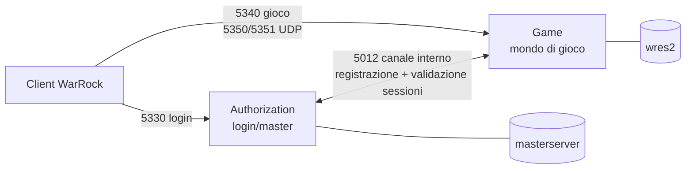
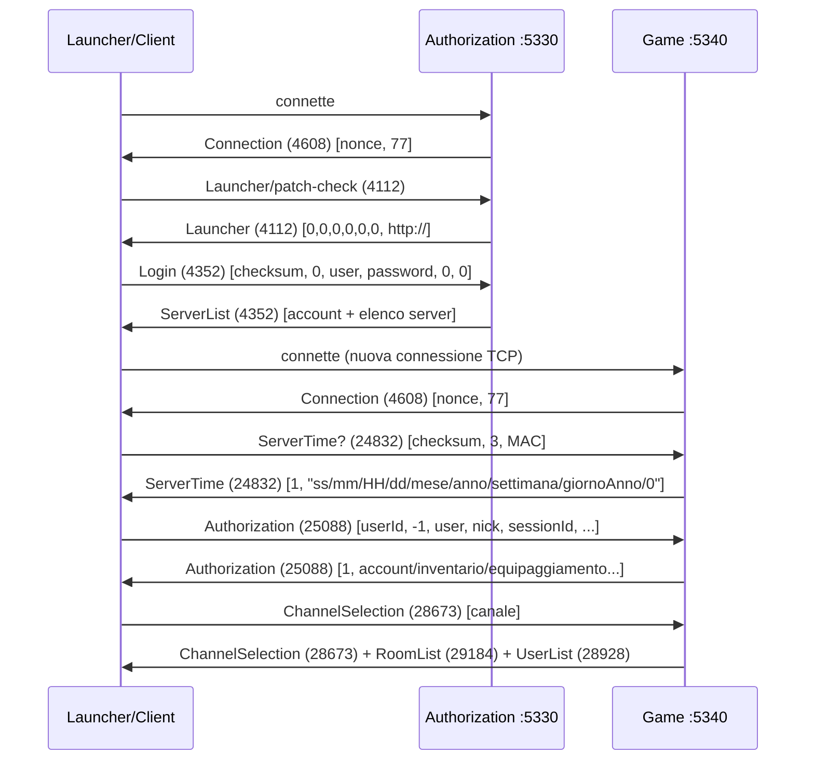
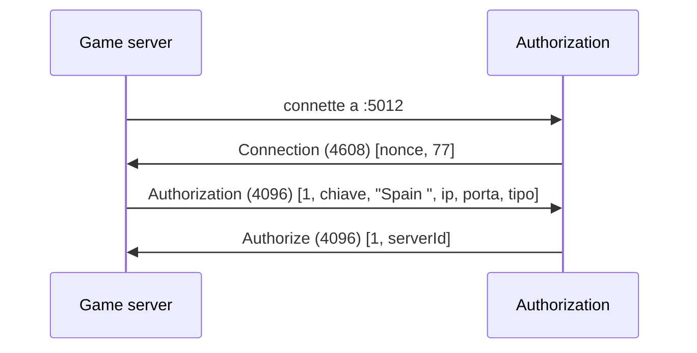

# Protocollo WarRock — guida di riferimento

Guida al protocollo di WarRock e al porting Node.js che lo implementa, organizzata **per concetto**: ogni argomento sta in un posto solo, con lo stato di conoscenza **attuale e corretto**, non nell'ordine in cui è stato scoperto.

Nasce da 45 fasi di lavoro scritte come diario cronologico. Quella cronologia è stata riassorbita: dove una fase successiva ha smentito una precedente (il sistema clan, la clan war, il banner win/lose, la scala della vita), qui compare **solo la versione giusta** — il percorso diagnostico sopravvive come nota "come ci siamo arrivati" quando la tecnica in sé è riutilizzabile, perché in questo progetto il metodo di indagine vale quanto il risultato.

**Cosa contiene ogni sezione**: il concetto spiegato, i pacchetti reali catturati dai log, i bug trovati con sintomo → causa → fix, gli scostamenti dichiarati dal riferimento C#, e quello che resta irrisolto.

**Due regole valide ovunque in questo documento**, imparate a caro prezzo:

1. **La cattura reale contro il client vero batte sempre il codice C#.** Quando divergono, vince quello che si vede sul filo.
2. **Prima di dichiarare un'area "vuota, da progettare da zero", vanno controllati *entrambi* i riferimenti C#** (`WarRock-Chapter-1-Server` e `WarRock-ToXiiC-Core`). Lo stesso errore è stato fatto due volte — comandi GM e sistema clan — dichiarando "scheletro" un'area che l'altro riferimento aveva cablata per intero.

---

## Indice

1. [Architettura: perché due processi](#1-architettura-perché-due-processi)
2. [Fondamenti del protocollo](#2-fondamenti-del-protocollo) — *lettura propedeutica a tutto il resto*
3. [Ciclo di connessione: dal launcher alla lobby](#3-ciclo-di-connessione-dal-launcher-alla-lobby)
4. [Lobby: canali, utenti, stanze, chat](#4-lobby-canali-utenti-stanze-chat)
5. [Stanze: creazione, ingresso, uscita, gestione](#5-stanze-creazione-ingresso-uscita-gestione)
6. [Ciclo di partita: avvio, tick, spawn, fine round](#6-ciclo-di-partita-avvio-tick-spawn-fine-round)
7. [Combattimento: danno, hitbox, morte, respawn](#7-combattimento-danno-hitbox-morte-respawn)
8. [Relay UDP: handshake, keepalive, tunnel](#8-relay-udp-handshake-keepalive-tunnel)
9. [Progressione ed economia](#9-progressione-ed-economia)
10. [Sistema clan](#10-sistema-clan)
11. [Comandi GM](#11-comandi-gm)
12. [Performance e scalabilità](#12-performance-e-scalabilità)
13. [Containerizzazione e deploy](#13-containerizzazione-e-deploy)
14. [Strumenti di test](#14-strumenti-di-test)
15. [Buchi noti e misteri aperti](#15-buchi-noti-e-misteri-aperti)
16. [Appendice: tabella opcode completa](#16-appendice-tabella-opcode-completa)

---

## 1. Architettura: perché due processi



`Authorization` è il "centralino": autentica l'account e tiene la lista dei `Game` server disponibili. `Game` è dove si gioca davvero. Sono processi separati perché nel 2008 un publisher poteva avere **un solo** Authorization server ma **molti** Game server (uno per regione/lingua) — il client fa login una volta, poi sceglie a quale mondo entrare. La porta 5012 è come i due processi si parlano *tra loro*, invisibile al client.

Questo spiega anche perché un login riuscito **non basta**: dopo aver scelto un server dalla lista, il client apre una **connessione TCP completamente nuova** verso il Game server (5340) e si autentica *di nuovo* lì, con un `SessionID` che l'Authorization gli ha dato come lasciapassare temporaneo.

| porta | protocollo | chi ascolta | a cosa serve |
|---|---|---|---|
| 5330 | TCP | Authorization | login, patch-check, lista server |
| 5012 | TCP | Authorization | canale interno Auth ↔ Game (mai esposto al client) |
| 5340 | TCP | Game | tutto il mondo di gioco (lobby, stanze, chat, combattimento) |
| 5350 | UDP | Game | handshake UDP iniziale |
| 5351 | UDP | Game | ping/NAT + tunnel di relay (movimento, spari) |

**Database**: `masterserver` (account, password, `status` per il ban) letto dall'Auth; `wres2` (tutto il resto: `user_details`, inventario, item, coupon, clan, mappe) letto dal Game. Il processo Game tiene anche una **seconda pool minima** verso `masterserver`, aggiunta per due sole necessità: `/ban`/`/unban` (che mutano `users.status`) e la risoluzione dei displayname per i roster clan — quei dati vivono solo nel DB di login.

Questa separazione regge lo scaling futuro senza stato condiviso né Redis: più `game` davanti a un solo `auth`, con il client che sceglie già uno shard dalla lista di login (confermato dall'analisi di performance, sezione 12).

---

## 2. Fondamenti del protocollo

Sezione propedeutica: tutto quello che serve per leggere qualunque pacchetto di questo gioco, indipendentemente da cosa faccia.

### 2.1 TCP: testo, XOR, newline

Ogni pacchetto TCP, prima di essere cifrato, è una **stringa di testo separata da spazi**:

```
<tick> <opcodeDecimale> <campo1> <campo2> ... \n
```

- `tick` — timestamp locale del mittente, **non validato da nessuno**. Qui è `Date.now() & 0x7fffffff`.
- `opcodeDecimale` — il tipo di pacchetto, scritto in **decimale** sul filo anche quando nel C# è definito come costante esadecimale (es. `24832` = `0x6100`).
- il resto sono i campi, letti **per posizione**. Il protocollo non è auto-descrittivo: nessun campo dichiara cosa sia.

**"Cifratura"**: ogni byte va in XOR con **una singola chiave fissa**. Non è crittografia — con la chiave nota si legge tutto in chiaro. L'XOR è la sua stessa inversa (`byte ^ k ^ k = byte`), quindi la stessa funzione cifra e decifra.

Esempio reale, dal primo test (`fake-client.js` che manda `hello world`):

| carattere | byte | chiave client→server | byte sul cavo |
|---|---|---|---|
| `h` | `0x68` | `0xC3` | `0x68 ^ 0xC3 = 0xAB` |

**Framing**: TCP consegna un flusso, non pacchetti. Il separatore è il byte `0x0A` (newline). Dettaglio non ovvio e facile da sbagliare: si **decifra prima**, poi si cerca `0x0A` nel testo in chiaro — un `0x0A` cifrato non è più `0x0A`.

### 2.2 Chiavi XOR per canale

Da `Core/Constants.cs`, e confermate sul filo:

| canale | server → client | client → server |
|---|---|---|
| esterno (login 5330, gioco 5340) | `0x96` | `0xC3` |
| interno Auth ↔ Game (5012) | `0x23` (lato Auth) | `0xA3` (lato Game) |

Le chiavi degli **endpoint UDP** (sezione 8) sono numericamente le stesse dell'esterno (`0xC3` in lettura, `0x96` in scrittura) ma si applicano a **blob di 6 byte**, non all'intero pacchetto — sono un meccanismo diverso che riusa gli stessi numeri, non "la stessa cifratura".

### 2.3 L'escaping degli spazi: `0x1D`

**La singola cosa più importante per leggere un log grezzo a occhio.** Lo spazio è il separatore di campo, quindi uno spazio *dentro* il testo di un campo lo romperebbe. Prima di spedire, ogni spazio reale viene sostituito dal byte `0x1D` (ASCII Group Separator):

```js
const str = [tick, id, ...fields.map(f => String(f).replace(/ /g, '\x1D'))].join(' ') + ' \n';
```

Conseguenza pratica: un campo multi-parola nei log appare **incollato** — `vieniqui` invece di `vieni qui`, `Sidekicksilenziatoper1minuti` invece della frase leggibile. Non è un bug: è `0x1D`, invisibile sia nei log del server sia nel terminale. Per rileggerlo serve `.split('\x1D').join(' ')`.

Questo ha ingannato due volte durante il progetto — la prima leggendo le catture di chat delle prime fasi, la seconda scrivendo un matcher di test che confrontava stringhe con spazi veri e falliva senza spiegazione.

Lo stesso escaping spiega un dettaglio della registrazione server interna: il nome viene mandato con uno spazio finale (`"Spain "`) come nel C#; toglierlo con un `.trim()` non cambiava nulla proprio perché quello spazio, passato dall'escaping, non è più un carattere spazio vero.

Il marcatore `>>` della chat convive con questo: il client manda `"WRUser>>\x1Dciao\x1Dmondo"` — prefisso, marcatore, poi il testo con gli spazi già escapati.

### 2.4 Notazione opcode: hex, decimale, e il wraparound a 16 bit con segno

Lo stesso numero compare in tre forme a seconda di dove lo si legge:

- **hex** nei file di enum del C# (`GameCountDown = 0x7531`)
- **decimale** nel codice C# che a volte scrive il letterale già convertito (`26384`)
- **decimale** sul filo, sempre — un pacchetto TCP porta `30000`, mai `0x7530`

Conviene tenere entrambe le forme a mente: `0x6710` = `26384` è lo stesso opcode `CLAN_SYSTEM`, e nei due riferimenti C# compare scritto in tutti e due i modi.

#### 🐛 Il wraparound a 16 bit con segno

Il `SessionID` veniva generato come numero casuale fino a ~268 milioni. Il client lo salva e lo rimanda indietro come **intero a 16 bit con segno** (`short`, -32768..32767). Un valore come `39574` (che sta in 16 bit *senza* segno) torna indietro come `39574 - 65536 = -25962`. La validazione `sessionId > 0` falliva sempre e il client mostrava "errore 73030".

**Lezione generale**: quando un protocollo non dichiara i tipi, ogni "intero" nasconde un range implicito, che va dedotto dal comportamento osservato, non assunto. Qualunque valore sopra `32767` mandato come unsigned a 16 bit tornerà negativo da una lettura signed.

### 2.5 Il pattern di dispatch: due livelli

Il protocollo ha **due livelli di smistamento**, e confonderli fa "sparire" pacchetti interi:

1. **Opcode top-level** — un id per tipo di pacchetto (`CHAT` 29696, `ROOM_JOIN` 29456, `SCOREBOARD` 30032...). Smistati direttamente da una mappa `id → handler`.
2. **Sotto-tipi dentro `GAME_PACKET` (`0x7530` = 30000)** — tutte le azioni *dentro* una stanza (pronto, cambio squadra, spawn, danno, morte...) viaggiano dentro questo unico opcode, con un'intestazione fissa di 4 campi:

```
[slot mittente, id stanza, campo non identificato, sotto-tipo, ...payload]
```

Esempio reale (cambio squadra): `[1, 1, 2, 56, 1, 0, 1, 0, 0, 0, 0, 0, 0, 0]` → slot `1`, stanza `1`, sotto-tipo `56` (SideUpdate), payload `[1,0,1,0,0,0,0,0,0,0]`.

**La trappola**: diversi pacchetti che *sembrano* azioni di gioco non passano affatto da `GAME_PACKET` e hanno un id proprio — `GameTick` (30016), `EndGame` (30048), `Scoreboard` (30032), `Equipment` (29970), `Explosives` (29984), `GameCountDown` (30001). Il tabellone del tasto Tab è rimasto non gestito per diverse fasi esattamente per questo: veniva cercato tra i `GameSub` dove non è mai stato.

**Un vincolo del dispatcher**, non ovvio: `handleGamePacket` manda **una sola risposta** per pacchetto in arrivo. Se un handler ha bisogno di mandare anche altro (es. l'autostart che scatta dopo un `READY`), quel lavoro extra va segnalato con un flag nel valore di ritorno ed eseguito dal dispatcher **dopo** aver spedito la risposta normale, altrimenti l'ack si perde.

**Un pacchetto senza handler viene ignorato in silenzio.** Vale per il server (`if (!handler) return;`) e vale, cosa più importante, **per il client**. Vedi 2.8.

### 2.6 UDP: un protocollo completamente diverso

Fin qui tutto testo + XOR su TCP. UDP è tutt'altro: **binario, a offset fissi, big-endian** (ordine di rete, byte più significativo per primo). Serve al traffico in tempo reale (movimento, spari) dove perdere un pacchetto è accettabile ma aspettare una ritrasmissione TCP no.

> Node legge e scrive big-endian nativamente (`readUInt16BE`/`writeUInt16BE`) — **nessuna inversione manuale di byte necessaria**, a differenza di quello che fa il C# di riferimento con la sua danza di byte-swap. Un porting ingenuo che replica quella danza ottiene il valore sbagliato.

Non è un protocollo standard (non è STUN, non è nulla di documentato): è un formato binario inventato dai dev di WarRock. Il pacchetto iniziale reale, catturato:

```
10 01 01 00 7a 4f 00 00 00 00 00 00 00 64
└─type─┘     └sessId┘
 0x1001       0x7a4f = 31311
```

Struttura di lettura, valida per entrambi i tipi:

| offset | dimensione | campo |
|---|---|---|
| 0 | u16 BE | **tipo** (`0x1001` Initial, `0x1010` Ping/tunnel) |
| 4 | u16 BE | sessionId del mittente |
| 6 | u16 BE | id stanza |
| 14 | 1 byte | **sotto-comando** (`0x21` handshake, `0x10`/`0x30`/`0x31`/`0x32`/`0x34` tunnel) |
| 22 | u16 BE | targetId (a chi va relayato) |
| 32 | 6 byte | endpoint IP:porta (cifrato, vedi sotto) |
| 50 | 6 byte | secondo endpoint (cifrato) |

**L'encoding di un endpoint NAT** è il pezzo più contorto del protocollo. Sei byte che contengono porta + IP, con XOR *e* un'inversione di ordine:

```js
const READ_KEY = 0xc3;   // endpoint che il client ci ha mandato
const WRITE_KEY = 0x96;  // endpoint che mandiamo noi

function readEndpoint(buf, offset) {
  const b = Buffer.from(buf.subarray(offset, offset + 6)).map(x => x ^ READ_KEY);
  return { ip: `${b[2]}.${b[3]}.${b[4]}.${b[5]}`, port: b.readUInt16LE(0) };
}

function writeEndpoint(buf, offset, ip, port) {
  const octets = ip.split('.').map(Number);
  const value = Buffer.from([port & 0xff, (port >> 8) & 0xff, ...octets]).reverse();
  for (let i = 0; i < 6; i++) buf[offset + i] = value[i] ^ WRITE_KEY;
}
```

Da notare: in **lettura** la porta è little-endian (`readUInt16LE`) dentro un pacchetto altrove big-endian, e in **scrittura** il blob viene costruito e poi `.reverse()`-ato prima dell'XOR. Non è eleganza, è quello che il client accetta — ricostruito dal `UdpReader` del riferimento e confermato dal fatto che il client impara davvero il proprio IP pubblico.

### 2.7 Come si "cattura" il traffico qui: nessun Wireshark

In questo progetto **non esiste uno step di cattura esterna**. Il server Node sta in mezzo a ogni scambio per costruzione — TCP *e* UDP, incluso il relay di movimento — quindi il suo stesso logging *è* lo strumento di cattura:

- ogni pacchetto TCP in arrivo viene loggato come `IN tick=... id=... blocks=[...]`, ogni uscita come `OUT id=... fields=[...]` o `OUT(broadcast xN)`.
- il path UDP ha un **campionatore** (`logTunnelSample`) che stampa il primo esemplare di ogni forma `(sotto-comando, lunghezza)` e poi uno ogni 20, con hex dump completo: abbastanza per vedere cambiare i campi tra un campione e l'altro senza inondare la console a 10Hz.

È una scelta metodologica dichiarata, non una mancanza. Il costo (log incondizionati sul path più caldo) è **noto e deliberatamente non ottimizzato** finché il progetto è in fase di esplorazione: sono lo strumento con cui si applica la regola "la cattura reale vince sul C#".

### 2.8 Metodologia: come si decodifica un pacchetto sconosciuto qui

Tecniche che hanno funzionato davvero, generalizzate.

**Controllare *entrambi* i riferimenti C# prima di dire "non è implementato".** Un'area può essere uno scheletro morto in uno e completamente cablata nell'altro. Successo due volte: comandi GM (3 comandi morti in `WarRock-Chapter-1-Server`, ~28 reali e cablati a mutazioni DB in `WarRock-ToXiiC-Core`) e sistema clan (zero handler di mutazione nel primo, `CP_Clan` con 16 sottotipi reali nel secondo). Entrambe le volte, il verdetto "vuoto" era stato dato guardandone uno solo.

**Il valore-marcatore distinto per campo.** Per scoprire quale campo il client legge davvero da un pacchetto, si manda un valore riconoscibile e *diverso in ogni posizione* (es. `1000+indice`) e si guarda quale marcatore torna indietro. Ha risolto il bug dell'invito stanza. Due avvertenze imparate lì:
- marcare *tutti* i campi non funziona: il client scarta l'intero pacchetto se i campi che devono sembrare validi (sessionId, displayname, xp) non lo sono. Vanno tenuti reali quelli e marcate solo le posizioni sospette.
- se un marcatore non torna indietro **in nessuna posizione**, la conclusione giusta non è "l'ho messo nel posto sbagliato" ma "quel campo il client non lo legge affatto".

**Un campo che finisce in una posizione diversa da quella attesa è il guasto più ricorrente qui.** Quattro casi documentati, in punti indipendenti — tre volte perché *questo client* legge a un offset diverso dal C#, una volta perché era il porting a scrivere nel posto sbagliato.

| pacchetto | posizione attesa leggendo il C# | posizione reale |
|---|---|---|
| `RoomInvite` — password | dopo il roomId | subito dopo il messaggio (dove il C# mette il roomId) |
| `MODE_UPDATE` (GameSub 52) | `payload[2]` | `payload[0]` |
| `PlayerDamage` — `shootenPart` (flag headshot) | indice 18 | indice **17** (18 è l'offset dei client Nexon più recenti) |
| `EndGame` — `CurrentRoundTeamA/B` | posizione 1-2 | posizione 1-2 — era *il porting* a mandarli in coda, lasciando a zero la posizione giusta (6.6) |

Quindi: un mismatch contro il layout dichiarato dal riferimento è un **modo di guasto ricorrente e atteso**, non una stranezza da scartare.

**Un client che ignora un opcode/sottotipo sconosciuto è comportamento normale.** Non genera errori, non logga nulla, non reagisce. Conseguenza diretta: **"il client non ha reagito" non è una prova che il pacchetto fosse malformato** — può semplicemente non essere gestito lato client. È successo letteralmente con l'opcode `USER_LIST_MODIFY` (28944), un nome che esiste nei file di riferimento ma che **nessuno dei due lati ha mai implementato**: il pacchetto partiva perfetto e non succedeva niente. La correzione giusta non è stata aggiustare il formato ma **riusare il pacchetto che il client già sa mostrare**.

**Corollario**: prima di inventare un formato, cercare quale pacchetto già funzionante produce lo stesso effetto quando l'utente lo fa a mano (il click "aggiorna", il tasto Tab, i tasti di paginazione). Quello sì che il client sa renderizzare.

**Sensibilità all'ordine dei pacchetti.** Diverse volte il contenuto era giusto e l'ordine no: il client scarta un aggiornamento arrivato prima della conferma che lo rende pertinente. Va verificato l'ordine di arrivo sul socket, non solo il contenuto.

**Fermarsi quando i tentativi diventano cieco.** Regola applicata due volte (fantasma UDP, autostart): dopo che 3-4 tentativi indipendenti danno lo stesso identico esito negativo con lo stato server dimostrabilmente corretto, il problema non è nel pacchetto successivo da provare — è dentro l'eseguibile del client, e serve un disassembler. Continuare costa test dal vivo dell'utente e rischia di lasciare il server in stati fantasma.

---

## 3. Ciclo di connessione: dal launcher alla lobby



### 3.1 Il saluto: `Connection` (4608)

Primo pacchetto che il server manda su **ogni** nuova connessione — login, gioco e canale interno usano lo stesso id. Due campi: un nonce casuale a 9 cifre e la costante `77`. Copiati as-is da `Core/Packets/Connection.cs`; il loro scopo reale non è chiaro e nulla a valle sembra dipenderci.

### 3.2 Patch-check (4112)

```
IN  id=4112 (Launcher / patch-check), nessun campo
OUT id=4112 fields=[0, 0, 0, 0, 0, 0, http://]
```

Rispondere `0` in ogni campo di versione fa concludere al client (che ha una versione reale più alta) "sono già aggiornato". Trucco pigro ma efficace, ereditato dal server originale.

### 3.3 Login (4352)

```
IN  id=4352 (login) blocks=[1335749171, 0, wruser, password123, 0, 0]
OUT id=4352 (ServerList) blocks=[1, 100, 0, wruser, NULL, WRUser, 24693, 1, 0, 1, 1, 1, Spain, 127.0.0.1, 5340, 0, 0, -1,-1,-1,-1, 0, 0]
```

`blocks[2]`/`blocks[3]` sono username e password — non per struttura del protocollo (potevano stare ovunque), ma perché è lì che il C# le leggeva, confermato al primo tentativo dalla cattura reale. La password nel DB è `SHA256(password + salt)`, con il salt pubblico nella stessa riga: serve solo a evitare che due utenti con la stessa password abbiano lo stesso hash.

Codici di errore reali di questo pacchetto: `72010` utente inesistente, `72020` password errata, `73050` bannato (`users.status <= 0`), `74010`/`74020` campi vuoti.

#### 🐛 Un campo di troppo sfasa tutto

Il C# manda anche un campo "versione" (`1.11025`) prima del conteggio server. Includendolo, il client mostrava il server come **"pieno"**, con un nome a caso al posto di "Spain". Non un errore di validazione: un disallineamento posizionale. Ogni campo è letto alla cieca per posizione — un campo extra sposta tutti quelli dopo di uno, così il nome del server legge quello che doveva essere l'ID e il conteggio giocatori legge la porta (`5340`, enorme per un contatore → "pieno").

**Diagnosi**: bastato chiedere "che nome vedi nella riga?" — la risposta ("qualcosa di strano, non 'Spain'") ha confermato lo sfasamento prima ancora di guardare i byte. Tecnica riutilizzabile: un sintomo *cosmetico* su un campo di testo identifica uno sfasamento più in fretta di qualunque analisi numerica.

#### 🐛 `127.0.0.1` nella lista server rompe ogni client non locale

Sintomo: login riuscito da una VM (`172.21.238.209`), poi "Connection failed. Returning to the main screen" — **senza che il Game server registrasse alcun tentativo di connessione**.

Causa: `config.json`'s `serverIp`, hardcoded a `127.0.0.1`, viene rispedito dentro `ServerList` come indirizzo a cui il client deve connettersi. Per un client sulla stessa macchina funziona per definizione; per un client altrove significa "connettiti a te stesso".

Fix: invece di scegliere un IP fisso in config (che si romperebbe di nuovo con una terza rete), l'Auth risponde con l'indirizzo **locale della connessione TCP in ingresso**:

```js
// auth/handlers.js
const gameIp = localIp(socket);  // socket.localAddress, spogliato del prefisso "::ffff:"
for (const s of servers) fields.push(s.id, s.name, gameIp, PORTS.game, s.playerCount, s.type);
```

Auth e Game girano sullo stesso host e ascoltano su tutte le interfacce (nessun `host` esplicito in nessuna `.listen()`/`.bind()`), quindi qualunque indirizzo raggiunga l'Auth raggiunge anche il Game. `config.json`'s `authServerIp`/`serverIp` restano `127.0.0.1` — sono solo il canale interno.

Verificato dal vivo: client sulla VM (`172.21.224.0/20`, dietro l'Hyper-V Default Switch) riceve `172.21.224.1` e si connette; client sulla stessa macchina continua a ricevere `127.0.0.1`. Stesso codice, nessuna configurazione da cambiare quando cambia la rete.

### 3.4 Canale interno: il Game si registra (5012)



```
OUT id=4096 fields=[1, AlterEmuV5.0.1, Spain , 127.0.0.1, 5340, 0]
Internal: registered game server "Spain" as id 1
OUT id=4096 fields=[1, 1]
```

Da qui l'Auth sa che esiste un server "Spain" su `127.0.0.1:5340` e lo include nella lista mandata ai giocatori. `connectToAuthServer()` fa un singolo `net.connect` **senza retry**: se l'Auth non è ancora in ascolto quando parte il Game, non recupera da solo (rilevante per Docker, sezione 13).

### 3.5 Autenticazione sul Game server

**`ServerTime` (24832)** è in realtà un controllo anti-cheat: il client manda `versionId=3` (fisso) e il proprio **indirizzo MAC** (12 caratteri esadecimali), confrontato con `macaddress_blacklist`. Se pulito, il server risponde con l'ora in un formato a campi slash-separati (`secondi/minuti/ore/giorno/mese(0-based)/anno-1900/settimana/giornoDellAnno/0`).

**`Authorization` (25088)** — id **diverso** da quello del login (4352): stesso concetto, porta diversa. Il client rimanda il `sessionId` ricevuto al login per dimostrare la propria identità. La risposta è enorme: account, clan, livello, inventario, equipaggiamento, slot. Per un account nuovo, valori vuoti (`F,F,F,F` = 4 slot inventario disattivati, `^` = nessun oggetto).

Questa risposta porta anche i **cinque loadout di classe** (il "character select"), mandati **una sola volta al login e mai più durante la sessione** — dettaglio decisivo per diagnosticare il bug dell'HUD resettato (sezione 7.6).

Limite noto e accettato: livello, denaro e 5° slot inventario si vedono **solo** da questo pacchetto, quindi una modifica a partita in corso resta invisibile fino a un nuovo login. Per questo `/setlevel` e `/addmoney` disconnettono il bersaglio (forzano un rilogin), mentre `/setpremium` no — gli effetti del premium si leggono dal vivo.

#### Il campo `AccessLevel` è scritto dal client

Cercando "chi decide chi è GM" nel C#, il campo si chiama `AccessLevel` e arriva in `blocks[7]` di questo pacchetto — **dichiarato dal client stesso**. Il riferimento lo rende sicuro con un giro di validazione verso l'Auth (che confronta con quanto salvato in sessione al login, derivato da `users.status`, colonna del DB di *login*, mai del client). Quel giro non è stato portato: fidarsi del campo significherebbe che chiunque modifichi il proprio client si autodichiara amministratore. Vedi sezione 11 per la soluzione adottata.

#### 🐛 Lo stesso account poteva autenticarsi due volte

Emerso appena due client reali sono diventati possibili (con i client finti si usavano apposta account diversi). Il riferimento ha per questo un intero giro di validazione Auth↔Game (`Session`/`SessionManager`, pacchetti interni `PlayerAuthorization`), non portato per intero — avrebbe richiesto uno stato di sessione a due fasi su entrambi i processi solo per questo.

Al suo posto, un controllo diretto e sufficiente in `handleAuthorization`: se un altro utente online ha già lo stesso `userId`, la seconda connessione riceve `92040` (`IdInUse`, codice reale del C#) e viene chiusa. Una scansione della mappa `users` già in memoria. Esiste una guardia simmetrica sul `sessionId` (sezione 12).

### 3.6 Ping applicativo e liveness (25600)

Il server manda `Ping` (`0x6400` = 25600) ogni 5 secondi a tutti i connessi. Porta il **countdown del premium rimanente**, ed è lo stesso punto in cui il riferimento chiama `UpdatePremiumState()` — riusato qui per la scadenza premium in tempo reale (sezione 9.2).

Il client **risponde già** a ogni Ping con un pacchetto identico. Per diverse fasi quella risposta è stata scartata come pacchetto sconosciuto; ora viene tracciata: se un utente resta muto per 20s (4 ping mancati), il server chiude forzatamente il socket riusando lo stesso percorso di pulizia di una disconnessione normale.

Serve per un guasto specifico e diverso dal crash: una connessione che muore **senza generare mai un evento di chiusura** (cavo staccato senza RST, NAT che silenzia il flusso). Un crash vero è già rilevato subito da TCP (`ECONNRESET`). Nessun traffico aggiuntivo: si è solo iniziato ad ascoltare una risposta che il client mandava già.

---

## 4. Lobby: canali, utenti, stanze, chat

### 4.1 Selezione canale (28673)

```
IN  id=28673 (ChannelSelection) blocks=[1]
OUT id=28673 fields=[1, 1]
OUT id=29184 (RoomList) fields=[0, 0, 0]     ← 0 stanze, pagina 0
```

Il canale determina anche la capienza massima delle stanze create lì dentro (vedi 5.1).

**Non-bug documentato**: quando un giocatore entra in un canale, il server **non notifica nessun altro** — manda solo a lui la lista stanze (`User.cs`'s `SetChannel`). È così anche nell'originale. Se un compagno di test non compare subito, non è un difetto del porting.

### 4.2 Lista utenti (28928) e le notifiche di presenza

`UserList` (`0x7100` = 28928) è **su richiesta**: il client la chiede, il server risponde con l'elenco.

#### 🐛 L'opcode inventato che il client ignora

Per avvisare automaticamente chi è in lobby dell'arrivo/uscita di qualcuno era stato usato `USER_LIST_MODIFY` (`28944`) — un nome che esiste in `txt/Packets.txt` ma **in nessun handler di nessuno dei due riferimenti**. Meccanica verificata sui log, formato coerente, batching corretto:

```
[game] IN id=28944 blocks=[1, 0, 100, 1193, WRUser, -1,-1,-1,-1, 0,16, 37757475, 0, 0, 0]   ← 1 aggiunto
[game] IN id=28944 blocks=[1, 0, 101, 17356, Sidekick, -1,-1,-1,-1, 0,16, 0, 0, 0, 0]        ← 1 aggiunto
[game] IN id=28944 blocks=[0, 1, 17356]                                                       ← 0 aggiunti, 1 rimosso
```

Dal vivo: **nulla**. Cliccando "aggiorna" a mano, invece, la lista si aggiornava. Spiegazione più semplice e più probabile: 28944 non è mai stato implementato **nemmeno nel client**. Un client ignora in silenzio ciò che non conosce, senza errori né segnali visibili — motivo per cui "non vedo nulla" non produce alcun indizio.

**Correzione**: riusare lo stesso pacchetto che il click "aggiorna" già produce (`UserList` 28928, confermato funzionante) e rimandarlo in automatico. Non è più un delta ma l'elenco ricostruito — qualche byte in più, ma l'unica versione che il client sa mostrare. Verificato dal vivo: il client reale ha mostrato correttamente un aggiornamento contenente la sessione di *un altro* utente, prova che il pacchetto non è legato a chi lo ha richiesto.

#### Batching, per non pagare O(n²)

Un broadcast a tutti a ogni evento costa lavoro quadratico sotto carico realistico (tutti che si riconnettono dopo un riavvio): N eventi × fino a N destinatari, in una manciata di millisecondi. Tre scelte:

1. **Batching temporale a 750ms** — cento login nello stesso secondo diventano *un* invio, non cento. Un login isolato aspetta al massimo 750ms, impercettibile per un umano.
2. **Platea ridotta** — solo chi ha `roomId === null` (è in lobby), stesso filtro già usato per gli aggiornamenti lista stanze. Chi è a metà partita non ha bisogno di sapere chi si è collegato, ed è proprio in partita che il server ha già il traffico più caro (relay UDP, `GameTick`).
3. Un solo buffer costruito e scritto su N socket, non N serializzazioni.

#### Paginazione

Nel C# di riferimento (`Packets/UserList.cs`) il campo `page` **non filtra**: itera l'intera lista qualunque pagina sia richiesta, cambiando solo l'offset dell'indice di ogni riga (`indice = i + page×10`). Il client riceve tutti i dati e pagina localmente.

**Scostamento deliberato adottato qui** (sezione 12): `buildUserListFields` fa ora `.slice(page*10, page*10+10)` e manda davvero 10 righe. `fields[0]` resta il conteggio **totale** vero, che il client usa per sapere quante pagine esistono. Motivo: rispedire l'intera anagrafica online a ogni richiesta *e* a ogni push automatico è un costo che cresce col numero di giocatori senza che il client ne usi più di una pagina.

Effetto collaterale noto del push automatico: ogni sessione ricorda l'ultima pagina richiesta esplicitamente (`userListPage`, default `0`). Chi naviga a una pagina diversa e chiude quella schermata senza tornare indietro riceverà i push successivi su quella pagina — nel peggiore dei casi un disallineamento cosmetico, mai dati mancanti.

### 4.3 Chat (29696)

```
[client] OUT id=29696 fields=[tipo, targetId, targetName, "WRUser>>testo"]
```

Il campo messaggio ha il formato `"<prefisso>>>\x1D<testo>"`: il client antepone il proprio nickname e un marcatore `>>`, e gli spazi del testo sono già `0x1D` (sezione 2.3). Per leggerlo: isolare dopo il marcatore, poi rimettere gli spazi.

Tipi reali (`Game/Enums/ChatType.cs`):

| valore | nome | resa osservata sul client reale |
|---|---|---|
| 1 | Notice1 | **popup**, non una riga di chat — inutilizzabile per messaggi frequenti |
| 2 | Notice2 | non testato dal vivo |
| 3 | LobbyToChannel | riga di chat |
| 4 | Room_ToAll | riga di chat — **gialla** con prefisso `System>> ` |
| 6 | Whisper | riga di chat privata |
| 8 | LobbyToAll | riga di chat |
| 10 | Clan | riga di chat, canale clan |

Skippati: `Room_ToTeam` (nessuno scoping per squadra) e il ramo `/cris` (chatbot "Cristina", fuori scope fin dall'inizio). Un tipo non riconosciuto viene ignorato in silenzio.

#### Due lezioni sui marcatori, imparate separatamente e identiche

1. **`Notice1` (tipo 1) rende come popup**, uno al secondo se usato per un countdown — inutilizzabile. Tornati a `Room_ToAll` con il prefisso `"System>> "` (trovato ispezionando entrambi i riferimenti: ogni uso reale di `Notice1` ha `targetId=999` e questo prefisso). Risultato dal vivo: **testo giallo, leggibile, nessun popup** — il colore diverso dalla chat normale ottenuto per altra via.
2. **Il marcatore `>>` serve su OGNI riga**, non solo sulla prima. Mandando risposte GM su più righe con `"GM>> "` solo in testa, ogni riga successiva mostrava **solo l'ultimo argomento tra parentesi angolari** — `/addmoney <giocatore|id> <importo>` diventava `<giocatore|id>` a schermo. Non era un problema di lunghezza (la prima riga, più lunga di diverse successive, si vedeva intera). Il client sembra richiedere il marcatore per **renderizzare il testo**, non solo per etichettare il mittente. Stessa lezione di `Notice1`, riscoperta su `WHISPER`.

Una terza lezione dello stesso tipo: le risposte GM apparivano inizialmente come `Notice`, non come righe di chat. Cambiate in `Whisper` (tipo 6) con i campi target (sessionId/nome del **destinatario**, non del mittente fittizio "GM") valorizzati come in un sussurro reale — un tentativo precedente con quei campi vuoti non renderizzava affatto.

#### 🐛 Limite di lunghezza di riga

Segnalato col client reale: `/gmhelp` mostrava solo `1`, il resto spariva. Due dati reali dal log:

- **messaggio-sonda dell'utente**, catturato per intero: `WRUser>>ahahahahahahahahahahahhahahhhhhhhhhhhhhhhhhhhhhhhhhhhhx` — il testo dopo `>>` è esattamente **55 caratteri**. La casella di digitazione del client ha un limite, e quello è il valore osservato.
- **risposta di `/gmhelp`** che si è persa: **575 caratteri** in un singolo pacchetto `CHAT`.

Due meccanismi diversi (limite in invio vs. qualcosa che si rompe in ricezione), stessa conclusione pratica: nulla in questo client è mai stato osservato gestire una riga da centinaia di caratteri. `/maps` (~700 caratteri, 44 mappe) aveva lo stesso problema, mai segnalato solo perché mai provato col client vero.

**Fix**: non tagliare (si perderebbe informazione) ma spezzare in più pacchetti `CHAT` sotto un limite di sicurezza — `MAX_CHAT_LINE = 50`, margine conservativo sotto i 55 confermati. Due funzioni diverse a seconda della natura del testo:

- `wrapLines(text, max)` — word-wrap greedy, mai a metà parola. Per testo libero (`/userinfo`, `/roominfo`, `/notice`).
- `packItems(items, max, sep)` — impacchetta **unità intere** (un comando, una voce mappa), mai a metà. Introdotta dopo un test dal vivo in cui `wrapLines` spezzava `/setpremium <giocatore|id> <tier 0-4> <giorni>` a cavallo di due righe e `30=Rusty` / `Nails,` su righe diverse: spezzare a livello di *parola* non basta quando il testo è in realtà una lista di voci indipendenti.

Verificato dal vivo: `/gmhelp` arriva come **15 pacchetti**, ognuno con uno o più comandi completi mai spezzati (`/notice <msg> | /kick <giocatore>` su una riga, `/closeroom <id> | /maps | /map <id> | /endgame` sulla successiva); `/maps` mostra `30=Rusty Nails` intatto. Gli altri comandi, già sotto i 50 caratteri, restano un solo pacchetto.

Resta da isolare il vero limite di **ricezione**, che potrebbe non coincidere con i 55 della digitazione: `MAX_CHAT_LINE` va stretto o allargato quando emergerà una cattura che lo mostri.

---

## 5. Stanze: creazione, ingresso, uscita, gestione

Le stanze rompono per la prima volta l'isolamento tra connessioni: se crei una stanza, *un altro* utente deve vederla comparire senza fare nulla. Da qui nasce il registro condiviso in memoria (`game/state.js`): chi è connesso, in che canale, in che stanza.

**Un solo formato "descrizione stanza"** da 25 campi è riusato da `RoomCreation`, `RoomList`, `RoomJoin`, `RoomUpdate` e `RoomSpectate` — impararne uno significa saperli leggere tutti.

### 5.1 Creazione (29440)

```
IN  blocks=[OneShot,OneKill, 0, NULL, 1, 12, 3, 0, 0]
OUT fields=[1, 0, 1, 1, 1, 0, OneShot,OneKill, 0, 16, 1, 1, 0, 2, 0, 2, 4, 1, 0, 0, 0, 0, 0, 0, 0, 0, 2, -1]
```

`blocks[0]` è il nome, `blocks[3]` è un **indice** di capienza (non il numero diretto): per il canale CQC, indice `1` → `8×(1+1)=16` giocatori.

**Due default corretti alla creazione**, entrambi frutto di bug reali:

- **`setting: 0`**, non `2`. Il `2` era un placeholder ereditato da quando ogni stanza era TDM per default. Una stanza Explosive appena creata giocava sempre a **5 round** (`ROUND_LIMITS=[1,3,5,7,9]` indicizzato da `setting=2`) nonostante il client mostrasse "single round" — e il client, verificato nei log, **non manda mai** un `CHANGE_ROUNDS`/`CHANGE_KILLS` per una stanza mai toccata su quel campo. Con `setting: 0` una stanza Explosive intonsa gioca davvero a 1 round.
- **ID stanza a base 0.** Entrambi i riferimenti assegnano id partendo da 0 (`Channel.GetOpenRoomID()`, `ChannelManager.GetOpenID`, entrambi `for (int i = 0; ...)`); il porting partiva da 1. Off-by-one corretto — con una conseguenza sull'invito, vedi 5.4.

#### 🐛 Nessun riutilizzo degli ID stanza

Prima stanza → id `1`, distrutta, nuova stanza → id `2` invece di riprendere l'`1` libero, lasciando un buco: nel client la stanza compariva nella *seconda* posizione invece che nella prima. Era una semplificazione dichiarata all'inizio ("niente riutilizzo ID, aggiungilo se serve") — è bastato il primo test con due sessioni reali per farla emergere. Corretto cercando sempre il **più piccolo id libero**.

#### 🐛 Un sessionId dove doveva starci uno slot

Il campo "master" è un piccolo **indice di slot** (0, 1, 2...), non un identificativo di sessione. Il codice iniziale ci metteva il `SessionID` intero (es. `29562`) — invisibile finché non si guarda un `RoomLeave` campo per campo e si nota un numero enorme dove ci si aspetta uno 0 o un 1.

#### 🐛 Paginazione incoerente tra due funzioni

`sendRoomList` assumeva id a base-1 (`(r.id - 1) / 8`), `handleRoomListRequest` già base-0 (`r.id >= 8*p`): la stanza in posizione 8 finiva in pagine diverse a seconda di quale delle due rispondesse. Allineate entrambe a base-0.

### 5.2 Lista stanze (29184) e aggiornamenti (29200)

Due percorsi distinti, ed è importante non confonderli:

- **`ROOM_LIST` (29184) come richiesta in arrivo** — il client la chiede di sua iniziativa (refresh manuale, tasti di paginazione). Per diverse fasi **non esisteva alcun handler**: si aveva solo il lato "lo mandiamo noi" dopo `ChannelSelection`. Il C# ha un intero `Handlers/RoomList.cs` con paginazione (`direction`, calcolata come differenza tra due campi, avanti/indietro) e un filtro `waitingOnly` (le ultime 8 stanze in attesa per ID). Portato fedelmente, incluso il dettaglio che **risponde solo se il richiedente non è in una stanza** (`u.Room == null`) — chi è dentro si aggiorna via broadcast dirette, non ri-richiedendo la lista.
- **`ROOM_LIST_UPDATE` (29200)** — l'aggiornamento incrementale che il server spinge alla lobby.

#### 🐛 L'update incrementale non basta a chi torna in lobby

Sintomo: A esce da una stanza dove resta B, torna in lobby e **non vede più la stanza** finché non clicca i tasti di paginazione. Cliccarli la mostrava — quindi il contenuto di `ROOM_LIST_UPDATE` era giusto, ma il client, tornato in lobby, non lo usa per popolare una lista che considera "da ricaricare da zero". La paginazione manda una vera richiesta `RoomList` e ottiene una risposta completa: quella sì, resa correttamente.

**Non è comportamento del riferimento** (`Handlers/RoomLeave.cs` rinfresca solo la *user list* di chi esce, mai la lista stanze) — ma qui vince la cattura reale: `handleRoomLeave` chiama ora `sendRoomList(socket, u.roomListPage || 0)`, la stessa funzione già usata dopo la selezione canale. Vale anche per chi viene kickato, che passa dallo stesso percorso.

### 5.3 Ingresso e squadre (29456)

**La squadra è codificata nello slot, non in un campo a parte.** Ogni stanza divide i propri slot a metà: la metà bassa (0-7 su 16) è squadra 0, la metà alta (8-15) è squadra 1. Il client **deduce** la squadra dal numero di slot assegnato.

#### 🐛 Il cambio squadra che non faceva nulla

Gli slot venivano assegnati in ordine sequenziale ignorando la squadra: il server diceva internamente "sei in squadra 1" ma dava uno slot della metà bassa, che il client legge come squadra 0. Ogni tentativo di "andare in squadra 1" falliva in silenzio perché per il server ci si era già. Fix: cercare lo slot nel **range corretto** in base alla squadra di destinazione (`Room.SwitchSide`).

#### 🐛 L'intestazione va scritta *prima* di applicare la modifica

Cambiare squadra sposta lo slot. Il C# è chiaro: lo slot nell'intestazione di risposta viene letto *all'arrivo* del pacchetto, prima di eseguire l'azione — quindi è sempre il valore **precedente**. Il nuovo slot compare solo dentro il payload. Costruendo l'intestazione *dopo* lo spostamento si mandava due volte lo stesso valore, e il client — non trovando più nessuno nella riga "vecchia" da aggiornare — mostrava un pannello vuoto.

Corollario scoperto testando i bot: il dispatcher **scarta in silenzio** ogni `GamePacket` il cui slot in intestazione non coincide con lo slot reale del giocatore. Un client (o un bot) che cambia squadra e non aggiorna il proprio slot locale smette silenziosamente di poter fare `ready`/`spawn`/`start` per sempre.

### 5.4 Invito (29520)

Portato fedelmente da `Handlers/RoomInvite.cs` + `Packets/RoomInvite.cs`. Cattura reale (A crea la stanza, invita B per displayname):

```
OUT id=29520 fields=[Sidekick, vieni qui]
IN  id=29520 blocks=[1, 0, -1, 3410, 3410, WRUser, -1, -1, -1, -1, 1, 18, 37765155, 3, 0, -1, vieniqui, 1, NULL]
```

Sulla carta i campi finali sono `[..., messaggio, roomId, roomPassword]` — corrisponde all'`Append()` del riferimento *e* alle catture incollate nei commenti di `WarRock-ToXiiC-Core`. **Non è quello che il client accettante legge davvero.**

#### 🐛 "You cannot join" — e come è stato craccato

L'invito arrivava (popup visibile) ma accettandolo il client rispondeva sempre "you cannot join". Il `RoomJoin` che mandava da solo dopo l'OK:

```
IN id=29456 blocks=[0, 1]     ← roomId=0, password="1" — non la stanza vera (id=1, password="123")
```

Diagnosi con la tecnica del **valore-marcatore distinto per campo**, senza un client da ispezionare al debugger. Primo tentativo (tutti i campi marcati con `1000+indice`): **nessuna notifica visibile** — il client scarta l'intero pacchetto se sessionId/displayname/xp non sembrano validi. Ripetuto tenendo quelli reali e marcando solo le posizioni sospette:

```
OUT id=29520 fields=[1, 7001, -1, sid, sid, WRUser, -1,-1,-1,-1, 7002, 18, xp, 3, 0, -1, msg, 7003, 7004]
IN  id=29456 blocks=[0, 7003]
```

`password` = `7003`, cioè esattamente il marcatore piazzato dove il riferimento mette il **roomId**. E `roomId` è rimasto `0` con qualunque marcatore in qualunque posizione — anche mettendo l'id vero della stanza lì, il client continuava a mandare `0`.

**Conclusione**: il campo password il client lo legge davvero (posizione: subito dopo il messaggio), il campo roomId **non lo legge da nessuna parte** — la UI di accettazione manda un `0` fisso, un *sentinel* che significa "entrami nell'ultima stanza a cui sono stato invitato".

**Fix**: tracciare lato server chi è stato invitato a quale stanza (`u.pendingInviteRoomId`, impostato da `handleRoomInvite` quando l'invito parte). In `handleRoomJoin`, se `roomId` arriva a `0` e non esiste una stanza `0`, si ripiega su quel valore.

**Caso limite non chiuso**: con gli id stanza a base-0 (5.1), un click *diretto* sulla prima stanza manda anch'esso `roomId=0`, indistinguibile dal sentinel. L'handler prova prima l'id letterale (una stanza 0 vera funziona normalmente) e ripiega sull'invito solo se la stanza 0 non esiste — resta ambiguo il caso in cui la stanza 0 sia realmente occupata *nello stesso momento* di un invito pendente per un'altra stanza. Serve un test dal vivo mirato.

#### Non-bug: l'invito va per displayname, non per username di login

Invitare `wruser2` (username di login) non recapita nulla: il riferimento cerca per `Displayname`, un campo separato assegnato dal server (`Sidekick`, visibile nel pacchetto di login, campo 5). Comportamento corretto — un client reale seleziona sempre il displayname mostrato in lobby. Annotato solo perché ha fatto perdere tempo in test.

### 5.5 Kick (29505)

A prima lettura la `KickPlayer` del C# sembrava uno scheletro: manda una notifica al bersaglio e non tocca mai `Room.Players`/`Master`/lobby. Un test dal vivo ha mostrato **perché basta così**.

#### 🐛 Il kick faceva crashare il kickato

Prima versione: notifica al bersaglio **e** `removeFromRoom` immediata (il pezzo che nel C# sembrava mancante, dichiarato "lavoro nuovo"). Con `fake-client.js` tutti i test passavano. Con un client reale, il kickato crashava subito.

```
IN  id=29505 blocks=[4]                 ← A (master) kicka lo slot 4 (B)
OUT id=29505 fields=[1, 4]              ← B riceve la notifica
OUT(broadcast) id=29504 fields=[...]    ← removeFromRoom rimuove B lato server, avvisa A
IN  id=29504 blocks=[]                  ← B, ricevuto il kick, manda un ROOM_LEAVE di suo
Game: socket error: read ECONNRESET     ← B crasha subito dopo
Game: disconnected
```

Causa: il client reale, ricevuta la notifica, **manda sempre lui stesso un `RoomLeave` esplicito** — esattamente come per un'uscita volontaria. È così che il riferimento "se la cava" mandando solo la notifica: lascia che sia il client a completare l'uscita. Ma `removeFromRoom`, eseguito dentro il kick, aveva già svuotato `u.roomId` *prima* che quella richiesta arrivasse, quindi `handleRoomLeave` la trovava con `u.roomId === null` e **ritornava senza rispondere**. Il client, in attesa di una risposta al proprio `RoomLeave`, va in crash.

**Fix**: tolta `removeFromRoom` dal kick — resta solo la notifica, identica al riferimento. La rimozione la completa il `RoomLeave` che il client manda da solo, lo stesso percorso già testato di un'uscita volontaria. Riverificato dal vivo:

```
OUT id=29505 fields=[8]                                     ← solo la notifica
IN(B) id=29505 blocks=[1, 8]
OUT id=29504 fields=[]                                       ← B manda il proprio RoomLeave
IN(B) id=29504 blocks=[1, 27358, 8, 1, 0, 5920, 66965]        ← una risposta vera, non il silenzio che crashava
OUT(broadcast x1) id=29504 fields=[1, 27358, 8, 1, 0, ...]   ← A vede B sparire dal roster
```

**Lezione generale**: un handler che non risponde mai può essere più pericoloso di uno che risponde male. Il kick lato GM (`/kickroom`) riusa letteralmente questa stessa scoperta — notifica e basta, mai `removeFromRoom` diretta.

### 5.6 Uscita (29504)

Il pacchetto `RoomLeave` va mandato **due volte** (`Room.Remove` nel C#: `Send(pBuffer); u.Send(pBuffer);`): una al giocatore che esce, e una **in broadcast a tutti quelli rimasti**. Mandandolo solo a chi usciva, chi restava continuava a vedere il giocatore nel proprio roster.

Campi che erano sbagliati e sono stati corretti:

- il **terzo campo è lo slot che il giocatore occupava** (`Packets/RoomLeave.cs`'s `oldSlot`), non sempre `0`. Se chi usciva era in slot 4, il client riceveva "slot 0 se n'è andato" — informazione sbagliata su chi far reagire.
- gli **ultimi due campi** (XP/denaro del giocatore) erano sempre `0, 0` invece dei valori reali post-pagamento.

#### 🐛 La broadcast esisteva solo per l'uscita volontaria

Un client è crashato durante un test e l'altro ha continuato a vederlo nel roster. `removeFromRoom` (condivisa dal `close` handler del socket e da `ROOM_LEAVE`) puliva `room.players` e la lobby, ma la **broadcast di uscita era cablata solo dentro `handleRoomLeave`**, mai nel percorso di disconnessione. Spostata dentro `removeFromRoom` stessa, così ogni via d'uscita la ottiene gratis:

```
Game: socket error: read ECONNRESET
Game: disconnected
OUT id=30048 (EndGame)
OUT id=29200 (RoomListUpdate)
OUT(broadcast x1) id=29504 (RoomLeave) fields=[1, 23938, 0, 1, 0, ...]   ← il player crashato sparisce dal roster
```

Stesso bug in forma più antica: chiudere la connessione senza `ROOM_LEAVE` (client chiuso, crash, `quit` del client di test) non rimuoveva mai il giocatore dalla stanza, solo dall'elenco utenti globale — da cui i **giocatori "fantasma"** che apparivano due volte nello stesso roster sotto lo stesso nome dopo qualche riconnessione. Emerso testando la clan war, che comportava molte riconnessioni con lo stesso account; presente fin dalle prime fasi, mai visto prima perché ogni test usciva sempre esplicitamente dalla stanza.

#### 🐛 Il master non veniva mai riassegnato

`removeFromRoom` aveva un `room.master = 0` incondizionato, con un commento che lo dichiarava semplificazione nota ("no real slot tracking, master stays 'slot 0'"). Se il master (slot 0) usciva e chi restava occupava un altro slot (es. 8, per il bilanciamento automatico delle squadre), `room.master` restava a `0` — uno slot vuoto. Il client di chi restava lo mostrava come nuovo master, ma lato server non lo era.

Portata la riassegnazione reale da `Room.Remove`: priorità `1 + Premium` per ogni slot occupato, scansionati in ordine (0..maxPlayers-1) così un pareggio (nessun premium) va al primo occupato; il nuovo master viene anche segnato `ready = true` (`Players[Master].Ready = true` nel riferimento) e perde il bonus Supermaster. Scatta **solo** se chi esce era davvero il master — un non-master che esce non tocca `room.master`.

#### 🐛 L'ordine dei pacchetti nascondeva la stanza alla lobby

La sequenza reale del riferimento è: *broadcast ai rimasti → risposta a chi esce → (solo dopo, nell'handler) aggiornamento alla lobby*. Il porting mandava l'aggiornamento alla lobby **dentro `removeFromRoom`**, prima ancora di rispondere al giocatore uscente. Se il client processa gli aggiornamenti lista-stanze solo dopo aver confermato la propria uscita (ragionevole: fino a quel momento la sua UI è ancora "dentro la stanza", non in lobby), un aggiornamento arrivato prima verrebbe scartato.

Riordinato: `removeFromRoom` non notifica più la lobby da sé, lo fanno i chiamanti (`handleRoomLeave` e il gestore di disconnessione) **dopo** la propria risposta — nel caso della disconnessione non c'è risposta da mandare, quindi la notifica parte subito. Verificato con un test che controlla l'**ordine di arrivo sul socket**, non solo il contenuto:

```
IN(A) id=29504 (RoomLeave, risposta a chi esce)     ← primo, zero ROOM_LIST_UPDATE prima
IN(A) id=29200 (ROOM_LIST_UPDATE, stanza ancora viva con B dentro)
    master field = slot reale di B (8), non più 0
```

Il riordino da solo **non bastava**: serviva anche il refresh completo della lista (5.2).

### 5.7 Blocco ingressi (GameSub 58)

Toggle lato host, **separato** dalla capacità massima della stanza (`Room.UserLimit`, `Handlers/Game/Lobby/ToggleUserlimit.cs`). Portato fedelmente, riusando il dispatcher `SUB` già esistente.

```
A → lock (GameSub 58)
IN(A) id=30000 blocks=[1, 0, 1, 2, 58, 0, 0, 1]   ← payload[2]=1, room.userLimit=true
B → join stanza bloccata
IN(B) id=29456 blocks=[94060]                     ← UsersExceeded, non 94120 (RoomIsFull)
```

I due codici devono restare distinti: è l'unico modo per cui un client reale possa distinguere "stanza piena" da "host ha chiuso gli ingressi".

### 5.8 Roster della stanza: `PLAYER_INFO` (29952)

Il roster viene mandato **solo all'ingresso in stanza** e **mai a un giocatore su se stesso** — entrambi i riferimenti escludono esplicitamente il mittente dalla lista destinatari (`Entities/Room.cs:213,259,270`; `Room/Room.cs`'s `InitializeUDP()`). Rispedirlo durante la partita è un bug, non un miglioramento: vedi 7.6.

Due campi di questo pacchetto sono stati fonte di bug e vanno letti con attenzione:

- **`kills`/`deaths` sono le statistiche lifetime dell'account**, non il punteggio della partita in corso (`RoomPlayers.cs:37-38`'s `p.User.Kills`/`p.User.Deaths`). Il tooltip che il client mostra passando il mouse su un giocatore in lobby legge da qui: mandandoci i contatori per-round, mostrava sempre `0` anche per un account con 137 kill/83 morti reali nel DB (confermato con una query diretta prima di ipotizzare qualunque cosa). Causa profonda: `socket.user` portava `xp`/`money`/`premium` ma non `kills`/`deaths`, pur leggendoli dalla stessa riga `user_details` al login e scartandoli subito dopo. Corretto in tre punti: caricarli su `socket.user`; aggiornarli in memoria ogni volta che un kill/morte/suicidio viene persistito (altrimenti il tooltip resterebbe indietro fino al prossimo login); usarli in `roomPlayerFields`. I contatori per-partita restano intatti dove servono davvero (scoreboard 0x7550, condizione di vittoria, XP di fine partita).
- **`class`** — vedi 7.6, era hardcoded a `0` e ha causato il bug dell'HUD resettato.

---

## 6. Ciclo di partita: avvio, tick, spawn, fine round

### 6.1 Le tre modalità implementate

`room.mode` segue l'enum del C# (`Explosive=0, Free_For_All=1, Team_Death_Match=2, Conquest=3`). Conquest non è implementata.

| modalità | condizione di vittoria | spawn | friendly fire |
|---|---|---|---|
| **FFA** (1) | primo che raggiunge `10 + 5×setting` uccisioni, oppure resta l'unico in piedi | round-robin condiviso 0-19 | mai (`CanInFlictDamageTo` è sempre vero in FFA) |
| **TDM** (2) | pool di ticket per squadra esaurito, o una squadra senza giocatori; vince chi ha più ticket | scelto dal client | bloccato salvo `room.friendlyFire` |
| **Explosive** (0) | primo a `ROUND_LIMITS[setting]` round vinti (`[1,3,5,7,9]`) | scelto dal client | bloccato salvo `room.friendlyFire` |

**TDM: ticket, non kill-target.** `Constants.TDMTickets = [30, 50, 100, 150, 200, 300]`, indicizzato da `room.setting` — lo *stesso* campo che in FFA indicizza il kill-target, riusato con un significato completamente diverso. Un'uccisione **normale** decrementa il pool della squadra **della vittima**, non un contatore dell'uccisore. Un'uccisione friendly-fire non tocca nessun pool.

**`room.mode` è stato hardcoded a `2` per molte fasi** — che nell'enum è già TDM — mentre tutta la logica di vittoria/scoreboard/spawn applicava le formule di `Modes/FreeForAll.cs`. Incoerenza mai emersa finché si testava solo FFA, risolta facendo seguire davvero a ogni modalità il proprio riferimento.

### 6.2 Avvio: `Start` (GameSub 1) → `START_REPLY` (GameSub 4)

Condizioni per avviare, tutte necessarie: tutti pronti, ≥2 giocatori, e — per Explosive e TDM — **squadre bilanciate**.

Il bilanciamento è portato da `Game/Handlers/Game/Lobby/Start.cs`: `teamDifference <= GameConfig.MaxTeamDifference` (default compilato `1`), a meno che la modalità sia FFA (dove le squadre non esistono) o il chiamante abbia `AccessLevel >= 3` (non applicabile qui). Se la condizione non è soddisfatta, `handleStart` ritorna `null` — **nessuna risposta**, stesso comportamento silenzioso già usato per "non tutti pronti".

Verificato con un test a due sessioni: entrambi i giocatori sulla stessa squadra e pronti → `Start` non produce alcuna risposta; bilanciando 1v1 → risposta reale (`newType=4`, `START_REPLY`) e la stanza passa a `Playing`.

### 6.3 Equipaggiamento pre-partita (29970)

Dopo "Start" il client mostra la selezione personaggio/armi — un pacchetto **completamente fuori dal contenitore `GamePacket`** (`Equipment`, `0x7512` = 29970, id a sé). Vedi 9.4 per la validazione reale.

### 6.4 `GameTick` (30016): senza battito il client non parte mai

#### 🐛 Il bug che ha sbloccato l'intero ciclo di gioco

Dopo `Start`, il client mandava `ConfirmSpawn` (100) e poi si fermava. Nessuno `Spawn` (150) in arrivo, timer di spawn fermo a zero a schermo.

Causa: il client aspetta il **battito del server** prima di considerare la partita davvero iniziata. `GameTick` (`0x7540` = 30016) è un pacchetto mandato **una volta al secondo** con due contatori — il primo, commentato "Spawn Counter" nel codice originale, è esattamente il timer che appariva fermo. Senza quel pacchetto il client resta in attesa indefinitamente: non manda mai `Spawn` da solo, quindi lo "spawn on demand" già implementato non veniva mai invocato.

```
OUT(broadcast x2) id=30016 fields=[20000, 3580000, 0, 0, 0, 0, 2, 0, 30]   ← battito
Game IN  id=30000 blocks=[..., 150, ...]                                    ← il client chiede di spawnare
OUT(broadcast x2) id=30000 fields=[1, 0, 1, 2, 150, ...]                    ← confermato, sei in gioco
```

**Nessun trigger di spawn dal server necessario**: bastava far vedere al client che il tempo stava scorrendo.

`GameTick` porta anche `ScoreboardA()`/`ScoreboardB()` — per FFA il numero di uccisioni bersaglio e le uccisioni del leader attuale. Mandandoli fissi a `0`, l'interfaccia mostrava "000" al posto dell'obiettivo reale. Calcolati a ogni tick e passati nello stesso pacchetto già in onda: nessun pacchetto nuovo necessario.

### 6.5 Spawn (GameSub 150) e respawn

**Il payload di `Spawn` non è opaco**: alcuni dei suoi primi 7 campi, a lungo considerati "solo identità/classe, ininfluenti", pilotano cose reali.

Per indagarli è stato scritto un comando GM di debug (`/spawnfields <v0>..<v6>` / `off`) che forza quei campi sul prossimo respawn, senza riavviare il server tra un tentativo e l'altro.

#### 🐛 Il campo Classe ha un range valido, mai controllato (crash reale del client)

Primo test, tutti i campi a `5`: il **client avversario è crashato**. Isolato con un test dedicato (indice 2 fisso, solo l'indice 3 variato): l'indice 3 del payload è `Class` (`Handlers/Game/Ingame/Spawn.cs`'s `GetByte(3)`, valido **0-4**: `Engineer=0, Medic=1, Sniper=2, Assault=3, Heavy=4`). Mandare `5` manda il client a cercare una classe che non esiste. La classe da sola non influenza il punto di spawn, solo la propria validità.

#### L'indice 2 sceglie squadra *e* punto esatto

Forzando sul respawn di un giocatore squadra 1 i valori reali osservati per squadra 0 (`[0,0,2,1,1,0,0]`), quel giocatore è comparso **sulla flag della squadra 0** — confermato anche nel verso opposto. Dentro una sessione il comportamento è deterministico; una sessione ha mostrato un pattern palindromo pulito attorno al valore 6:

```
idx2=0  → squadra 0, punto A        idx2=8  → squadra 0, punto C (= idx2 4)
idx2=2  → squadra 0, punto B        idx2=10 → squadra 0, punto B (= idx2 2)
idx2=4  → squadra 0, punto C        idx2=12 → squadra 0, punto A (= idx2 0)
idx2=6  → squadra 1
```

Ma la mappatura valore→punto **non è stabile tra sessioni diverse**: stessi valori, partita diversa, punto diverso. Nessuna formula fissa trovata, solo il meccanismo confermato. Trovato anche un secondo valore pericoloso: `idx2=9` ha bloccato il client in un loop di respawn (sbloccato solo disattivando l'override). Per questo il secondo comando di debug (`/spawncycle team0|team1 <valori già testati>|off`) è **opt-in e mai automatico**: ruota solo l'indice 2 tra valori curati a mano.

#### 🐛 Il vero mistero dello spawn TDM: un timer troppo impaziente, non una formula

Per fasi si è creduto che il punto di spawn TDM fosse deciso dal client in modo imperscrutabile. La causa vera, trovata **chiedendo aiuto a entrambi i riferimenti C#**: in nessuno dei due esiste un **auto-respawn lato server**. Ogni spawn, in ogni modalità, è sempre iniziato dal client; il server reagisce e basta. La rete di sicurezza a 5 secondi introdotta qui (per un caso raro di client NAT'd che sembrava non rispawnare mai) non ha alcun corrispettivo nel riferimento.

Test dal vivo con il timer allargato a 30s: **il client TDM manda davvero uno `Spawn` esplicito ogni volta, con un ritardo naturale di ~19 secondi**.

```
morte 1: ConfirmDeath → Spawn esplicito dopo 18.9s
morte 2: ConfirmDeath → Spawn esplicito dopo 19.5s
morte 3: ConfirmDeath → Spawn esplicito dopo 19.4s
```

La rete di sicurezza a 5s **precedeva sempre** il client, sostituendo la sua scelta fresca e corretta con un payload congelato al primo spawn della partita. Era questo il vero motivo per cui il punto sembrava "sempre lo stesso" e, forzato a mano, sembrava dipendere da una formula instabile: **non si stava mai osservando il client vero.**

`AUTO_RESPAWN_MS` portato a **25000** (margine sopra i ~19s osservati). Confermato su una partita intera: il punto di spawn ora varia naturalmente, nessun override necessario.

Anche il **countdown di rientro** visibile durante quei 19s è stato verificato: **puramente lato client**. Nessun campo inutilizzato nei pacchetti periodici di nessuno dei due riferimenti, nessun timestamp di morte su `Player`/`User`, e l'unico pacchetto dedicato a un countdown nel riferimento vecchio (`Packets/CountDown.cs`) ignora il proprio parametro e non ha mai un chiamante: codice morto. Il fix del timer è la soluzione completa.

#### 🐛 Il respawn automatico faceva spawnare la squadra 1 nel posto della squadra 0

La rete di sicurezza costruiva un payload di `Spawn` **vuoto** invece di riusare quello reale mandato dal client — i campi 0-6 restavano a zero e il client li interpretava come "squadra 0". Il primo spawn di ogni round è sempre client-iniziato (payload reale, corretto); tutti i respawn successivi partivano dalla rete di sicurezza, quindi il bug si vedeva su ogni respawn. Corretto memorizzando il payload reale dell'ultimo spawn del giocatore e riusandolo, aggiornando solo l'indice di spawn.

#### Spawn dinamico in FFA

Tutti i giocatori spawnavano nello stesso punto perché si mandava sempre `0` come indice. Nel C#, `Modes/FreeForAll.cs`'s `SpawnSlot()` è un **contatore round-robin condiviso da tutta la stanza** (0-19, poi ricomincia), non legato a chi chieda di spawnare: il primo che manda `Spawn` in un round prende 0, il secondo 1, e così via. Il server non sa dove si trovi fisicamente ogni indice — manda solo il numero, è il client a tradurlo. Il contatore si azzera a ogni nuovo round.

#### Esperimento fatto e disfatto: spawn multipli per squadra in TDM

`TeamDeathMatch` non sovrascrive `SpawnSlot()`, eredita il `return 0;` di base. Un contatore round-robin *per squadra* è stato provato: l'indice cambiava correttamente lato server (verificato nei log) ma **senza alcun effetto visibile** sulla posizione mostrata dal client. Rimesso a `0` fisso, fedele al riferimento. (Il vero meccanismo era il timer, vedi sopra.)

#### Dati di mappa reali: bandiere e ancore di spawn

`Databases/GameServer.SQL`'s tabella `map_data`, mai portata prima: ogni mappa ha un numero di bandiere (`flag_count`, lo stesso sistema di Conquest) e uno `flag_state` nel formato `"X-Y"` — i due indici bandiera usati come **ancore di spawn**, uno per squadra (`Room.Start()`: `Flags[spawnFlags[0]] = 0; Flags[spawnFlags[1]] = 1;`). Sono sempre e solo 2, qualunque sia il totale di bandiere. Portato in `node/game/maps.js` (44 mappe caricate all'avvio) e agganciato a `Start()`: la stanza sa quali sono le due bandiere reali della propria mappa, anche se il campo `Spawn` mandato al client resta `0` e non usa ancora queste posizioni.

### 6.6 Fine round: `EndGame` (30048)

Pacchetto a sé, **non** dentro `GamePacket` — come `GameTick`. Porta XP/denaro guadagnati per giocatore (stessa formula di `applyMatchEnd`, sezione 9.1, con `points = kills` reali) e li persiste su DB.

```
Game IN  id=29504 (RoomLeave) blocks=[]                          ← un giocatore esce a metà partita
OUT(broadcast x1) id=30048 (EndGame) fields=[1, 1, 0, 0,0,0,0, 0,0, 1, 0,0,0,0,0, 250, 100, 37758075, 0]
```

#### 🐛 Il banner win/lose: i campi erano nel posto sbagliato

**Il bug più costoso del progetto**, in tempo speso a cercarlo nel posto sbagliato. La squadra che aveva vinto la bomba vedeva **Lose**, l'altra Win. Invertire i valori mandati (provato in entrambe le direzioni, per FFA e poi per Explosive) non cambiava nulla: stesso esito sbagliato sia con i dati fedeli sia invertiti.

La causa vera, trovata confrontando campo per campo con `Game/Packets/EndGame.cs`:

```
Riferimento: [OK, CurrentRoundTeamA, CurrentRoundTeamB, killsDerb, deathsDerb, killsNIU, deathsNIU, 0, 0, numGiocatori, ...]
Nostro:      [1,  0,                0,                 killsDerb, deathsDerb, killsNIU, deathsNIU, roundA, roundB, numGiocatori, ...]
```

`CurrentRoundTeamA/B` — i campi che il client legge davvero per il banner — vanno in **posizione 1-2**, subito dopo l'OK. Il codice li mandava in coda (posizione 7-8, dove il riferimento ha `0,0` fissi), mentre la posizione 1-2 restava sempre `0,0`.

**Ogni esperimento di inversione stava quindi cambiando un valore che il client non ha mai letto**, perché il campo vero è sempre rimasto fermo a zero. Corretto l'ordine dei campi in `roundtimer.js`'s `endRound()`; **confermato dal vivo sia per Explosive sia per TDM**: il banner mostra la squadra giusta.

**Lezione riutilizzabile**: se invertire un valore booleano produce lo *stesso* esito rotto invece dell'esito opposto, il modello "questi bit controllano X" è sbagliato — non è il segno, è il campo. Due tentativi di inversione che danno lo stesso risultato sono già una prova sufficiente per smettere di invertire e ricontrollare l'offset.

**Il caso FFA resta un'eccezione per definizione**: `FreeForAll.Winner()` restituisce sempre `Team.None` anche nel riferimento, e `Room.EndGame()` assegna `Wins++` solo se `player.Team == winning` — siccome nessun giocatore ha team `None`, in FFA ogni giocatore riceve sempre `Losses++`. Non è un bug del porting, è il comportamento letterale del codice originale. `CurrentRoundTeamA/B` per FFA sono comunque hardcoded a zero anche nel riferimento, quindi nessun cambiamento atteso dal fix — ma non è stato riverificato dal vivo con l'ordine corretto.

#### 🐛 Il client resta bloccato sulla schermata dei risultati

Dopo `EndGame` il client manda `BackToLobby` (GameSub `9`). Il primo tentativo rispondeva `null` (fire-and-forget, per analogia con `ConfirmSpawn`), ragionando che `endRound()` avesse già rimesso la stanza in `Waiting`. Risultato: **entrambi i giocatori bloccati sulla schermata di fine partita**. `Handlers/Game/Ingame/BackToLobby.cs` ha invece sempre `respond = true; selfTarget = true;` — il client aspetta l'**eco del proprio pacchetto** prima di far sparire quella schermata.

Stesso identico schema per **`ConfirmDeath` (154)**: non esiste alcun handler nel C# di riferimento (nessun `Handlers/Game/Ingame/ConfirmDeath.cs`), quindi era stato trattato come fire-and-forget per somiglianza con `ConfirmSpawn`. La cattura reale ha smentito: senza eco, il client aspettava qualche secondo dopo aver confermato la propria morte e poi **usciva dalla stanza da solo**, senza mai richiedere lo spawn.

**Regola generale che ne esce**: in questo protocollo l'eco al mittente è il default, non l'eccezione. "Non c'è un handler nel C#" non significa "non serve rispondere" — significa solo che quel file non esiste, e il comportamento va verificato dal vivo.

### 6.7 Explosive: round, bomba, contatori

Portata fedelmente da `Modes/Explosive.cs`, incluse le sue costanti magiche mai spiegate da nessuno (terzine che sembrano coordinate, sei stringhe `"0.0000"` ripetute, un `"DS05"` fisso) — copiate verbatim, come i numeri magici di `GetMission`, e da correggere solo quando una cattura reale mostri che sono sbagliate.

Sotto-tipi usati: `START_MISSION` (403), `START_ROUND` (5), `END_ROUND` (6), `ROUND_END_CONFIRM` (7). I due centrali **non hanno un nome nell'enum `GameSubs.cs`** — sono usati come numeri grezzi anche nel riferimento. `EXPLOSIVES` (`0x7520` = 29984) è un opcode top-level separato, non un GameSub.

#### 🐛 Serviva vincere due round, non uno

`tickExplosive()` controllava `room.teamRounds[winner] < room.roundLimit` **prima** che l'incremento del contatore (dentro `endExplosiveRound`) avvenisse — con `roundLimit=1` la squadra doveva vincerne due. Confermato confrontando con `WarRock-ToXiiC-Core`'s `Room/Modes/Explosive.cs`'s `prepareRound()`, dove l'incremento avviene *prima* del controllo e il confronto è `>=` non `<`. Stesso ordine applicato — verificato dal vivo.

### 6.8 Scoreboard (30032): il tasto Tab

Il tabellone tenuto premuto Tab **non è un GameSub**: è un id a sé (`0x7550` = 30032), motivo per cui è sfuggito a `handleGamePacket` per molte fasi. Cattura reale: il client manda ripetutamente `id=30032 blocks=[]` mentre Tab è premuto.

`Handlers/Scoreboard.cs` + `Packets/Scoreboard.cs` sono completi nel C#: risposta solo se il giocatore è in una stanza `Playing`, con lo stesso `ScoreboardA/B` di `GameTick` più una riga per giocatore (`slot, kills, morti, flags, assists+points, 0`). Portato fedelmente — `flags` e `assists+points` mandati a `0` (nessuna delle due meccaniche esiste qui).

#### Limite noto: la colonna "assist" è calcolata dal client

Con lo scoreboard finalmente risposto, kills/morti sono apparsi corretti — ma la colonna "assist" mostrava numeri negativi. Isolata con tre campioni puliti (kills/morti → assist mostrato: 2/2→-10, 1/0→-4, 0/1→-1):

```
assist mostrato = -4 × kills - 1 × morti
```

Usa **solo** kills/morti, che già mandiamo corretti. Il client calcola quel numero per conto suo. Confermato che non dipende né dal campo "assist" né da "points" che mandiamo (entrambi provati, nessun effetto). Dato coerente dal nostro lato, comportamento non influenzabile da qui.

### 6.9 Autostart: countdown reale, trigger ancora ignoto

Il campo esiste in entrambi i riferimenti (`Room.AutoStart`, `room.autostart`), è serializzato al client in tutti i pacchetti info-stanza, e solo `WarRock-Chapter-1-Server` ha un **toggle** GameSub reale e funzionante (`GameSubs.Autostart = 62`, `ToggleAutostart.cs`, master-only, stanza Waiting) — quello di ToXiiC-Core è uno stub che registra l'opcode senza toccare mai il campo. **In nessuno dei due esiste una riga che *legga* quel campo per avviare davvero una partita**: write-only in entrambi (stesso pattern di `EnableVoteKick`).

Portato fedelmente solo il toggle. Il **trigger è dichiarato lavoro nuovo**, non un porting.

La condizione (tutti pronti, ≥2 giocatori, squadre bilanciate se non FFA) viene ricontrollata dopo `READY` e `SIDE_UPDATE` — le uniche due azioni che possono completarla — e subito dopo il toggle. Non agganciato a join/leave: un giocatore appena entrato è sempre `ready:false` e non può completare la condizione da solo.

#### 🐛 Quattro tentativi, quattro fallimenti — e un "match fantasma"

| tentativo | cosa è stato mandato | esito |
|---|---|---|
| 1 | `START_REPLY` identico byte per byte a uno Start manuale, appena le condizioni sono soddisfatte | server passa a `Playing` (mappa, ticket, `GameTick` regolari), client **fermo nella schermata stanza**; uscendo poco dopo arriva un `EndGame` a sorpresa — **stato fantasma** |
| 2 | countdown reale in chat (20s, annullabile) e poi `START_REPLY` | countdown visibile e corretto, poi `Playing` server-side con `GameTick` per oltre 80 secondi e **zero reazione su entrambi gli schermi** — nemmeno un tasto evidenziato o un suono |
| 3 | stesso, con payload corretto a **10 campi** (`padded([], 10)`) invece dei 3 copiati dal comando di test | **stesso identico esito** — l'ipotesi "il client scarta un `GamePacket` più corto del previsto" era plausibile e verificata dal vivo, ma smentita |
| 4 | `GameCountDown` nativo + `START_REPLY` nello stesso istante dell'ultimo tick a 0 | il countdown nativo funziona, la partita **non parte** |

**La scoperta reale del quarto tentativo**: `Game/Enums/Packets.cs`'s `GameCountDown = 0x7531` (30001), con un costruttore (`Packets/CountDown.cs`) che **ignora il proprio parametro** e manda sempre `0`, senza alcun chiamante in tutto il repo. Codice morto — ma il numero di opcode è reale. Mandandolo in broadcast a ogni tick del countdown:

**appare un countdown nativo, numeri che scendono, direttamente nella UI della chat** — non un popup, un elemento reale del client per questo scopo esatto. Allo scadere il client mostra persino una stringa propria, mai scritta da noi: **`"Starting the game 0!"`**. Prova diretta che il client riconosce questo pacchetto e si aspetta che la partita stia per cominciare.

**Conclusione, applicando la regola di stop**: quattro combinazioni indipendenti, stesso punto morto. `tryAutoStart` non manda più `beginMatch`/`START_REPLY` in nessun caso — il countdown nativo resta (è un risultato reale e confermato), e allo scadere il messaggio invita il master a premere Start di persona, l'unica azione che sappiamo per certo funzionare. Nessuno stato fantasma, nessun `EndGame` a sorpresa. Cosa completi davvero la transizione allo 0 resta un mistero aperto: servirebbe una cattura da un server privato che questa funzione la implementi davvero.

### 6.10 Sotto-tipi minori

- **`WeaponSwitch` (155)** — registra l'arma corrente (`payload[2]`, letto come `GetUShort(2)` su blocchi già "stripped" di 4, coerente con `WeaponSwitch.cs:9`) e la ribroadcasta alla stanza. Nessuna validazione contro l'inventario reale — non la fa nemmeno il riferimento, stesso client-autoritativo del movimento. Verificato dal vivo: ogni cambio arriva in coppia (stesso valore due volte, poi un flag a 0), probabile "inizio cambio" + "cambio completato".
- **`AmmoRecharge` (105)** — solo un ack, nessuno stato da aggiornare (non teniamo conteggio munizioni). Mai osservato in un pacchetto reale: possibile che questo client gestisca la ricarica solo via animazione.
- **`Suicide` (157)** — una morte senza uccisore, nessun kill assegnato. Il riferimento lo disabilita in stanze FFA/Explosive; qui il controllo non blocca mai nulla in pratica. Mai testato dal vivo (nessun modo trovato di invocarlo dall'interfaccia).
- **`GetMission` / `RoomReady` (402)** — il nome di Chapter-1-Server è fuorviante: il comportamento reale, confermato da ToXiiC-Core che lo chiama `RoomReady`/`ServerRoomReady`, è *"il client ha finito di caricare la mappa, dammi lo snapshot iniziale del mondo"*. Portato 1:1 da `Setup.cs`, risponde **solo al chiamante** (`selfTarget: true`) e non ha alcun effetto su altri giocatori. Lo snapshot mondo/veicoli che ToXiiC manda in più (`SP_RoomMapData`/`SP_RoomInitializeUsers`, opcode 30017) va anch'esso solo a chi lo richiede — **non può in nessun caso spiegare perché un altro client non veda un personaggio**, e richiederebbe geometria mappe e un sistema veicoli inesistenti qui. Non portato, dichiarato esplicitamente.
- **`MODE_UPDATE` (52)** — vedi la tabella degli offset spostati in 2.8. Il valore reale è a `payload[0]`, non `payload[2]`:

```
IN  id=30000 blocks=[4, 0, 2, 52, 1, 0, 0, 0, 0, 0, 0, 0, 0, 0]   ← B seleziona FFA
```
Payload (dopo l'header a 4 campi) = `[1, 0, 0, 0, 0, 0, 0, 0, 0, 0]`. `ChangeMode.cs`'s `GetByte(2)` leggerebbe `0` (Explosive) — il valore vero, `1` (FFA), è a `payload[0]`. Con la lettura vecchia la stanza tornava silenziosamente a Explosive. Creato un handler dedicato con validazione (solo Explosive/FFA/TDM). Gli altri tre campi gestiti da `settingHandler` (mappa, kill/round, ping limit) **non** sono stati toccati: nessuna prova che siano sbagliati anche loro, solo questo è stato osservato fallire.

- **Non-bug: FFA negata a chi non ha premium.** Nel riferimento non esiste alcun gate premium legato alla FFA — solo un flag generico "stanza premium-only" per la *creazione*, esplicitamente disattivato nel C# con un commento del dev originale (`// DARKRAPTOR: PREMIUM ONLY REPLACED FOR FRIENDLYFIRE`). La restrizione osservata è **puramente lato client**, nulla da replicare.

---

## 7. Combattimento: danno, hitbox, morte, respawn

### 7.1 Il pacchetto: `PlayerDamage` (GameSub 103)

Un colpo sparato produce un `GamePacket` con sotto-tipo `103`. Per una fase intera non era nella tabella `SUB` e veniva scartato in silenzio — il colpito non riceveva mai conferma del danno subito, e pochi secondi dopo mandava da solo un `ROOM_LEAVE` e usciva dalla stanza (spiegato retroattivamente dal timer anti-AFK, 7.7).

Il pacchetto porta, tra gli altri: lo slot del bersaglio, un `boneId`, e il **codice dell'arma usata** in `payload[22]`.

### 7.2 La formula di danno reale

```
danno = round( Power × PowerPersonal[0]/100 × radius/100 × moltiplicatoreHitbox )
```

Con `PowerPersonal[0]` e `radius` entrambi 100 in un colpo normale, si riduce a **`Power × moltiplicatoreHitbox`**.

`Power` viene dalla tabella `item_target_info` (`code, power, personal, surface, ship, air`) nel DB `wres2`. Era **già popolata** — 114 codici, 100 con `power>0` (es. `DA02=200`, `DG05=850`, `DL01=2000`) — e nessun file la leggeva, mentre il codice dichiarava onestamente il buco (`FLAT_DAMAGE = 25` con il commento "il catalogo item non porta ancora le statistiche dell'arma"). Il dato serviva, esisteva, e arrivava già sul filo: mancava solo il collegamento (`LEFT JOIN item_target_info` sulla query armi).

**Scostamento dichiarato**: il riferimento applica anche un fattore di **caduta per distanza** (`Weapon.PowerPersonal`, tier "Low/Middle/High", confermato in entrambi i riferimenti). Il pacchetto di danno a 23 campi mappato qui **non ha un campo distanza/raggio identificato** — trovarlo richiederebbe reverse-engineering di un campo mai osservato. Si usa sempre il tier più vicino (indice 0). **Aggiornamento (17.5)**: col catalogo client `items.bin` completo, si sa ora che l'indice 0 **non è quasi mai 100** in generale — lo è per la stragrande maggioranza delle armi da fuoco "normali", ma scende per coltelli/lanciarazzi (`DJ*`/`DK*`, 70-90%) e armi montate su veicolo (`FB*`/`FC*`/`FD*`, 50-90%), ed è 0 per gli oggetti che non infliggono danno diretto (medikit, chiave inglese, granate non letali...). Implementato in `gamesubs.js` come `PERSONAL_FALLOFF`, tabella delle sole eccezioni rispetto al default 100%. `surface`/`ship`/`air` (danno a veicoli) restano non caricati.

### 7.3 Hitbox: quattro zone, moltiplicatori indipendenti dall'arma

La zona colpita si ricava da `boneId - sessionId dell'attaccante` (`GameMode.cs`'s `_realBoneId`). Per fasi si è creduto indistinguibile: campioni come 1237/1239/1241 sembravano "troppo vicini" per un enum discreto. La formula completa era invece nel riferimento vecchio (`OnDamage`/`DamageCalculator`/`GetHitBoxMultiplier`, enum `Hitbox`, tabella `damage_multipliers`) — non 3 zone ma **4**:

| valore | zona | moltiplicatore | note |
|---|---|---|---|
| 1237 | testa/collo | ×1.5 | headshot: icona + statistica |
| 1239 | torso/arti | ×0.75 | il riferimento di base |
| 1241 | arti bassi | ×0.33 | mai gestito prima |
| 1243 | osso sniper | ×1.5 | stesso danno della testa, **ma non conta come headshot** |

Esclusione portata dal riferimento: **coltelli e razzi** (codici arma `DA`/`DJ`/`DK`) non contano mai come headshot, anche colpendo la zona testa.

#### 🐛 L'icona headshot non compariva: indice sbagliato di uno

Il campo che segnala l'headshot (`shootenPart`) veniva scritto in posizione 18 del payload — ma per un client "vecchio" (il nostro target) è la posizione **17**. Commento nel `Damage.cs` del riferimento: *"22 = Nexon - 21 = Older clients"*, che spostato per l'offset del payload dà 18 vs 17. Corretto — confermato dal vivo, l'icona compare.

### 7.4 🐛 La scala della vita: 1000, non 100

Il bug più insidioso della sezione, perché la formula era già giusta.

Test dal vivo, log filtrato sui soli `PLAYER_DAMAGE`/`PLAYER_DEATH`:

```
DF01 (MP5,  power 400)  zona 1241 (arti bassi, ×0.33) -> 132 danni
DB01 (Colt, power 320)  zona 1241 (arti bassi, ×0.33) -> 106 danni
DB01 (Colt, power 320)  zona 1239 (torso,      ×0.75) -> 240 danni
```

Numeri **corretti** secondo la formula — ma 240 danni contro una salute massima di 100 significa che una pistola secondaria quasi uccide in un colpo, cosa che non torna con l'esperienza di gioco reale.

**Causa radice: non la formula, la scala della vita.** `Entities/Player.cs` (Chapter-1) inizializza `Health = 1000` in **ogni** punto rilevante (costruttore, spawn, inizio round) — non solo per Explosive. Controllato anche ToXiiC (`Room.cs`, `Spawn.cs`, `PlacementUse.cs`, `ZombieDropUse.cs`): stesso `Health = 1000` universale, conferma indipendente. Il porting aveva assunto `100` per FFA/TDM, trattando il `1000` come una deviazione specifica di Explosive mai verificata — assunzione mai messa in crisi finché il danno era piatto e basso (25), saltata subito all'occhio con la potenza reale delle armi (200-2000).

Fix: `health = 1000` in ogni punto che usava `100` (`beginMatch`, `handleSpawn`, `scheduleAutoRespawn`, tutti i default player in `rooms.js`, e `explosive.js` reso uniforme invece che deviazione dichiarata). **Nessuna modifica alla formula** — era già corretta, sbagliato era solo il denominatore contro cui veniva confrontata.

Self-check aritmetico sul catalogo reale caricato dal DB, ricalcolato a mano contro i valori DB: `DA02` torso → 150, `DB01` headshot → 480, `DG05` arti bassi → 281, `DL01` zona sniper → 3000. Tutti confermati.

**Punto aperto**: un test dal vivo (colpo al piede, poi alla testa) ha fatto sospettare valori scambiati. Rileggendo il log dello stesso test i numeri tornavano nell'ordine giusto (11 danni arti bassi, poi 50 testa con icona). Non chiarito se fosse una percezione sbagliata durante il test o un caso genuinamente diverso mai isolato — rimandato a un test pulito con un singolo colpo isolato e salute prima/dopo controllata a vista.

### 7.5 Morte, friendly fire, respawn

- Alla morte: `victim.alive=false`, `victim.deaths++`, `attacker.kills++`, persistiti su `user_details` in modalità "spara e dimentica" (nessun `await` nel path di combattimento).
- Il pacchetto stesso viene **ripromosso** da `PlayerDamage` (103) a `PlayerDeath` (152) sull'ultimo colpo — stesso trucco del riferimento (`handler.type = GameSubs.PlayerDeath`).
- `ConfirmDeath` (154) va **ecoggiato** al mittente, vedi 6.6.
- Respawn: riusa `SPAWN` (150), resettando `health` e `alive`.

**Friendly fire** (`CanInFlictDamageTo`): `Attacker.Team != Victim.Team || Room.FriendlyFire || Mode == FFA`. In FFA è sempre vero, motivo per cui la squadra non serviva mai controllarla prima di TDM. Un'uccisione friendly-fire **non passa** dal normale `AddKill`/`AddDeaths`: penalizza chi ha sparato (`kills--`, `deaths++`) e non tocca nessun pool ticket, esattamente come nel C#.

Cattura reale pulita di una sequenza completa (con il danno piatto originale, quindi 4 colpi da 25 su 100 di vita):

```
Game IN  id=30000 blocks=[0, 1, 2, 103, 0, 1, 1, 4, 0, 1, 0, 1, 0, 0, 0, 23952, ...]   ← colpo 1, targetSlot=4
OUT(broadcast x2) id=30000 fields=[..., 103, ..., 75, 100, ...]                         ← salute 100→75
Game IN  id=30000 blocks=[..., 103, ...]                                                ← colpo 2
OUT(broadcast x2) id=30000 fields=[..., 103, ..., 50, 75, ...]                          ← 75→50
Game IN  id=30000 blocks=[..., 103, ...]                                                ← colpo 3
OUT(broadcast x2) id=30000 fields=[..., 103, ..., 25, 50, ...]                          ← 50→25
Game IN  id=30000 blocks=[..., 103, ...]                                                ← colpo 4
OUT(broadcast x2) id=30000 fields=[..., 152, ..., 0, 25, ...]                           ← 25→0, tipo promosso a PlayerDeath
Game IN  id=30000 blocks=[4, 1, 2, 154, ...]                                            ← ConfirmDeath dal colpito
Game IN  id=30000 blocks=[4, 1, 2, 150, ...]                                            ← respawn
```

### 7.6 🐛 Una kill resettava l'HUD di chi sparava

Sintomo dal vivo: A (classe Medico, loadout personalizzato — Beretta `DB06`, Uzi `DF03`, MP7A1 `DF06`) ottiene un headshot su B e **subito dopo l'HUD/inventario del proprio personaggio torna a una configurazione "standard"**, pur non essendo mai morto né avendo fatto respawn.

**Investigazione: escluso tutto il probabile prima di allargare la ricerca.** Con prove dirette dal log e dal codice: nessun pacchetto `Equipment` (0x7512) mandato da nessuno dei due client in tutta la sessione; il character select mandato una sola volta al login, mai più; `handleSpawn` non tocca armi/classe ed è comunque irrilevante (A non è mai morto); l'header del pacchetto di morte usa lo slot dell'attaccante, ma **è così anche nel riferimento** (`GameDataHandler.cs:57,62`: `roomSlot = p.Id` è sempre il mittente); i tanti `WeaponSwitch` di A sono traffico legittimo di combattimento.

Restava una pista: `handlePlayerDamage`, su ogni kill, richiamava `sendRoomPlayers(..., [player, victim])` — un `PLAYER_INFO` completo per **entrambe** le righe, attaccante incluso.

**Diagnosi.** Il campo sospettato (`weapon`) era a posto — confermato in ToXiiC (`ItemManager.GetItemCodeByID`, `Room Data/Heal.cs:35`, `Spawn.cs:39-108`) che è davvero un ID numerico del catalogo, con l'offset di lettura coincidente. Il colpevole era il campo **adiacente**: `class`, qui hardcoded a `0` (con un commento onesto: *"class... still placeholders... we don't track player class"*). `RoomPlayers.cs:17` e `RoomUDP.cs:25` mandano lì `p.Class`, che vale `1` per il Medico. A, ricevendo un `PlayerInfo` **su se stesso** con `class=0`, veniva ri-renderizzato dal client come Engineer — esattamente la "configurazione standard" osservata.

**Ma il vero bug è più a monte del valore sbagliato: quella chiamata non doveva esistere affatto.** In entrambi i riferimenti `PlayerInfo`/`RoomPlayers` viene mandato **solo all'ingresso in stanza** e **mai a un giocatore su se stesso**. Il commento che giustificava la chiamata ("la scoreboard non sente mai gli aggiornamenti di kill/morti") era doppiamente sbagliato: la scoreboard in-partita è un pacchetto separato e già implementato fedelmente (6.8), e i campi kills/deaths di `RoomPlayers` sono comunque le statistiche **lifetime** dell'account (5.8), non il punteggio del round.

**Fix**: rimossa la chiamata da entrambi i rami di `handlePlayerDamage` (normale e friendly-fire) e il commento che la giustificava. Chiusa nell'occasione anche la fedeltà del campo `class`: `handleSpawn` imposta ora `player.class = Number(payload[3]) || 0` (`Spawn.cs:16`'s stesso campo) e `roomPlayerFields` lo usa invece del letterale `0` — così chi entra a partita in corso non vede più tutti come Engineer.

Riverificato dal vivo: nuova kill di A su B (tre colpi torso/headshot/arti bassi, danni coerenti), B muore e rispawna, **l'HUD di A resta sul loadout Medico corretto**.

### 7.7 Non-bug: il timer anti-AFK è del client

Un giocatore lasciato **vivo, fermo, senza fare nulla** esce da solo dalla stanza dopo circa **115 secondi**, con la connessione perfettamente sana per tutto il tempo (ping regolare). Nessuna morte, nessun respawn in ballo: è un timer di inattività **lato client**, slegato dal sistema di morte/respawn.

Spiega retroattivamente buona parte dei `ROOM_LEAVE` "misteriosi" dei test precedenti: un giocatore morto che restava troppo in attesa di un respawn che tardava finiva per incappare in questo timer.

Per i test in solitaria esiste `node/tools/anti-afk.ps1`: uno script PowerShell che ogni 45s porta brevemente in primo piano la finestra del client locale, manda un tocco di tasto movimento e ripristina il focus precedente. Non è codice del server, è comodità per chi testa da solo.

---

## 8. Relay UDP: handshake, keepalive, tunnel

### 8.1 Il server fa il postino, non il fisico

La scoperta più controintuitiva del progetto. Ci si aspetterebbe che il server debba capire i pacchetti di movimento/sparo per validarli. Leggendo fino in fondo `UDPListener.cs`, invece:

tutto il traffico di gioco in tempo reale viaggia sotto lo stesso `type=0x1010` del ping, con un **byte di sotto-comando all'offset 14** (`0x10`, `0x30`, `0x31`, `0x32`, `0x34`) — mai completamente mappati nemmeno nel codice originale, dove c'è un commento dello sviluppatore che dice letteralmente *"non sono sicuro di dove si trovino"*. Il server:

1. legge **solo tre cose**: chi manda (`sessionId`, offset 4), in che stanza (offset 6), a chi è diretto (`targetId`, offset 22);
2. verifica che mittente e destinatario siano nella stessa stanza **e** che la stanza sia in stato `Playing` — altrimenti sarebbe un relay gratuito per chiunque indovini due session id;
3. inoltra il pacchetto **byte per byte, invariato**, all'endpoint UDP pubblico del destinatario imparato durante l'handshake.

Il contenuto — posizione vera, angolo di mira — non viene mai decifrato dal server. Il gioco è **client-autoritativo** per il movimento: il server valida solo "siete nella stessa partita?".

Conseguenza pratica: il relay è **punto-punto**. Raggiungere N giocatori richiede N send per tick, non uno.

### 8.2 Handshake: `Initial` (0x1001) → `Ping` (0x1010)

Il client apre lo scambio su UDP1 (5350) con `Initial`. Il server risponde con **lo stesso pacchetto**, riscrivendo i byte 4-5 con "porta+1" (5350+1=5351): *"usa l'altra porta per il prossimo passo"*.

Poi arriva `Ping` (`type=0x1010`, sotto-comando `0x21` all'offset 14), che scambia gli endpoint IP:porta locale e remoto — è così che un client dietro NAT scopre il proprio IP pubblico, ed è **l'unica occasione** in cui il server impara l'endpoint UDP pubblico del giocatore, indispensabile per il relay.

La risposta è un buffer di 65 byte: copia del pacchetto in arrivo, `response[17] = 0x41`, `response[64] = 0x11`, sessionId riscritto a offset 4, endpoint visto dal server a offset 32, endpoint locale dichiarato dal client a offset 50 (entrambi cifrati come in 2.6).

### 8.3 🐛 Il mapping NAT scade e il client se ne accorge

Sintomo: il client sulla VM torna da solo alla lista server dopo diversi minuti di inattività — mai quello locale.

Causa: il timeout di default di Windows ICS (l'NAT dietro l'Hyper-V Default Switch) per i mapping UDP inattivi. Fermi in lobby, nessun traffico di movimento passa, il mapping scade, i pacchetti UDP smettono di arrivare, il client conclude che la connessione è morta.

**Fix**: un keepalive ogni 60s che rimanda a ogni giocatore, sul suo endpoint già noto, **lo stesso identico pacchetto di risposta dell'handshake**, memorizzato al momento dell'handshake stesso. Non serve inventare un nuovo tipo: un mapping NAT si rinfresca con *qualunque* datagramma che passa sul flusso, non serve che il client lo capisca in modo particolare. Costo trascurabile (~65 byte a giocatore ogni 60s).

### 8.4 Decodificare il corpo del pacchetto di movimento

Dato che il server è il punto di relay, per capire il contenuto non serviva Wireshark: **vede ogni pacchetto in chiaro prima di inoltrarlo**, bastava stamparlo.

I primi 29 byte (tipo, sessionId, stanza, sotto-comando, targetId) sono in chiaro. Il resto mostrava lunghe sequenze del byte `c3` ripetuto — la stessa chiave XOR dell'handshake. Un XOR ripetuto su zeri produce sempre la chiave stessa, quindi lunghe sequenze di `c3` sono byte "vuoti" cifrati. Decifrando il corpo con XOR `0xc3` sono comparsi float plausibili.

| offset nel corpo | valore osservato | interpretazione |
|---|---|---|
| 9 | 359.78 → 352.38 → 358.68 → 14.18 (salta da 359 a 14: un giro oltre lo zero) | angolo di mira (0-360°) |
| **13 e 41** | stesso valore ripetuto nei due punti, es. `180.0000` | **non una posizione** — un unico valore ripetuto due volte somiglia a un orientamento/heading |
| 17 | sempre 1.00 | flag/costante |
| **29** | | **coordinata X — confermata numericamente** |
| 33 | quasi fisso in un breve movimento | **non è la Y** — resta senza spiegazione |
| **37** | | **coordinata Z — confermata numericamente** |
| **61** | sempre 100.00 | **salute — confermata esatta** |

#### La conferma numerica: un valore di riferimento indipendente

Fino a quando è esistito solo il traffico UDP, queste erano tutte ipotesi "sembra plausibile". Il pacchetto `PlayerDamage` le ha rese **verificabili**: porta la posizione del bersaglio **in chiaro, senza XOR** (è testo+XOR standard su TCP, non binario), quindi è una verità di riferimento indipendente dalla decodifica del movimento.

Con due client reali, un colpo ha riportato il bersaglio a `x=3191.2261, y=98.0820, z=1885.5220`. Decifrando (XOR `0xc3`) il pacchetto di movimento UDP dello stesso giocatore, catturato pochi istanti prima dello stesso colpo:

```
offset 13 = 180.0000   offset 41 = 180.0000   (stesso valore, come sempre)
offset 17 = 1.0000
offset 29 = 3191.6746   ← combacia con la X reale (3191.2-3191.6)
offset 33 = 62.7014     ← NON combacia con la Y reale (98.08)
offset 37 = 1880.6887   ← vicina alla Z reale (scarto ~5, plausibile nel breve intervallo)
offset 61 = 100.0000    ← esatto, salute a vita piena
```

X e salute combaciano con margine minimo, Z è vicina (normale: qualche secondo di movimento reale è passato tra i due campioni). **Offset 33 resta un mistero** — non è la Y, nonostante fosse raggruppata con 29/37 come "altra coordinata" nella tabella originale.

**Tecnica riutilizzabile**: per validare la decodifica di un formato opaco, cercare un *secondo* pacchetto — su un altro canale, in un altro formato — che porti lo stesso dato in chiaro. Non c'è modo migliore di verificare un'ipotesi che confrontarla con una fonte indipendente.

### 8.5 Il mistero irrisolto: il giocatore fantasma mai visibile

**Il buco più lungo e meglio isolato del progetto.** Un client (finto o bot) può fare tutto correttamente lato protocollo e **non apparire mai come personaggio** sullo schermo di un client reale.

Tentativi fatti, tutti dal vivo, tutti con lo stato server dimostrabilmente corretto (roster, tabellone, `alive`, `GameTick`, relay UDP funzionante):

| # | cosa è stato provato | esito |
|---|---|---|
| 1 | **Replay UDP puro**: il client finto cattura dal vivo l'ultimo pacchetto di movimento ricevuto dal client vero (che contiene la *sua* posizione reale), lo re-invia sotto la propria identità (mittente/destinatario scambiati nell'header, corpo invariato) in flusso continuo | meccanicamente perfetto — pacchetto costruito, relayato, in streaming, con posizione presa dal vivo. **Nessun personaggio a schermo.** |
| 2 | **Bot che spawna all'avvio**: `autospawn` fa spawnare il bot nell'istante in cui vede il `START_REPLY` broadcast | il bot compare **nel tabellone (Tab) con le statistiche corrette**, il personaggio resta invisibile |
| 3 | **Bot che entra a metà partita**: match già in corso da oltre 140 tick (~2 min e mezzo, tempo abbondante perché il client reale avesse finito di caricare la mappa), spawn subito dopo | stesso esito lato server (spawn broadcast pulito, nessun errore), **ancora invisibile** |
| 4 | **Spawn + streaming UDP di movimento continuo**: il bot manda anche il flusso che un client reale manda di continuo, riproducendo tutti i sotto-comandi tunnel effettivamente catturati (mai inventati) | relay UDP attivo per oltre 15 secondi consecutivi verso la sessione reale, confermato nei log. **Ancora invisibile** |

**Escluso con test reali, non per ipotesi**: il timing dello spawn; l'assenza di un flusso UDP continuo; il GameSub 402 (verificato: risponde solo al chiamante, non può influenzare altri client); la forma del payload di spawn (identica byte per byte a una cattura reale verificata sicura).

**Un'osservazione dal tentativo 4**: in tutta la sessione **solo `0x31` è mai stato osservato in arrivo dal client reale** — mai `0x10`/`0x30`/`0x32`/`0x34`, probabilmente inviati solo per azioni specifiche (sparare, mirare) e non durante un movimento normale. Sono l'ultima variabile plausibile — potrebbero essere un "player enters world" mandato solo dal client host, o un'azione che non si presenta mai camminando — ma **senza una cattura che li mostri non c'è nulla di concreto da replicare**.

Nota metodologica su un falso risultato incontrato lì: durante uno di questi test un `move`/`spawn` manuale è risultato silenziosamente respinto dal server. **Non era un risultato del test** ma un errore di sequenza: la partita reale era terminata (tornata a `Waiting`) tra un tentativo e il successivo, e sia `handleSpawn` sia `handleTunnel` richiedono `room.state === 2`. Diagnosticato controllando il log (`GameTick` assente, nessun `[udp-tunnel]` inoltrato davvero). *Prima di dedurre qualcosa da un "non è successo niente", verificare che le precondizioni fossero soddisfatte.*

**Conclusione**: il server fa esattamente quello che farebbe un vero giocatore che spawna. Quello che resta ignoto è puramente **cosa, sul client, decide di disegnare un personaggio remoto** — e non è né "sei nel roster" (il tabellone ce l'ha) né "è arrivato un pacchetto Spawn broadcast per quel giocatore" (arriva). Quella logica vive dentro l'eseguibile nativo: servirebbe un disassembler (Ghidra, x64dbg), non un editor esadecimale e un XOR noto. **Non riprovare senza una cattura o un indizio nuovo.**

Il problema è comunque diventato meno urgente da quando un secondo client reale è possibile (sezione 14.2): con due giocatori veri non serve simulare un fantasma per vedere un secondo personaggio.

---

## 9. Progressione ed economia

### 9.1 Livelli ed esperienza: una tabella, non una formula

Il livello **non è mai salvato da nessuna parte** — solo l'XP grezzo (`user_details.xp`). Si **deriva** ogni volta cercando in una tabella di 100 soglie (`Core/LevelCalculator.cs`): si scorre finché l'XP del giocatore non è più piccolo della soglia corrente.

```
xp=0      → livello 1   (sotto la prima soglia, 2250)
xp=2200   → livello 1   (ancora sotto 2250)
xp=2300   → livello 2   (ha superato la soglia)
```

**Quando si guadagna XP**: a fine partita (`EndGame`) e quando un giocatore lascia una stanza in stato *Playing*. Formula: `ceil((20 + punti×4×tasso) × expRate)`, con `points = kills` reali.

```
GameConfig: { expRate: 5, dinarRate: 5, levelUpMoneyReward: 5000 }   ← da `gameconfig`, non inventato
applyMatchEnd result: { xpEarned: 100, moneyEarned: 250, levelUp: null }
```

`100 = ceil((20 + 0) × 5)`. **Dettaglio che si scopre solo leggendo la formula fino in fondo**: il moltiplicatore premium *non* cambia questo numero quando i punti sono zero — nella formula originale il bonus premium moltiplica solo il termine `punti×4`, non il `20` fisso. Non è un bug del porting, è così anche nel C#.

Attraversamento di soglia verificato: da xp=2200 (livello 1) +100 xp → 2300 (livello 2), il server manda `LevelUp` (`0x7920` = 31008) e assegna il bonus da `gameconfig.levelup_base_reward` (5000).

**Gate di livello** riportati dal C#: creare o entrare in una stanza con un limite di livello (1-10, 11+, 21+, 31+, 41+) controlla davvero il livello del giocatore — prima veniva solo salvato sulla stanza senza mai essere confrontato con nessuno.

**Schema di persistenza usato ovunque qui**: aggiornare **prima la memoria** (sorgente di verità per le risposte immediate), poi scrivere sul DB in modalità "spara e dimentica" (senza `await`). Nasce da un bug reale, vedi 10.4.

### 9.2 Premium: cinque tier, e uno mai finito

`Game/Enums/Premium.cs`:

```
0 = Free2Play   1 = Bronze   2 = Silver   3 = Gold   4 = Platinum
```

Il valore `3` hardcoded fin dalle prime fasi (serviva a sbloccare l'avvio partita) era "Gold" per puro caso.

#### Bug del riferimento, deliberatamente non copiato

L'array dei bonus XP per tier nel C# ha solo 4 celle (`{0, 0.2, 0.3, 0.5}`, indici 0-3): un giocatore Platinum (indice 4) causerebbe un `IndexOutOfRangeException`. Segno che quel tier è stato aggiunto all'enum ma mai completato nel gioco originale. Qui, un tier oltre Gold semplicemente non riceve bonus extra (lookup con fallback a 0) invece di far esplodere il server — **non un tentativo di "completare" Platinum, solo di non ereditarne il crash**.

**Cosa cambia visibilmente per tier**: 5° slot inventario sbloccato per qualunque tier sopra Free2Play (`SlotState` passa da `F,F,F,F` a `T,F,F,F`), e il countdown "tempo premium rimanente" nel `Ping` (25600).

#### Scadenza in tempo reale

Il premium veniva calcolato **solo al login**: se scadeva mentre un giocatore era connesso, non succedeva nulla finché non si riconnetteva — il countdown mostrava correttamente `-1` ma il campo `premium` restava quello vecchio, con bonus XP e badge attivi ben oltre la scadenza.

**Rilevamento**: riusato il loop di `Ping` (già gira ogni 5s su tutti — lo stesso punto in cui il C# chiama `UpdatePremiumState()`). Se il premium risulta scaduto, torna a Free2Play sia in memoria sia sul DB.

**Comportamento scelto**: solo un avviso in chat, **nessuna disconnessione forzata**. Bonus XP e badge si leggono dal vivo da `u.premium` e smettono di applicarsi subito; resta indietro solo il 5° slot inventario (mostrato una volta sola nel pacchetto Authorization) finché non ci si riconnette — stesso limite già noto e accettato per livello/denaro.

##### 🐛 Il comando disconnetteva il bersaglio prima ancora che potesse scadere

Il primo test (concedere 60 secondi di premium e aspettare) non mostrava mai la scadenza: il bersaglio veniva disconnesso **5 secondi dopo la concessione**. Causa: `/setpremium` era stato scritto copiando lo schema di `/setlevel`/`/addmoney`, che disconnettono sempre il bersaglio per forzare un rilogin — necessario lì (livello e denaro si vedono solo dal pacchetto Authorization), inutile per il premium, i cui effetti principali si leggono dal vivo.

Rimossa la disconnessione forzata. Verificato: concesso Gold per 60 secondi a un client rimasto connesso, il countdown nel `Ping` scende fino a scadere, arriva l'avviso in chat, `premium`/`premium_expiredate` tornano a zero sul DB, e il client **resta connesso**.

*(Nota sui dati seed: i due account originali del C# hanno una `premium_expiredate` con un'unità sbagliata ereditata dai dati originali — sembra millisecondi ma viene confrontata come secondi — che li rende "premium per sempre" e mai testabili. Da qui il bisogno di `/setpremium <giocatore|id> <tier 0-4> <giorni>`, con `giorni=0` che concede il tier senza scadenza pratica, 100 anni.)*

### 9.3 Inventario e shop: qui il C# è completo

A differenza di aree solo abbozzate, inventario e shop nel C# sono **reali e funzionanti**: `Handlers/Itemshop.cs`, `Handlers/Equipment.cs`, `Managers/ItemManager.cs` e sei tabelle DB (`item_weapons`, `item_extra`, `item_shop`, `item_equipment`, `user_inventory`, `user_equipment`) popolate con **148 oggetti reali**. Qui il lavoro è tradurre, non inventare.

#### Il modello dati

Tutte le tabelle oggetto condividono la stessa chiave: un **codice a 4 lettere** (`DA02`, `DC01`, `CA04`...).

- `item_weapons`/`item_extra` — il catalogo.
- `item_shop` — se e a che prezzo un codice si compra. `cost` è un elenco di **5 prezzi** indicizzati per durata (3/7/15/30 giorni + un quinto valore "permanente", quasi sempre `-1` nei dati di test).
- `item_equipment` — in quali slot/classe un'arma può stare: una griglia CSV a 8 flag per ognuna delle 5 classi.
- `item_target_info` — le statistiche di combattimento (sezione 7.2).
- `user_inventory` — registra un acquisto (chi, cosa, quando, per quanto, a che prezzo). **Nessuno slot persistito**: la posizione in inventario è solo una nozione a runtime.
- `user_equipment` — una riga per utente con 5 colonne CSV (una per classe). È letteralmente la stessa stringa spedita al client.

**10 armi di base** (`DA02, DB01, DF01, DG05, DC02, DJ01, DR01, DQ01, DN01, DL01`) si possono sempre equipaggiare gratis, senza possederle: è la dotazione di partenza.

#### Acquisto (`Itemshop`, `0x7600` = 30208)

```
[client] buy DC01 1     → OUT id=30208 fields=[1110, DC01, 0, 0, 1]
[server] IN  id=30208 blocks=[1, 1110, -1, 3, 1, DC01-1-0-26082810-0, 145100, F,F,F,F]
```

Ordine di validazione identico al C#: codice/formato → in vendita → spazio in inventario (max 32) → premium richiesto → livello richiesto → prezzo per quella durata esiste → denaro sufficiente → non già posseduto. Ogni passo ha un codice di errore reale (`97040` denaro insufficiente, `97070` inventario pieno, `97020` non comprabile...).

**Un codice inesistente o una durata fuori range fanno chiudere la connessione**, non danno un errore "normale" — stessa scelta del C#, dove sono trattati come probabile manomissione del pacchetto.

Verificato dal vivo: l'acquisto scala il denaro esattamente del prezzo giusto, l'oggetto compare nell'`Itemlist`, ricomprare lo stesso oggetto ancora valido dà `97020`.

#### 🐛 Bug del C# non copiato: il rinnovo disallinea DB e memoria

Leggendo `Itemshop.cs` fino in fondo: se ricompri un oggetto che già possiedi (non permanente), il riferimento non aggiorna la riga esistente — ne **inserisce una seconda**, mentre solo la scadenza in memoria viene estesa. Nel tempo, DB e stato a schermo divergono.

Invece di portare questo comportamento (o di correggerlo senza che nessuno l'abbia chiesto), qui possedere ancora un oggetto valido **blocca semplicemente un nuovo acquisto**. Il rinnovo vero si aggiunge quando servirà, progettato apposta invece di ereditare un bug.

### 9.3bis Attivare tutto ciò che il catalogo del client rende reale

Richiesta dell'utente: molti codici in `items.bin` (17.5) risultavano attivi ma non acquistabili nell'item shop, o del tutto assenti dal DB — obiettivo, attivarli tutti e renderli comprabili, inventando un prezzo dove mancava.

**Il confronto reale è stato più stretto del previsto.** Decodificato `items.bin` (17.3) e confrontato codice per codice con `item_weapons`/`item_extra`/`item_shop` del DB dev live (non solo il dump SQL):

- **Tutti** gli 83 codici `WEAPON` e i 33 `ETC` di `items.bin` esistono già nel DB — zero oggetti davvero "non inclusi", contrariamente all'ipotesi iniziale.
- **Tutte** le 114 righe `item_weapons` hanno già `active=1`. Il gap "non attivo" non esiste per le armi.
- Il vero gap era **solo nell'`item_shop`**: 10 codici già attivi e completamente cablati (potenza reale in `item_target_info`, matrice classe/slot reale in `item_equipment`, o già letti da `inventory.js` per CA02/CA03) risultavano `buyable=0` con `cost` tutto `-1` — comprabili di fatto per nessuno. Attivati in `sql/03-activate-item-shop.sql` (applicato al DB dev, montato anche in `docker-compose.yml` come `03-activate-item-shop.sql` per un deploy pulito):

| Codice | Nome | Perché era sicuro attivarlo | Prezzo (3/7/15/30/perm) |
|---|---|---|---|
| `CA02` | SLOT_6TH | `inventory.js` legge già questo codice per sbloccare il 6° slot | `-1,-1,-1,35000,-1` |
| `CA03` | SLOT_7TH | idem, 7° slot | `-1,-1,-1,50000,-1` |
| `DJ02` | M136 AT4 | potenza 500 e matrice equip reali in DB, stesso schema di DJ03 (RPG-7, già in vendita) | `-1,4500,-1,14000,-1` |
| `DJ04` | Javelin | idem | `-1,5000,-1,16000,-1` |
| `DK02` | SG | idem, confrontato con DK01 Stinger già in vendita | `-1,3000,-1,9000,-1` |
| `DO03` | Flashbang 2 | idem, sopra DO02 Flashbang 1 già in vendita | `3500,8000,17000,28000,-1` |
| `DP02` | Claymore switch | telecomando della claymore, potenza 0 corretta, matrice equip reale (ingegnere, 6° slot) | `-1,-1,2000,3500,-1` |
| `DP03` | PDA | matrice equip reale (ingegnere, 6° slot) | `-1,2500,5000,8000,-1` |
| `DP04` | Switch C4 | idem, potenza 6000 | `-1,-1,8000,15000,-1` |
| `DZ01` | HA_SUPPLY | stesso oggetto di DL02 (già in vendita), solo per classe/slot diversi — stesso prezzo | `500,1000,1500,2000,-1` |

Prezzi inventati (nessuno sopravvive dal client per questi codici), scalati sul comparabile più vicino già in vendita — non a caso.

**Lasciati fuori di proposito, e perché** (lo stesso errore già visto con i comandi GM: un dato presente non significa un sistema cablato):

- ~~`DW01` K203, `DW02` telescopio, `DW03` silenziatore, `DW04` tronchesi~~ — sembravano attacchi-arma senza un modo di equipaggiarli, ma **non lo erano**: risolti in 9.3quinquies.
- `CC03` UP_EXP, `CC04` UP_DINAR — booster di esperienza/denaro: nessun riferimento nel codice a un moltiplicatore, in **nessuno dei due riferimenti** (verificato anche in ToXiiC-Core: `gameserver.xml` ha `EXPBonus`/`DinarBonus` ma zero `.cs` li legge). A differenza dei comandi GM o del sistema clan, qui non c'è un secondo riferimento che lo salva — è davvero uno scheletro mai finito nel gioco originale. Implementarlo oggi sarebbe un sistema autoprogettato da zero, non un porting: rimandato a una decisione esplicita dell'utente.
- ~~`CB01` CHG_NICK, `CB02` CHG_CLANNICK~~ — sembravano nello stesso caso di CC03/CC04, ma **non lo erano**: risolti in 9.3ter.
- ~~`D001` D0_DRUM_PIECE~~ — reale (`Weapon == "D001" // Barrel` in ToXiiC-Core's `User.cs`), rimandato solo perché era un'arma e le armi erano fuori scope in quel momento. Attivato in 9.3quinquies.
- L'intera sezione `EQUIPMENT` (60 veicoli) e `E_WEAPON` (30 armi montate) di `items.bin` non ha **nessuna** tabella DB corrispondente (non `item_vehicles`, niente) — e nel client stesso sono `BUYABLE=FALSE` per tutti e 90, senza eccezioni: i veicoli in WarRock si prendono dai mezzi sulla mappa (`map_vehicles`), non si comprano in item shop. Renderli acquistabili sarebbe inventare un meccanismo mai esistito nel gioco originale, non un porting — fuori scope per questa richiesta.

### 9.3ter USE_ITEM: reale, ma nel riferimento sbagliato (`CB01`, `CB02`, `CB03`)

`shop.js` dichiarava `USE_ITEM = 0x457` "mai implementato nel riferimento neanche lì" — vero solo per Chapter-1-Server. **ToXiiC-Core's `CashItemBuy.cs` ha un `OnItemUse = 1111` reale** (`0x457` in decimale è esattamente 1111: stesso opcode, non una coincidenza), con casi cablati a mutazioni DB vere: stesso errore già visto con i comandi GM e col sistema clan (CLAUDE.md) — controllare **entrambi** i riferimenti prima di dichiarare qualcosa "mai fatto".

Portati i due casi con un vero equivalente in questo schema:

- **`CB01` (rinomina account)** — `usr.nickname` nel C# è `masterserver.users.displayname` qui (non `wres2`), stessa tabella cross-DB già usata da `gm.js`/`clan.js` (`authDb`, ora esteso anche a `shop.js`). Controllo di unicità con una `SELECT` semplice, **non un vincolo DB** — fedele al riferimento, che non ne ha uno neanche lui.
- **`CB03` (reset kill/death)** — azzera `user_details.kills`/`deaths` (i totali account, non quelli di round di `gamesubs.js`) sia in memoria (`u.kills`/`u.deaths`, gli stessi letti dal tooltip di `rooms.js`) sia su DB.
- **`CB02` (rinomina clan)** — questo però **non passa da `USE_ITEM`**: nel C# è il subtype `NickChange=12` di `CLAN_SYSTEM` (`Clan.cs`), un pacchetto completamente diverso (`0x6710`, non `0x7600`). Implementato in `clan.js`, non `shop.js`. Stesso bug/comportamento del riferimento portato fedelmente: se il nome è libero ma il chiamante non possiede `CB02`, il server non risponde nulla (nessun errore) — non "corretto" qui, solo copiato.

Consumo dell'oggetto in entrambi i casi tramite `removeItem(db, u, code)` (nuova in `shop.js`, il contrario di `grantItem`: rimuove dalla `Map` in memoria e marca `deleted=1` su `user_inventory`), riusata anche da `clan.js`.

**Non portati** (stessa lista di `OnItemUse` in `CashItemBuy.cs`): `CZ73` (Ham Radio), `CC56/CC57/CC36/CC37` (Random Box 1-4), `CZ99`/`CR16`/`CR05` (random/attendance/gift box) — richiedono un intero sistema di ricompense a pacchetto (`PackageManager`/`packageItems`) che questo schema non ha tabelle per rappresentare. Non attivati nello shop (restano non-buyable).

Attivati in `sql/04-nickchange.sql`: `CB01` (già `buyable=1` nel dump, solo `active` mancava), `CB02` (`active=1`, `buyable=1`, prezzo inventato `50000` — sopra i `9800` di CB01, rinomina un intero clan non un singolo giocatore).

#### ✅ Verificato dal vivo (fake-client, comandi `use`/`clan nick` nuovi)

```
[client] buy CB01 0             → OUT id=30208 fields=[1110, CB01, 0, 0, 0]
[server] IN  id=30208 blocks=[1, 1110, -1, 3, 10, ...,CB01-2-0-26082907-0, 12660, T,F,F,F]
[client] use CB01 WRUserRenamed → OUT id=30208 fields=[1111, CB01, WRUserRenamed]
[server] IN  id=30208 blocks=[1, 1111, -1, 3, 9, ...(senza CB01)..., 12660, T,F,F,F]
```
`masterserver.users.displayname` passa da `WRUser` a `WRUserRenamed`, l'oggetto sparisce dall'itemlist, i soldi non si toccano (il costo è già stato scalato al buy).

```
[client] use CB03                → OUT id=30208 fields=[1111, CB03, ]
[server] IN  id=30208 blocks=[1, 1111, -1, 3, 9, ...(senza CB03)..., 167000, T,F,F,F]
```
`user_details.kills`/`deaths` per l'account tornano a 0.

```
[client] clan nick RenamedClan   → OUT id=26384 fields=[12, RenamedClan]
[server] IN  id=26384 blocks=[12, 1, ...(itemlist senza CB02)...]
```
`clan.name` in DB passa a `RenamedClan`.

Verificato anche il percorso di errore: `use` su un codice non posseduto (`CB03` non ancora comprato) risponde `97010` (stesso codice errore di un acquisto non valido) invece di non rispondere o far crashare il processo.

**Non ancora confermato dal vivo**: il layout esatto dei blocchi in ingresso per `USE_ITEM` (quale indice porta il codice oggetto, quale l'eventuale parametro come il nuovo nickname) è dedotto per analogia da `BUY_ITEM` (9.3), non da una cattura del client reale — funziona perché il client di test qui lo costruisce con lo stesso layout ipotizzato. Se un client reale invia `USE_ITEM` con un layout diverso, vince quello (CLAUDE.md) e va corretto.

### 9.3quater `CC03`/`CC04`: autoprogettati, dichiarato esplicitamente

A differenza di `CB01`/`CB02`/`CB03` (9.3ter), questi due **non sono un porting**: confermato (9.3bis) che nessuno dei due riferimenti C# applica mai un moltiplicatore per questi codici — nemmeno ToXiiC-Core, il cui `gameserver.xml` ha `<EXPBonus>0.3</EXPBonus>`/`<DinarBonus>0.3</DinarBonus>` senza che nessun `.cs` li legga. Scelta dell'utente: implementarli comunque, da zero.

Design scelto — il più pigro che copre il requisito, non un sistema ad attivazione: `CC03`/`CC04` sono oggetti **posseduti**, esattamente come qualunque altro oggetto del negozio (stesso meccanismo di lease/scadenza di `user_inventory`), non oggetti da "usare" per innescare un timer separato. `progression.js`'s `applyMatchEnd` — già strutturata con un `expRate` moltiplicativo per il bonus premium — ora aggiunge **+30%** (riusando lo stesso `0.3` mai cablato di ToXiiC, non un numero nuovo inventato) a `expRate`/`dinarRate` finché il codice risulta posseduto (`ownsItem`), sia per XP che per denaro:

```js
const expRate = 1 + premiumXpBonus(user.premium) + (ownsItem(user.inventory, 'CC03') ? 0.3 : 0);
const dinarRate = 1 + (ownsItem(user.inventory, 'CC04') ? 0.3 : 0);
```

Il bonus si applica solo alla quota legata ai kill (`points * 4 * expRate`), non al fisso `+20`/`+50` per round — stessa forma già in uso per il bonus premium, non una scelta nuova.

Attivati in `sql/05-boosters.sql`: `active=1`, `buyable=1`, prezzo inventato `-1,5000,9000,15000,-1` (sopra i cosmetici `CC01`/`CC02`, dato che questi incidono sulla progressione stessa, non solo sull'aspetto).

**Verificato** con una chiamata diretta a `applyMatchEnd` (non tramite partita reale — richiederebbe orchestrare un intero round): stesso utente, stessi kill, con `CC03`+`CC04` posseduti guadagna più XP e denaro di uno senza (72 vs 60 XP, 89 vs 80 denaro, a parità di 10 kill) — il rapporto non è esattamente 1.3× per via del termine fisso non scalato, atteso e coerente con la stessa forma già usata dal bonus premium.

### 9.3quinquies Le armi rimandate: `D001` era solo un prezzo mancante, `DW01-04` una lettura sbagliata

Richiesta successiva dell'utente: tornare sulle armi lasciate fuori in 9.3bis/9.3ter. Entrambi i casi si sono rivelati meno problematici di come erano stati descritti.

**`D001` (Barrel, potenza 650)** — sta nell'8° slot arma (colonna 8 di `item_equipment`, tutte le classi), insieme a `D501`/`D502` (skin oro di armi esistenti): quello slot è **già reale e già monetizzato** — `CA04` (SLOT_8TH) è già `buyable` (7000/15000/22000) e `D501`/`D502` sono già in vendita. `D001` era l'unica arma di quello slot senza un prezzo. Calibrato su `D902`/`DT02` (potenza 600) e `DG06` (potenza 700), già in vendita in quella fascia.

**`DW01` K203, `DW02` telescopio, `DW03` silenziatore, `DW04` tronchesi** — la lettura precedente ("attacchi-arma, matrice `item_equipment` tutta a zero, nessun sistema di modifica-arma") non aveva controllato se una categoria *gemella* già esistesse con lo stesso ruolo. La 2ª lettera del codice (`W`) corrisponde alla voce `AllClass = W` della tabella `<WEAPON>` di `items.bin` (17.5/9.3) — la stessa categoria concettuale di `AllClass_Paid = S`, cioè `DS01` (Adrenalina), `DS02` (Paracadute), `DS03` (Stamina), `DS05` (Mina flash), `DS10` (Kit medico): **tutti già attivi, comprabili, e con la stessa identica matrice** `0,0,0,0,0,1,0,0` per ogni classe — il 6° slot (`CA02`/SLOT_6TH, già in vendita da 9.3bis), non un attacco ad un'altra arma. La matrice tutta a zero di `DW01-04` letta la prima volta come "nessun modo di equipaggiarli" era più probabile un buco nei dati del seed originale che un sistema mancante — lo stesso errore-tipo dei comandi GM (CLAUDE.md): un dato assente non prova che il meccanismo non esista, va cercato un caso gemello prima di concludere.

Corretta la matrice di `DW01-04` sul modello reale di `DS*` e prezzati per fascia di potenza (`DW01`/potenza 1000 vicino a `DS01`/`DS03`; `DW02`/`DW03`/potenza 0 vicino a `DS02`; `DW04`/potenza 700 tra i due). Tutto in `sql/06-weapons.sql`.

#### ✅ Verificato dal vivo (fake-client)

```
[client] buy CA04 1         → sblocca l'8° slot (SlotState T,T,F,T dopo anche CA02)
[client] buy D001 0         → acquisto riuscito
[client] buy DW02 0         → acquisto riuscito
[client] equip 0 5 DW02     → OUT id=29970 fields=[0, 0, D, 0, DW02, 5]
[server] IN  id=29970 blocks=[1, 0, DA02,DB01,DF01,DR01,^,DW02,^,^]
[client] equip 0 7 D001     → OUT id=29970 fields=[0, 0, D, 0, D001, 7]
[server] IN  id=29970 blocks=[1, 0, DA02,DB01,DF01,DR01,^,DW02,^,D001]
```

Entrambi gli equip riusciti al primo colpo (nessun errore `isEquipEligible`) — la matrice `DS*`-style per `DW02` nel 6° slot e la matrice esistente di `D001` nell'8° slot sono risultate corrette senza bisogno di correzioni successive.

**Non ancora confermato dal vivo**: che un client reale invii davvero `DW01-04` nel 6° slot specificamente (l'inferenza è dalla categoria `AllClass` di `items.bin` + il pattern `DS*` già reale, non da una cattura diretta di questi quattro codici). Se un giorno emerge un indizio diverso (una cattura reale, o un dato di `items.bin` non ancora incrociato), vince quello.

### 9.3sexies Scoperto dal test col client vero: il negozio è disegnato dal client, non dal server

Test dell'utente col client reale: nessuna delle armi appena attivate (Scorpion inclusa) compariva come acquistabile nel negozio in-game, nonostante fossero `buyable=1` lato server e verificate funzionanti via `fake-client.js`.

**Causa**: il negozio del client **non riceve mai un catalogo dal server**. Confermato in `CashItemBuy.cs`: `OnItemShopOpen` (1113) chiama solo `usr.RefreshCash()` (aggiorna il saldo mostrato) — nessun pacchetto elenca gli oggetti in vendita. Il client disegna la sua lista **dal proprio `Data/items.bin` locale**; il server entra in gioco solo quando arriva un vero tentativo d'acquisto. Prova definitiva: `DF07` (Scorpion) risultava già `buyable=1` nel DB **da prima di questa sessione** — eppure non è mai comparso nel negozio reale, a conferma che il flag server non è mai stato sufficiente.

**Implicazione**: tutto il lavoro di attivazione fatto finora (9.3bis-9.3quinquies) rende un acquisto *possibile se richiesto* (utile per `fake-client.js`, o per un client che legga un catalogo diverso), ma non lo rende *visibile/cliccabile* nel client reale installato — quello richiede modificare il file del client stesso.

#### Patchato `Data/items.bin` del client reale

Confrontati tutti i 138 codici `buyable=1` di `item_shop` con `items.bin`: **64 di questi** (41 `WEAPON`, 23 `ETC` — non solo quelli toccati in questa sessione, anche vecchi come `DC05`/`DG02`/`DF04`, già più permissivi lato server da prima) risultavano `BUYABLE=FALSE` (o `ACTIVE=FALSE`, 54 casi) nel client. **32 codici** (`D001`, `D501`/`D502`, la serie `D6xx-D9xx`, `CA04`, `DZ01`...) non esistono affatto nel catalogo del client installato — probabilmente contenuto aggiunto in una patch successiva del gioco reale, mai scaricata da questa copia — e restano non patchabili senza aggiungere record nuovi al file, un'operazione già rivelatasi rischiosa su un file della stessa famiglia (17.7ter, `StaticObject.dat`: aggiungere un oggetto ha rotto il caricamento mappa anche con un duplicato byte-per-byte identico).

Per i 106 codici trovati e già `buyable=1` lato server (i 64 da correggere + 42 già coerenti, riscritti senza cambiare nulla), script di decodifica/modifica/ricodifica (stesso schema di 17.3-17.5) applicato ai campi `BASIC_INFO.ACTIVE`, `BUY_INFO.BUYABLE`, `BUY_INFO.COST` (allineato esattamente al prezzo del DB, che spesso divergeva pur essendo entrambi "attivi" — es. `CD01` costava `700,-1,2100,3300,-1` nel client contro `-1,-1,16500,33000,-1` nel DB: senza allineare i due, il client avrebbe mostrato un prezzo diverso da quello davvero addebitato) e `BUY_INFO.REQ_BP`, azzerato su richiesta esplicita dell'utente — `REQ_BP` è un secondo sblocco basato sui *Battle Point* (una progressione separata dal denaro/Dinar, guadagnata in partita nel gioco originale) che questo server non implementa affatto: per armi come `DC05`/`DF04`/`DG02` il client chiedeva fino a 37.757.475 BP, un numero irraggiungibile qui, che avrebbe tenuto l'arma visibile ma bloccata per sempre.

Nello stesso giro, trovata e corretta un'incoerenza nel DB stesso: 12 codici (`CA02`, `CA03`, `CC09-15`, `CG01`, `CG02`, `CI01`) risultavano già `buyable=1` in `item_shop` (alcuni da prima di questa sessione) ma ancora `active=0` in `item_extra` — non bloccava gli acquisti (`shop.js` non controlla mai `active` per gli `ETC`) ma non aveva senso dichiarare `ACTIVE=TRUE` al client per un codice che il nostro stesso DB segnava inattivo. Corretto in `sql/07-activate-extra.sql`.

**Meccanica di scrittura**: stessa doppia codifica di 17.3 (testo → XOR `0xD7` → esadecimale ASCII **maiuscolo**, per coerenza col file originale — la round-trip funziona comunque anche minuscolo, ma non c'era motivo di rischiare). Editing fatto in **latin1**, non UTF-8: il file non è UTF-8 valido (i campi `KOREAN` sono byte singoli XORati, non sequenze UTF-8), e un giro attraverso stringhe JS in UTF-8 li avrebbe corrotti in modo permanente coi caratteri di sostituzione Unicode (`U+FFFD`) — latin1 mappa 1:1 byte↔codepoint, zero rischio di corruzione indipendentemente dalla codifica originale del testo. Verificato un round-trip decode→encode→decode byte-per-byte identico prima di scrivere sul file reale. Backup a `Data/items.bin.bak` prima di ogni scrittura.

Non serve nessuna patch aggiuntiva a `WarRock.exe`: il bypass CRC di 17.7 (byte `0x2E4F2C`, `74`→`EB`) e Smart App Control disattivato sono risultati ancora entrambi attivi da una sessione precedente — verificato leggendo il byte sul file reale prima di procedere, non assunto.

**Verificato dal vivo**: le armi comparivano correttamente nel negozio. Ma passando alla scheda `ETC` (5°/6°/7° slot e affini) **il client è crashato**.

#### 🐛 Il vero bug: `BUYTYPE` non è decorativo, decide come viene letto `COST`

`BUYTYPE=9` in `items.bin` è il segnaposto standard di "mai in vendita" — **in tutte le altre occorrenze del file** (una cinquantina) è sempre accoppiato a `COST=0`. Il patch di 9.3sexies aveva riscritto `ACTIVE`/`BUYABLE`/`COST` ma **non `BUYTYPE`**, lasciando diversi oggetti con `BUYTYPE=9` e un `COST` reale (un numero singolo o una lista CSV a 5 valori) — una combinazione che non esiste da nessun'altra parte nel file originale.

Cercati sistematicamente tutti i codici patchati con questa combinazione: **27 su 106** (7 `ETC` inclusi tutti i codici della scheda che è crashata — `CA02`, `CA03`, `CB02`, `CC03`, `CC04`, `CC05`, `CC08` — e 20 `WEAPON`, tra cui `DP01` Claymore e la serie `DW01-04` di 9.3quinquies, già mal messi **da prima** di questa correzione). `BUYTYPE` quasi certamente seleziona a runtime come va interpretato `COST` (probabilmente un array di dimensione fissa diversa per tipo) — un `COST` a più valori dietro un `BUYTYPE` che ne prevede zero è una lettura fuori dai limiti lato client, coerente con un crash su un eseguibile C++ del 2008.

**Corretto** riassegnando `BUYTYPE` in base alla forma del nuovo `COST`, copiando il tipo di un oggetto gemello già reale: `1` per un'arma vera (`WEAPON`/`E_WEAPON`/`EQUIPMENT`, sempre CSV a 5 valori, come `DB02`/`DC05`) `2` per un valore singolo (come `CB01`/`CB03`) `3` per un CSV a 5 valori non-arma (come `CA01`/`CC01`/`CC02`). Ri-scritto `Data/items.bin` (stesso giro decode→edit→encode→verifica round-trip di prima).

**Lezione**: un campo che sembra ridondante con un altro (`BUYTYPE` con `COST`) spesso non lo è — copiare solo i campi "ovvi" (`ACTIVE`, `BUYABLE`, `COST`) e lasciare invariato un terzo campo correlato (`BUYTYPE`) ha prodotto una combinazione di valori mai esistita nel file originale. Il modo per accorgersene prima di un crash live sarebbe stato cercare, per ogni campo toccato, se esiste un altro campo il cui valore è **sempre** accoppiato allo stesso pattern nel resto del file (qui: `BUYTYPE=9` ⇔ `COST=0`, verificabile con un grep prima di scrivere, non dopo un crash).

**Verificato dal vivo**: crash ancora presente dopo la sola correzione di `BUYTYPE`.

#### 🐛 Stesso bug, secondo campo: `ADD_DINAR` ha la stessa regola di forma di `COST`

Cercata la stessa identica combinazione ("valore reale dietro il segnaposto sbagliato") su ogni altro campo del blocco, invece di fermarsi al primo trovato. `ADD_DINAR` è un secondo array parallelo a `COST` (prezzo in una valuta secondaria, mai realmente usata — **ogni** oggetto reale multi-valore nel file ha `ADD_DINAR = -1,-1,-1,-1,-1`, verificato su tutti i 221 oggetti, solo 4 forme distinte esistono in tutto il file). Il patch precedente aveva riscritto `COST` senza toccare `ADD_DINAR`, lasciato al vecchio valore singolo `0` del segnaposto `BUYTYPE=9` — **esattamente gli stessi 26 codici** (tutti tranne `CB02`, il cui `COST` è rimasto a valore singolo ed è quindi coerente) avevano questa seconda incoerenza.

Corretto: `ADD_DINAR → -1,-1,-1,-1,-1` ovunque `COST` sia diventato un CSV a 5 valori partendo dal segnaposto. Controllati anche `BUYOPTION` e `RANDOM_NUM` per lo stesso tipo di problema — **sempre valore singolo su tutti i 221 oggetti**, nessuna forma multipla esiste per questi due, quindi non toccati.

**Lezione (rinforza quella di sopra)**: non basta trovare *un* campo con lo stesso pattern sospetto ("valore accoppiato in modo fisso altrove nel file") e correggerlo — va cercato lo stesso pattern su **ogni altro campo del record**, non solo su quello che sembrava più ovvio. `BUYTYPE`/`COST` sembrava la coppia completa; `ADD_DINAR` era la stessa storia un campo più in là.

**Verificato dal vivo**: crash ancora presente. A questo punto tirare a indovinare campo per campo non aveva più senso — serviva la vera causa.

#### ✅ La vera causa: non era `items.bin` — analizzato il crash dump reale con Ghidra

Il client, crashando, scrive un vero **minidump di Windows** (formato `MDMP`) in `System/*.dmp` — trovato quello più recente e scritto un parser minimale (Node, ~80 righe: header + directory degli stream + `MINIDUMP_EXCEPTION_STREAM` + `CONTEXT` x86 + `MINIDUMP_MEMORY_LIST`) invece di indovinare ancora. Risultato: `EXCEPTION_ACCESS_VIOLATION` (`0xC0000005`) a `WarRock.exe+0x2C339E`, lettura da un puntatore spazzatura (`0x59868BBE`, fuori da ogni modulo caricato).

Riletto lo stack catturato nel dump (l'`ESP` del thread crashato ricadeva dentro uno dei blocchi di memoria salvati) per risalire all'indirizzo di ritorno reale, poi decompilata la funzione chiamante con Ghidra headless (stesso progetto di 17.7, `-process` invece di un nuovo `-import`, script Java invece di Python — questa build di Ghidra non ha PyGhidra abilitato). La funzione chiamante fa, per ogni oggetto ETC nella lista:

```c
// (pseudocodice ricostruito dal disassemblato)
GetInt("PxItemIndex" + N + "ToPxItemFileShopThumbnail", &fileIdx);
ptr = g_PxItemThumbTable[fileIdx];   // <-- 0x00d8bc10 + fileIdx*4
CallVirtual(ptr, ...);               // legge ptr+4 -> crash se ptr è spazzatura
```

`N` è l'**indice fisso dell'oggetto nel catalogo ETC** (verificato: coincide esattamente con `item_extra.id - 1` su ogni voce già funzionante — `id=4` CB01 → indice 3 "nick", `id=6` CB03 → indice 5 "kill/death", `id=7`/`8` CC01/CC02 → indici 6/7, e così per altre 20 voci, tutte confermate dai commenti già presenti nel file). La stringa formattata (`"PxItemIndexToPxItemFileShopThumbnail"`, trovata leggendo le costanti del binario) è la chiave di una tabella di remap **esterna a `items.bin`**: `Data/IndexRemap.xml`, mai incrociata finora — tre tabelle sparse (`PxItemIndexToPxItemFileShopThumbnail`, `..._x`, `..._y`) con una entry solo per gli indici che il gioco reale mostrava già.

**Root cause reale**: `IndexRemap.xml` ha una entry solo per gli indici degli oggetti **già visibili nel client originale**. Attivare oggetti mai mostrati prima (9.3bis/9.3ter/9.3quinquies) li rende visibili nella lista — ma la loro riga nella tabella di remap **non esiste mai stata**: `GetInt` su una chiave assente restituisce un indice fuori dai limiti dell'array `g_PxItemThumbTable`, e leggerlo dà un puntatore casuale che il codice poi dereferenzia. `BUYTYPE`/`ADD_DINAR` (sopra) erano bug reali — solo non *questo* bug: correggerli non poteva bastare perché il crash non era mai in `items.bin`.

Verificato quali dei 13 codici ETC attivati in questa conversazione mancano davvero dalla tabella (`id-1` non presente in nessuna delle tre `<Table>`): `CA02`(0), `CA03`(1), `CB02`(4), `CC03`(8), `CC04`(9), `CC05`(10), `CC09`(14), `CC10`(15), `CC11`(16), `CC12`(17), `CC13`(18), `CC14`(19), `CC15`(20). `CC08`, `CG01`, `CG02`, `CI01` **avevano già** una entry (attivi da prima in item_shop, solo `active` in DB era 0 — vedi `sql/07`) e non fanno parte del problema.

**Corretto**: aggiunta una entry sicura (`File=1, x=0, y=0` — la stessa combinazione già usata per l'indice 3 "nick", non inventata) per questi 13 indici in tutte e tre le tabelle di `Data/IndexRemap.xml` (backup in `IndexRemap.xml.bak`). Effetto collaterale accettato: questi 13 oggetti nel negozio mostreranno l'icona generica invece di una dedicata, finché qualcuno non assegna loro un vero riquadro nell'atlas texture — un problema cosmetico, non un crash.

Le armi attivate nella stessa sessione (9.3quinquies) **non** hanno mostrato lo stesso problema (confermato dall'utente: visibili e cliccabili) — la tabella usa la stessa numerazione sequenziale anche per le armi (indici 65/70/75/76/78 nei commenti corrispondono a oggetti oltre l'ultimo ETC), quindi non è escluso che lo stesso buco esista per qualche arma non ancora provata: se un'icona nella scheda armi dovesse mai crashare, questa è la prima cosa da controllare.

**Lezione**: due round di "trovato un campo sbagliato, corretto, ancora crash" erano il segnale di fermarsi e cercare la causa vera invece di continuare a ipotizzare — il client scrive da solo un crash dump completo ad ogni crash (`System/*.dmp`), e leggerlo con un parser minimo più Ghidra ha risolto in un giro solo quello che field-guessing non avrebbe mai trovato (il bug non era nemmeno nel file che si stava modificando).

#### 🐛 Il fix da 13 indici non bastava: la stessa lacuna esiste su tutto il catalogo

Verificato dal vivo: scorrendo la lista oltre i primi oggetti, **nuovo crash**, stesso identico punto (`WarRock.exe+0x2C339E`). Ripetuta la stessa diagnosi (nuovo `.dmp`, stesso parser): questa volta `EDI=0x42` (indice 66), un valore che ricade nella parte di numerazione condivisa con le **armi** (i commenti del file arrivano fino a 78 — "adrenaline"=65, "flash mine"=70 — voci che appartengono a `item_weapons`, non a `item_extra`: la numerazione `PxItemIndex` è quindi **un unico spazio condiviso fra ETC e armi**, non due sequenze separate per categoria).

Correggere un indice alla volta, aspettando che l'utente scorra fino al prossimo, non è una strategia — è lo stesso errore di 9.3ter/quater ripetuto sullo stesso file. Calcolati **tutti** gli indici mancanti fra 0 e 130 (margine oltre il massimo indice già noto, 78) in tutte e tre le tabelle: **94 mancanti su 131** per tabella. Riempiti tutti in un solo colpo con lo stesso fallback sicuro già usato (`File=1, x=0, y=0`) — non serve indovinare quale icona ciascuno dovrebbe avere, serve solo che l'array non venga letto fuori dai limiti. `IndexRemap.xml` passa da 24 voci originali per tabella a 131 (37 già presenti + 94 nuove); backup originale (`IndexRemap.xml.bak`, da prima di qualunque modifica di questa sessione) invariato.

**Lezione (di nuovo, più netta)**: quando lo stesso identico crash si ripresenta con un indice diverso dopo aver corretto solo l'indice che aveva causato il crash precedente, il problema è nell'*intera classe* di dati mancanti, non nel singolo valore — la correzione giusta copre tutto lo spazio di indici plausibili in un solo passaggio, non uno per uno a ogni nuovo report.

**Verificato dal vivo**: nessun crash scorrendo l'intera lista. Fix confermato.

### 9.3septies Skin armi e costumi personaggio: cosa mostra davvero il client

Richiesta dell'utente: vedere anche le skin (armi ed eventualmente personaggio), prima verificando via disassembling se sia tecnicamente possibile.

**Skin armi** (`DB06` Beretta_D, `DD02` G36C_D, `DE02` G36_D, `DF07` Scorpion_D): sono armi `WEAPON` a tutti gli effetti, già attive/acquistabili da 9.3bis in poi — stesso identico percorso di rendering di qualunque arma normale, nessuna scheda dedicata nel client per le "skin": compaiono mischiate nella sotto-lista della loro categoria base (es. Scorpion_D vicino alle altre SMG).

**Struttura del negozio — prima ipotesi, poi corretta sotto**: inizialmente letta come `UISessionItemShop::Init` (`FUN_0054f0b0`, namespace `NewUI`) con `BranchTabs` a 6 categorie e visibilità legata al conteggio oggetti attivi. **Rivelatasi analisi della funzione sbagliata** — vedi sezione seguente.

**Costumi (`CHARACTER`, 10 oggetti: `BA01` Suit, `BB02` Shirt, `BC01` Pants, `BD02` Glasses, `BE01` Earring, `BF02` Necklace, `BG02` Mask, `BH02` Bracelet, `BI02` Ring, `BJ02` Shoes)**: tutti e 10 `ACTIVE=FALSE` nel client, stesso segnale di funzione mai finita nel gioco originale — ma `textdata_eng.lua` ha una stringa reale (`m283 = "Uniform item"`), a conferma che il concetto esisteva almeno in parte lato client. **Attivati** (stesso schema di 9.3sexies: `ACTIVE=TRUE`, `BUYABLE=TRUE`, `BUYTYPE=3` coerente col nuovo `COST` a 5 valori, prezzo inventato `-1,3500,-1,6500,-1` per tutti e 10) per far comparire la branch — su richiesta esplicita dell'utente, **prima di costruire il resto**.

**⚠️ Attenzione, non ancora risolto**: il server **non ha alcuna infrastruttura per questi 10 codici** — nessuna tabella DB (`item_weapons`/`item_extra` non li contengono), `items.js` non li carica, `getItem()` restituisce `undefined`. Il risultato concreto: ora che sono visibili e cliccabili nel client, **un tentativo di acquisto reale farà chiudere la connessione** (`shop.js`, stesso ramo "codice sconosciuto → probabile manomissione" già usato per qualunque codice non riconosciuto) invece di un errore normale o di un semplice "non succede nulla". Costruire il resto richiede, come minimo: una tabella DB per i costumi, caricarli in `items.js`, un meccanismo di possesso/inventario per questa categoria, e soprattutto **una cattura reale del protocollo di equip costume** — nessuno dei due riferimenti C# la documenta, quindi qui non c'è nulla da portare: andrebbe progettata da zero.

#### 🔍 Verificato dal vivo: attivare `CHARACTER` non fa comparire una terza scheda

Riavviato il client dopo l'attivazione: compaiono ancora solo "armi" e "px", nessuna scheda costumi. L'ipotesi di 9.3sexies ("una branch con almeno un oggetto attivo diventa visibile") era **sbagliata** — smentita dal test reale, non solo da un dubbio teorico.

Ridisassemblata `UISessionItemShop::Init` (`FUN_0054f0b0`) cercando la vera logica di conteggio-per-categoria. Due ipotesi intermedie si sono rivelate a loro volta sbagliate nel corso della stessa indagine: un loop che sembrava creare "6 branch" crea invece 4 pulsanti in un pannello diverso (`UISessionItemShopBottom`); un secondo loop di 6 costruisce i widget della griglia oggetti (`ItemScrollWindow`/`ItemEntry`), non categorie. Tre ipotesi sbagliate di fila erano il segnale di fermarsi — nessun debugger live disponibile in sessione per chiudere la domanda da soli.

#### ✅ Risolto da un subagent Opus con analisi indipendente: `UISessionItemShop` è codice morto

Su richiesta esplicita dell'utente, lanciato un secondo giro d'indagine — un subagent con modello Opus, stesso Ghidra headless, stesso progetto, ma senza nessuna delle assunzioni già fatte in questa sessione. Ha trovato l'errore di fondo: **`FUN_0054f0b0` non viene mai eseguita**. Il suo `Init` fa `bail` se non trova `Data\UI\UISItemShop.xml` — file che **non esiste da nessuna parte nell'installazione** (nessuna cartella `Data/UI/`, nessun `UIS*.xml`, verificato anche dentro `FileCodes.bin` e in tutte le DLL). Tutta l'analisi di 9.3septies sopra era corretta nel dettaglio ma sulla funzione sbagliata — un ramo `NewUI` mai attivato in questa build.

**Il negozio vero vive in `OldUI\uiMarketSub.cpp`** (~`0x59c000`–`0x5a8xxx`), confermato dagli xref alla stringa di assert del file (`0x008a7124`) da tre funzioni diverse, e dall'handler di rete `DO_TMARKET_PROTOCOL` (stringa `0x0089bf2c`) che punta a `FUN_00511b80`.

**Tre prove, non supposizioni:**

1. **Il campo filtrato è `BUYTYPE`, non la sezione/categoria.** Il parser di `items.bin` (`FUN_00466530`) scrive `BUYABLE`/`BUYTYPE` con lo stesso layout in tutte e 6 le sezioni del file — la sezione (`WEAPON`/`ETC`/`CHARACTER`/...) non viene mai letta dal pool del negozio vivo (`FUN_005a8ad0`), che filtra solo `[EDI+0x1464]` (`BUYABLE`) e `[EDI+0x1466]` (`BUYTYPE`).
2. **Il numero di schede è una jump table a 2 voci reali**, non un elenco dinamico: `FUN_005a8330` fa `JMP dword ptr [EAX*0x4+0x5a85c0]` su un indice 0-3, ma solo i rami 0 (`FUN_...` lista armi) e 1 (`FUN_0059f1c0`, percorso icone "Px") hanno un handler — branch ≥2 esce senza fare nulla. L'appartenenza alla sotto-scheda "armi" (`FUN_0059cce0`) guarda **solo la seconda lettera del codice** (`CODE[1]`) contro tre insiemi fissi di lettere-tipo-arma (es. `C,D,E,F,G,I,H`) — mai la sezione di `items.bin`.
3. **Nessuna istruzione in tutto l'eseguibile confronta `BUYTYPE` con `3`** (il valore usato per i 10 costumi in 9.3septies) — verificato su ogni sito che legge quel campo. `BUYTYPE=1` (armi) e `BUYTYPE=2` (i 3 ETC a prezzo singolo tipo `CB01`/`CB03`) sono gli unici valori mai controllati.

**Conclusione**: una terza scheda è impossibile senza patchare l'eseguibile — non un limite di dati, un ramo di codice che semplicemente non esiste per `BUYTYPE=3` o superiore, né per `branch>=2`. La leva mancata nel tentativo di 9.3septies non era `ACTIVE`/`BUYABLE`: era `BUYTYPE`. Predizione (non ancora testata dal vivo): un costume con `BUYTYPE=1` entrerebbe nel pool del negozio, ma per via del filtro su `CODE[1]` finirebbe mischiato nella sotto-categoria armi corrispondente alla sua seconda lettera (es. `BC01` Pants, `CODE[1]='C'`, finirebbe con i fucili) — dimostra il meccanismo, non crea una vera categoria costumi.

**Ancora non verificato**: quale delle due sotto-schede del branch 0 sia "armi" vs. un'eventuale altra, dedotto dai dati e dal percorso icona ma non osservato a runtime; le altre schede di primo livello esistono come widget (loop da 6 in `FUN_005a0690`) ma senza handler dietro — chi le nasconde materialmente in UI non è stato tracciato. Risposta comunque solida: **(b)**, cablato a compile-time, non generato da `items.bin`.

**Stato consolidato**: skin armi confermate funzionanti (9.3septies sopra). I 10 costumi restano attivati lato dati con `BUYTYPE=3` — inutile a mostrarli con questo codice, ma innocuo — e la domanda "si possono mostrare i costumi nel negozio" ha ora una risposta definitiva: no, non con questa build del client, senza ricompilarlo. Non riprovare a cercarli nel negozio senza un indizio nuovo, stesso principio già applicato ai misteri di 15.1.

### 9.3octies Le 31 armi mai esistite nel client installato: aggiunti record nuovi, non modificati esistenti

Richiesta dell'utente: attivare anche le restanti armi già reali e prezzate nel DB (`item_weapons`/`item_shop`, dati ereditati dal dump SQL originale) ma **assenti da `items.bin`** — probabilmente contenuto di una patch del gioco reale successiva alla versione di questo client installato (`D001`, `D101`, `D501/D502` skin duplicate, `D601/D602`, `D701/D702`, `D801/D802`, `D901/D902`, varianti dita `DA05/DA10/DA20`, e una decina di fucili/SMG/cecchino con codice nella stessa lettera-tipo di armi già esistenti: `DB08/DB09`, `DC10/DC11/DC12`, `DD03`, `DF09/DF10/DF11`, `DG09-DG12`, `DI02`, più `DS10`/`DZ01` — 31 in totale).

**Diverso da tutto il resto fatto finora**: fino a qui ogni patch a `items.bin` ha modificato campi di record **già esistenti**. Qui si **aggiungono 31 record nuovi** — un'operazione mai tentata su questo file. Il precedente noto in questo progetto (17.7ter) è negativo: aggiungere un oggetto a `StaticObject.dat` (mappe) ha rotto il caricamento anche con un duplicato identico byte-per-byte, per un indice binario esterno (`PropMap`/`MaterialMap`) mai trovato. `items.bin` sembra strutturalmente più sicuro — è testo auto-delimitato da marcatori `<!-- //-->`, nessun contatore in testa al file, nessun indice binario esterno noto per il *catalogo* (`IndexRemap.xml` esiste ma è per le icone, non per il catalogo stesso) — ma questo resta **non verificato**, un'ipotesi ragionevole non un fatto accertato.

**Costruzione**: invece di scrivere 31 record da zero (ognuno ha ~25 campi in `ABILITY_INFO`/`TARGET_INFO` che il server non usa mai — munizioni, rinculo, velocità di ricarica...), clonato per ciascuno il blocco completo di un'arma reale già presente e dello stesso tipo (es. `DA05` Knuckle_2 clona `DA02` Knuckle, `D501` Scorpion_D-duplicato clona `DF07` Scorpion_D reale, i cecchini `DG09-12` clonano `DG01` PSG-1), sovrascrivendo solo `CODE`/`ENGLISH`/`KOREAN`/`ACTIVE`/`BUYABLE`/`COST`/`ABILITY_INFO.POWER`/`TARGET_INFO.PERSONAL` con i valori reali già nel DB — tutto il resto (compresi `BUYTYPE`/`ADD_DINAR`, la lezione di 9.3sexies) resta quello del donatore, già in una forma reale e funzionante, non ricostruito da zero.

**Prezzi**: 18 dei 31 avevano già un prezzo verosimile nel DB (probabilmente sopravvissuto da una versione più completa del catalogo) — lasciato invariato. 13 avevano `1,1,1,1,1` in ogni campo (segnaposto mai sostituito, non un prezzo reale — `DB08/DB09`, `DC10/DC11/DC12`, `DD03`, `DF10/DF11`, `DG09-DG12`, `DI02`) — prezzo inventato per fascia di potenza, stesso metodo delle sezioni precedenti.

Inserimento fatto in coda alla sezione `[WEAPON]` (prima di `[/WEAPON]`), verificato che il totale oggetti passi da 221 a 252 (114 `WEAPON`, prima 83) e che nessuna forma `BUYTYPE`/`COST`/`ADD_DINAR` sia incoerente (stesso controllo di 9.3sexies/9.3septies, zero mismatch). Round-trip decode→encode→decode confermato byte-per-byte prima di scrivere. Backup originale (`items.bin.bak`, da inizio sessione) invariato.

**Verificato dal vivo**: il client si avvia e carica normalmente, nessun crash — ma **quasi tutte le 31 armi nuove risultavano invisibili** nel negozio (solo 2-3 su 31), non un problema di singola arma.

#### 🐛 Due bug reali dietro "quasi tutte invisibili" — nessuno dei due un limite di capacità

Rilanciato lo stesso subagent Opus (stesso contesto, nuova domanda mirata) invece di ripartire da un'altra ipotesi manuale. Prima verificato ed **escluso** un limite di capacità del pool armi: l'array del gestore oggetti è allocato a **1000 elementi per sezione** (`FUN_00466130`, sei `CALL` da 1000×4 byte ciascuno) e il commit di un record (`0x00467cec`-`0x00467d01`) non ha nessun controllo di limite — 114 armi contro 1000 non trunca nulla.

I due bug reali:

1. **Ho clonato `BUYTYPE` dal donatore senza controllare se il donatore stesso fosse un caso speciale.** Il pool live (`FUN_005a8ad0`, `0x005a8b29`/`0x005a8b39`) richiede `BUYABLE=TRUE` **e** `BUYTYPE==1` esatto. Tre dei donatori scelti in 9.3octies sono in realtà **oggetti gratuiti di partenza** (`DR01` Spanner, `DA02` Knuckle, `DF01` MP5 — gli stessi 10 `DEFAULT_ITEMS` di `items.js`) con `BUYTYPE=9` nel file reale, e un quarto (`DS01` Adrenalina, donatore di `DS10`) ha `BUYTYPE=3` — l'intera serie `DS*` (Adrenalina/Paracadute/Stamina/Mina flash/Kit medico) non entra mai nel pool del negozio per lo stesso motivo, un fatto del gioco originale scoperto per caso, non un bug introdotto qui. Risultato: 6 dei 31 nuovi codici (`D101`, `DA05`, `DF09`, `DF10`, `DF11`, `DS10`) ereditavano un `BUYTYPE` che li escludeva dal pool nonostante `BUYABLE=TRUE`. Corretto forzando `BUYTYPE=1`/`BUYOPTION=5` su tutti e 31, invece di clonarlo dal donatore.

2. **Molto più serio, e retroattivo**: `BUYOPTION` non è un flag decorativo — è **il numero di prezzi reali che `COST`/`ADD_DINAR` contengono**, letto dalla macchina a stati del parser di `<BUY_INFO>`. Con `BUYOPTION=0` (il valore di ogni oggetto-segnaposto) il parser **si blocca allo stato 3** e non legge più `COST`, `ADD_DINAR`, `REQ_BP`, `REQ_LVL`, qualunque cosa contengano. Ogni patch di questa sessione (9.3sexies, 9.3septies, l'inserimento di 9.3octies) ha sempre riscritto `BUYTYPE`/`COST`/`ADD_DINAR` **senza mai toccare `BUYOPTION`**, lasciandolo al valore-segnaposto `0` ereditato — verificato: **zero** armi con `BUYOPTION=0` nel backup originale, **26 su 104** nel file appena prodotto, di cui 6 fra quelle nuove. Un bug silenzioso, presente da diverse fasi di questa sessione, non solo nell'ultima.

Corretto centralmente in `patch_items.js` (lo script che genera ogni versione di `items.bin` da questa sessione in poi): quando un campo viene attivato da un segnaposto, `BUYOPTION` passa a `5` per un `COST` a 5 valori o `1` per un valore singolo — stessa convenzione già presente e verificata su oggetti reali mai toccati (`CB01`/`CB03` con `BUYOPTION=1`, `DC05`/`DB02` con `BUYOPTION=5`). **Rigenerato l'intero `items.bin` da zero, partendo dal backup originale** (non da una patch incrementale sopra quella già scritta) applicando in sequenza tutte e tre le patch di questa sessione (i 106 codici di 9.3bis-9.3sexies, i 10 costumi di 9.3septies, le 31 armi di 9.3octies) con la correzione — verificato zero oggetti `buyable=TRUE` con `BUYOPTION=0` e zero incoerenze di forma `COST`/`ADD_DINAR` su tutto il catalogo, non solo sulle voci toccate oggi. Round-trip byte-per-byte confermato come sempre prima di scrivere.

**Lezione**: un campo può restare "silenzioso" per molte fasi prima di rivelarsi — `BUYOPTION` è stato ignorato per tre round di patch (crash su `BUYTYPE`/`ADD_DINAR` prima, ora questo) perché il suo effetto non è un crash immediato ma una lettura che si ferma a metà, mascherata dal fatto che il valore letto PRIMA del blocco (`BUYABLE`) era già quello giusto. La stessa domanda va posta per ogni campo toccato, non solo per quelli il cui effetto è visibile subito: "cosa succede se questo resta al valore-segnaposto mentre i campi vicini diventano reali?"

**Verificato dal vivo**: la correzione `BUYTYPE`/`BUYOPTION` ha funzionato — molte più armi visibili di prima — ma alcune restano invisibili anche possedendole (regalate via DB, bypassando negozio e categorie). Serviva un'altra causa.

### 9.3nonies Il vero limite finale: asset 3D/texture/audio mai spediti con questo client

Tre round d'indagine in più con lo stesso subagent Opus, ciascuno con un test dal vivo a fare da giudice — non solo disassemblato.

**Round 1 — smentito un tetto di capacità.** Ipotesi: l'inventario/equip client ha un array fisso a 30 oggetti posseduti (`0046c160 CMP EBP,0x91c812` → esattamente 30 slot, confermato in due punti indipendenti del codice). Reale come meccanismo, ma **non applicabile**: contato a mano il pacchetto di login, la lista oggetti dell'account di test ne aveva solo 9. `DF11` (CX4Storm, uno dei 31 record nuovi) restava invisibile comunque, anche regalato via DB e con la Itemlist di login confermata corretta nei log del server.

**Round 2 — smentito `weapondata.bin`.** Trovato un secondo catalogo (`Data/weapondata.bin`, già noto da 17.3 per le statistiche di UI) che arricchisce i record di `items.bin` via la stessa `FindItemByCode`; `DF11` ne è assente (la serie `DF` si ferma a `DF07`). Ipotesi dichiarata esplicitamente come non provata, con un test di controllo pulito indicato dallo stesso subagent: regalare `DF08` (Spectre M4, **record già esistente prima di questa sessione**, anch'esso assente da `weapondata.bin`). **`DF08` compare e funziona in gioco** — l'ipotesi cade.

**Round 3 — confermata la causa reale, dall'utente, non dal disassemblato.** Intuizione dell'utente: forse ad alcune armi mancano proprio i file di rendering (modello/texture/audio) nell'installazione del client. Cercati su disco tutti i nomi reali delle 31 armi in `Texture/` e `Sound/`: **16 delle 31 non hanno nessun asset, in nessuna cartella, con nessun nome plausibile provato** (`UMP45`, `M16A4`, `AN94`, `HK417`, `M21`, `WA2000`, `SR25`, `M40A1`, `Beretta M93R`, `AKS74U`, `MP7A1`, `AIAW`, `Knuckle_2`, `Stiletto_JP`, `HP_KIT`, `CX4Storm`) — armi mai modellate per questa build del client, non un problema di dati. Le altre 15 sono tutte varianti/duplicati di armi **già reali**, con asset ereditati dall'arma base (`Scorpion_D`→scorpion, `G36C_D`/`G36`→G36C, `Barrett_M82`→barrett, `M134`→minigun, `M60`, `M249`, `Uzi`, `MAC10`, `Sword_JP`→sword, `Drum`→g36_drum).

**Confermato con due test live indipendenti, non solo con la ricerca file**: regalati `D702` (Barrett duplicato, uno dei 31 record nuovi, ha asset reali) e `DF08` (Spectre, record esistente, li ha) — **entrambi compaiono e funzionano**, `D702` anche acquistabile dal negozio. L'unica variabile che separa in modo pulito i casi funzionanti (`DF08`, `D702`, `DC06`/XM8) dal caso che fallisce (`DF11`) è la presenza di asset — non `weapondata.bin`, non "record nuovo vs esistente", non un limite di capacità.

**Classificazione finale delle 31 armi**, in base agli asset trovati su disco (non tutte testate individualmente in gioco — `D702`/`DF08` confermati, gli altri per analogia):

| Probabile esito | Codici |
|---|---|
| **Funzionano** (asset reali, stesso schema di `D702`/`DF08` confermati) | `D001`, `D501`, `D502`, `D801`, `D802`, `D901`, `D902`, `DA20`, `DB08`, `DF09` |
| **Non funzionano** (zero asset trovati, stesso schema di `DF11` confermato) | `D101`, `D601`, `D602`, `D701`, `DA05`, `DA10`, `DB09`, `DC10`, `DC11`, `DC12`, `DD03`, `DF10`, `DF11`, `DG09`, `DG10`, `DG11`, `DG12`, `DI02`, `DS10`, `DZ01` |

**Non risolvibile senza aggiungere veri file 3D/texture/audio al client** — un lavoro di produzione asset, non di dati o di codice, fuori scope per questo progetto. I dati restano corretti e coerenti in `items.bin` (nessun motivo di rimuoverli), semplicemente il client non ha nulla da disegnare per queste 20 armi specifiche.

**Lezione conclusiva di tutta questa catena di indagini (tre round, quattro ipotesi cadute)**: il disassemblato statico ha prodotto meccanismi reali (il tetto a 30, `weapondata.bin` come arricchimento dati, la macchina a stati di `BUY_INFO`) ma **due volte su quattro l'attribuzione causale finale era sbagliata** — smentita non da altro disassemblato ma da un test dal vivo economico (un `INSERT` diretto in `user_inventory` e un relogin). Su questo binario, un'ipotesi statica non confermata da un test reale resta un'ipotesi, non una conclusione — e il test decisivo, alla fine, non è arrivato da altro codice letto ma dall'intuizione dell'utente di guardare cosa c'è davvero su disco.

### 9.4 Equipaggiamento (`0x7512` = 29970)

Inizialmente accettava **qualunque** codice a 4 lettere senza controllare nulla, e l'equipaggiamento spariva alla riconnessione. Ora:

- il codice deve esistere nel catalogo ed essere un'arma attiva;
- deve poter stare in quello slot per quella classe (matrice `item_equipment`);
- il giocatore deve possederlo davvero (o essere una delle 10 armi di base);
- il risultato si **salva** su `user_equipment` e sopravvive alla riconnessione.

```
[client, non-GM] equip 3 0 DC01   ← slot non valido per DC01 in quella classe, e non posseduto
[server] Game: disconnected        ← trattato come probabile manomissione, non un errore normale
```

#### Dettaglio trovato leggendo il codice: il bypass GM è più stretto del previsto

Nel piano era scritto che un account GM avrebbe saltato anche il controllo di possesso. Leggendo `Equipment.cs` riga per riga, invece, `AccessLevel > 3` salta **solo** il controllo "questo slot va bene per questa classe" — il possesso resta obbligatorio. Corretto in corsa per restare fedele: un GM può forzare un'arma valida in uno slot "sbagliato" per testare, ma deve comunque possederla (comprarla, o usare `/addmoney` per finanziarsi) — coerente con l'idea che i sistemi nuovi vadano provati *attraverso* se stessi, non aggirati.

Verificato dal vivo: GM in slot non idoneo → riuscito (bypass confermato); stesso oggetto non posseduto su account non-GM → disconnessione; oggetto di base già equipaggiato in quello slot → `97090` ("già equipaggiato"); rimosso e ri-equipaggiato → funziona.

### 9.5 Coupon (`0x8100` = 33024)

Prima di progettare qualsiasi cosa, un controllo su cosa significhi "eventi" in questo C#: gli opcode `EVENT_*` (`EVENT_HOT_TIME_CLAN_WAR`, eventi stagionali) sono nomi che compaiono **solo nei dump grezzi dei pacchetti del client** — non entrano nemmeno nell'enum del server: zero handler, zero tabelle. Il comando GM `gift` è nella stessa condizione: una riga di permessi senza una riga di codice dietro.

Quello che invece esiste per davvero, completo, è il sistema **coupon**: un codice testuale scambiato con denaro e/o oggetti. Stesso id in entrata e in uscita.

```
[client] coupon MEOW      → OUT id=33024 fields=[MEOW]
[server] IN  id=33024 blocks=[0, 0, 119000]                                    ← successo, denaro accreditato
[client] coupon PEWPEW    → OUT id=33024 fields=[PEWPEW]
[server] IN  id=30208 blocks=[1, 1110, -1, 3, 1, DF07-1-0-26092012-0, 119000, F,F,F,F]  ← oggetto, via il pacchetto shop
```

**Dettaglio del riferimento riusato fedelmente**: per i premi in oggetti, il C# non risponde con un pacchetto Coupon proprio — **rispedisce il pacchetto di successo dello shop**. Qui è bastato esportare due funzioni già esistenti (`grantItem`, `sendSuccess` di `shop.js`) invece di riscrivere la logica.

Un coupon ha un contatore di usi: `0` = esaurito, `-1` = illimitato, un positivo che scende a ogni redenzione. I dati di test coprono tutti i casi: `MEOW` (illimitato, denaro), `PEWPEW`/`NINJA`/`ASSAULT`/`HEALSLUT` (illimitati, oggetti), `ROBINHOOD` (esaurito).

#### Un buco reale del riferimento, chiuso qui

Il C# **non traccia da nessuna parte chi ha già usato un coupon**: uno a usi illimitati si può ripetere all'infinito con lo stesso account. Per un sistema pensato per restare in piedi è un buco genuino: aggiunta una tabella `user_coupons` con vincolo di unicità (proprietario, coupon), caricata al login come inventario/equipaggiamento. Un coupon già usato torna "esaurito" per chi lo ridigita — **stesso codice di risposta già usato per quel caso, nessun valore nuovo inventato sul filo**.

Verificato dal vivo in sequenza su un unico account: `MEOW` accredita denaro (50000→119000, esatto), `PEWPEW` accredita l'oggetto senza toccare il denaro, `ROBINHOOD` risponde "esaurito", un codice inventato risponde "non valido", e ridigitare `MEOW` una seconda volta — pur essendo il coupon ancora illimitato — viene bloccato dal guardiano per-utente.

### 9.6 Rimandato deliberatamente

Rinnovo di un oggetto posseduto (vedi 9.3); valuta premium `cash` (i prezzi qui sono sempre in dinar); `UseItem`/`RemoveItem` (mai implementati nemmeno nel riferimento); oggetti accumulabili e coda outbox/inbox (ToXiiC copre quest'area più granularmente ma senza superare in completezza il flusso dinar già portato).

---

## 10. Sistema clan

### 10.1 La correzione: non era self-designed

**Verdetto attuale, che smentisce quello iniziale.** Per molte fasi il sistema clan è stato trattato come area "senza nulla da portare", progettata da zero. Quel verdetto era vero **solo per `WarRock-Chapter-1-Server`**, dove `Managers/ClanManager.cs` è codice di sola lettura per la UI (userlist/roominvite/roomplayers) con **zero handler di mutazione**.

`WarRock-ToXiiC-Core` ha invece un handler reale e completo: `Game/Clan.cs`'s `CP_Clan`, cablato in `PacketManager.cs:54` sullo **stesso identico opcode** `0x6710`/26384, con **16 sottotipi** e mutazioni DB vere in `Managers/ClanManager.cs`.

Esattamente il precedente già visto con i comandi GM. Il `clan.js` riscritto è ora un **porting fedele da ToXiiC-Core**.

#### I tre bug che il porting sbagliato aveva introdotto

Il vecchio codice usava l'opcode giusto (per puro caso — è l'unico numero coerente tra i due riferimenti) ma una mappa di sottotipi inventata che **collideva** con quella reale:

| sottotipo | significato reale | cosa faceva il vecchio codice | conseguenza |
|---|---|---|---|
| **4** | `MyClan` (apri il pannello del tuo clan, sola lettura) | `DISBAND` | un master che apriva il proprio pannello **scioglieva il clan in silenzio** |
| **6** | `SearchClan` (cerca un clan per nome/master) | `START_WAR` (funzione self-designed) | cercare un clan **dichiarava guerra a caso** |
| **1** | `Create` — manda **solo il nome** (`Game/Clan.cs:57`) | richiedeva `payload[0]=nome, payload[1]=tag` | la creazione da un client reale **sarebbe fallita sempre** — `tag` è una colonna dello schema Chapter-1 mai trasmessa da nessun riferimento |

A questi si aggiungevano:

- **modello di rango sbagliato** (`1=master` combinato con ufficiale, nessun concetto di candidato in attesa), con un `>= 1` che permetteva a un **ufficiale di sciogliere il clan**;
- **id clan generato scansionando gli id liberi in memoria** invece di usare l'`AUTO_INCREMENT` già presente nello schema. Un clan sciolto (`disbanded=1`, riga mai cancellata) lasciava il suo id "libero" per la scansione, la creazione successiva con quell'id andava in duplicate-key **silenzioso** (`persist()` logga solo un `console.error`), e **il clan spariva al riavvio del server**.

### 10.2 Il protocollo reale

`CLAN_SYSTEM` = `0x6710` = **26384**, inviluppo `[sottotipo, ...payload]`.

| sottotipo | nome | note |
|---|---|---|
| 0 | `CHECK_NAME` | il nome è libero? |
| 1 | `CREATE` | solo il nome; costa 10000 dinar (`Configs.Server.Clan.CreationCost`) |
| 2 | `APPLY` | candidatura (stato "in attesa"), non ingresso istantaneo |
| 3 | `LEAVE` | |
| 4 | `MY_CLAN` | pannello del proprio clan, sola lettura |
| 5 | `MEMBERS` | roster + candidati |
| 6 | `SEARCH` | ricerca clan per nome |
| 7 | `INFO` | |
| 9 | `JOIN_ACTION` | accetta/rifiuta un candidato |
| 10 | `RANK_ACTION` | cambio rango, kick |
| 11 | `PROMOTE` | passaggio master |
| 16 | `DISBAND` | scioglimento |

Non gestiti (esistono nel riferimento ma richiedono un item `CB02`/`CB54` o una colonna assente in questo schema): `ChangeAnnDec` (8), `NickChange` (12), `MarkChange` (14), `NewSearchClan` (17).

**Modello di rango reale** (`clanrank`): `0 = membro, 1 = ufficiale, 2 = master, 9 = candidato in attesa`.

**`CLAN_RANKING`** = `0x6760` = **26464** — la classifica clan, un opcode a sé mai esistito in questo porting prima della correzione.

**Chat di clan**: tipo `10` (sezione 4.3). Il tipo è reale e confermato dal C#, ma la **logica di inoltro è nostra**: nel riferimento la chat di clan scrive solo su un log DB (`chat_private_clan`), non la manda a nessuno. Quella tabella non viene ancora scritta qui.

### 10.3 Scostamenti dichiarati dal riferimento

**Colonne che ToXiiC ha e questo schema no** (Chapter-1's `clan`/`user_details`): nessuna colonna nuova aggiunta. `exp` è derivato (`wins × 250`, approssimazione dichiarata — ToXiiC assegna 1000/500/250 a seconda dell'esito di una guerra di clan, non tracciata qui); `iconid`/`maxusers` sono costanti fisse (`1001001` e `20`, gli stessi default che ToXiiC usa alla creazione, nessun upgrade portato); la data di ingresso per membro è approssimata con la data di creazione del clan.

**Displayname**: il roster/candidati/ricerca hanno bisogno del nome account, che vive nel DB di login. `clan.js` ha un proprio `setAuthDb()` (stesso pattern di `gm.js`), risolto con una singola query batch `WHERE id IN (?)` per lista, non una query per riga.

**Controlli aggiunti dove il riferimento non ne ha** — trattati come bug del riferimento, non come design intenzionale:
- `PROMOTE` (11) nel riferimento **non ha alcun controllo di rango**: qualunque membro potrebbe assegnare il master a chiunque. Ogni altra azione equivalente nello stesso file (`LeaveClan`-da-master, `DisbandClan`) richiede `clanRank == MASTER` — portato **con** il controllo mancante aggiunto.
- `JOIN_ACTION`/`RANK_ACTION`: il reale non verifica mai che il bersaglio appartenga davvero al clan di chi chiama. Qui sì (query DB con `AND clanid = ?`, stato in memoria aggiornato solo se il bersaglio online risulta davvero membro) — altrimenti un ufficiale di un clan qualunque avrebbe potuto espellere o degradare un account a caso.

**Fedeltà mantenuta anche dove sembra un bug**: `LeaveClan` (3) chiamato dal master scioglie il clan **senza** notifica né risposta pacchetto, a differenza di `DisbandClan` (16) che manda entrambe. Sembra un'incoerenza, ma senza una cattura reale che mostri il contrario si è portato così com'è — le aree confermate complete si portano fedelmente, non si migliorano a naso.

### 10.4 Bug trovati implementando

#### 🐛 Due richieste ravvicinate si "sorpassavano"

Creare un clan e chiedere subito la lista membri rispondeva "non sei in nessun clan" alla seconda richiesta, subito dopo che la prima aveva confermato la creazione.

Causa: gli handler scrivevano prima sul database (con un `await`) e solo *dopo* aggiornavano lo stato in memoria. Due pacchetti dello stesso client che arrivano nello stesso blocco TCP vengono processati nello stesso istante — il secondo veniva gestito mentre il primo era ancora "a metà", con la memoria non ancora aggiornata.

**Fix**: aggiornare **prima la memoria** (sorgente di verità per le risposte immediate), poi scrivere sul DB in modo "spara e dimentica". **Promemoria che vale oltre il clan**: qualunque handler che mischia `await` e stato condiviso in memoria ha lo stesso rischio.

#### 🐛 L'appartenenza andava stantia dopo una riconnessione

`clan.members` era un `Set` di sessionId popolato solo alla creazione/ingresso — mai aggiornato quando un membro si riconnette con una sessione nuova. La chat di clan non aveva questo problema perché deriva l'appartenenza **dal vivo** da `users` filtrando per `clanId`; lista membri e scioglimento invece lo avevano, senza che nessun test lo avesse mai esercitato dopo una riconnessione.

**Corretto alla radice**: eliminato il `Set`, ogni punto che ha bisogno di "chi è online in questo clan" usa lo stesso metodo già corretto della chat.

#### 🐛 Un `require` in cima al file rompeva `gm.js` in silenzio

Aggiungendo `const { sendSystemWhisper, sendClanNotice } = require('./chat')` in testa a `clan.js`, il game server stampava 5 warning Node su *"Accessing non-existent property... inside circular dependency"* per proprietà di `rooms.js`.

Catena: `handlers.js` → `rooms.js` → `clan.js` (per `clanInfo`) → `chat.js` → `gm.js` → di nuovo `rooms.js`, che a quel punto è ancora a metà del proprio caricamento (`module.exports` non ancora popolato) → le 5 destrutturazioni di `gm.js` da `rooms.js` catturano `undefined` **per sempre** (CommonJS non ha binding live).

**Fix**: `require('./chat')` spostato dentro una funzione chiamata da ogni handler che lo usa. La stessa cautela era già applicata altrove nello stesso file per `rooms.js` — non era stata estesa al nuovo require.

### 10.5 Verifica

Dal vivo con `fake-client.js` (`wruser`/`wruser2`):

```
clan check TestClan45  → [0, 1]                                    NotExist
clan create TestClan45 → [1, 1, 15, 2, TestClan45, 31210]          creato, dinar scalato (41210→31210)
clan check TestClan45  → [0, 62003]                                Exist, ora rilevato
clan my                → [4, 1, 2, TestClan45, WRUser, ..., 1, 0, 0, 0, 0, 1, 0, , , 1001001, 0]
                                                                     ← il clan sopravvive (bug dell'id chiuso)
[wruser2] clan apply 15   → [2, 1]
[wruser]  clan members 2  → [5, 1, 1, 101, 9, 8220, Sidekick, ...]  ← candidato in coda, rango 9
[wruser2] clan members 1  → [5, 1, 1, 100, 2, 37767895, WRUser, ...] ← candidato NON nel roster
[wruser]  clan accept 101 → [9, 0, 101]
[wruser]  clan rank 0 101 → [10, 0, 101]                            promosso a ufficiale
[wruser]  clan promote 101 → [11, 1]                                 passaggio master a wruser2
[wruser2] clan disband     → [16, 1]                                 wruser2, ora master, scioglie con l'opcode reale
[wruser]  clan create WarBand99 → [1, 1, 16, 2, WarBand99, 21210]
[wruser]  clan search WarBand   → [6, 1, 1, 16, WRUser, ..., WarBand99, 0, 1, 1001001]
[wruser]  clan ranking          → [1, 16, 1, 1001001, WarBand99, 0, 1, 20]
```

**Non ancora verificato contro un client reale**: la UI potrebbe attendersi un formato leggermente diverso su qualche campo cosmetico (icona, descrizione).

### 10.6 Clan war: questa sì è ancora self-designed

Lo stato reale, dopo aver controllato entrambi i riferimenti:

- `Room.isClanWar`/`Clan1`/`Clan2` **esistono** e vengono persino trasmessi al client (`-1` = no, `>0` = sì, in `RoomCreation`/`RoomList`/`RoomJoin`/`RoomUpdate`/`RoomSpectate`) — ma in Chapter-1-Server **nessuna stanza viene mai creata con `isClanWar=true`**: la chiamata al costruttore in `RoomCreation.cs` lo passa sempre `false`, cablato. `Clan1`/`Clan2` non vengono mai trasmessi: un commento dice letteralmente *"IF ENABLED ADD 2 BLOCKS WITH BOTH OF THE CLAN IDS"*, mai abilitato.
- `WarRock-ToXiiC-Core`'s `Room/Room.cs` ha invece **logica reale per una guerra già in corso**: fine partita, punteggio, `clan.win`/`clan.lose`/`exp`, storico.
- **Ma in nessuno dei due esiste un pacchetto che mostri come un client reale ne *avvia* una.** Il gap è genuinamente su "come si innesca", non su "cosa succede dopo".

**Scostamento deliberato**: il controllo `ClanRank<1` di `Room.Add()` **non è stato portato**. Con un modello di rango binario bloccherebbe *tutti* i membri normali dall'entrare in una guerra del proprio clan, rendendo la funzione inutilizzabile per chiunque non sia il master. Con zero stanze mai create in stato clan-war, quel controllo non è mai stato eseguito da nessuno nemmeno nel riferimento: scaffolding morto, non una funzione testata.

**Come funziona qui** (progettato da zero, dichiarato): una sotto-azione fuori dal range reale 0-17 (`START_WAR = 1000`, deliberatamente fuori range per **non collidere** con `SearchClan` come faceva la versione precedente). Un master dichiara guerra a un altro clan per ID; il server crea subito una stanza (nessun accetta/rifiuta), con `isClanWar=1`, e **assegna** la squadra in base al clan di appartenenza invece che a scelta — sfidante → squadra 0, sfidato → squadra 1. Il clan sfidato riceve un avviso in chat.

```
[A, master di Alpha] clan war 1        → dichiara guerra al clan Beta (id 1)
[B, membro di Beta]  IN id=29696 blocks=[..., Alpha ha dichiarato guerra al tuo clan! Stanza #1 pronta.]
[B]                  join 1            → IN id=29456 blocks=[1, 8, ...]   ← slot 8 = metà squadra 1, assegnato non scelto
```

Un cambio squadra manuale in una stanza di guerra non ha effetto (stesso schema "ignora silenziosamente" già usato altrove).

**Non portato**: la **persistenza degli esiti** di una guerra già in corso (punteggio, `wins`/`losses`/`draws`, `exp`). ToXiiC ce l'ha in `Room.cs`, ma accoppiata al proprio modello di stanza in un modo che richiederebbe una riscrittura più ampia di `gamesubs.js` senza un ciclo di verifica dal vivo che la giustifichi. Le colonne `wins`/`losses`/`draws` su `clan` restano ferme.

---

## 11. Comandi GM

### 11.1 Perché non ci si può fidare di un campo mandato dal client

Il permesso GM nel C# è `AccessLevel`, che arriva **scritto dal client** nel pacchetto `Authorization` (sezione 3.5). Il riferimento lo valida contro l'Auth server; quel giro non è portato.

**Soluzione adottata**: un flag `is_gm` su `user_details` (lo stesso DB di gioco già usato per XP/denaro/premium), **mai influenzato da nessun campo che il client manda**. Concesso con una query diretta (`UPDATE user_details SET is_gm=1 WHERE id=...`), non da un pacchetto di rete — coerente con come si tratta ogni altro dato sensibile qui.

### 11.2 Comandi come pacchetti di chat travestiti

Nessun opcode nuovo: un comando è un normale `Chat` (29696) che inizia per `/`, intercettato **prima** di essere trasmesso — solo per account con `is_gm=1`. Per chiunque altro `/qualsiasi-cosa` resta testo normale: "inghiottire" in silenzio i messaggi di chi non è GM sarebbe più sorprendente che non riconoscerli come comando.

La risposta arriva come `Whisper` (tipo 6) da un mittente fittizio `GM`, con i campi target del **destinatario** e il prefisso `GM>> ` **su ogni riga** (sezione 4.3).

```
[client] chat /setlevel WRUser 15
[server] GM>> Livello di WRUser impostato a 15 (xp=130725)
```

**Bersaglio del comando**: per nome se il giocatore è online, altrimenti trattato come ID account diretto (funziona anche su chi è offline, senza dover collegare il DB di login dove vivono i nickname).

**`/help` collide con un comando built-in del client** — digitarlo mostra l'help *del client* e il messaggio non arriva mai al server. Rinominato `/gmhelp`.

### 11.3 Il porting reale da ToXiiC-Core

I due riferimenti non sono nemmeno lontanamente equivalenti qui:

- **`WarRock-Chapter-1-Server`** (`Managers/CommandManager.cs`, `Objects/Command.cs`): **3 comandi** dietro `/cris <Nome> ...` (`Notice`, `DisconnectUser`, `List`), di cui `Test` è definito ma mai registrato (morto), e `GetInt`/`GetByte` sugli argomenti sono **rotti** (`Convert.ToInt32(arg, base)` usato come se il secondo parametro fosse un out-value: ritorna sempre `-1`). Nessun ban persistente, nessun mute, nessun rank.
- **`WarRock-ToXiiC-Core`** (`Game Server/User/User.cs::isCommand`, ~950 righe): **~28 comandi** dietro `/nome` diretto, tutti cablati a mutazioni DB reali — ban persistente, mute con scadenza, grant di item/denaro/coupon, dump di debug, chiusura forzata stanze, cambio mappa, controllo eventi XP/Dinar-rate, un log di audit (`admincp_logs`), e un rank graduato (`User.rank`: 1=utente, 2=donatore, 3-6=livelli GM).

Deciso: **portare fedelmente il set di ToXiiC-Core**, mantenendo però il singolo flag `is_gm` invece del rank graduato (troppa gerarchia per un server con pochi account di test), e filtrando i comandi non compatibili con una motivazione esplicita per ciascuno.

Ogni comando **riusa un modulo già scritto**, non codice nuovo isolato:

| comando | riuso |
|---|---|
| `/notice <msg>` | broadcast diretto a `users`, schema `System>> ` + `Room_ToAll` |
| `/kick` / `/kickroom` | `socket.end()` (pulizia già gestita dal `close` handler); `/kickroom` riusa **letteralmente lo stesso bug già trovato e fixato** al kick (5.5) — notifica `ROOM_KICK` e basta, mai `removeFromRoom` diretta |
| `/mute` / `/unmute` | nuova colonna `mutedexpire` su `user_details` (stesso pattern di `premium_expiredate`), enforcement in `chat.js` prima di ogni `TYPE` |
| `/ban` / `/unban` | **nessuna colonna nuova** — riusa `users.status` sul DB di login, la stessa che `auth/handlers.js` controlla già (`status<=0` → `73050`). Il Game non aveva una connessione a quel DB: aggiunta una seconda pool minima, passata a `gm.js` con un setter a livello di modulo invece di infilare un secondo parametro `db` in tutta la catena per due soli comandi |
| `/giveitem`, `/giveroom` | `grantItem(db, u, code, days)`, già esportata da `shop.js` — stesso INSERT di un acquisto reale |
| `/userinfo`, `/roominfo`, `/online` | letture dirette da `users`/stato stanza già in memoria |
| `/closeroom` | `removeFromRoom` + `notifyLobbyAfterLeave` per ogni giocatore (5.6), non un percorso a parte |
| `/maps`, `/map` | `maps.js` (6.5), aggiunto solo un `listMaps()` mancante |
| `/endgame` | `endRound(room, db)`, già esportata da `roundtimer.js` |
| `/extendtime` | somma diretta su `room.downTick`, lo stesso campo che già pilota `endRound` |
| `/setlevel`, `/addmoney`, `/setpremium` | `progression.js` (9.1/9.2) |
| `/spawnfields`, `/spawncycle` | strumenti di debug spawn (6.5) |
| `/warn` | **non-porting, nuovo**: un whisper diretto al target, stesso `reply()` di `gm.js` ma indirizzato al bersaglio |

**Esclusi con motivazione esplicita** (non un porting parziale silenzioso): `/weed`/`/mlg` (effetti sonori custom, nessuna prova che il client del 2008 li supporti), `/fps`/`/messagebox` (debug rivolto al chiamante, non moderazione), `/reload` (il flusso di sviluppo qui è già "riavvia i due processi"), `/gmmode`, `/hwban` (richiede tracciamento MAC/HWID mai catturato), `/event`/`/flushevent` (presuppongono un motore XP/Dinar-rate mai portato), `/setcolor`, `/givecoupon` (bookkeeping "già riscattato" da verificare su una cattura reale prima), `/uptime`/`/ping`, `/stop` (spegnimento via chat è distruttivo ed esposto sulla rete: il controllo processo resta esterno).

**Tre comandi rinominati** perché i nomi ereditati non erano autoesplicativi fuori contesto, e aggiungere una descrizione avrebbe vanificato il lavoro sul limite di riga (4.3): `/kickr` → **`/kickroom`** (rimuove dalla stanza, non disconnette), `/rdis` → **`/closeroom`**, `/who` → **`/online`**. Nessun alias per i vecchi nomi: nessun utente reale li aveva ancora imparati.

### 11.4 🐛 Un comando ha fatto cadere l'intero server

Testando `/addmoney <id> -1000000` su un account con meno di un milione di dinar, il processo Node è **crashato del tutto**, disconnettendo *tutti* i giocatori collegati.

Causa a due livelli:

1. **Immediata**: la colonna `money` è `unsigned`. Il calcolo `money + (-1000000)` va sotto zero *prima* che `GREATEST(0, ...)` possa riportarlo a zero — MariaDB, invece di troncare, lancia `ER_DATA_OUT_OF_RANGE`. Corretto con `GREATEST(0, CAST(money AS SIGNED) + ?)`.
2. **Di fondo, più seria**: quell'errore era dentro una funzione `async` mai avvolta in un `try/catch` in nessun punto della catena — un *unhandled promise rejection*, che per default termina l'intero processo Node. **Un singolo comando malformato bastava a buttare giù il server per chiunque.** Corretto con **una sola modifica nel punto condiviso da cui ogni pacchetto viene smistato** (`game-server.js` e, per lo stesso motivo, `auth-server.js`): se un handler fallisce, l'errore viene loggato e resta in piedi solo la connessione di chi l'ha causato. Una guardia nel dispatcher, invece di un `try/catch` ripetuto in ogni handler presente e futuro.

Quella guardia si è rivelata **insufficiente una seconda volta** — vedi 14.3: proteggeva solo un rifiuto di Promise, non un `throw` sincrono.

### 11.5 🐛 Puntare a un giocatore online per ID lo trattava come offline

`resolveTarget` cercava prima per nickname tra gli online, e solo se falliva trattava l'argomento come ID diretto (percorso "offline": scrive solo su DB). Ma indicando un giocatore **per ID mentre è connesso**, quel percorso veniva comunque preso: l'aggiornamento arrivava sul DB ma **non sulla copia in memoria** di quella sessione attiva. Alla mossa successiva che avrebbe risalvato i suoi dati (es. uscendo da una partita), il valore vecchio in memoria avrebbe **silenziosamente sovrascritto la correzione appena fatta**.

Corretto cercando l'ID anche fra gli utenti già online, non solo il nickname.

**Promemoria generale**: qualunque comando che confronta o mostra un campo di un oggetto condiviso in memoria *dopo* un `await` rischia di leggere un valore già cambiato da un altro comando arrivato nel frattempo — meglio catturare il risultato in una variabile locale subito dopo averlo calcolato, non ripescarlo più tardi dall'oggetto condiviso.

**Vincolo di design pre-esistente, riscoperto testando**: `resolveTarget` **non trova per nome un giocatore appena disconnesso** (la ricerca per displayname funziona solo sulla `users` Map). Un target appena colpito da `/kick` va indirizzato **per id numerico** ai comandi successivi (`/ban`, `/setlevel`...). Non un bug, un limite documentato fin dalla prima versione del file.

### 11.6 Verifica

Due script a doppia sessione contro auth-server/game-server/MariaDB reali: `gmhelp`, `online`, `roominfo`, `notice`, `mute`→blocco chat→`unmute`→chat di nuovo udibile, `giveitem`, `userinfo`, `maps`, `endgame` (rifiuto a partita non avviata), `kickroom` (pacchetto `ROOM_KICK` reale ricevuto dal bersaglio), `closeroom`, `warn`, `kick` (disconnessione reale del socket), `ban` → login successivo rifiutato con `73050` → `unban` → login accettato, `giveroom`, `map` (accettato/rifiutato per id valido/non valido). Tutti verdi al primo giro dopo la correzione dell'escaping `\x1D` nel matcher del test stesso.

---

## 12. Performance e scalabilità

Analisi architetturale richiesta esplicitamente (non un bug segnalato dal vivo), con vincolo dichiarato: proposte solo **sicure**, che non buttino via il lavoro già verificato dal vivo. Ogni claim del report è stato riverificato a mano contro le righe reali prima di agire.

**Conclusione principale**: il collo di bottiglia non era dove ci si aspetterebbe (gameplay/danno) ma **prima**, in due punti banali di correttezza più uno di I/O. L'architettura a due processi è **già corretta** per uno scaling per-voce-della-lista-server: nessuno stato condiviso né Redis necessario, il client sceglie già un server al login.

### 12.1 Fix applicati

1. **`sessionId` senza controllo collisioni** — generato con `Math.random()` in un range di soli 32766 valori: già **46% di probabilità di collisione a 200 utenti online** (paradosso del compleanno), e una collisione sovrascriveva silenziosamente un altro giocatore nella `users` map, senza errore visibile. **Bug di correttezza, non di performance.** Sostituito con un contatore sequenziale modulare (`allocSessionId`, stesso pattern già usato per gli id server), che non può collidere finché non sono online tutti i 32766 slot. Aggiunta comunque una guardia simmetrica in `handleAuthorization` (`users.has(sessionId)` → `92040`/`IdInUse`, accanto al controllo duplicati già esistente per `userId`).
2. **`USER_LIST` non paginava mai** — il campo `page` esisteva ed era già usato per calcolare l'indice di ogni riga, ma si mandavano comunque **tutti** gli utenti online in ogni risposta. Ora ne manda davvero 10 — scostamento dichiarato dal C#, formato, motivo ed effetto collaterale in 4.2.
3. **`socket.setNoDelay(true)`** sulla connessione TCP di gioco — elimina fino a ~40ms di ritardo di Nagle su invii consecutivi ravvicinati (join stanza, scambio di colpi).
4. **`udp.on('error', ...)` mancante su entrambi i socket UDP** — un `ECONNRESET` inviando a un peer appena disconnesso (comune con più disconnessioni concorrenti) avrebbe abbattuto l'intero processo di gioco: **stesso tipo di crash già blindato due volte lato TCP** (11.4, 14.3), semplicemente mai replicato lato UDP.
5. **Micro-ottimizzazioni sul path a più alto volume** (`lib/packet.js`, `lib/xor-socket.js`):
   - `Buffer.alloc` → `Buffer.allocUnsafe` in `xorBuffer` (ogni byte viene riscritto subito dopo, lo zero-fill è sprecato su *ogni* pacchetto TCP/UDP);
   - `buildPacket` salta la regex di escaping degli spazi quando il campo non ne contiene (la maggioranza dei campi sono numeri);
   - il buffer di ricezione evita array-literal + `Buffer.concat` quando il residuo è vuoto (il caso comune: un pacchetto arrivato intero in un solo evento `data`).

### 12.2 Esplicitamente rimandato o scartato

**Non toccato il logging incondizionato** (`console.log` su ogni pacchetto TCP/UDP, incluso l'hex-dump periodico di `logTunnelSample` sul path UDP più caldo). È un costo reale, ma il progetto è ancora in fase di costruzione e quei log sono lo strumento con cui si applica la regola "la cattura reale vince sul C#" (sezione 2.7). Da rivisitare quando il progetto passa a una fase stabile.

**Rimandato a numeri reali che lo giustifichino**: query DB nel path di combattimento, `connectionLimit`/`queueLimit` sul pool DB, blacklist MAC in memoria, `Promise.all` sulle query di login, backpressure sulle write TCP, deduplicazione del pattern di materializzazione socket-stanza.

**Scartato esplicitamente**: tick globale al posto dei timer per-stanza; ottimizzazioni V8 sul dispatch polimorfo (il `try/catch` di sicurezza resta — ha già evitato due crash reali); `worker_threads` (nessuna fisica lato server); indice per-slot su `room.players`.

### 12.3 Verifica

`node -c` su ogni file toccato, riavvio dei due processi, giro dal vivo con `fake-client.js`: login (sessionId assegnato sequenzialmente: `1`), creazione stanza, uscita — pacchetti in/out identici a quelli osservati prima, nessun errore su nessuno dei due log.

---

## 13. Containerizzazione e deploy

Via **aggiuntiva**, non un rimpiazzo: il loop di sviluppo bare-metal (MariaDB portatile + `node auth-server.js`/`node game-server.js` riavviati a mano) resta invariato.

### 13.1 Decisioni

**Docker, non Podman**: Docker Desktop ha supporto UDP-over-WSL2 maturo, necessario perché 5350/5351 portano traffico di gioco live. Su Windows il vantaggio "rootless" di Podman si assottiglia comunque, dato che Docker Desktop isola già tutto in una VM WSL2. Il `docker-compose.yml` usa solo chiavi standard della Compose Specification, quindi resta leggibile da un `podman compose` moderno in futuro senza averlo dovuto scegliere oggi.

**Tre container, uno per processo esistente** (`db`, `auth`, `game`), non un container unico: `auth` e `game` comunicano già via vero socket TCP (canale interno 5012) e non guadagnano nulla dallo stare insieme — e lo scaling futuro è per-shard su più `game` davanti a un solo `auth` (sezione 12): accorparli avrebbe rotto quella direzione da subito.

**Config invariata per il bare-metal, sovrascrivibile per i container**: `node/lib/config.js` (richiesto al posto di `config.json` diretto) sovrascrive `host`/`user`/`password` dei due pool DB e `authServerIp` **solo se** `DB_HOST`/`DB_USER`/`DB_PASSWORD`/`GAME_AUTH_HOST` sono impostate. A riposo il comportamento è verificato **byte-identico** a `require('./config.json')`.

> `config.game.serverIp` — l'indirizzo che il game server annuncia ai client esterni — **non viene mai toccato**. È un campo diverso da `authServerIp` (che riguarda solo il canale interno): confonderli avrebbe rotto ogni connessione client reale.

**Ordine di avvio**: `connectToAuthServer()` fa un singolo `net.connect` senza retry (3.4). Risolto con `depends_on: condition: service_healthy` in compose — healthcheck su `db` via `mariadb-admin ping`, su `auth` via una connessione TCP di prova alla porta 5330 da dentro il container stesso — **senza toccare il codice**.

**Rete**: nessuna `ports:` pubblicata per `db` (3306) né per il canale interno di `auth` (5012) — raggiungibili solo dagli altri container sulla rete bridge. Su bare-metal entrambe sono su `127.0.0.1` a livello di intero host Windows, quindi raggiungibili da qualunque altro processo sulla macchina: **è il miglioramento di sicurezza concreto di questa fase**. Container Node non-root (utente `node` dell'immagine ufficiale `node:24-alpine`). Nessun segreto in git: `config.json` mantiene i suoi default innocui per il dev bare-metal, le credenziali reali vivono solo in `.env` (gitignored). Utente DB `root` mantenuto per ora — un utente dedicato con permessi limitati è un follow-up esplicitamente rimandato.

### 13.2 File

`node/lib/config.js` (loader con overlay da env var), `node/Dockerfile` (`node:24-alpine`, nessuna dipendenza nativa quindi nessun build multi-stage, `npm ci --omit=dev`, utente `node`), `node/.dockerignore`, `docker-compose.yml` (3 servizi + volume nominato `db_data` — è quel volume, con dump/restore via `mariadb-dump`, il meccanismo di migrazione tra host), `.env.example` (committato), `.env` (generato, gitignored). Modificati: `auth-server.js`/`game-server.js`, una riga ciascuno.

**Un dettaglio non ovvio nel mount dello schema**: i file reali sono `LoginServer.SQL`/`GameServer.SQL` (**maiuscoli**) dentro il riferimento C#; lo script di init dell'immagine `mariadb` filtra `/docker-entrypoint-initdb.d/*.sql` **case-sensitive su Linux** — invisibile su Windows (filesystem case-insensitive) ma reale dentro il container. Risolto montando ciascun file sotto un nome target minuscolo diverso (`01-login.sql`, `02-game.sql`), senza toccare i file di riferimento.

### 13.3 Stato di verifica

Confermato: `node -c` sui file toccati; `node -e "require('./lib/config')"` con zero env var produce un JSON **identico byte-per-byte** al `config.json` originale; YAML del compose ispezionato a mano.

**Non ancora verificato dal vivo**: Docker non è installato sulla macchina di sviluppo. Build immagine, avvio dei 3 container, caricamento schema nel volume, connessione del canale interno su rete Docker, e smoke test con `fake-client.js` contro le porte pubblicate **restano da eseguire** alla prima esecuzione reale — e da documentare qui con il comportamento osservato, non con quello pianificato.

---

## 14. Strumenti di test

### 14.1 `fake-client.js`: un client reale senza interfaccia

Il gioco non permette due istanze sullo stesso PC. `node/tools/fake-client.js` fa l'intero login+autenticazione vero (stesse funzioni di codifica del server) e si presenta al server esattamente come un secondo giocatore, pilotabile da terminale. **Non è un mock**: dal punto di vista del protocollo è un client reale, solo senza grafica. Copre login, lobby, stanze, chat, clan, shop, coupon, comandi GM, e l'intero flusso join→ready→start→spawn più il relay UDP di movimento.

Uso: `node tools/fake-client.js [username] [password]`, comandi interattivi (elenco aggiornato nel commento in testa al file). Accetta anche uno script in pipe (`< script.txt`).

### 14.2 Un secondo client *reale*: multi-rete, non multi-istanza

Per verificare la resa grafica (danno, morte, banner) serve un client vero. La soluzione non è stata aggirare il limite di istanza singola, ma eseguire il secondo client su una **rete virtuale diversa** — una VM/sandbox sulla stessa macchina, via Hyper-V Default Switch. Un PC diverso agli occhi del client, zero bisogno di toccare quel limite. Ha reso necessari due fix reali di rete (3.3 e 8.3).

### 14.3 `bots.js`: più di due giocatori

`main()` di `fake-client.js` è un'unica closure su stato locale; renderla multi-sessione in un solo processo avrebbe richiesto di passare tutto quello stato per ramo di comando senza vantaggi, più il rischio che l'eccezione di un bot ne uccida altri tre. Scelto invece: **`node/tools/bots.js` lancia N processi figli dell'invariato `fake-client.js`** (uno per account), con log prefissati per bot, inoltrando il proprio stdin a tutti (un prefisso numerico instrada un comando a un bot solo, utile per squadre/spawn scaglionati).

Modifiche dirette a `fake-client.js` rese necessarie:

- **Coda comandi + `sleep <ms>`** — un `rl.on('line', ...)` che eseguiva subito non reggeva uno script in pipe: tutte le righe arrivano insieme, `join`/`ready`/`spawn` partirebbero prima della risposta alla precedente. Ora ogni riga entra in coda e un loop async la svuota una alla volta, dove `sleep` fa un vero `await`.
- **Roster dei peer** (`Map` sessionId→{slot,name}) al posto di un singolo `targetSessionId`, costruito accumulando ogni `PLAYER_INFO` (che manda roster incrementali, non un elenco completo).
- **`move` manda a ogni peer noto**, non a uno solo — il relay UDP è punto-punto per costruzione (8.1).
- **`autospawn`** — arma un flag che fa spawnare il bot nell'istante in cui vede il `START_REPLY` broadcast (utile quando è un client reale, non noi, a premere Start, con tempistica imprevedibile) e avvia anche lo streaming di movimento.

#### 🐛 Nessun bot sopravviveva più di 20 secondi

Il primo bot lanciato spariva silenziosamente dopo un attimo. Causa: `ping.js` disconnette chiunque non risponda a un `Ping` entro 20s (3.6) — un client reale risponde, `fake-client.js` non l'aveva mai fatto. **Nessun test precedente in tutto il progetto era mai durato più di 20 secondi filati**, quindi il problema non si era mai manifestato. Fix: rispondere automaticamente a ogni `id===0x6400` in ingresso con lo stesso opcode.

#### 🐛 Due bug latenti, invisibili con un solo bot

1. **`ROOM_LEAVE` trattato come "sono uscito io"** anche quando il pacchetto era la notifica broadcast dell'uscita di *un altro* (`blocks[1]` porta il sessionId di chi è uscito — non è mai un pacchetto solo-per-sé, 5.6). Con 3+ bot, l'uscita di uno qualsiasi resettava lo stato-stanza di *tutti gli altri*, che da lì in poi stampavano solo "Not in a room." Fix: confrontare `blocks[1]` col proprio sessionId.
2. **Lo slot non si aggiornava dopo `side`** — vedi il corollario in 5.3: un bot che cambiava squadra una volta smetteva silenziosamente di poter fare `ready`/`spawn`/`start` per sempre. Fix: leggere il nuovo slot dalla risposta (`blocks[8]`).

#### 🐛 Un `throw` sincrono in un handler abbatte l'intero game server

Trovato **per puro incidente**: un errore di battitura nello script di test (due bot con lo stesso account) ha fatto scoprire un bug più serio di quello che si cercava. **Il game server intero è crashato**, disconnettendo tutti.

Catena: `handleAuthorization` rifiuta correttamente il secondo login (`IdInUse`, `92040`) senza mai impostare `socket.user` — ma `fake-client.js` non controllava l'esito del login e mandava comunque `CHANNEL_SELECTION`, il cui handler legge `socket.user.channel` **senza controllare che esista**, lanciando un `TypeError` **sincrono**.

Il dispatcher aveva già un `.catch()` messo lì apposta dopo il crash di 11.4 — ma protegge **solo un rifiuto di Promise**: `Promise.resolve(handler(...))` valuta `handler(...)` *prima* di costruire la Promise, quindi un `throw` sincrono scappa senza mai passarci. **La stessa identica falla esisteva in `auth-server.js`**, stesso pattern copiato.

Fix a più livelli, tutti necessari perché le cause sono due e si sono solo incontrate per caso:
- `game-server.js` e `auth-server.js`: il dispatch è ora avvolto in un vero `try/catch`, non solo in un `.catch()` di Promise — chiude la falla per **qualunque** handler futuro che lanci in modo sincrono.
- `fake-client.js`: controlla l'esito di `AUTHORIZATION` (0x6200) prima di proseguire, come già faceva per il login — un client reale si fermerebbe lì.

Verificato riproducendo il crash prima e dopo: prima, due bot sullo stesso account abbattevano il processo per tutti; dopo, il secondo si ferma da solo con un errore pulito e il primo continua indisturbato.

#### 🐛 Il comando `spawn` equipaggiava armi negli slot sbagliati

Il comando equipaggiava 5 armi, una per classe, sempre allo **slot 0** — ma nella dotazione di default solo l'arma della classe 0 occupa davvero lo slot 0; le altre (`DB01`, `DC02`, `DN01`) appartengono agli slot 1/2/3 del loro corredo. Il server rifiuta correttamente un equip che non rispetta l'accoppiamento arma↔slot↔classe come probabile manomissione e **chiude la connessione** (9.4) — comportamento anti-cheat voluto, non un bug server.

Verificato che quel passo **non serve affatto**: `handleSpawn` non legge mai `u.equipment`, usa solo il payload esplicito del pacchetto `Spawn`. Fix: rimosso l'intero passo di equip dal comando.

### 14.4 Verifica multi-bot

**Solo bot** (4 processi: un master che crea la stanza, due compagni, un quarto che esce a metà partita): tutti e 4 entrano, si preparano, il master avvia — `START_REPLY` ricevuto da tutti, `GameTick` regolare, tutti e 4 spawnano senza disconnessioni. `move` in parallelo: contatore `[udp] N relayed packet(s)` tra 18 e 26 al secondo per bot (coerente con più mittenti a 10Hz ciascuno). Il quarto esce a metà: gli altri tre continuano regolarmente, mai più "Not in a room".

**Con client reale**: un bot è entrato nella stanza reale dell'utente, si è messo pronto, ha spawnato automaticamente all'avvio. Compare nel tabellone con statistiche corrette; il personaggio resta invisibile (8.5).

### 14.5 Ambiente

- MariaDB portatile su `127.0.0.1:3306`, avviata a mano — due database: `masterserver` (login) e `wres2` (gioco).
- Due processi da riavviare ad ogni modifica, dalla cartella `node/`: `node auth-server.js`, `node game-server.js`.
- Account di test: `wruser`/`wruser2` (password `password123`, creati per questo progetto — `wruser` è l'account reso GM), più `wruser3`/`wruser4` per i test multi-bot; `darkraptor`/`test` sono i due seed originali del C#, password reale sconosciuta.
- `node/tools/anti-afk.ps1` per i test in solitaria (7.7).

---

## 15. Buchi noti e misteri aperti

Elenco consolidato di tutto ciò che non è chiuso, con lo stato reale di ciascuno.

### 15.1 Irrisolvibili senza un disassembler

| tema | stato | dove |
|---|---|---|
| **Il "giocatore fantasma" mai visibile** | 4 tentativi live indipendenti, stato server dimostrabilmente corretto ogni volta. Escluse con test reali: timing dello spawn, assenza di flusso UDP, GameSub 402, forma del payload. Ultima variabile plausibile: i sotto-comandi tunnel `0x10`/`0x30`/`0x32`/`0x34`, **mai osservati nemmeno una volta** durante un movimento normale. **Non riprovare senza una cattura o un indizio nuovo.** | 8.5 |
| **Il trigger dell'autostart a zero click** | 4 combinazioni diverse, stesso punto morto. Trovato e sfruttato un countdown nativo reale (`GameCountDown` 0x7531) che il client conferma di seguire testualmente (`"Starting the game 0!"`), ma la transizione non si completa. Servirebbe una cattura da un server privato che implementi davvero la feature. | 6.9 |
| **La colonna "assist" dello scoreboard** | Formula del client isolata con precisione (`-4×kills - 1×morti`, tre campioni puliti), ma **non pilotabile** da nessun campo nostro: né "assist" né "points" hanno effetto. Dato coerente dal nostro lato. | 6.8 |
| **Offset 33 del corpo di movimento UDP** | Non è la Y (62.70 contro una Y reale di 98.08), nonostante fosse raggruppata con X e Z. Senza spiegazione. | 8.4 |

### 15.2 Aperti, ma con una pista concreta

| tema | stato |
|---|---|
| **Caduta di danno per distanza** | Il catalogo item porta ora `power` per arma, ma il pacchetto di danno a 23 campi **non ha un campo distanza/raggio identificato** per selezionare il tier `PowerPersonal` Low/Middle/High. Si assume sempre il tier più vicino (indice 0) — dal catalogo completo di `items.bin` (17.5) sappiamo ora che non è quasi mai 100%: le eccezioni reali (coltelli/lanciarazzi, armi montate) sono implementate in `PERSONAL_FALLOFF`. **Deviazione dichiarata, non un buco dimenticato** — resta ipotetico solo l'indice-tier (sempre 0, mai "Middle"/"High" per mancanza del campo distanza). |
| **Win/lose in FFA** | Il bug di posizionamento campo che ha risolto Explosive e TDM **non è stato riverificato dal vivo in FFA**. Per la FFA quel campo è comunque sempre `0,0` per definizione nel riferimento (`FreeForAll.Winner()` restituisce sempre `Team.None`), quindi nessun cambiamento è atteso — ma resta da confermare. |
| **Mappatura valore→punto di spawn TDM** | Il meccanismo è confermato (indice 2 del payload `Spawn` sceglie squadra *e* punto), ma la mappatura **non è stabile tra sessioni diverse**. Non è più un problema pratico da quando il client sceglie da solo rispettando il suo tempo naturale (~19s). |
| **Il caso limite del sentinel invito** | `roomId=0` è ambiguo tra "stanza 0 vera" e "ultima stanza a cui sono stato invitato". Risolto per il caso comune; resta aperto se la stanza 0 è realmente occupata *nello stesso momento* di un invito pendente per un'altra stanza. Serve un test dal vivo mirato. |
| **Il danno che "non tornava" in un test** | Un test (colpo al piede, poi alla testa) ha fatto sospettare valori scambiati; rileggendo il log dello stesso test i numeri tornavano. Non chiarito se percezione sbagliata o caso genuinamente diverso mai isolato. Rimandato a un test pulito con un singolo colpo. |
| **Il vero limite di riga in ricezione** | Confermato solo il limite di **digitazione** (55 caratteri). `MAX_CHAT_LINE=50` è un margine conservativo, da stringere o allargare su una cattura che isoli il limite di *ricezione*. |
| **`\x1D` a schermo sul client reale** | Confermato che l'escaping esiste ed è intenzionale sul filo. Resta aperto se il client reale lo riconverta in spazio per la visualizzazione, o se anche lì il testo appaia incollato — mai osservato da vicino sullo schermo. |

### 15.3 Non verificato dal vivo

- **Sistema clan contro un client reale** — verificato per l'intero ciclo con `fake-client.js` (crea → candidatura → accetta → cambio rango → passaggio master → scioglimento → ricerca → classifica), mai con la UI vera. Qualche campo cosmetico (icona, descrizione) potrebbe attendersi un formato diverso.
- **Docker** — non installato sulla macchina di sviluppo: build, avvio dei 3 container, caricamento schema, canale interno su rete Docker e smoke test restano da eseguire.
- **`AmmoRecharge` (105)** e **`Suicide` (157)** — mai osservati/invocabili dall'interfaccia del client.
- **`Notice2` (tipo chat 2)** — mai testato dal vivo.
- **Cambio modalità a FFA con un account premium reale** — il fix del campo `payload[0]` è corretto e necessario, ma la restrizione osservata è lato client (6.10) e il percorso non è stato riverificato con un account premium.

### 15.4 Territorio non esplorato

Modalità **Conquest**; **veicoli** e **artiglieria** (`ObjectDamage`); **rinnovo** di un oggetto già posseduto; valuta premium **`cash`**; `UseItem`/`RemoveItem`; **persistenza degli esiti di clan war** (punteggio, `wins`/`losses`/`draws`, `exp` — esiste in ToXiiC ma accoppiata al suo modello di stanza); il **trigger** di una clan war (nessun riferimento mostra come un client reale ne avvii una); persistenza della **chat di clan** (`chat_private_clan` esiste ma non viene scritta).

### 15.5 Stato complessivo, in una riga

L'intero percorso che un giocatore compie dall'apertura del client a una partita giocata per intero — login, lobby, stanza, avvio, spawn, combattimento con danno reale per arma, morte, respawn, fine round con banner corretto, ritorno alla lobby — **funziona verificato dal vivo con due client reali**, su FFA, TDM ed Explosive, su più cicli di partita completi.

---

## 16. Appendice: tabella opcode completa

Riferimento rapido di ogni opcode, sotto-tipo e codice di errore citato in questo documento.

### 16.1 Opcode TCP — canale di login (porta 5330)

| hex | dec | nome | direzione | sezione |
|---|---|---|---|---|
| `0x1010` | 4112 | `LAUNCHER` (patch-check) | C→S, S→C | [3.2](#32-patch-check-4112) |
| `0x1100` | 4352 | `SERVER_LIST` (login → lista server) | C→S, S→C | [3.3](#33-login-4352) |
| `0x1200` | 4608 | `CONNECTION` (saluto) | S→C | [3.1](#31-il-saluto-connection-4608) |

### 16.2 Opcode TCP — canale interno Auth ↔ Game (porta 5012)

| hex | dec | nome | direzione | sezione |
|---|---|---|---|---|
| `0x1200` | 4608 | `CONNECTION` (saluto) | Auth→Game | [3.4](#34-canale-interno-il-game-si-registra-5012) |
| `0x1000` | 4096 | `AUTHORIZATION` (registrazione server / conferma) | Game→Auth, Auth→Game | [3.4](#34-canale-interno-il-game-si-registra-5012) |

### 16.3 Opcode TCP — canale di gioco (porta 5340)

| hex | dec | nome | direzione | sezione |
|---|---|---|---|---|
| `0x1200` | 4608 | `CONNECTION` (saluto) | S→C | [3.1](#31-il-saluto-connection-4608) |
| `0x6100` | 24832 | `SERVER_TIME` (+ check MAC) | C→S, S→C | [3.5](#35-autenticazione-sul-game-server) |
| `0x6200` | 25088 | `AUTHORIZATION` (gioco) | C→S, S→C | [3.5](#35-autenticazione-sul-game-server) |
| `0x6400` | 25600 | `PING` (premium countdown + liveness) | S→C, C→S | [3.6](#36-ping-applicativo-e-liveness-25600) |
| `0x6710` | 26384 | `CLAN_SYSTEM` | C→S, S→C | [10.2](#102-il-protocollo-reale) |
| `0x6760` | 26464 | `CLAN_RANKING` | C→S, S→C | [10.2](#102-il-protocollo-reale) |
| `0x7001` | 28673 | `CHANNEL_SELECTION` | C→S, S→C | [4.1](#41-selezione-canale-28673) |
| `0x7100` | 28928 | `USER_LIST` | C→S, S→C (+ push) | [4.2](#42-lista-utenti-28928-e-le-notifiche-di-presenza) |
| `0x7110` | 28944 | `USER_LIST_MODIFY` — **nome reale, mai implementato da nessuno dei due lati. Abbandonato.** | — | [4.2](#42-lista-utenti-28928-e-le-notifiche-di-presenza) |
| `0x7200` | 29184 | `ROOM_LIST` | C→S, S→C | [5.2](#52-lista-stanze-29184-e-aggiornamenti-29200) |
| `0x7210` | 29200 | `ROOM_LIST_UPDATE` | S→C | [5.2](#52-lista-stanze-29184-e-aggiornamenti-29200) |
| `0x7300` | 29440 | `ROOM_CREATION` | C→S, S→C | [5.1](#51-creazione-29440) |
| `0x7310` | 29456 | `ROOM_JOIN` | C→S, S→C | [5.3](#53-ingresso-e-squadre-29456) |
| `0x7340` | 29504 | `ROOM_LEAVE` | C→S, S→C (+ broadcast) | [5.6](#56-uscita-29504) |
| `0x7341` | 29505 | `ROOM_KICK` | C→S, S→C | [5.5](#55-kick-29505) |
| `0x7350` | 29520 | `ROOM_INVITE` | C→S, S→C | [5.4](#54-invito-29520) |
| `0x7400` | 29696 | `CHAT` (incluso il canale dei comandi GM) | C→S, S→C | [4.3](#43-chat-29696) · [11.2](#112-comandi-come-pacchetti-di-chat-travestiti) |
| `0x7500` | 29952 | `PLAYER_INFO` (roster stanza) | S→C | [5.8](#58-roster-della-stanza-player_info-29952) |
| `0x7512` | 29970 | `EQUIPMENT` | C→S, S→C | [9.4](#94-equipaggiamento-0x7512--29970) |
| `0x7520` | 29984 | `EXPLOSIVES` (**top-level, non un GameSub**) | S→C | [6.7](#67-explosive-round-bomba-contatori) |
| `0x7530` | 30000 | `GAME_PACKET` (contenitore dei GameSub) | C→S, S→C | [2.5](#25-il-pattern-di-dispatch-due-livelli) |
| `0x7531` | 30001 | `GAME_COUNTDOWN` (**codice morto nel C#, opcode vivo nel client**) | S→C | [6.9](#69-autostart-countdown-reale-trigger-ancora-ignoto) |
| `0x7540` | 30016 | `GAME_TICK` (battito 1/s + scoreboard passivo) | S→C | [6.4](#64-gametick-30016-senza-battito-il-client-non-parte-mai) |
| `0x7550` | 30032 | `SCOREBOARD` (tasto Tab, **top-level**) | C→S, S→C | [6.8](#68-scoreboard-30032-il-tasto-tab) |
| `0x7560` | 30048 | `END_GAME` (**top-level**) | S→C | [6.6](#66-fine-round-endgame-30048) |
| `0x7600` | 30208 | `ITEMSHOP` (acquisto, e risposta ai coupon a oggetti) | C→S, S→C | [9.3](#93-inventario-e-shop-qui-il-c-è-completo) |
| `0x7920` | 31008 | `LEVEL_UP` | S→C | [9.1](#91-livelli-ed-esperienza-una-tabella-non-una-formula) |
| `0x8100` | 33024 | `COUPON` | C→S, S→C | [9.5](#95-coupon-0x8100--33024) |
| — | 30017 | `SP_RoomMapData`/`SP_RoomInitializeUsers` (solo ToXiiC) — **non portato** | — | [6.10](#610-sotto-tipi-minori) |

### 16.4 GameSub — sotto-tipi dentro `GAME_PACKET` (30000)

Inviluppo: `[slot mittente, id stanza, campo non identificato, sotto-tipo, ...payload]`.

| dec | nome | note | sezione |
|---|---|---|---|
| 1 | `START` | richiesta di avvio dal master | [6.2](#62-avvio-start-gamesub-1--start_reply-gamesub-4) |
| 4 | `START_REPLY` | conferma avvio, broadcast | [6.2](#62-avvio-start-gamesub-1--start_reply-gamesub-4) |
| 5 | `START_ROUND` | Explosive — **senza nome nell'enum**, numero grezzo anche nel riferimento | [6.7](#67-explosive-round-bomba-contatori) |
| 6 | `END_ROUND` | Explosive — idem | [6.7](#67-explosive-round-bomba-contatori) |
| 7 | `ROUND_END_CONFIRM` | Explosive | [6.7](#67-explosive-round-bomba-contatori) |
| 9 | `BACK_TO_LOBBY` | **richiede eco al mittente** o il client resta bloccato | [6.6](#66-fine-round-endgame-30048) |
| 50 | `READY` | può innescare il check autostart | [6.9](#69-autostart-countdown-reale-trigger-ancora-ignoto) |
| 51 | `MAP_UPDATE` | via `settingHandler` | [6.10](#610-sotto-tipi-minori) |
| 52 | `MODE_UPDATE` | **valore in `payload[0]`, non `payload[2]`** | [6.10](#610-sotto-tipi-minori) |
| 53 | `CHANGE_ROUNDS` | | [5.1](#51-creazione-29440) |
| 55 | `CHANGE_KILLS` | | [5.1](#51-creazione-29440) |
| 56 | `SIDE_UPDATE` | cambio squadra = cambio slot | [5.3](#53-ingresso-e-squadre-29456) |
| 58 | `USER_LIMIT` | blocco ingressi lato host | [5.7](#57-blocco-ingressi-gamesub-58) |
| 59 | `PING_LIMIT` | via `settingHandler` | [6.10](#610-sotto-tipi-minori) |
| 62 | `AUTO_START` | toggle reale; **il trigger è lavoro nuovo** | [6.9](#69-autostart-countdown-reale-trigger-ancora-ignoto) |
| 100 | `CONFIRM_SPAWN` | fire-and-forget | [6.4](#64-gametick-30016-senza-battito-il-client-non-parte-mai) |
| 103 | `PLAYER_DAMAGE` | codice arma in `payload[22]`, flag headshot in **posizione 17** | [7.1](#71-il-pacchetto-playerdamage-gamesub-103) |
| 105 | `AMMO_RECHARGE` | solo ack; mai osservato dal vivo | [6.10](#610-sotto-tipi-minori) |
| 150 | `SPAWN` | `payload[2]` = squadra+punto, `payload[3]` = classe (**0-4**, fuori range crasha il client) | [6.5](#65-spawn-gamesub-150-e-respawn) |
| 152 | `PLAYER_DEATH` | promozione di 103 sull'ultimo colpo | [7.5](#75-morte-friendly-fire-respawn) |
| 154 | `CONFIRM_DEATH` | **richiede eco** o il client esce dalla stanza | [6.6](#66-fine-round-endgame-30048) |
| 155 | `WEAPON_SWITCH` | arma in `payload[2]`; arriva sempre in coppia | [6.10](#610-sotto-tipi-minori) |
| 157 | `SUICIDE` | mai testato dal vivo | [6.10](#610-sotto-tipi-minori) |
| 402 | `GET_MISSION` / `RoomReady` | *"ho caricato la mappa, dammi lo snapshot"* — risponde **solo al chiamante** | [6.10](#610-sotto-tipi-minori) |
| 403 | `START_MISSION` | | [6.7](#67-explosive-round-bomba-contatori) |

### 16.5 Sotto-tipi `CLAN_SYSTEM` (26384)

| dec | nome | stato | sezione |
|---|---|---|---|
| 0 | `CHECK_NAME` | portato | [10.2](#102-il-protocollo-reale) |
| 1 | `CREATE` | portato — **solo il nome**, nessun tag | [10.1](#101-la-correzione-non-era-self-designed) |
| 2 | `APPLY` | portato — candidatura, non ingresso | [10.2](#102-il-protocollo-reale) |
| 3 | `LEAVE` | portato (incluso il comportamento asimmetrico del master) | [10.3](#103-scostamenti-dichiarati-dal-riferimento) |
| 4 | `MY_CLAN` | portato — **era `DISBAND` nella versione sbagliata** | [10.1](#101-la-correzione-non-era-self-designed) |
| 5 | `MEMBERS` | portato | [10.2](#102-il-protocollo-reale) |
| 6 | `SEARCH` | portato — **era `START_WAR` nella versione sbagliata** | [10.1](#101-la-correzione-non-era-self-designed) |
| 7 | `INFO` | portato | [10.2](#102-il-protocollo-reale) |
| 8 | `ChangeAnnDec` | **non gestito** (richiede item `CB02`/`CB54`) | [10.2](#102-il-protocollo-reale) |
| 9 | `JOIN_ACTION` | portato **+ controllo di appartenenza aggiunto** | [10.3](#103-scostamenti-dichiarati-dal-riferimento) |
| 10 | `RANK_ACTION` | portato **+ controllo di appartenenza aggiunto** | [10.3](#103-scostamenti-dichiarati-dal-riferimento) |
| 11 | `PROMOTE` | portato **+ controllo di rango aggiunto** (assente nel riferimento) | [10.3](#103-scostamenti-dichiarati-dal-riferimento) |
| 12 | `NickChange` | **non gestito** | [10.2](#102-il-protocollo-reale) |
| 14 | `MarkChange` | **non gestito** | [10.2](#102-il-protocollo-reale) |
| 16 | `DISBAND` | portato | [10.2](#102-il-protocollo-reale) |
| 17 | `NewSearchClan` | **non gestito** | [10.2](#102-il-protocollo-reale) |
| 1000 | `START_WAR` | **self-designed**, deliberatamente fuori dal range reale 0-17 per non collidere | [10.6](#106-clan-war-questa-sì-è-ancora-self-designed) |

Ranghi (`clanrank`): `0` membro · `1` ufficiale · `2` master · `9` candidato in attesa.

### 16.6 UDP (porte 5350/5351)

| campo | valore | significato | sezione |
|---|---|---|---|
| tipo @0 (u16 BE) | `0x1001` | `INITIAL` — handshake, su 5350; il server risponde riscrivendo la porta a 5351 | [8.2](#82-handshake-initial-0x1001--ping-0x1010) |
| tipo @0 (u16 BE) | `0x1010` | `PING` — inviluppo condiviso da handshake NAT **e** tunnel di relay | [8.2](#82-handshake-initial-0x1001--ping-0x1010) |
| sub @14 | `0x21` | handshake ping / keepalive NAT | [8.2](#82-handshake-initial-0x1001--ping-0x1010) · [8.3](#83--il-mapping-nat-scade-e-il-client-se-ne-accorge) |
| sub @14 | `0x31` | **movimento** — l'unico sotto-comando mai osservato dal vivo | [8.4](#84-decodificare-il-corpo-del-pacchetto-di-movimento) |
| sub @14 | `0x10`, `0x30`, `0x32`, `0x34` | tunnel, **mai osservati** — probabile sparo/mira; ultima pista aperta del mistero del fantasma | [8.5](#85-il-mistero-irrisolto-il-giocatore-fantasma-mai-visibile) |

### 16.7 Tipi di chat (campo `blocks[0]` di `CHAT` 29696)

`1` Notice1 (**popup**) · `2` Notice2 · `3` LobbyToChannel · `4` Room_ToAll (**giallo** con `System>> `) · `6` Whisper · `8` LobbyToAll · `10` Clan. Dettagli in [4.3](#43-chat-29696).

### 16.8 Codici di errore

| codice | significato | dove |
|---|---|---|
| `72010` | utente inesistente | login |
| `72020` | password errata | login |
| `73030` | sessione non valida | Authorization gioco ([2.4](#-il-wraparound-a-16-bit-con-segno)) |
| `73050` | account bannato (`users.status <= 0`) | login · `/ban` |
| `74010` / `74020` | username / password vuoti | login |
| `92040` | `IdInUse` — account o sessionId già online | [3.5](#35-autenticazione-sul-game-server) · [12.1](#121-fix-applicati) |
| `94060` | `UsersExceeded` — l'host ha chiuso gli ingressi | [5.7](#57-blocco-ingressi-gamesub-58) |
| `94120` | `RoomIsFull` — capacità massima raggiunta | [5.7](#57-blocco-ingressi-gamesub-58) |
| `97010` / `97020` | codice non valido / non comprabile (incluso "già posseduto") | [9.3](#93-inventario-e-shop-qui-il-c-è-completo) · [9.5](#95-coupon-0x8100--33024) |
| `97040` | denaro insufficiente | [9.3](#93-inventario-e-shop-qui-il-c-è-completo) |
| `97060` | premium/livello richiesto non soddisfatto | [9.3](#93-inventario-e-shop-qui-il-c-è-completo) |
| `97070` | inventario pieno (max 32) | [9.3](#93-inventario-e-shop-qui-il-c-è-completo) |
| `97090` | `AlreadyEquipped` | [9.4](#94-equipaggiamento-0x7512--29970) |
| `62003` | il nome clan esiste già | [10.5](#105-verifica) |

### 16.9 Costanti di gioco

| costante | valore | fonte | sezione |
|---|---|---|---|
| Salute iniziale | **1000** (non 100) | `Entities/Player.cs`, confermato in entrambi i riferimenti | [7.4](#74--la-scala-della-vita-1000-non-100) |
| Moltiplicatori hitbox | testa 1.5 · torso 0.75 · arti bassi 0.33 · osso sniper 1.5 | `damage_multipliers` | [7.3](#73-hitbox-quattro-zone-moltiplicatori-indipendenti-dallarma) |
| Ticket TDM | `[30, 50, 100, 150, 200, 300]` indicizzati da `room.setting` | `Constants.TDMTickets` | [6.1](#61-le-tre-modalità-implementate) |
| Kill-target FFA | `10 + 5×setting` | `Modes/FreeForAll.cs` | [6.1](#61-le-tre-modalità-implementate) |
| Round limit Explosive | `[1, 3, 5, 7, 9]` indicizzati da `room.setting` | `Constants.RoundLimits` | [6.1](#61-le-tre-modalità-implementate) |
| Differenza massima squadre | `1` | `GameConfig.MaxTeamDifference` | [6.2](#62-avvio-start-gamesub-1--start_reply-gamesub-4) |
| Spawn round-robin FFA | 0-19, condiviso, azzerato a ogni round | `FreeForAll.SpawnSlot()` | [6.5](#65-spawn-gamesub-150-e-respawn) |
| Auto-respawn (rete di sicurezza) | **25000 ms** — il client reale chiede spawn dopo ~19s | osservazione dal vivo | [6.5](#65-spawn-gamesub-150-e-respawn) |
| Timeout liveness ping | 20000 ms (4 ping mancati, ping ogni 5s) | | [3.6](#36-ping-applicativo-e-liveness-25600) |
| Keepalive UDP | 60000 ms | | [8.3](#83--il-mapping-nat-scade-e-il-client-se-ne-accorge) |
| Batching notifiche presenza | 750 ms | | [4.2](#42-lista-utenti-28928-e-le-notifiche-di-presenza) |
| Limite riga chat | `MAX_CHAT_LINE = 50` (invio confermato a 55) | osservazione dal vivo | [4.3](#43-chat-29696) |
| Timer anti-AFK del client | ~115 s | osservazione dal vivo | [7.7](#77-non-bug-il-timer-anti-afk-è-del-client) |
| Costo creazione clan | 10000 dinar | `Configs.Server.Clan.CreationCost` | [10.2](#102-il-protocollo-reale) |
| Tier premium | `0` F2P · `1` Bronze · `2` Silver · `3` Gold · `4` Platinum (**bonus XP mai completato**) | `Game/Enums/Premium.cs` | [9.2](#92-premium-cinque-tier-e-uno-mai-finito) |
| Classi | `0` Engineer · `1` Medic · `2` Sniper · `3` Assault · `4` Heavy | `Game/Enums/Classes.cs` | [6.5](#65-spawn-gamesub-150-e-respawn) |
| Modalità | `0` Explosive · `1` FFA · `2` TDM · `3` Conquest (**non implementata**) | `Game/Enums/Mode.cs` | [6.1](#61-le-tre-modalità-implementate) |
| Armi di base gratuite | `DA02, DB01, DF01, DG05, DC02, DJ01, DR01, DQ01, DN01, DL01` | | [9.3](#93-inventario-e-shop-qui-il-c-è-completo) |

---

## 17. Reverse engineering del client

Fin qui il protocollo è stato ricostruito dal lato server: il C# come specifica, le catture come verità sul filo. Questa sezione guarda dall'altra parte — il **client reale installato in locale**, per trovare dati che il client tiene per sé e non manda mai in rete.

### 17.1 Non è (solo) disassemblare un eseguibile

`System\WarRock.exe` è un PE32 a 32 bit del 2008 (Intel i386, 5 sezioni, 6.9 MB) — ma la maggior parte dei dati di gioco **non vive nell'eseguibile**. Vive in centinaia di file separati che l'exe legge all'avvio:

| cartella | contenuto | formato |
|---|---|---|
| `Data/` | armi, oggetti, filtro parole, controlli, testi/UI | mix: XML in chiaro, `.lua`, `.bin` offuscati |
| `Maps/<Nome>/` | 30 mappe, ciascuna con `MapInfo.xml` | XML in chiaro |
| `Sound/`, `Audio/`, `Music/` | indici suoni, banchi audio | testo in chiaro + `.wav`/`.mp3` |
| `System/` | exe, dll di motore/audio/voce, PunkBuster (`pb/`), `Engine.ini` | binario + INI in chiaro |
| `Texture/`, `StaticMesh/`, `Animation/` | assets grafici (`.tga`, `.dds`, `.smf`, `.phy`) | binari proprietari del motore, non esplorati |

La conseguenza pratica: gran parte del lavoro utile si fa **senza** un disassembler. Scala di difficoltà, dalla più facile:

1. **Testo in chiaro** (XML/INI/TXT) — si apre col Blocco Note, zero lavoro.
2. **Testo con un offuscamento leggero** (una codifica, uno XOR) — serve guardare i byte grezzi (HxD, o uno script) per riconoscere lo schema, poi invertirlo una volta capito.
3. **Binario a record fissi, senza offuscamento** — la struttura va dedotta da valori che si ripetono a intervalli regolari.
4. **Logica compilata nell'exe** — serve un disassembler (IDA/Ghidra, non installato). Ultima risorsa, non ancora tentata.

Questa sessione si è fermata ai livelli 1 e 2, ed è bastata a decifrare per intero il formato dati più diffuso del client (17.3).

### 17.2 Il client su questa macchina

Installato in `C:\Program Files (x86)\WarRock`. Alcuni file di configurazione, letti prima di qualunque reverse engineering:

- **`connection.cfg`** — non è un indirizzo, è la *modalità* di connessione (`0 = usa la configurazione di registro`, `1 = diretta`, `3 = via proxy`, `4 = blocca java/script/INS`). L'indirizzo vero non è qui.
- **`C:\Windows\System32\drivers\etc\hosts`** — contiene già `127.0.0.1 login.warrock.net`: è così che il client reale, che ha quell'hostname cablato, viene puntato al server locale. Non una scoperta di questa sessione, ma la conferma che il meccanismo è quello, non il registro né `connection.cfg`.
- **`version.cfg`** — solo numeri di versione di launcher/updater/client, nessun dato utile.
- **`System/*.dmp`** — 5 crash dump di `WarRock.exe` da sessioni precedenti. Non esaminati in questa sessione; potenziale pista futura se un crash si ripete.

### 17.3 🐛 Il formato `Data/*.bin`: due livelli, e un falso positivo

`items.bin`, `weapondata.bin`, `branch.bin`, `FileCodes.bin` sembrano binari puri aperti in un editor esadecimale — ogni byte è nel range `0x80`-`0xFF`, nessun testo riconoscibile. Il primo tentativo naturale, esattamente come per i pacchetti (2.1), è uno **XOR a singolo byte**: si prova ogni chiave da 0 a 255 e si cerca una sottostringa nota (un codice arma tipo `D001`, confermato esistere in `item_target_info`).

Quel tentativo **ha prodotto un risultato**: chiave `117`, `D001` trovato a un certo offset. Sembrava fatta — ma il contesto intorno era spazzatura (frammenti di 2-3 lettere senza senso, un byte ripetuto 10 volte di fila decodificato come testo). **Falso positivo**: su ~41 KB e 256 chiavi possibili, una coincidenza di 4 byte specifici capita per puro caso circa 1 volta ogni 400 tentativi — non è impossibile, è solo raro ma non nullo. La lezione: **un singolo match non è conferma**, serve un'intestazione leggibile intorno per fidarsi.

Il problema vero era un altro: i byte del file **non sono già binario offuscato**, sono **testo ASCII che rappresenta esadecimale** — ogni carattere del file è uno fra `0-9A-F`, sempre, a coppie. Verifica banale: prendere l'insieme dei caratteri distinti del file e controllare che nessuno esca da quel range. Un solo primo livello (XOR diretto sui byte grezzi) stava quindi decifrando la rappresentazione testuale dell'esadecimale, non il contenuto — da cui la spazzatura quasi-leggibile che ha prodotto il falso positivo.

Il formato reale, in due passi:

```
byte grezzo del file "45 42 46 36 ..." (ASCII 'E','B','F','6',...)
  → decode esadecimale → byte reali "eb f6 fa fa dd 8c ..." (ancora non leggibili)
  → XOR con chiave costante 0xD7 (215) → testo leggibile
```

#### 🐛 Errore in una versione precedente di questa sezione

La chiave `0xD7` non è stata indovinata a caso: nel buffer decodificato dall'esadecimale, il byte `0xF7` copre da solo il **46%** di tutti i byte (9464 su 20649 in `weapondata.bin`) — un singolo valore che domina l'istogramma indica quasi sempre un carattere di riempimento molto frequente nel testo in chiaro, XORato sempre con la stessa chiave.

Una prima stesura di questa sezione diceva `0xF7 ^ 0xD7 = 0x00`, cioè "il riempimento è zero, la chiave è il byte più frequente". **Calcolo sbagliato**: `0xF7 ^ 0xD7` fa `0x20`, non `0x00`. Il riempimento più frequente qui non è il byte nullo — è lo **spazio** (`0x20`), coerente col formato a tag visto sopra, pieno di spazi di allineamento prima di ogni `=`. La deduzione corretta è: *chiave = byte più frequente nel testo cifrato XOR carattere di riempimento più probabile nel testo in chiaro* — provando prima `0x00` (tipico nei binari a struct) e poi `0x20` o `0x0A` (tipico nei formati testuali con indentazione), non assumendo automaticamente che il riempimento sia zero. `0xF7 ^ 0x20 = 0xD7` torna, ed è quello che ha prodotto l'intestazione leggibile.

La chiave `0xD7` è poi stata **confermata indipendentemente** dal match `DG05` della forza bruta (17.3, sopra) — le due tecniche (frequenza + testo noto) si sono confermate a vicenda, il che le rende affidabili insieme molto più che singolarmente.

Con `0xD7` il file si apre come un formato a tag stile pseudo-XML/INI, di chiara origine coreana:

```
<!--
[WEAPON SETTING DATA]
	<!--
	<BASIC INFORMATION>
		KOREAN                      =	DB_ÄÝÆ®
		ENGLISH                     =	DB_COLT
		CODE                        =	DB01
	</BASIC INFORMATION>
	<ABILITY INFORMATION>
		POWER                       =	32
		RPM                         =	30
		ACCURACY                    =	20
		REACTAMOUNT                 =	48
		WEIGHT                      =	15
		MAGAZINENUM                 =	5
		AMMONNUM                    =	8
	</ABILITY INFORMATION>
	//-->
```

Confermato identico (stesso doppio livello, stessa chiave `0xD7`) su tutti e 4 i `.bin` di `Data/`: `items.bin` (`[ITEM SETTING]`), `branch.bin` (`[ENGINEER]`...), `FileCodes.bin` (`[TEXTURE]`...). È la codifica standard del client per questa famiglia di file, non un caso isolato di `weapondata.bin`.

### 17.4 `weapondata.bin` decodificato: cosa c'è, e cosa conferma

44 blocchi arma, ciascuno con nome coreano/inglese, `CODE` (lo stesso codice a 4 caratteri usato in `item_target_info`), e 7 valori di `ABILITY INFORMATION`. Nessuno di questi 7 campi è oggi modellato lato server (velocità di fuoco, precisione, munizioni in caricatore, peso) — territorio non esplorato, non necessario per il porting attuale.

Il campo interessante era `POWER`, per la sospetta sovrapposizione con `item_target_info.power` (il danno reale, [7.2](#72-danno-il-payload-a-23-campi)). Confronto diretto su qualche arma:

| codice | arma | `POWER` nel client | `power` in `item_target_info` (DB) | rapporto |
|---|---|---|---|---|
| `DB01` | Colt | 32 | 320 | ×10 |
| `DB02` | Desert Eagle | 52 | 520 | ×10 |
| `DB03` | MP5K | 29 | 290 | ×10 |
| `DC02` | K2 | 37 | — | — |
| `DG05` | M24 | 85 | — | — |

Rapporto costante ×10 sui tre codici verificabili: il `POWER` del client è **una barra statistica per la UI** (schermata di selezione arma, 0-100 circa), non il danno reale — quello resta `item_target_info.power`, già portato correttamente lato server. Nessuna correzione necessaria: questo è stato un controllo di conferma, non la scoperta di un bug. `FALLBACK_POWER = 25` (`gamesubs.js`) resta per i codici arma assenti da `item_target_info`, non per un valore sbagliato.

### 17.5 `items.bin`: catalogo completo mappato

Stessa doppia codifica (17.3). 861 KB grezzi → 430.654 byte decodificati, struttura `[ITEM SETTING]` (intestazione: versioni, codici materia prima/slot equip) + `[ITEM DATA]`, con 6 sotto-sezioni per categoria e **221 oggetti totali**, ciascuno un blocco `<!-- <BASIC_INFO> ... //-->`:

| Sezione | Oggetti | Tag presenti | Cos'è |
|---|---|---|---|
| `RESOURCE` | 5 | BASIC_INFO, TEXT, BUY_INFO, USE_INFO | Materie prime crafting (olio, legno, pietra, minerale, fibra) |
| `CHARACTER` | 10 | idem | Slot cosmetici personaggio (divisa, occhiali, orecchini...) |
| `ETC` | 33 | idem | Oggetti vari (kit medici, granate, munizioni, riparazione...) |
| `WEAPON` | 83 | + ABILITY_INFO, TARGET_INFO | Armi impugnabili |
| `E_WEAPON` | 30 | + ABILITY_INFO, TARGET_INFO | Armi montate su postazioni/veicoli (es. `FB01 CAL50`, `FB02 M60_E`) |
| `EQUIPMENT` | 60 | + ABILITY_INFO, TARGET_INFO, DISTINCT_INFO, RIDING_INFO, ADD_INFO | Veicoli/postazioni fisse — `RIDING_INFO` elenca posti a sedere e referenzia un codice `E_WEAPON` per l'arma montata (es. `EA01 FIXED_CAL50` monta `FB01` via `<CAL50>`) |

`ABILITY_INFO.POWER` per `DB01/DB02/DB03` = **320/520/290**, identico byte-per-byte ai valori già presenti in `item_target_info` nel DB (vedi `WarRock-Chapter-1-Server/Databases/GameServer.SQL`) — conferma indipendente che il porting del danno server-side (`gamesubs.js`, `handlePlayerDamage`) è corretto, non solo plausibile.

#### ✅ `TARGET_INFO.PERSONAL` risolto: non è una zona-corpo, è `Weapon.PowerPersonal`

Prima ipotesi (sbagliata, corretta subito dopo averla scritta): i tre numeri di `TARGET_INFO.PERSONAL = X,Y,Z` sembravano moltiplicatori per zona corpo (testa/busto/arti), da sostituire alla tabella fissa `HITBOX_MULTIPLIER` del server. `grep -rn "TARGET_INFO"` non trova nulla nei riferimenti C# — ma cercando il nome reale del campo (`PowerPersonal`, visto in un commento già esistente in `gamesubs.js`) si trova invece **`Weapon.PowerPersonal`** in `WarRock-Chapter-1-Server/Game/Objects/Items/Weapon.cs` e il suo uso in `GameMode.cs`: è il tier di **caduta di danno per distanza** (Low/Middle/High) già descritto in 7.2 — un fattore **indipendente** dalla zona colpita (`GetHitBoxMultiplier` resta un fattore separato nella stessa formula), non un sostituto.

Il campo `TARGET_INFO` in `items.bin` ha quattro sotto-chiavi — `PERSONAL`, `SURFACE`, `AIR`, `SHIP` — che corrispondono esattamente ai quattro array `PowerPersonal`/`PowerSurface`/`PowerAir`/`PowerShip` di `Weapon.cs` (`weaponData.Powers[0..3]`). Il server usa sempre l'indice `[0]` (il pacchetto di danno non porta un campo distanza), finora assunto ~100% senza il catalogo completo. Con tutti i 113 codici arma/arma-montata estratti da `items.bin`, si vede che l'indice 0 **non è 100 per tutti**: coltelli/lanciarazzi (`DJ01=75`, `DK01=70`...) e armi montate su veicolo (`FB01=55`, `FC02=50`...) sono sotto il 100%, e oggetti non offensivi (medikit, chiave inglese...) sono a 0. Implementato in `gamesubs.js` come `PERSONAL_FALLOFF` — tabella delle sole 37 eccezioni rispetto al default 100%, applicata **insieme a**, non al posto di, `HITBOX_MULTIPLIER`.

**Lezione**: lo stesso identico dato (`TARGET_INFO.PERSONAL`) aveva due letture plausibili — zona-corpo o caduta-distanza — e solo cercare il nome del campo C# per esteso (non un grep letterale sul nome della sezione del file client) ha rivelato quale fosse quella vera. Un grep negativo su un nome non è prova che il dato sia assente dal riferimento: potrebbe avere un nome diverso lì.

### 17.6 File già in chiaro, letti in questa sessione

Nessuna decodifica necessaria — solo lettura diretta:

- **`System/Engine.ini`** — risoluzione, profondità colore, fullscreen (`[D3DMode]`: `Width/Height/ColorBit/DepthBit/Gamma/Fullscreen`). La leva più semplice per personalizzare il client (risoluzione, windowed mode) — nessun reverse engineering richiesto.
- **`Maps/MapList.xml`** — lista ufficiale di 30 mappe. Due sono marcate con un prefisso `_` sul tag (`<_Map Name="XVelruf"/>`, `<_Map Name="BlocHalloween"/>`) invece di `<Map>` — convenzione client per "presente sul disco ma disattivata". Da incrociare con `map_data` lato server ([node/game/maps.js](#)) se si vogliono includere o escludere di proposito.
- **`Data/Weapons.txt`** — **nome fuorviante**: nonostante il nome, non è una tabella di danno. È l'indice suoni per arma (`new sound` / `index N` / `path Weapons\<Nome>` / `radius`), coi commenti `//tado` in coreano (mojibake se letto senza `EUC-KR`). Il danno reale resta in `item_target_info`, non in un file col nome "Weapons".
- **`Data/WordFilter.xml`** — filtro parole lato client (censura in chat prima ancora che il testo lasci il client). Non ancora incrociato con eventuale filtro lato server.

### 17.7 L'eseguibile: Ghidra installato, e cosa si è scoperto aprendolo

`WarRock.exe` (System/, 6.9 MB, PE32 Intel i386, 5 sezioni) e `WRLauncher.exe` (4 sezioni) sono entrambi eseguibili a 32 bit del 2008 — coerente con l'era del gioco. Presente `System/pb/` con PunkBuster (anti-cheat di terze parti: `pbcl.dll`, `PnkBstrB.exe`, firme `wa0*.dll`/`wc0*.dll`) — non toccato, non rilevante per un server privato che non lo pilota, ma da tenere a mente se in futuro un test si comporta in modo anomalo e PunkBuster è ancora attivo sul lato client.

**Disassembler installato** (macchina locale, non nel repo — vedi memoria di progetto): JDK 21 portatile + Ghidra 12.1.3, entrambi solo estratti da zip in `C:\Users\<utente>\re-tools\`, nessuna modifica al sistema. Analisi headless completata su una copia di `WarRock.exe` (il percorso originale con `Program Files (x86)` mandava in errore lo script batch di Ghidra per via delle parentesi — copiata prima l'exe in un percorso senza caratteri speciali).

#### 🔍 Scoperta: l'eseguibile non contiene i testi di gioco

Tentativo: cercare nell'exe le stringhe citate nei misteri di [15.1](#151-irrisolvibili-senza-un-disassembler) (`"Starting the game 0!"`, `"assist"`) per risalire, dai riferimenti incrociati (xref), alla funzione che le usa. Ghidra ha analizzato correttamente il binario (6.404 stringhe definite: percorsi asset come `Sprite\AttenuationZ.dds`, messaggi runtime C++ come `"vector<T> too long"`, stringhe di formato...) — ma **nessuna corrisponde ai testi di gioco**. Verificato il motivo: quei testi non sono nell'eseguibile, sono in `Data/textdata_eng.lua`, indicizzati per chiave (`m32 = "Starting the game"`) invece che scritti come stringa letterale nel codice. L'exe passa un ID numerico a una funzione di lookup, non la stringa stessa — un grep testuale nel binario non troverà mai un testo di UI.

**Implicazione per i tre misteri di 15.1**: senza un ancoraggio testuale, isolare la funzione giusta richiede leggere il flusso di controllo (tabella di dispatch dei pacchetti, poi seguire a mano gli handler) invece che cercare una stringa — un lavoro di ordine di grandezza superiore, con esito incerto. Coerente con quanto già scritto in 15.1 per tutti e tre ("non riprovare senza una cattura o un indizio nuovo"): il disassembler *da solo*, senza un indizio più preciso da una cattura di rete, non li sblocca. Resta installato e pronto per quando un indizio simile emergerà.

#### 🔍 Il vero sistema anti-tamper: `FileCRCListDoc`, e perché non è (solo) PunkBuster

Tentativo di verificare dal vivo se il client accetta una modifica a `Data/textdata_eng.lua` (17.7bis): il client reale ha rifiutato l'avvio con **"CRC Checksum Error"**. Non è PunkBuster (assente su questa installazione) — è un sistema di integrità **interno a `WarRock.exe` stesso**, trovato tramite le stringhe del binario: classe `FileCRCListDoc` (percorso sorgente leakato nei simboli di debug: `E:\Project\Warrock\trunk\Core\FileCRCListDoc.cpp`), messaggi `"CheckCRC start/done"`, `"CRC Checksum Error - %s"`, `"Failed To Check CRC for Static Object/Unit File/\"Init.dat\" File"`.

Decompilata la funzione che innesca l'errore (`FUN_006e4e30` @ `006e4e30`): confronta un CRC calcolato con uno atteso e, se diverso, mostra il messaggio e chiama `_exit(0)` — nessuna possibilità di continuare. Il file realmente controllato **non è** `Data/FileCodes.bin` (ipotesi iniziale, sbagliata): quel file ha un formato testo con residui `.SVN\...` — probabilmente un artefatto del tool di build, non letto a runtime. Il formato vero, dedotto dalla funzione che valida l'header (`FUN_00707c50`), è binario puro: 12 byte di intestazione (contatore + tag magico a 4 byte + versione) seguiti da record a lunghezza fissa — nessun file `Data/*` decodificato finora corrisponde a questo formato. Non individuato in questa sessione: risalire al file vero richiede seguire una chiamata a metodo virtuale C++ (vtable), che l'analisi headless di base non risolve.

**Patch tentata (byte singolo, poi annullata)**: il punto che decide se mostrare l'errore è un salto condizionale a `006e4f2c` (`74 5A` = `JZ`, salta se il puntatore al checker è nullo). Cambiarlo in `EB 5A` (`JMP`, salto incondizionato — stessa lunghezza, stessa destinazione) fa sì che il controllo venga sempre saltato. Patch applicata manualmente in HxD dall'utente (azione bloccata per Claude Code dal suo stesso classificatore di sicurezza, trattandosi di scrittura diretta su un eseguibile — corretamente, anche se l'intento qui era legittimo).

#### 🐛 L'errore che ha rivelato un secondo sistema, non collegato al primo

Dopo la patch, il gioco non si avviava più: `WRUpdater.exe` restituiva **"ERROR: Cannot launch child process (code:4551)"**. Diagnosi (decompilata `FUN_00406d20` in `WRUpdater.exe`): `CreateProcessA` verso `System\Warrock.exe` fallisce, e `GetLastError()` restituisce 4551 — non un codice Win32 documentato per errori comuni (file mancante, permessi, formato). La causa reale, confermata nel log eventi di Windows (`Microsoft-Windows-CodeIntegrity/Operational`, ID 3077/3033): **Smart App Control** di Windows 11 (`VerifiedAndReputablePolicyState=1`) blocca il caricamento perché l'eseguibile modificato non supera più la verifica di firma/integrità del codice — un livello di protezione del **sistema operativo**, indipendente sia da `FileCRCListDoc` sia da PunkBuster. Non è WarRock ad essersi accorto della manomissione: è Windows stesso a rifiutarsi di avviare un binario la cui firma non torna più dopo la modifica.

**Implicazione**: non basta disattivare `FileCRCListDoc` (un solo salto condizionale). Su una macchina con Smart App Control attivo, *qualunque* modifica byte-per-byte a `WarRock.exe` verrà bloccata dal sistema operativo stesso, prima ancora che il gioco abbia la possibilità di controllare alcunché.

#### ✅ Risolto: disattivato Smart App Control, patch riapplicata, personalizzazione confermata dal vivo

Ricerca dedicata (fonti Microsoft dirette, vedi cronologia sessione) prima di agire: la convinzione che disattivare Smart App Control fosse "semi-irreversibile senza reinstallare Windows" era **vera fino a fine 2025, ma superata da un aggiornamento Microsoft del 2026** che rimuove il vincolo one-way della UI — e anche prima esisteva comunque una via ufficiale (documentata da Microsoft) per forzare qualunque stato scrivendo offline il registro (`VerifiedAndReputablePolicyState` + `...MinValueSeen` in `HKLM\SYSTEM\CurrentControlSet\Control\CI\...`, da console di ripristino). L'utente ha disattivato Smart App Control dalle Impostazioni di Windows (confermato: `VerifiedAndReputablePolicyState` passato da `1` a `0`).

Con Smart App Control disattivato: patch di `WarRock.exe` (17.7, byte `74`→`EB` a offset `0x2E4F2C`) riapplicata in HxD, client avviato correttamente tramite `WRLauncher`→`WRUpdater`→`WarRock.exe` — nessun errore CRC, nessun blocco di Windows. Poi testata dal vivo la modifica a `Data/textdata_eng.lua`: il primo tentativo (chiave `m18`, ipotesi per corrispondenza semantica del testo "Invalid Password") **non ha funzionato** — il client, riavviato per intero, mostrava ancora il testo originale invariato. Non era un problema di cache: era la chiave sbagliata. Cercando tutte le occorrenze di "password" nel file sono emersi due candidati migliori (`m7 = "Invalid password"`, generico; `m81 = "Login Failed. Invalid Password"`, specifico del login) — modificati entrambi in parallelo per non sprecare un altro ciclo di test. **Confermato dal vivo: `m7` è la chiave giusta** per l'errore di password sbagliata al login.

**Lezione**: la corrispondenza testuale tra un nome-chiave e il messaggio visto in game non è affidabile a colpo sicuro (tre chiavi diverse contenevano tutte una variante di "Invalid password") — l'unica verifica che conta è il test dal vivo. Vale lo stesso principio già visto per `TARGET_INFO.PERSONAL` (17.5): un'ipotesi plausibile va sempre confermata, mai assunta.

**Sul patchare l'exe in generale** (per una futura sessione che voglia riportare `FileCRCListDoc` disattivato in modo più solido, o riattivare Smart App Control mantenendo il client modificato funzionante): una ricerca dedicata ha confermato che Smart App Control valuta i binari **al caricamento del file da disco**, non le scritture in memoria di un processo già avviato — quindi una patch applicata a runtime (es. processo lanciato con `CREATE_SUSPENDED`, patch del singolo byte in memoria, poi ripreso) lascerebbe `WarRock.exe` intatto su disco e supererebbe la verifica al caricamento. Il limite pratico: con Smart App Control riattivato, lo *strumento* usato per iniettare la patch (una DLL non firmata, un loader custom) verrebbe a sua volta valutato e rischierebbe di essere bloccato — quindi questa via ha senso solo se lo strumento stesso è affidabile/firmato, o se il test avviene in un ambiente con Smart App Control comunque disattivato (es. una VM Hyper-V, inclusa gratis in Windows 11 Pro, che non richiede di toccare la sicurezza della macchina principale). Da verificare se `WarRock.exe` accetta di essere avviato senza passare da `WRUpdater.exe` (che potrebbe aspettarsi un handshake) — se sì, questa via è pulita; se no, il problema si sposta di nuovo su un file su disco da modificare.

### 17.7bis Personalizzazione del client: tre leve reali, zero reverse engineering

Esplorando le cartelle per il disassembler sono emerse leve di personalizzazione concrete, tutte file di testo in chiaro:

- **`System/WarRock.ini`** (diverso da `Engine.ini`, 17.6) — impostazioni utente reali: tasti (`[KeySetting]`, `Key 0=87` è il codice ASCII del tasto W, rimappabili modificando il numero), volume musica/effetti, sensibilità mouse/tastiera, preset grafici.
- **`Data/textdata_eng.lua`** (e `_kor`/`_jpn`) — **1186 messaggi di sistema** (`m1`="No response from server", `m29`="Game starts in 20 seconds"...) più le descrizioni di ogni oggetto per codice item (`DB02`="A large calibre, gas-operated..."). Ogni testo che il client mostra passa da qui — modificabile senza toccare l'exe.
- **`Data/texturedata_eng.lua`** — tabella indice→percorso per le texture di interfaccia (`tex1="UI/Temp/Window_eng.dds"`...), separata dai file grafici veri in `Texture/`. Punto d'appoggio per un reskin dell'interfaccia senza rinominare file, solo ripuntando il percorso.

Nota: richiedono il client riavviato per intero (non ricaricano a caldo) e passano dallo stesso controllo `FileCRCListDoc` di 17.7 — con la patch attiva, nessun problema.

### 17.7ter Modelli 3D delle armi: territorio non pubblico, non esplorato

Non esiste una cartella dedicata alle armi in `StaticMesh/` (solo `Deco`, `Effect`, `Flag`, `Ghost`, `SkyBox`, `StandardMesh`, `TreeMesh`, `Vehicle`). I nomi delle mesh referenziati in `Data/firstperson_controller.xml`/`thirdperson_controller.xml` (es. `Colt_body`, `Colt_mag`) non corrispondono a nessun file `.smf`/`.ase` trovato per nome. Ipotesi più probabile: sono incorporati dentro `Animation/1st_motion01.cvf`/`.chf` (21 MB / 16 MB), che iniziano col marcatore testuale `"Bip01"` — il nome standard dello scheletro "Biped" di 3ds Max — insieme alle animazioni.

`.smf`/`.chf`/`.cvf` sono un formato **binario proprietario del motore** (intestazione riconoscibile: `"Ver.0.0.1.1."` o `"Ver.0.0.0.1."` seguita da un nome interno — es. `tree_winter.smf` ha nome interno `Tree_winter`, non sempre identico al nome del file), **senza specifica pubblica**, a differenza di `.ase` (formato testuale standard di 3ds Max, usato qui solo per effetti — esplosioni, fumo — non per le armi). Estrarre o sostituire un modello arma richiederebbe decifrare da zero la struttura di questi contenitori enormi correlandola col codice di caricamento nell'exe — non tentato, stimabile come un progetto a sé (settimane, non una sessione), non i pochi minuti bastati per gli altri formati `Data/*.bin`.

### 17.7quater Mappe: testo in chiaro, ma un oggetto in più rompe il caricamento

`Maps/<nome>/*.dat` sono **testo semplice, nessuna codifica** — a differenza di tutto il resto in `Data/`. Formato a blocchi `Chiave.Proprietà valore\r\n`, separati da una riga vuota:

```
StandardMesh.Name emblem_tree01
StandardMesh.Position 3207.057861/8.795290/4138.695801
StandardMesh.Rotate 0.000000/-32.400902/0.000000
StandardMesh.Scale 0.700000/0.700000/0.700000
```

`StaticObject.dat` (oggetti decorativi), `PlayerSpawnTemplate.dat`, `ControlPointTemplate.dat`, `ObjectSpawnTemplate.dat` (veicoli/postazioni) seguono lo stesso principio. Passano dallo stesso `FileCRCListDoc` di 17.7 (le stringhe dell'exe menzionano esplicitamente "Static Object" e "Init.dat").

#### 🐛 Aggiungere un oggetto a `StaticObject.dat` rompe il caricamento della mappa — causa non ancora trovata

Tentativo dal vivo: aggiunto un albero (`Tree_winter`, coordinate derivate da un oggetto vicino esistente per restare nell'area giocabile alla quota giusta) a `Maps/ColdCave/StaticObject.dat`. Il client mostra **"read object start failed - function"** e il caricamento non procede. Percorso di diagnosi, tre round di test dal vivo per isolare la causa:

1. **Non è un problema di formattazione**: la prima versione aveva due righe vuote invece di una tra blocchi (bug reale, corretto) — l'errore persiste identico dopo la correzione.
2. **Non è la maiuscola del nome mesh** (`tree_winter` vs il nome interno `Tree_winter`) — corretto, l'errore persiste identico.
3. **Non è il contenuto in generale**: sostituito l'albero con un **duplicato esatto, byte per byte, di un oggetto già presente e funzionante** (`Under_train`, stessi valori) — **stesso errore identico**.

Il terzo test è quello decisivo: se anche una copia esatta di dati già validi rompe il caricamento, il problema non è nei *valori* che scriviamo ma nel fatto stesso di **aggiungere una voce in più**. Ipotesi più probabile, non verificata: un indice/cache binario collegato (`PropMap`, `MaterialMap` — entrambi a dimensione fissa, 16.384 byte, accanto a `StaticObject.dat` in ogni cartella mappa) deve restare sincronizzato col conteggio/ordine degli oggetti, e un editor di mappa ufficiale (mai avuto) lo rigenererebbe insieme al testo. Nessuna delle stringhe dell'exe trovate finora (`"ReadObject start"`, `"ReadObjectStart"`, `"failed_function"`) ha portato, con un'analisi headless rapida (`-noanalysis`), a una funzione risolvibile in una zona di codice con i confini corretti — servirebbe una ri-analisi completa di Ghidra (~8 minuti) su quella specifica area, non tentata per limite di tempo/costo in questa sessione. `StaticObject.dat` ripristinato all'originale a fine sessione.

**Lezione**: leggibilità del formato (testo in chiaro) non implica editabilità sicura — a differenza dei file `Data/*.lua` (dove aggiungere testo a un messaggio esistente è innocuo), qui il **numero di oggetti** sembra essere un invariante cross-file che un semplice editor di testo non può rispettare senza conoscere il formato del file collegato.

### 17.8 Metodo per il prossimo file sconosciuto

Cheatsheet usata in 17.3, riutilizzabile per qualunque file non ancora capito in `Data/`, `Maps/`, o altrove:

1. **Istogramma dei caratteri.** Se il set di caratteri distinti è ristretto a `0-9A-F` e la lunghezza è pari → probabile testo esadecimale, decodificare quello per primo (`Buffer.from(str, 'hex')`), *prima* di provare qualunque XOR.
2. **Istogramma dei byte** (dopo l'eventuale decodifica esadecimale). Un valore che copre >30-40% del file è quasi certamente un riempimento molto comune nel testo in chiaro, XORato sempre con la stessa chiave. La chiave candidata è *quel byte* XOR *il riempimento più probabile* — provare prima `0x00` (binari a struct, con padding nullo) poi `0x20`/spazio o `0x0A`/a-capo (formati testuali indentati, come 17.3). Non dare per scontato che il riempimento sia zero.
3. **Bruteforce XOR a singolo byte** (256 tentativi, banale a questa scala) cercando una sottostringa nota, *solo se* il passo 2 non dà un candidato chiaro.
4. **Non fidarsi di un solo match.** Un'intestazione leggibile (parentesi quadre, tag, parole intere concatenate in modo sensato) conferma; un frammento isolato di 4 byte no — vedi il falso positivo di 17.3.

### 17.9 Prossimi passi

- Decidere se attivare `XVelruf`/`BlocHalloween` lato server (17.6) o lasciarle fuori come lo sono nel client.
- **Personalizzazione client (testi/config): risolta e confermata dal vivo** (17.7, 17.7bis). Smart App Control disattivato, patch `FileCRCListDoc` applicata, modifica a `textdata_eng.lua` (chiave `m7`) e `WarRock.ini`/`texturedata_eng.lua` verificate in gioco. Nota per il futuro: ogni chiave testo va verificata dal vivo prima di fidarsene, la corrispondenza per nome/significato non basta (successo solo al secondo tentativo).
- **Aggiungere oggetti alle mappe: aperto, causa non trovata** (17.7quater). Aggiungere una voce a `StaticObject.dat` rompe il caricamento anche con un duplicato esatto di dati già validi — non è un problema di sintassi/contenuto, sembra un invariante di conteggio con un file collegato (`PropMap`?) mai identificato. Richiede una ri-analisi Ghidra completa (non `-noanalysis`) sulla zona di `ReadObject`/`FileCRCListDoc` per trovare la funzione vera.
- **Modelli 3D delle armi: non affrontato** (17.7ter). Formato binario proprietario (`.smf`/`.cvf`/`.chf`) senza spec pubblica, verosimilmente le armi sono incorporate nei contenitori di animazione da 16-21 MB. Progetto a sé, non una sessione.
- Se emerge un indizio nuovo da una cattura di rete per uno dei tre misteri di [15.1](#151-irrisolvibili-senza-un-disassembler), Ghidra è pronto (17.7) per seguirlo dentro il codice compilato — ma non da solo, senza quell'indizio.
- Valutare la patch a runtime (in memoria, file su disco intatto) invece di quella su disco, se si vuole riattivare Smart App Control mantenendo il client modificato funzionante — verificare prima se `WarRock.exe` accetta di partire senza passare da `WRUpdater.exe`.
